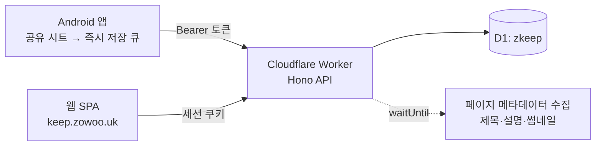

# ZKeep — 나중에 읽을 링크 보관함

갤럭시 탭에서 **공유 → ZKeep** 으로 저장하고, 나중에 컴퓨터에서 <https://keep.zowoo.uk> 에 들어가 하나씩 읽은 뒤 **읽음 처리하거나 삭제**하는 용도의 개인 서비스입니다.



| 폴더 | 내용 |
|------|------|
| `web/` | Cloudflare Worker(Hono) + D1 + React 19 SPA(Vite, Tailwind v4). API와 정적 자산을 Worker 하나로 서빙 |
| `android/` | Kotlin + Jetpack Compose 앱. 공유 대상(Share target), 오프라인 저장 큐(WorkManager), 목록 화면 |

## 웹 (`web/`)

```bash
cd web
npm install
npm run db:migrate:local   # 최초 1회
npm run dev                # Worker + SPA 동시 실행
npm run typecheck && npm test && npm run build
npm run deploy             # vite build + wrangler deploy (keep.zowoo.uk)
npm run db:migrate:remote  # 스키마 변경 시
```

- 로컬 로그인: `.dev.vars.example`을 `.dev.vars`로 복사(`DEV_LOGIN=1`)하면 `POST /auth/dev-login`이 열립니다. 배포 환경에는 설정하지 않습니다.
- 테스트는 `@cloudflare/vitest-plugin`으로 workerd + 로컬 D1 위에서 실행됩니다. 외부 메타데이터 fetch는 테스트에서 끕니다(`META_FETCH=0`).
- 키보드: `j`/`k` 이동, `o` 열기, `e` 읽음, `#`/`d` 삭제, `z` 실행취소, `/` 검색, `?` 도움말.

### 로그인 설정

| 값 | 종류 | 설명 |
|----|------|------|
| `GOOGLE_CLIENT_ID` | `wrangler.jsonc` vars (공개 값) | Google OAuth **Web application** client ID. redirect URI에 `https://keep.zowoo.uk/auth/callback` 등록. client secret은 쓰지 않습니다(OIDC `id_token` + `form_post`). |
| `BOOTSTRAP_KEY` | wrangler secret | `GOOGLE_CLIENT_ID`가 비어 있는 동안만 동작하는 임시 접속 키 로그인. |
| `SIGNUP_MODE` | vars | `first-user`(기본: 첫 가입자와 `ALLOWED_EMAILS`만) / `open` |
| `ALLOWED_EMAILS` | vars 또는 secret | 쉼표로 구분한 허용 이메일 |

Google 로그인으로 전환: `wrangler.jsonc`의 `GOOGLE_CLIENT_ID`를 채우고 `npm run deploy`. 임시 키 로그인은 자동으로 닫히고, **첫 Google 로그인이 임시 계정(저장된 북마크·연결된 기기 포함)을 그대로 이어받습니다.** 이후 `npx wrangler secret delete BOOTSTRAP_KEY`.

### 설계 메모

- **속도**: 세션 확인과 목록 조회를 D1 batch 한 번으로 처리(`worker/session.ts`의 `USER_ID_SQL`). 웹은 마지막 목록을 localStorage에서 먼저 그리고, HTML `<head>`에서 API 요청을 JS 번들보다 먼저 시작합니다.
- **저장**: 같은 URL을 다시 저장하면 새로 만들지 않고 맨 위·안읽음으로 되돌립니다. 클라이언트가 보낸 `id`는 멱등 키라 재시도가 안전합니다.
- **삭제**: soft delete 후 실행취소 가능, cron(매일)이 30일 지난 항목을 실제 삭제합니다.
- **앱 연결**: 앱은 Google 자격 증명을 다루지 않습니다. 브라우저에서 로그인 → 동의 → `zkeep://auth?code=…` → PKCE verifier로 토큰 교환. 토큰은 서버에 SHA-256 해시로만 저장됩니다.

## Android (`android/`)

빌드·서명·동작 설명은 [`android/README.md`](android/README.md) 참고.

```bash
cd android
./gradlew :app:assembleRelease     # app/build/outputs/apk/release/app-release.apk
adb install -r app/build/outputs/apk/release/app-release.apk
```

릴리스 keystore(`android/keystore/`, `keystore.properties`)는 Git에 올리지 않습니다. 잃어버리면 기존 설치본 위에 업데이트할 수 없으니 따로 백업해 두세요.
