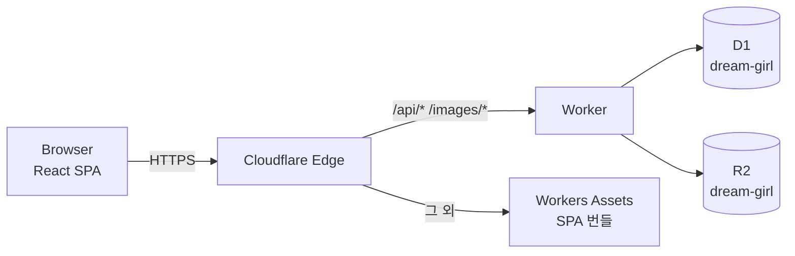

# 00. 전체 구조

- **CSR 선택 이유**: 상호작용 중심 게임이라 SSR 이점이 작고, 정적 번들 + Worker API로 충분합니다.
- `runWorkerFirst: ["/api/*","/images/*"]` 덕분에 두 경로만 Worker 코드가 실행되고 나머지는 무료 정적 서빙입니다.

## 퀴즈
1. `/images/*`가 R2에 없으면 어디로 폴백하나요? → `env.ASSETS`
2. 왜 `/api/*`만 Worker-first인가요? → 정적 자산 요청에 Worker 실행 비용을 쓰지 않기 위해
