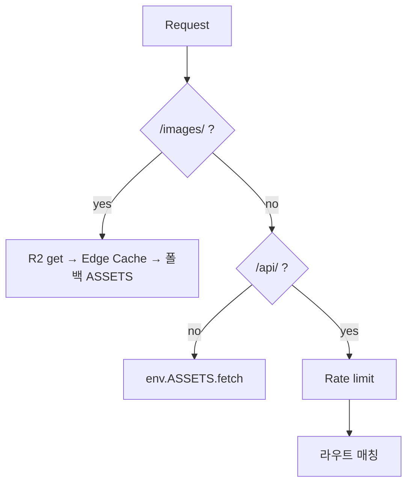

# 02. Worker와 Assets

[worker/index.js](../worker/index.js) 의 라우팅 순서:

- 입력 검증: 캐릭터 ID는 `^(f|m|mf|mm)(0[1-9]|1[0-6])$` 정규식만 허용.
- 본문 크기 제한(64KB) 후 `JSON.parse`.
- 응답은 `Cache-Control: no-store` (API), 이미지는 `immutable` 1년.

## 실습
`npm test` — [tests/worker.test.js](../tests/worker.test.js) 가 가짜 D1/R2로 Worker를 로컬에서 검증합니다.
