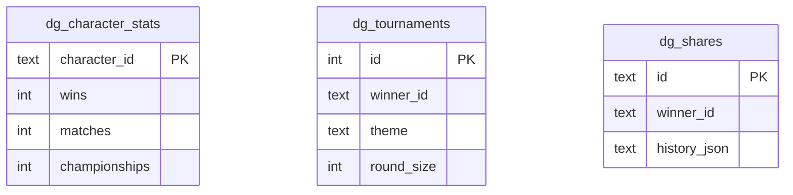

# 03. D1

스키마: [migrations/0001_init.sql](../migrations/0001_init.sql)



## 핵심 패턴: UPSERT + batch
```sql
INSERT INTO dg_character_stats (character_id, theme, wins, matches)
VALUES (?1, ?2, 1, 1)
ON CONFLICT(character_id) DO UPDATE SET wins = wins + 1, matches = matches + 1;
```
승자 +1, 패자 +1을 `env.DB.batch([...])` 로 묶어 **한 트랜잭션처럼** 실행합니다.

## 명령
```bash
cf d1 migrations apply <D1_UUID>           # 마이그레이션 적용
cf d1 query <D1_UUID> --sql "SELECT * FROM dg_character_stats LIMIT 5"
```
