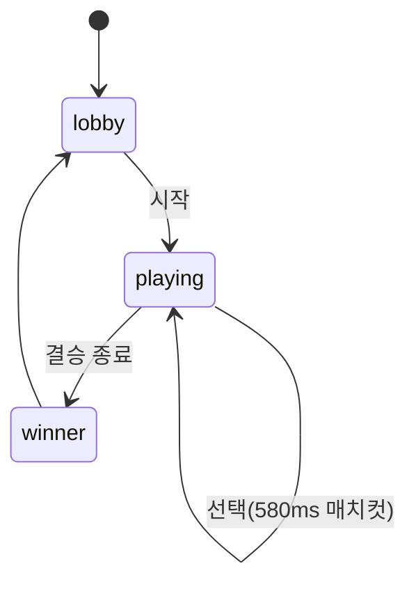

# 05. 프론트엔드

- 상태: [src/App.tsx](../src/App.tsx) — `roundPool`, `nextRoundPool`, `matchIndex`, Undo 스택.
- 데이터: [src/data/characters.ts](../src/data/characters.ts), [src/data/maleCharacters.ts](../src/data/maleCharacters.ts) — `getCharactersByTheme()`.
- API 클라이언트·PNG 포토카드: [src/utils/api.ts](../src/utils/api.ts) (Canvas 2D → `toDataURL`).
- 소리: [src/utils/soundEngine.ts](../src/utils/soundEngine.ts) — 오실레이터 합성 + `speechSynthesis` TTS.
- 모션: framer-motion spring (`stiffness 200~300`, `damping 18~26`).

**API 실패해도 게임은 계속**: 모든 API 호출은 `try/catch`로 무시되어 오프라인에서도 로컬 전적으로 동작합니다.
