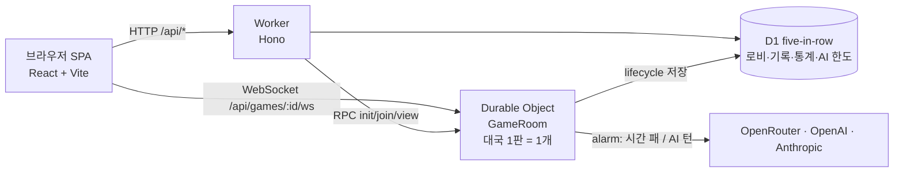

# 오목 한 판 — five.zowoo.uk

가입 없이 바로 두는 무료 온라인 오목입니다. 체스가 어렵다는 분들을 위해 [체스 한 판](https://chess.zowoo.uk)과 같은 구조·디자인으로 만들었습니다.

- **사람과 대국**: 익명으로 방을 만들고 로비에 공개하거나 링크로 초대합니다. 다른 사람이 들어오면 바로 시작합니다. 관전도 됩니다.
- **AI와 대국 / AI vs AI**: TypeSafe **Jev**, OpenAI **Decisions**, Anthropic **Claude Haiku 5.5**(Medium/High) 중에서 골라 대국하거나 AI끼리 붙여 실력과 API 비용을 비교합니다.
- **감정 표현**: 사람 대 사람 대국에서 6가지 감정 표현(하스스톤 방식). 채팅은 없습니다.
- 무승부 제안, 재대결(흑백 교대), 기권, 첫 수 전 취소, 기보 되돌려 보기, 기보 복사, 효과음, 다크 모드.

## 규칙

| 항목 | 규칙 |
| --- | --- |
| 판 | 15×15, 좌표는 열 A–O, 행 1–15 (예: 천원 `H8`) |
| 순서 | 흑이 먼저, 번갈아 한 수씩 |
| 승리 | 가로·세로·대각선으로 5개 이상 연속 (6목 이상도 승리) |
| 쌍삼(3-3) | 방을 만들 때 고름: **흑만 금지(기본)** · 모두 금지 · 모두 허용. 금지여도 그 수로 5목이 되면 허용. 사사(4-4)는 허용 |
| 무승부 | 판이 가득 차거나 합의 |
| 시간 | 시간이 먼저 다 되면 패배. 양쪽이 첫 수를 두기 전이면 점수 없이 취소 |

규칙 판정은 `shared/omok.ts` 하나가 서버(권위)와 클라이언트(금지점 × 표시, 미리보기)에서 함께 씁니다.

## 구조



| 경로 | 설명 |
| --- | --- |
| `shared/omok.ts` | 오목 규칙(5목 판정, 쌍삼 금지, 합법 점, AI 후보 점) |
| `worker/index.ts` | Worker 엔트리. Hono API, 한도 검사, DO 라우팅 |
| `worker/room.ts` | `GameRoom` Durable Object. 상태 저장, WebSocket hibernation, alarm |
| `worker/game.ts` | 대국 진행·시계·좌석 토큰 권한(런타임 독립, 단위 테스트 대상) |
| `worker/ai/` | AI 어댑터(`engines.ts`), 프롬프트용 국면(`position.ts`), AI 턴 실행(`turn.ts`) |
| `worker/store.ts`, `quota.ts` | D1 로비/기록/통계, 일일 AI 한도 |
| `shared/types.ts` | 서버·클라이언트 공용 타입, 엔진 메타데이터, 감정 표현, 한도 |
| `src/` | React UI (모바일 세로: Duolingo 스타일, 가로: lichess 스타일) |
| `migrations/` | D1 스키마 |

익명 신원: 브라우저가 무작위 토큰(localStorage `five.token`)과 닉네임을 만듭니다. 토큰이 곧 좌석 권한이며 서버 밖으로 노출되지 않습니다.

모바일에서는 칸이 작아서 **한 번 탭하면 미리보기, 같은 자리를 한 번 더 탭(또는 "놓기")하면 착수**합니다. 마우스는 클릭 한 번으로 둡니다.

## AI 비용 보호

| 한도 | 값 | 위치 |
| --- | --- | --- |
| 방문자(IP 해시)당 하루 AI 대국 | 10판, 한국 시간 자정 초기화 | `wrangler.jsonc` `AI_DAILY_LIMIT` |
| 전체 하루 AI 대국 | 600판 | `AI_GLOBAL_DAILY_LIMIT` |
| 방문자당 동시 AI 대국 | 2판 | `worker/index.ts` |
| AI 대국 시간 | 최대 30분 + 수당 10초 | `shared/types.ts` `LIMITS` |
| API 요청 | IP당 분당 60회(대국 생성·참가) | `ratelimits` |

체스와 한도는 따로 셉니다(별도 D1). 수당 비용은 Jev·Decisions 약 $0.0002, Haiku 약 $0.001~0.002입니다.

## 로컬 실행

```bash
npm ci
cp .env.example .env.local     # OPENROUTER_KEY, OPENAI_API_KEY, CLAUDE_API_KEY
npm run db:migrate:local
npx vite build                 # wrangler dev가 dist/를 요구함 (최초 1회)
npm run dev                    # web http://localhost:5180 · worker http://localhost:8790
```

| 명령 | 설명 |
| --- | --- |
| `npm run typecheck` | 앱 / Worker / 테스트 tsconfig 3개 타입 검사 |
| `npm test` | 규칙(쌍삼 등)·시계·권한·AI 턴·통계 단위 테스트 (`node:test`) |
| `npm run build` | 타입 검사 + Vite 빌드(`dist/`) |
| `npm run deploy` | 빌드 후 `wrangler deploy` (five.zowoo.uk) |
| `npm run db:migrate` | 운영 D1에 마이그레이션 적용 |
| `npm run types` | `wrangler.jsonc` 변경 후 `worker-configuration.d.ts` 재생성 |
| `npm run probe` | 4개 AI 구성을 실제 API로 한 번씩 호출 (소액 과금) |

## 배포

```bash
npm run db:migrate
npm run deploy
# 키는 최초 1회 (값을 화면에 찍지 않도록 파이프로)
grep '^CLAUDE_API_KEY=' .env.local | cut -d= -f2- | tr -d '\n' | npx wrangler secret put CLAUDE_API_KEY
curl -sI https://five.zowoo.uk/api/quota | grep cf-placement   # remote-ICN 이어야 함
```

한국 트래픽은 Cloudflare HKG colo로 들어가는데 Anthropic/OpenAI가 홍콩 요청을 403으로 막습니다. 그래서 `placement`를 `aws:ap-northeast-2`(서울)로 고정했습니다.

## AI 구성 (4종)

| AI | API | 변형 |
| --- | --- | --- |
| Jev | OpenRouter `POST /api/alpha/decisions`, `~typesafe/jev-latest`, choice 질문 | 없음 |
| Decisions | OpenAI `POST /v1/decisions`, `gpt-6-luna`, choice 질문 | 없음 |
| Haiku 5.5 Medium | Anthropic Messages, `claude-haiku-5-5`, structured output(후보 점 enum) | `effort: medium` |
| Haiku 5.5 High | 위와 동일 | `effort: high` |

모든 AI는 같은 입력(텍스트 판 그림, 기보, 후보 점 목록)과 같은 한 줄 지시문만 받습니다. 후보 점은 **이미 놓인 돌에서 2칸 이내의 합법 점**(빈 판이면 천원 주변 5×5)으로, 평가 없이 기하학적으로만 거릅니다. 중반에 180개 남짓까지 늘어나도 세 API 모두 받는 것을 확인했습니다. API 대기 시간도 해당 AI의 시계에서 빠지고, API 오류가 3번 이어지면 후보 점 중 무작위로 둡니다.
