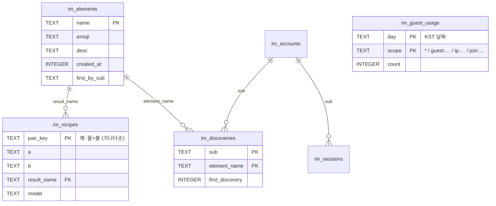

# 1. D1 교습서

> 목표: 이 장을 마치면 D1에 테이블을 만들고(migration), 코드에서 읽고 쓰고(binding), 비용(`rows_read`)과 용량을 스스로 계산하고, 백업에서 되살리는 법을 압니다.

## 1-1. D1이 뭔가

- **D1 = Cloudflare가 운영하는 SQLite.** SQL 문법, 타입, `PRAGMA`, trigger가 거의 그대로 SQLite입니다. 이 앱이 원래 쓰던 `node:sqlite` 스키마를 거의 그대로 옮길 수 있었던 이유입니다.
- **서버가 없습니다.** 연결 문자열이나 연결 풀이 없고, Worker는 **binding**(`env.DB`)이라는 핸들로 바로 접근합니다. 접속 정보가 코드에 없으니 유출될 것도 없습니다.
- **primary는 한 곳에 있습니다.** `wrangler d1 create … --location apac`로 만들었고, 실제로는 홍콩(HKG) colo에 생겼습니다. 읽기 복제(read replication)는 꺼져 있습니다(`wrangler d1 info`에서 `read_replication.mode: disabled`).
- **과금 단위는 "읽은 행/쓴 행"입니다.** 쿼리 횟수가 아닙니다. 그래서 인덱스가 곧 비용 절감입니다(1-6절).

| 항목 | Free 한도 |
|---|---|
| DB 1개 최대 크기 | **500 MB** |
| 계정 전체 저장 용량 | 5 GB (DB 10개) |
| 읽은 행 | 하루 500만 행 (UTC 00:00 초기화) |
| 쓴 행 | 하루 10만 행 |
| Worker 요청 1번당 쿼리 수 | 50 |
| Time Travel(시점 복구) | 7일 |

한도를 넘으면 그날은 쿼리가 오류를 냅니다(과금되지 않고 멈춥니다). 출처: [D1 limits](https://developers.cloudflare.com/d1/platform/limits/), [D1 pricing](https://developers.cloudflare.com/d1/platform/pricing/)

## 1-2. 이 앱의 테이블

모든 테이블은 `im_`(infinite-merge)로 시작합니다. 스키마 원본은 [`migrations/0001_init.sql`](../../migrations/0001_init.sql)입니다.



| 테이블 | 역할 |
|---|---|
| `im_elements` | 세계에 존재하는 모든 원소. 기본 5원소는 migration이 넣어 둡니다 |
| `im_recipes` | **전 세계 공용 레시피 책.** 누군가 한 번 만든 조합은 AI를 다시 부르지 않습니다 |
| `im_discoveries` | 플레이어별 보유 원소 |
| `im_accounts`, `im_sessions` | 게스트·ChatGPT 계정과 로그인 세션 |
| `im_oauth_pending` | Sign in with ChatGPT 진행 중 상태(로컬 실행 전용) |
| `im_guest_usage` | 게스트 일일 사용량. 방어 장치의 카운터입니다(4장) |
| `im_counters` | trigger가 관리하는 원소 수 카운터(1-7절) |

## 1-3. 실습: 로컬 D1과 원격 D1

D1은 두 벌입니다.

| | 로컬 D1 | 원격(운영) D1 |
|---|---|---|
| 위치 | `.wrangler/state/v3/d1/` 안의 SQLite 파일 | Cloudflare (APAC) |
| 누가 쓰나 | `npm run dev:local`, `npm run preview`, `lab:d1` 기본값 | merge.zowoo.uk, `npm run dev` |
| wrangler 플래그 | `--local` | `--remote` |

```bash
npx wrangler d1 list                      # 내 계정의 D1 목록
npx wrangler d1 info infinite-merge       # 크기, 24시간 읽기/쓰기 행 수
npx wrangler d1 execute infinite-merge --local  --command "SELECT name, emoji FROM im_elements"
npx wrangler d1 execute infinite-merge --remote --command "SELECT name, emoji FROM im_elements"
```

`wrangler d1 info`의 실제 출력 일부(원소 30개 시점):

```
│ database_size         │ 102 kB   │
│ read_queries_24h      │ 739      │
│ write_queries_24h     │ 180      │
│ rows_read_24h         │ 1,676    │
│ rows_written_24h      │ 330      │
│ read_replication.mode │ disabled │
```

## 1-4. 실습: `lab:d1`로 쿼리와 meta 보기

`wrangler d1 execute`는 결과만 보여 줍니다. [`learn/d1/lab.mjs`](../../learn/d1/lab.mjs)는 앱 코드와 **같은 binding API**(`env.DB.prepare().all()`)로 실행하고, D1이 돌려주는 `meta`(읽은 행, 쓴 행, DB 크기, 처리 리전)를 함께 보여 줍니다.

```bash
npm run lab:d1 -- "SELECT * FROM im_recipes LIMIT 3"                 # 로컬
npm run lab:d1 -- --file learn/d1/queries/01-overview.sql             # 파일의 여러 문장
npm run lab:d1 -- --remote --file learn/d1/queries/02-recipes.sql     # 운영, 읽기 전용
```

원격에 쓰기 문장을 보내면 도구가 멈춥니다.

```
원격 DB는 호스팅 사이트와 공유됩니다. 쓰기 문장이 있어 중단합니다:
  · INSERT OR IGNORE INTO im_elements …
정말 원격에 쓰려면 --write 를 붙이세요.
```

| 파일 | 내용 |
|---|---|
| [`01-overview.sql`](../../learn/d1/queries/01-overview.sql) | 테이블·인덱스·trigger 목록, 테이블별 행 수 |
| [`02-recipes.sql`](../../learn/d1/queries/02-recipes.sql) | 최근 레시피, 인기 결과물, 최초 발견자. 시간 변환(`datetime(… '+9 hours')`) |
| [`03-index-and-plan.sql`](../../learn/d1/queries/03-index-and-plan.sql) | 인덱스 유무에 따른 `rows_read` 차이, `EXPLAIN QUERY PLAN` |
| [`04-guest-usage.sql`](../../learn/d1/queries/04-guest-usage.sql) | 오늘의 게스트·IP 사용량(방어 장치 카운터) |
| [`05-practice-writes.sql`](../../learn/d1/queries/05-practice-writes.sql) | `RETURNING`, trigger, 레시피 고치기, 외래 키. **로컬 전용** |

> 🧪 **해 보기:** `01-overview.sql`의 행 수 쿼리를 `UNION ALL` 6개로 바꿔 실행해 보세요. 일반 SQLite에서는 되는데 D1은 `too many terms in compound SELECT`로 거절합니다. D1은 compound SELECT를 5개까지만 허용합니다. 이 교재를 만들다 실제로 만난 오류입니다.

## 1-5. migration: 스키마를 바꾸는 유일한 방법

스키마 변경은 `migrations/` 폴더의 번호 붙은 SQL 파일로만 합니다. D1은 적용한 파일 이름을 `d1_migrations` 테이블에 기록하고, 아직 적용 안 된 파일만 실행합니다.

```bash
npm run db:migrate:local    # = wrangler d1 migrations apply infinite-merge --local
npm run db:migrate:remote   # = wrangler d1 migrations apply infinite-merge --remote
npx wrangler d1 migrations list infinite-merge --remote   # 적용 대기 목록 ("No migrations to apply!")
```

**규칙**
1. 이미 적용한 migration 파일은 고치지 않습니다. 바꾸려면 새 번호 파일을 추가합니다.
2. 순서는 **로컬 적용 → 테스트 → 원격 적용 → 코드 배포**입니다. 새 열을 읽는 코드가 열보다 먼저 배포되면 오류가 납니다.
3. 열 이름 변경이나 삭제처럼 되돌리기 어려운 변경 전에는 `wrangler d1 export`로 백업합니다(1-9절).

> 🧪 **해 보기 (운영 DB와 분리된 실습 DB 사용):**
> ```bash
> cd learn/workers/hello-d1
> npx wrangler d1 execute im-hello-lab --local --file schema.sql     # 실습 테이블 lab_visits
> npx wrangler d1 migrations create im-hello-lab add_note            # migrations/0001_add_note.sql 생성
> echo "ALTER TABLE lab_visits ADD COLUMN note TEXT;" >> migrations/0001_add_note.sql
> npx wrangler d1 migrations list  im-hello-lab --local              # 0001_add_note.sql 대기 중
> npx wrangler d1 migrations apply im-hello-lab --local              # ✅
> npx wrangler d1 execute im-hello-lab --local --command "PRAGMA table_info(lab_visits)"   # note 열 확인
> ```
> 다 했으면 `migrations/` 폴더와 `.wrangler/`를 지워 처음 상태로 돌아갈 수 있습니다.

## 1-6. 코드에서 쓰기: binding API

앱은 [`lib/server/db.ts`](../../lib/server/db.ts)의 `getDb()`로 `env.DB`를 얻습니다.

| 메서드 | 돌려주는 것 | 이 앱에서 쓰는 곳 |
|---|---|---|
| `prepare(sql).bind(...).first()` | 첫 행 또는 `null` | 세션으로 계정 찾기 |
| `.first("열")` | 그 열의 값 | 원소 수 카운터 |
| `.all()` | `{ results: 행[], meta }` | 보유 원소 목록 |
| `.run()` | `{ meta }`(쓰기 결과) | 진행 초기화 |
| `db.batch([...])` | 결과 배열. **하나의 트랜잭션** | 연성 결과 기록, 쿼터 차감 |

**`?` 자리표시자와 `bind`를 항상 씁니다.** 문자열을 이어 붙이지 않으니 SQL injection을 막을 수 있습니다.

```ts
// lib/server/session.ts — 세션 조회와 계정 조회를 JOIN으로 한 번에 (왕복 1회)
return getDb()
  .prepare(
    `SELECT a.sub, a.email, a.name, a.picture, a.client_id, a.selected_model
       FROM im_sessions s JOIN im_accounts a ON a.sub = s.sub
      WHERE s.id = ? AND s.expires_at >= ?`,
  )
  .bind(id, Date.now())
  .first<Account>();
```

### 트랜잭션 대신 batch

D1은 `BEGIN … COMMIT`을 쓸 수 없습니다. 대신 `db.batch([...])`가 넘겨준 문장들을 **한 트랜잭션으로** 실행합니다. 하나라도 실패하면 전부 취소됩니다.

```ts
// lib/server/alchemy/combine.ts — 새 원소와 그 레시피는 함께 기록되거나, 함께 실패한다
const [elementWrite, recipeWrite] = await db.batch([
  db.prepare("INSERT OR IGNORE INTO im_elements (…) VALUES (?, ?, ?, ?, ?) RETURNING name").bind(…),
  db.prepare("INSERT OR IGNORE INTO im_recipes (…) VALUES (?, ?, ?, ?, ?, ?, ?) RETURNING pair_key").bind(…),
]);
const isFirstDiscovery = elementWrite.results.length === 1;   // RETURNING 행이 있으면 새로 들어간 것
```

### 조건부 upsert: 읽고-쓰기를 한 문장으로

"남은 횟수를 읽고, 남았으면 1 늘린다"를 두 문장으로 나누면, 그 사이에 다른 요청이 끼어들 수 있습니다. 한 문장으로 합치면 안전합니다.

```sql
-- lib/server/guest/quota.ts — 한도 미만일 때만 +1, 성공하면 새 count를 돌려받는다
INSERT INTO im_guest_usage (day, scope, count) VALUES (?, ?, 1)
ON CONFLICT(day, scope) DO UPDATE SET count = count + 1 WHERE count < ?
RETURNING count
```

돌아온 행이 없으면 한도에 걸린 것입니다. 여러 버킷(전체·게스트·IP)을 batch로 같이 차감하다가 하나가 막히면, 이미 차감한 버킷은 되돌립니다(보상 차감).

## 1-7. 비용 감각: `rows_read`와 인덱스

D1 Free는 하루 **읽은 행** 500만 개까지입니다. "몇 행을 돌려받았나"가 아니라 "몇 행을 훑었나"로 셉니다.

```bash
npm run lab:d1 -- --remote --file learn/d1/queries/03-index-and-plan.sql
```

운영 DB(레시피 29개)에서의 실제 결과:

| 쿼리 | 실행 계획 | rows_read |
|---|---|---|
| `WHERE pair_key = '물+불'` (PRIMARY KEY) | `SEARCH im_recipes USING INDEX sqlite_autoindex_im_recipes_1` | **1** |
| `WHERE result_name = '증기'` (인덱스 없음) | `SCAN im_recipes` | **29** (전체) |

레시피가 10만 개가 되면 두 번째 쿼리는 한 번에 10만 행을 읽습니다. 자주 쓰는 조건이면 인덱스를 만듭니다. 대신 쓰기 때마다 인덱스도 갱신되어 `rows_written`이 1 늘어납니다.

### 왜 `im_counters`와 trigger를 만들었나

첫 화면은 매번 "이 세계의 원소 수"를 보여 줍니다. `SELECT COUNT(*) FROM im_elements`는 원소가 10만 개면 매번 10만 행을 읽습니다. 그래서 원소가 추가·삭제될 때 trigger가 카운터 한 행을 고치게 하고, 화면은 그 한 행만 읽습니다(`rows_read = 1`).

```sql
CREATE TRIGGER im_elements_count_insert AFTER INSERT ON im_elements
BEGIN
  UPDATE im_counters SET value = value + 1 WHERE key = 'elements';
END;
```

## 1-8. 함정 모음 (이번에 실제로 겪은 것 포함)

| 함정 | 증상 | 대응 |
|---|---|---|
| **trigger가 `meta.changes`를 부풀린다** | 원소 1개 INSERT의 `meta.changes`가 **2**(본 행 + 카운터 UPDATE). `changes === 1`로 "새로 들어갔나"를 판단했더니 첫 발견이 전부 false로 기록됐다 | 삽입 여부는 `INSERT … RETURNING`의 결과 행 유무로 판단한다. 테스트용 가짜 D1(`tests/support/d1.ts`)도 실제 D1처럼 trigger 변경을 세게 고쳐서 회귀 테스트가 잡게 했다 |
| `BEGIN`/`COMMIT` 불가 | 오류 | `db.batch([...])` |
| `bind(undefined)` | `D1_TYPE_ERROR` | `null`로 바꿔 넘긴다(`desc ?? null`) |
| compound SELECT 5개 제한 | `too many terms in compound SELECT` | 스칼라 서브쿼리 |
| 외래 키는 항상 켜져 있다 | 레시피가 가리키는 원소를 지우면 `FOREIGN KEY constraint failed` | 자식(레시피)부터 지운다(`05-practice-writes.sql`) |
| Free는 요청 1번에 쿼리 50개 | 반복문 안에서 쿼리를 쏘면 초과 | batch와 JOIN으로 왕복을 줄인다 |
| 원격 binding은 진짜 데이터다 | `npm run dev`에서 지운 건 운영에서도 지워진다 | 실습은 로컬, 운영 데이터 실습은 `lab:clone-remote` |

## 1-9. 백업과 복구

### 내보내기(export)와 로컬 복제

```bash
npx wrangler d1 export infinite-merge --remote --output backup.sql   # 스키마 + 데이터 전체를 SQL로
npm run lab:clone-remote                                             # 위 export → 로컬 D1 초기화 → 들여오기
```

`lab:clone-remote` 실제 실행 결과:

```
① 원격 D1 내보내기 (읽기만 함)
   → .wrangler/remote-dump.sql (19.6 KB)
② 로컬 D1 사본 초기화
③ 로컬 D1에 들여오기
🚣 117 commands executed successfully.
```

덤프에는 플레이어 ID 같은 운영 데이터가 들어 있습니다. gitignore 대상인 `.wrangler/` 밖으로 꺼내지 마세요.

### Time Travel: 지난 7일 안의 아무 시점으로

D1은 모든 변경을 기록해 두고, 특정 시점(bookmark)으로 DB 전체를 되돌릴 수 있습니다.

```bash
npx wrangler d1 time-travel info infinite-merge
# ⚠️ The current bookmark is '00000003-00000000-00005104-…'
npx wrangler d1 time-travel info infinite-merge --timestamp 2026-10-14T13:00:00Z   # 그 시각의 bookmark
```

복구는 `wrangler d1 time-travel restore infinite-merge --bookmark=…`입니다. **DB 전체가 그 시점으로 돌아가고, 이후 데이터는 모두 사라집니다**(복구 직전 bookmark가 출력되므로 되돌리기는 가능). 운영 DB에서는 꼭 필요할 때만 쓰고, 연습은 실습 DB(`im-hello-lab`)를 원격에 만들어서 하세요.

## 1-10. 용량: 원소가 100개, 1,000개가 되면?

```bash
npm run lab:size                     # 100 / 1,000 / 10,000 / 100,000개
npm run lab:size -- 5000 --recipes 4 --discoveries 20   # 가정 바꾸기
```

[`learn/d1/size-estimate.mjs`](../../learn/d1/size-estimate.mjs)는 `migrations/`를 적용한 임시 SQLite 파일에 운영 DB 실측 평균(원소 행 약 85바이트, 레시피 행 약 83바이트)과 같은 크기의 행을 넣고 파일 크기를 잽니다. 가정: 원소 1개당 레시피 2개, 발견 기록 5개, 게스트 0.2명.

| 원소 수 | DB 크기 | 원소당 | Free 500 MB 대비 |
|---|---|---|---|
| 100 | 184 KB | 1.8 KB | 0.04% |
| 1,000 | 1.15 MB | 1.2 KB | 0.23% |
| 10,000 | 11.1 MB | 1.1 KB | 2.2% |
| 100,000 | 114 MB | 1.1 KB | 23% |

- 원소 1개는 레시피·발견 기록을 포함해 **약 1.1 KB**입니다. 단순 계산으로 500 MB에는 원소가 약 **45만 개** 들어갑니다.
- 빈 스키마도 테이블·인덱스마다 최소 1페이지(4 KB)를 쓰기 때문에, 원소 30개인 지금도 102 KB입니다. 처음 100개까지는 크기가 거의 늘지 않습니다.
- 용량보다 먼저 닿을 수 있는 것은 **하루 읽기 500만 행**입니다. 인덱스 없는 쿼리를 피하는 1-7절이 더 중요합니다.
- 게스트 계정은 사람 수만큼 쌓입니다(1명에 약 200바이트). 100만 명이 와도 200 MB 수준입니다. 만료된 세션과 7일 지난 사용량 행은 새 게스트가 들어올 때 자동으로 정리됩니다(`createGuestSession`).

## 체크리스트

- [ ] `--local`과 `--remote`의 차이를 설명할 수 있다
- [ ] `lab:d1`로 쿼리를 실행하고 `rows_read`를 읽을 수 있다
- [ ] 실습 DB에서 migration을 만들고 적용해 봤다
- [ ] 인덱스가 있는 조회와 없는 조회의 `rows_read` 차이를 확인했다
- [ ] batch가 트랜잭션이라는 것과, `meta.changes` 대신 `RETURNING`을 쓰는 이유를 안다
- [ ] `lab:clone-remote`로 운영 데이터를 로컬에 복제해 봤다
- [ ] `time-travel info`로 bookmark를 조회해 봤다
