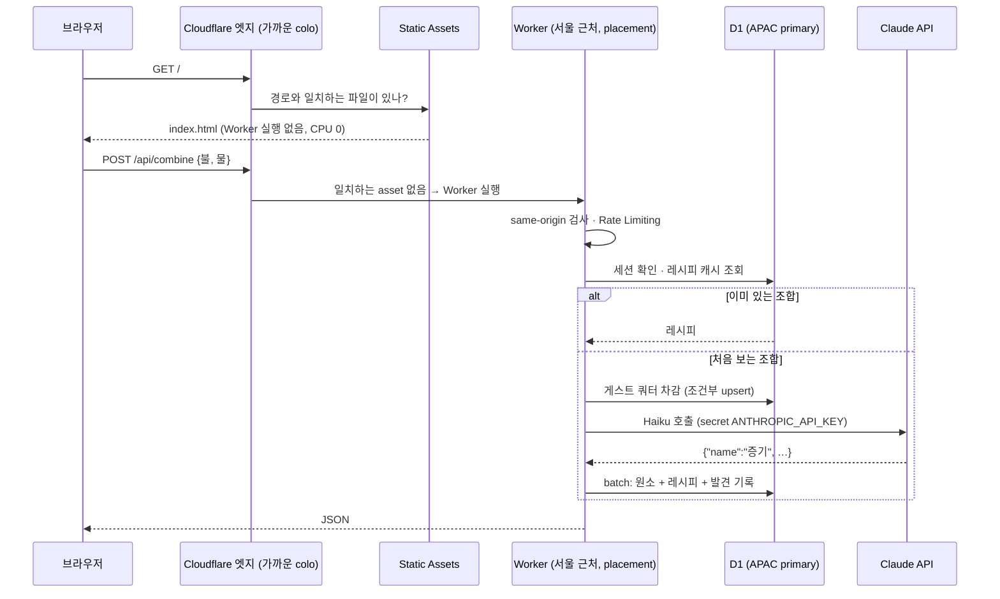
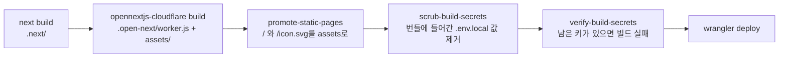

# 2. Workers와 이 앱의 Cloudflare 스택

> 목표: 요청 하나가 merge.zowoo.uk에 들어와서 응답이 나가기까지 어떤 Cloudflare 부품을 거치는지 설명할 수 있고, 직접 Worker를 만들어 로컬에서 돌리고, 배포·로그·롤백을 다룰 수 있습니다.

## 2-1. 이 앱이 쓰는 Cloudflare 부품

| 부품 | 이 앱에서 하는 일 | 설정 위치 |
|---|---|---|
| **Workers** | Next.js 서버(API 라우트)를 실행 | `wrangler.jsonc`의 `main` |
| **Workers Static Assets** | JS·CSS·이미지, 그리고 정적 페이지 `/` | `assets` |
| **D1** | 게임 데이터 전부 | `d1_databases` |
| **Rate Limiting binding** | IP별 폭주 차단 | `ratelimits` |
| **Turnstile** | 게스트 입장 시 봇 확인 | 위젯 + `TURNSTILE_*` |
| **Custom Domain** | merge.zowoo.uk → 이 Worker | `routes` |
| **Placement** | Worker를 서울 근처에서 실행 | `placement` |
| **Secrets / vars** | API 키, 설정값 | 3장 |
| **Observability (Workers Logs)** | 로그 보관, 대시보드 검색 | `observability` |

## 2-2. Worker는 어떻게 실행되나

Worker는 서버나 컨테이너가 아니라 V8 **isolate**(브라우저 탭 하나와 비슷한 격리 공간)에서 돕니다. 수백 곳의 Cloudflare 데이터센터 어디서든 요청을 받으면 그 자리에서 실행됩니다.

```js
// learn/workers/hello-d1/src/index.js — Worker의 전부: fetch 함수 하나
const worker = {
  async fetch(request, env, ctx) {
    // request: 들어온 요청, env: binding(DB·secret·vars…), ctx: waitUntil 등
    return new Response("hello");
  },
};
export default worker;
```

- **binding (`env`)**: Worker가 쓸 자원을 설정 파일에서 연결해 둔 것입니다. 코드에는 접속 정보가 없고 `env.DB`, `env.COMBINE_LIMITER` 같은 이름만 있습니다.
- **CPU 시간 vs 대기 시간**: Claude 응답을 2초 기다리는 동안은 CPU를 쓰지 않습니다. 과금과 한도는 CPU 시간 기준이라, AI를 기다리는 시간이 긴 이 앱에 유리합니다.
- **`ctx.waitUntil(promise)`**: 응답을 먼저 보내고 뒷정리를 이어서 합니다.

### Free 플랜 한도 (이 앱 기준)

| 항목 | Free | 이 앱 실측 |
|---|---|---|
| 요청 수 | 하루 10만 | 정적 asset 요청은 세지 않음 |
| 요청당 CPU | 10 ms | API는 warm 상태 5~14 ms. 새 isolate가 뜰 때 100~300 ms |
| Worker 크기 | 비압축 64 MiB (압축 기준 제한 없음) | 5,736 KiB / gzip 1,206 KiB |
| 서브리퀘스트(외부 fetch) | 요청당 50 | 연성 1회에 Claude 1~2회 |

> ⚠️ 측정해 보니 새 isolate가 뜨는 요청은 Next 서버 초기화 때문에 CPU를 100~300 ms 씁니다. 지금까지 실패(`exceededCpu`)는 없었지만, 트래픽이 늘면 대시보드 **Workers → infinite-merge → Metrics**에서 오류를 지켜보세요. 계속 실패하면 Workers Paid($5/월)가 해결책입니다.

출처: [Workers limits](https://developers.cloudflare.com/workers/platform/limits/)

## 2-3. 요청 하나의 여정



## 2-4. `wrangler.jsonc` 한 줄씩

[`wrangler.jsonc`](../../wrangler.jsonc)가 이 Worker의 설계도입니다.

| 키 | 값 | 의미 |
|---|---|---|
| `name` | `infinite-merge` | Worker 이름. 대시보드와 `wrangler tail infinite-merge`에 쓰인다 |
| `main` | `.open-next/worker.js` | 진입 파일. OpenNext가 만든다 |
| `compatibility_date` | `2026-10-01` | 이 날짜 기준의 런타임 동작으로 고정한다. 날짜를 올리면 새 동작이 켜진다 |
| `compatibility_flags` | `nodejs_compat` | `node:crypto`, `process.env` 같은 Node API를 쓰게 해 준다. Next.js에 필수 |
| | `global_fetch_strictly_public` | Worker가 `fetch`한 요청이 같은 zone의 origin으로 지름길로 가지 않고, 외부 요청처럼 Cloudflare를 거치게 한다 |
| `assets` | `.open-next/assets`, binding `ASSETS` | 정적 파일. **경로가 일치하면 Worker보다 먼저 응답한다** |
| `placement` | `targeted`, `aws:ap-northeast-2` | Worker를 서울 근처에서 실행한다(2-8절) |
| `routes` | `merge.zowoo.uk`, `custom_domain: true` | DNS 레코드와 인증서를 Cloudflare가 자동으로 만든다 |
| `d1_databases` | binding `DB`, `remote: true` | 1장. `remote: true`는 로컬 개발에서도 원격 DB를 쓰게 하는 표시 |
| `ratelimits` | `COMBINE_LIMITER`, `GUEST_START_LIMITER` | 4장 |
| `vars` | 한도 숫자, Turnstile site key | 3장 |
| `observability` | `enabled: true` | 로그를 대시보드에 보관한다 |

## 2-5. OpenNext: Next.js를 Worker로 바꾸는 어댑터

Next.js는 원래 Node 서버에서 돕니다. [`@opennextjs/cloudflare`](https://opennext.js.org/cloudflare)가 `next build` 결과를 Worker 하나와 정적 파일로 다시 묶어 줍니다.

```bash
npm run cloudflare:build
```



| 단계 | 왜 필요한가 |
|---|---|
| `promote-static-pages` | 정적 페이지 `/`도 OpenNext를 거치면 Next 서버가 렌더해서 CPU를 18~119 ms 썼다. 미리 렌더된 HTML을 assets에 두면 Worker가 아예 실행되지 않는다(실측: 홈 10회 요청에 Worker 호출 0회) |
| `scrub` / `verify` | OpenNext는 빌드 시점의 `.env.local` 값을 `.open-next/cloudflare/next-env.mjs`에 그대로 적는다. 실제로 `ANTHROPIC_API_KEY`가 들어가 있었다. 3장에서 자세히 |

### 버전 궁합: 이번에 실제로 막힌 두 가지

| 증상 | 원인 | 조치 |
|---|---|---|
| preview에서 `Unexpected loadManifest(/.next/server/preview-props.json) call!` | Next 16.4.0이 새로 만든 파일을 OpenNext 1.20.11이 아직 모른다 ([#1448](https://github.com/opennextjs/opennextjs-cloudflare/issues/1448)) | OpenNext가 지원하는 Next **16.3.8로 고정**(`package.json`에 `^` 없이) |
| 홈이 응답 없이 멈춤, `Cache Components … setTimeout()` 경고 | `cacheComponents: true`일 때 OpenNext의 PPR 렌더 버그 ([#1225](https://github.com/opennextjs/opennextjs-cloudflare/issues/1225)) | 이 앱은 `"use cache"`를 안 쓰므로 `cacheComponents`를 끔 |

**교훈:** Next.js를 올리기 전에 `npm view @opennextjs/cloudflare peerDependencies`로 지원 범위를 확인하세요. 두 버그 모두 `next dev`에서는 보이지 않았고, 실제 Workers 런타임에서 돌리는 `npm run preview`에서만 드러났습니다.

## 2-6. 로컬에서 돌리는 세 가지 방법

| 명령 | 런타임 | D1 | 쓰임새 |
|---|---|---|---|
| `npm run dev` | Node (next dev) | **원격** (운영과 공유) | 평소 개발. ChatGPT 로그인(SIWC) 가능 |
| `npm run dev:local` | Node (next dev) | 로컬 사본 | 클론한 사람, 오프라인, 위험한 실험 |
| `npm run dev:mock` | Node (next dev) | 로컬 사본 | AI 없이 가짜 연성으로 UI만 확인 |
| `npm run preview` | **workerd** (실제 Workers 런타임) | 로컬 사본 | 배포 직전 점검. 위 두 버그를 잡은 곳 |

`next.config.ts`의 이 부분이 원격과 로컬을 가릅니다.

```ts
const remoteD1 = process.env.IM_D1 === "remote";   // npm run dev 가 IM_D1=remote 를 붙인다
initOpenNextCloudflareForDev({ remoteBindings: remoteD1 });
```

`npm run dev`에서 만든 레시피는 곧바로 merge.zowoo.uk에도 보입니다. 실제로 로컬에서 `진흙 + 나무 → 도자기`를 만들자 원격 `im_recipes`가 28개에서 29개가 됐습니다. 가짜 데이터가 운영 세계에 섞이지 않도록 mock 모드와 원격 DB를 함께 쓰려고 하면 `next.config.ts`가 시작을 거부합니다.

## 2-7. 배포, 로그, 롤백

```bash
npm run deploy                                   # 빌드 → 검증 → wrangler deploy
npx wrangler versions list                       # 배포 이력 (secret 변경도 새 버전이 된다)
npx wrangler tail infinite-merge                 # 실시간 로그 (Ctrl+C로 종료)
npx wrangler tail infinite-merge --format json   # CPU 시간(cpuTime)까지 보기
npx wrangler rollback                            # 직전 버전으로 되돌리기 (확인 후 실행)
```

`wrangler tail --format json`으로 잰 실제 값:

```
GET /             cpu 18~119 ms   ← 정적 asset으로 바꾸기 전
GET /             (Worker 실행 없음) ← 바꾼 뒤
GET /api/state    cpu 5~14 ms (warm), 103~292 ms (새 isolate)
POST /api/combine cpu 6 ms (401 응답)
```

앱이 남기는 주요 로그:

| 로그 | 뜻 |
|---|---|
| `[guest] claude ok 불+물 in=… out=… request_id=…` | 게스트 연성 1회의 토큰 사용량. Anthropic 콘솔의 request_id와 맞춰 볼 수 있다 |
| `[guest] claude call failed: …` | 키 오류, 크레딧 부족, 과부하 |
| `[alchemy] guest bad output` | 모델 출력이 JSON이 아니어서 다시 시도함 |

대시보드에서는 **Workers & Pages → infinite-merge → Logs**에서 지난 로그를 검색할 수 있습니다(`observability.enabled`).

## 2-8. placement: 왜 서울에 고정했나

한국 사용자의 요청이 홍콩(HKG) 데이터센터에서 처리되면 Anthropic API가 `403 Request not allowed`(지원하지 않는 지역)를 반환합니다. 같은 저장소의 다른 앱(`menu`)에서 겪은 문제입니다. `placement.region: "aws:ap-northeast-2"`는 요청을 받은 곳과 상관없이 Worker를 서울 AWS 리전 근처에서 실행하게 합니다. 이번 배포에서 게스트 연성 28회가 모두 성공했습니다.

## 2-9. 실습: 미니 Worker 직접 돌려 보기

[`learn/workers/hello-d1`](../../learn/workers/hello-d1)은 D1·vars·secret·Rate Limiting·`waitUntil`을 한 파일에 담은 60줄짜리 Worker입니다. 본 앱과 DB·이름이 완전히 분리되어 있습니다.

```bash
cd learn/workers/hello-d1
npx wrangler d1 execute im-hello-lab --local --file schema.sql   # 로컬 실습 DB에 테이블 만들기
cp .dev.vars.example .dev.vars                                   # 로컬 secret (3장)
npx wrangler dev --port 8799
```

다른 터미널에서:

```bash
curl http://127.0.0.1:8799/          # 안내문 (vars.GREETING)
curl http://127.0.0.1:8799/visit     # {"id":1,"total":1,"meta":{…"rows_read":1…}}
curl http://127.0.0.1:8799/secret    # {"configured":true,"length":20}  ← 값은 절대 응답하지 않는다
for i in 1 2 3 4 5 6 7; do curl -s -o /dev/null -w '%{http_code} ' http://127.0.0.1:8799/limited; done
# 200 200 200 200 200 429 429        ← 10초에 5번
curl http://127.0.0.1:8799/later     # ctx.waitUntil 로 뒷정리 예약
```

> 🧪 **더 해 보기 (실제 배포, 선택)**
> 1. `npx wrangler d1 create im-hello-lab` → 출력된 id를 `wrangler.jsonc`의 `database_id`에 넣기
> 2. `npx wrangler d1 execute im-hello-lab --remote --file schema.sql`
> 3. `npx wrangler deploy` → `https://im-hello-lab.<내-서브도메인>.workers.dev`
> 4. `npx wrangler secret put LAB_SECRET` 후 `/secret` 확인
> 5. 정리: `npx wrangler delete` (Worker 삭제), `npx wrangler d1 delete im-hello-lab` (DB 삭제)

## 체크리스트

- [ ] binding이 무엇이고 `env`로 어떻게 들어오는지 안다
- [ ] `wrangler.jsonc`의 각 키가 무슨 일을 하는지 설명할 수 있다
- [ ] OpenNext 빌드 단계와 `preview`가 왜 필요한지 안다
- [ ] `dev` / `dev:local` / `preview`의 차이를 안다
- [ ] 미니 Worker를 로컬에서 돌리고 4개 경로를 호출해 봤다
- [ ] `wrangler tail --format json`으로 CPU 시간을 확인해 봤다
