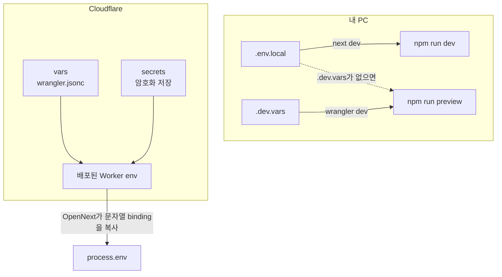

# 3. vars와 secret: 설정값과 비밀값을 어디에 두나

> 목표: 값 하나를 보고 "이건 vars인가 secret인가, 로컬에서는 어디서 읽히나"를 바로 판단하고, `wrangler secret`으로 키를 넣고·바꾸고·지울 수 있습니다.

## 3-1. 값이 사는 네 곳

| 위치 | 커밋? | 누가 읽나 | 이 앱에서 |
|---|---|---|---|
| `wrangler.jsonc`의 `vars` | ✅ 커밋 | 배포된 Worker, `wrangler dev` | 한도 숫자, `INFINITE_MERGE_SIWC=off`, Turnstile **site key**(공개값) |
| **secret** (`wrangler secret put`) | ❌ Cloudflare에만 암호화 저장 | 배포된 Worker | `ANTHROPIC_API_KEY`, `IM_IP_SALT`, `TURNSTILE_SECRET_KEY` |
| `.env.local` | ❌ gitignore | `next dev`(`npm run dev`), 그리고 `.dev.vars`가 없을 때 `wrangler dev` | 내 PC의 `ANTHROPIC_API_KEY` |
| `.dev.vars` | ❌ gitignore | `wrangler dev` / `npm run preview` | 미니 Worker의 `LAB_SECRET` 실습 |

판단 기준은 하나입니다. **남이 보면 안 되는 값이면 secret, 봐도 되는 값이면 vars.** vars는 대시보드와 `wrangler versions view` 출력에 그대로 보입니다. secret은 한 번 넣으면 Cloudflare도 값을 다시 보여 주지 않습니다(이름만 보임).



앱 코드는 어디서든 `process.env.ANTHROPIC_API_KEY`로 읽습니다. 배포된 Worker에서는 OpenNext가 요청마다 `env`의 문자열 binding(vars + secrets)을 `process.env`로 복사해 줍니다.

## 3-2. 이 앱에 넣은 secret 세 개

| 이름 | 무엇 | 어떻게 만들었나 |
|---|---|---|
| `ANTHROPIC_API_KEY` | 게스트 연성용 Claude 키 | `.env.local`의 값을 파이프로 |
| `IM_IP_SALT` | IP를 해시할 때 섞는 비밀 소금. 원본 IP를 DB에 남기지 않기 위함 | `openssl rand -hex 32` |
| `TURNSTILE_SECRET_KEY` | Turnstile 토큰 서버 검증용 | `wrangler turnstile widget create`의 출력에서 |

실제로 실행한 명령입니다. 값이 화면이나 셸 히스토리에 남지 않도록 **파이프**로 넘겼습니다.

```bash
# 1) .env.local 에서 값만 꺼내 그대로 전달 (echo로 출력하지 않는다)
grep '^ANTHROPIC_API_KEY=' .env.local | cut -d= -f2- | tr -d '\n' | npx wrangler secret put ANTHROPIC_API_KEY
# 2) 무작위 값 생성
openssl rand -hex 32 | tr -d '\n' | npx wrangler secret put IM_IP_SALT
# 3) 확인: 이름만 나온다
npx wrangler secret list
```

```
✨ Success! Uploaded secret ANTHROPIC_API_KEY
✨ Success! Uploaded secret IM_IP_SALT
✨ Success! Uploaded secret TURNSTILE_SECRET_KEY
```

그냥 `npx wrangler secret put NAME`을 실행하면 값을 입력하라는 프롬프트가 뜹니다. 입력 내용은 화면에 보이지 않습니다. 사람이 직접 넣을 때는 이 방법이 가장 쉽습니다.

### 넣는 순서가 중요했던 이유

1. **secret 없이 먼저 배포**했습니다. 키가 없으면 게스트 모드가 스스로 꺼지게 만들어 두었기 때문에(`/api/state` → `"guest":{"available":false}`), 배포 자체는 안전합니다.
2. 그다음 secret을 넣었습니다. **secret 변경은 즉시 새 버전으로 배포됩니다**(`wrangler versions list`에 기록됨). 재배포는 필요 없습니다.
3. `curl https://merge.zowoo.uk/api/state`에서 `"available":true`가 된 것으로 런타임이 secret을 읽는다는 것을 확인했습니다.

## 3-3. 함정: 빌드 결과물에 키가 들어간다

OpenNext는 빌드할 때 `.env.local`의 값을 `.open-next/cloudflare/next-env.mjs`에 **문자열 그대로** 적어 둡니다. secret이 없을 때를 위한 대비용입니다. 이번 빌드에서 실제로 확인했습니다.

```bash
grep -c 'sk-ant-' .open-next/cloudflare/next-env.mjs   # 2  ← 키가 번들 안에 있었다
```

이 상태로 배포하면 키가 Worker 코드 안에 박혀 올라갑니다. 그래서 `npm run cloudflare:build`에 두 단계를 붙였습니다.

| 스크립트 | 하는 일 |
|---|---|
| [`scripts/scrub-build-secrets.mjs`](../../scripts/scrub-build-secrets.mjs) | `next-env.mjs`에서 `ANTHROPIC_API_KEY`, `TURNSTILE_SECRET_KEY`, `IM_IP_SALT`를 지운다 |
| [`scripts/verify-build-secrets.mjs`](../../scripts/verify-build-secrets.mjs) | `.env*`·`.dev.vars`의 실제 값이 `.open-next/` 어디에든 남아 있으면 **빌드를 실패**시킨다. 공개 assets에 키 이름이 보여도 실패 |

```
Scrubbed sensitive runtime bindings from 1 build env module(s).
Verified .open-next: no configured credential values in deploy artifacts or key names in public assets.
```

새 비밀값을 추가하면 두 스크립트의 목록에도 꼭 넣으세요.

## 3-4. 운영 작업 레시피

| 하고 싶은 일 | 명령 |
|---|---|
| 키 교체 | Anthropic 콘솔에서 새 키 발급 → `npx wrangler secret put ANTHROPIC_API_KEY` → `/api/state`에서 `guest.available` 확인 → 옛 키 폐기 |
| 게스트 모드 즉시 끄기 | `npx wrangler secret delete ANTHROPIC_API_KEY` (키가 없으면 게스트 모드가 꺼짐) |
| 한도 숫자 바꾸기 | `wrangler.jsonc`의 `vars` 수정 → `npm run deploy` |
| 여러 개 한꺼번에 | `npx wrangler secret bulk secrets.json` (`{"NAME":"value",…}` 파일. 쓰고 나서 바로 지우기) |
| 단계적 배포와 함께 | `npx wrangler versions secret put NAME` (새 버전만 만들고 배포는 따로) |
| Turnstile secret 재발급 | 대시보드 Turnstile → 위젯 → Rotate secret → `npx wrangler secret put TURNSTILE_SECRET_KEY` |

## 3-5. 실습

### A. 로컬 secret (`.dev.vars`)

```bash
cd learn/workers/hello-d1
npx wrangler dev --port 8799              # .dev.vars 없이 실행
curl http://127.0.0.1:8799/secret         # {"configured":false,"length":0}
# Ctrl+C 후
cp .dev.vars.example .dev.vars
npx wrangler dev --port 8799              # 시작 로그에 env.LAB_SECRET ("(hidden)") 표시
curl http://127.0.0.1:8799/secret         # {"configured":true,"length":20}
```

`wrangler dev` 시작 로그의 binding 표에서 secret은 `(hidden)`, vars는 값이 그대로 보입니다. 이 차이를 직접 확인해 보세요.

### B. 본 앱의 secret과 vars 비교

```bash
npx wrangler secret list                      # 이름 3개만
npx wrangler versions list                    # secret을 바꿀 때마다 버전이 늘어난 것 확인
npx wrangler versions view <버전 ID>          # vars는 값까지 보이고, secret은 목록에 없음
```

### C. (선택) 배포한 미니 Worker에 secret 넣기

2장의 "더 해 보기"로 미니 Worker를 배포했다면:

```bash
npx wrangler secret put LAB_SECRET            # 프롬프트에 아무 값이나 입력
curl https://im-hello-lab.<내-서브도메인>.workers.dev/secret
npx wrangler secret delete LAB_SECRET
```

## 체크리스트

- [ ] vars와 secret을 고르는 기준을 말할 수 있다
- [ ] `.env.local`과 `.dev.vars`가 각각 어떤 명령에서 읽히는지 안다
- [ ] 파이프로 `wrangler secret put` 하는 이유를 안다
- [ ] OpenNext 번들에 키가 들어가는 함정과 scrub/verify를 이해했다
- [ ] 미니 Worker로 `.dev.vars` 전후를 비교해 봤다
