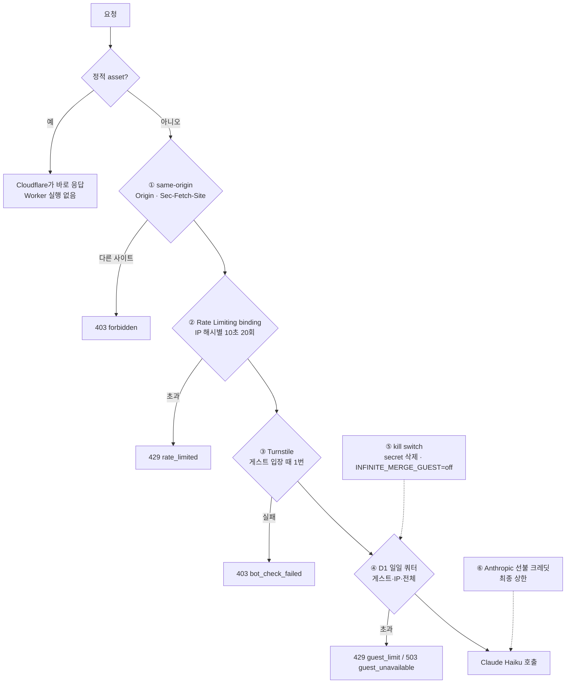
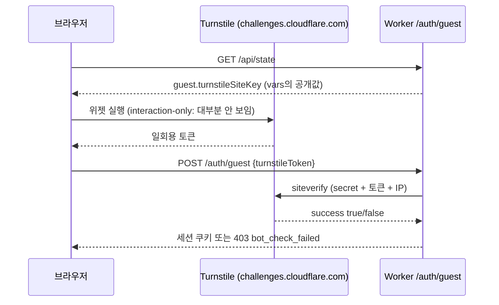

# 4. Cloudflare로 막기: 운영자 크레딧 지키기

> 목표: 이 앱의 방어 장치 여섯 겹이 각각 무엇을 막고 어디서 동작하는지 설명하고, 부하 도구로 직접 두드려 보며 차이를 확인합니다.

## 4-1. 무엇을 지키나

호스팅된 merge.zowoo.uk에서는 처음 보는 조합마다 **운영자의 Claude 크레딧**으로 Haiku를 부릅니다. 악용하는 쪽이 노리는 것은 세 가지입니다.

| 노리는 것 | 피해 |
|---|---|
| 새 조합을 무한히 요청 | Claude 크레딧 소진 |
| 요청 폭주 | Workers Free 하루 10만 요청, D1 하루 읽기 500만·쓰기 10만 행 소진 → 사이트 정지 |
| 쿠키를 지우고 새 게스트로 계속 입장 | 1인당 한도 무력화 |

이미 누군가 발견한 조합은 D1에서 바로 나오므로 AI를 부르지 않고 횟수도 차감하지 않습니다. **비용이 드는 것은 "세계 최초의 조합"뿐입니다.**

## 4-2. 여섯 겹의 방어

싼 검사부터 먼저 합니다. 앞 단계에서 걸러지면 뒤의 비싼 단계(D1, AI)는 실행되지 않습니다.



| # | 장치 | 어디서 | 정확도 | 비용 | 코드/설정 |
|---|---|---|---|---|---|
| ① | same-origin 검사 | Worker | 정확 | 0 | [`lib/server/guard.ts`](../../lib/server/guard.ts) `assertSameOrigin` |
| ② | Rate Limiting binding | Cloudflare 엣지 카운터 | **느슨함** | 0 | `wrangler.jsonc` `ratelimits`, `enforceRateLimit` |
| ③ | Turnstile | Cloudflare + 브라우저 | 높음 | 0 | `components/Turnstile.tsx`, `verifyTurnstile` |
| ④ | D1 일일 쿼터 | D1 | **정확** | D1 행 몇 개 | [`lib/server/guest/quota.ts`](../../lib/server/guest/quota.ts) |
| ⑤ | kill switch | 설정 | — | — | secret / vars |
| ⑥ | 선불 크레딧 | Anthropic | — | — | Anthropic 콘솔 |

### ① same-origin: 남의 사이트가 내 쿠키로 요청하지 못하게

브라우저는 다른 사이트에서 보낸 요청에 `Origin`과 `Sec-Fetch-Site: cross-site`를 붙입니다. 쿠키를 쓰는 POST 요청(`/api/combine`, `/auth/guest`, `/auth/logout`, `/api/progress`, `/api/models`)은 이 헤더가 우리 호스트가 아니면 거절합니다.

```bash
curl -s -X POST -H 'Origin: https://evil.example' https://merge.zowoo.uk/api/combine -d '{}'
# {"error":{"code":"forbidden",…,"detail":"origin=evil.example"}}
```

### ② Rate Limiting binding: 빠르지만 느슨한 첫 번째 그물

```jsonc
"ratelimits": [
  { "name": "COMBINE_LIMITER",     "namespace_id": "7301", "simple": { "limit": 20, "period": 10 } },
  { "name": "GUEST_START_LIMITER", "namespace_id": "7302", "simple": { "limit": 3,  "period": 60 } }
]
```

```ts
// lib/server/guard.ts
const { success } = await env.COMBINE_LIMITER.limit({ key: ipHash });
if (!success) throw new AppError("rate_limited");   // 429
```

- `period`는 10 또는 60초만 됩니다. `namespace_id`가 같은 binding끼리는 계정 전체에서 카운터를 공유합니다.
- 키는 **IP를 소금(`IM_IP_SALT`)과 함께 해시한 값**입니다. 원본 IP는 어디에도 저장하지 않습니다.
- 검사 위치를 로그인 확인보다 **앞**에 두었습니다. 그래서 쿠키 없는 공격 요청도 D1을 건드리기 전에 걸러지고, 실습 도구로 공짜로 시험할 수 있습니다.

**실측: 로컬은 정확하고, 운영은 느슨합니다.** Cloudflare 문서도 이 binding을 "permissive, eventually consistent"라고 설명합니다. 카운터를 각 서버에 캐시해 두고 비동기로 맞추기 때문에, 요청이 여러 서버로 흩어지면 한동안 한도를 넘겨도 통과합니다.

```bash
npm run preview                                        # 다른 터미널에서
npm run lab:hammer -- -n 40                            # 로컬 workerd
npm run lab:hammer -- --url https://merge.zowoo.uk -n 200 -c 12   # 운영
```

```
# 로컬 (wrangler dev): 정확히 20회 뒤부터 막힌다
첫 429: 22번째 요청
순서: ·····················■■■■■■■■■■■■■■■■■■■

# 운영 (merge.zowoo.uk): 68번째부터, 그것도 띄엄띄엄
   110  401 not_signed_in
    90  429 rate_limited
첫 429: 68번째 요청
순서: ···································································■··············■■·■·■··■··■■■■■■·■■■··■■·■…
```

순차 요청 50회를 17초에 걸쳐 보냈을 때(10초당 약 30회)는 운영에서 한 번도 막히지 않았습니다. 그러니 **이 binding은 폭주를 막는 장치이지, 정확한 한도가 아닙니다.** 정확한 한도는 ④가 맡습니다.

### ③ Turnstile: 사람인지 확인 (게스트 입장 때 1번)



- 위젯은 `wrangler turnstile widget create infinite-merge --domain merge.zowoo.uk --mode managed`로 만들었습니다(wrangler 로그인 권한에 `challenge-widgets.write`가 필요해서 `wrangler login`을 한 번 다시 했습니다).
- 연성할 때마다가 아니라 **게스트 입장 때 1번만** 확인합니다. 입장 뒤의 남용은 ②와 ④가 맡습니다.
- 실제 브라우저 테스트에서는 위젯이 보이지 않은 채 통과했고("자동 입력 방지 확인 중…" → "바로 시작하기"), 토큰 없이 보낸 curl은 `bot_check_failed`로 막혔습니다.
- site key는 공개값이라 vars에, secret key는 secret에 둡니다(3장). 둘 중 하나라도 없으면 검사를 건너뜁니다. 그래서 로컬 개발이 막히지 않습니다.

```bash
seq 1 60 | xargs -P 12 -I{} curl -s -X POST -H 'Origin: https://merge.zowoo.uk' \
  -H 'Content-Type: application/json' https://merge.zowoo.uk/auth/guest -d '{}' | grep -o '"code":"[a-z_]*"' | sort | uniq -c
#   23 "code":"bot_check_failed"     ← 토큰이 없어서 ③에서
#   37 "code":"rate_limited"         ← 그 전에 ②에서
```

> 🧪 **로컬에서 Turnstile 켜 보기:** Cloudflare가 제공하는 [테스트 키](https://developers.cloudflare.com/turnstile/troubleshooting/testing/)를 씁니다.
> ```bash
> # .dev.vars 가 있으면 wrangler dev는 .env.local을 읽지 않으므로 Claude 키도 함께 넣는다 (.dev.vars는 gitignore 대상)
> grep '^ANTHROPIC_API_KEY=' .env.local > .dev.vars
> echo 'TURNSTILE_SITE_KEY=1x00000000000000000000AA' >> .dev.vars            # 항상 통과하는 위젯
> echo 'TURNSTILE_SECRET_KEY=1x0000000000000000000000000000000AA' >> .dev.vars # 항상 통과하는 검증
> npm run preview      # http://127.0.0.1:8787 → "바로 시작하기"가 위젯 통과 후 활성화된다
> ```
> secret을 `2x0000000000000000000000000000000AA`로 바꾸면 검증이 실패합니다(`bot_check_failed`, `invalid-input-response`). 실습이 끝나면 `rm .dev.vars`.

### ④ D1 일일 쿼터: 정확한 마지막 관문

모델을 부르기 **직전에** 한 단위를 차감합니다. 하나라도 꽉 차 있으면 호출하지 않습니다.

| 버킷 (`im_guest_usage.scope`) | 기본 한도 (KST 하루) | vars 이름 | 막는 것 |
|---|---|---|---|
| `*` 전체 | 1,500회 | `INFINITE_MERGE_GUEST_GLOBAL_DAILY` | **운영자 지출의 상한** |
| `guest:…` 게스트 1명 | 60회 | `INFINITE_MERGE_GUEST_DAILY` | 한 사람의 독점 |
| `ip:<해시>` IP 1개 | 150회 | `INFINITE_MERGE_GUEST_IP_DAILY` | 쿠키를 지우고 새 게스트로 돌기 |
| `join:<해시>` IP별 새 게스트 | 20명 | `INFINITE_MERGE_GUEST_JOIN_IP_DAILY` | 게스트 계정 무한 생성 |

한도는 IP 1개에 게스트 60회 × 2.5명 정도로 잡았습니다. 집이나 회사처럼 IP를 여럿이 함께 쓰는 경우를 고려한 값입니다. 현황은 이렇게 봅니다.

```bash
npm run lab:d1 -- --remote --file learn/d1/queries/04-guest-usage.sql
```

동작 원리(조건부 upsert + 보상 차감)는 1장 1-6절에 있습니다. 비용 감각: 연성 1회에 입력 약 1,300토큰, 출력 약 50토큰입니다. Haiku 5.5 단가로 약 $0.00016이고, 전체 한도 1,500회를 다 써도 하루 약 $0.25입니다.

### ⑤ kill switch: 지금 당장 끄기

| 상황 | 방법 | 반영 |
|---|---|---|
| 게스트 모드 전체 중단 | `npx wrangler secret delete ANTHROPIC_API_KEY` | 즉시 (새 버전) |
| 같은 효과, 키는 보존 | `wrangler.jsonc` vars에 `"INFINITE_MERGE_GUEST": "off"` → `npm run deploy` | 배포 후 |
| 하루 총량 줄이기 | `INFINITE_MERGE_GUEST_GLOBAL_DAILY`를 낮추고 배포 | 배포 후 |
| 사이트 전체 내리기 | 대시보드 Workers → infinite-merge → Settings → Domains에서 merge.zowoo.uk 제거 | 즉시 |

이미 발견된 조합은 게스트 모드가 꺼져도 계속 쓸 수 있습니다. 끄면 첫 화면이 "오늘의 체험 연성이 모두 소진됐어요"로 바뀝니다.

### ⑥ Anthropic 선불 크레딧

코드에 버그가 있어도 선불로 충전한 금액 이상은 쓸 수 없습니다. 크레딧이 떨어지면 Claude가 400을 돌려주고, 앱은 이를 `guest_unavailable`로 바꿔 게스트 모드를 쉬게 합니다(`lib/server/guest/claude.ts`). 서비스 전용 키를 따로 발급하고 콘솔에서 월 지출 한도를 걸어 두면 더 안전합니다.

## 4-3. 대시보드 실습: WAF Rate limiting rule (코드 밖의 방어)

②는 Worker **안에서** 셉니다. WAF 규칙은 Worker가 실행되기 **전에** Cloudflare 엣지가 막아서, 막힌 요청은 Workers 요청 수에도 들어가지 않습니다. Free 플랜은 규칙 1개, IP 기준, 10초 주기, 10초 차단입니다.

1. 대시보드 → `zowoo.uk` → **Security → WAF → Rate limiting rules → Create rule**
2. 이름: `infinite-merge guest start`
3. **If incoming requests match**: Field `URI Path`, Operator `equals`, Value `/auth/guest`
   (호스트까지 제한하려면 Edit expression: `(http.host eq "merge.zowoo.uk" and http.request.uri.path eq "/auth/guest")`. Free에서 쓸 수 있는 필드인지 화면에서 확인)
4. **With the same characteristics**: IP
5. **When rate exceeds**: Requests `5`, Period `10 seconds`
6. **Then take action**: Block, Duration `10 seconds` → Deploy
7. 시험:
   ```bash
   npm run lab:hammer -- --url https://merge.zowoo.uk --path /auth/guest -n 30
   ```
   우리 Worker의 429는 `429 rate_limited`처럼 JSON 오류 코드가 붙고, WAF의 429는 Cloudflare 오류 페이지라 코드 없이 `429`만 찍힙니다. 이 차이로 어느 층에서 막혔는지 구분해 보세요.
8. **Security → Events**에서 차단 기록을 확인합니다.

> 규칙은 zone(`zowoo.uk`) 전체에 적용되므로, 경로 조건을 꼭 넣어 같은 도메인의 다른 앱(`bm.zowoo.uk`)에 영향이 없게 하세요.

### 선택: Bot Fight Mode

**Security → Settings → Bot traffic → Bot fight mode**를 켜면 알려진 봇 패턴에 계산 비용이 큰 챌린지를 냅니다. 무료입니다. 다만 다음 주의점이 있어서 이 앱에는 켜 두지 않았습니다.
- zone 전체에 적용되어 `bm.zowoo.uk`까지 영향을 받습니다.
- WAF 규칙으로 예외를 둘 수 없습니다.
- API 호출을 막을 수 있습니다.

켜 보고 싶다면 Security → Events에서 `Bot Fight Mode`로 걸린 요청을 관찰한 뒤 판단하세요.

## 4-4. 아직 막지 못한 것 (다음 과제 후보)

| 빈틈 | 설명 | 후보 대책 |
|---|---|---|
| IP를 바꿔 가며 공격 | 봇넷이나 IPv6 대역을 바꿔 가며 들어오면 IP별 쿼터가 약해진다 | 전체 한도(⑤·⑥)가 최종 방어선. 필요하면 Turnstile을 연성마다 확인 |
| 부적절한 결과 이름 | AI가 만든 이름이 모두에게 공유된다 | 금칙어 필터. 지금은 SQL로 고친다(1장 `05-practice-writes.sql`) |
| 지출 알림 | 많이 써도 알려 주는 장치가 없다 | `[guest] claude ok … in= out=` 로그를 Workers Logs에서 집계하거나, Anthropic 콘솔 알림 |

## 체크리스트

- [ ] 여섯 겹의 방어가 각각 무엇을 막는지 말할 수 있다
- [ ] `lab:hammer`로 로컬과 운영의 Rate Limiting 차이를 직접 봤다
- [ ] Rate Limiting binding만으로는 부족한 이유와 D1 쿼터의 역할을 안다
- [ ] 테스트 키로 로컬에서 Turnstile을 켜 봤다
- [ ] WAF Rate limiting rule을 만들고 Security Events에서 확인했다
- [ ] 게스트 모드를 즉시 끄는 방법 두 가지를 안다
