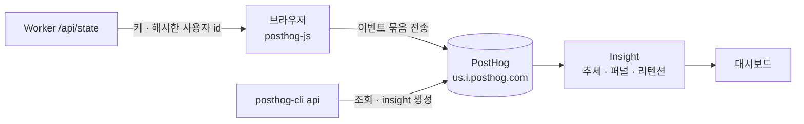

# 5. PostHog로 지표 보기: 이벤트, 퍼널, 리텐션

> 목표: "사람들이 정말 이 게임을 하나?"를 숫자로 답할 수 있게 됩니다. PostHog의 기본 개념(이벤트·속성·사용자·insight)을 익히고, 이 앱이 보내는 이벤트를 직접 만들어 본 뒤 대시보드에서 읽어 봅니다.

## 5-1. PostHog가 하는 일

D1에는 **결과**(원소, 레시피, 누가 무엇을 발견했나)가 남습니다. 하지만 "몇 명이 왔다가 그냥 나갔나", "처음 온 사람의 몇 %가 첫 조합까지 가나", "어제 온 사람이 오늘 또 왔나" 같은 **행동**은 남지 않습니다. PostHog는 브라우저가 보내는 행동 기록(이벤트)을 모아서 그래프로 보여 주는 서비스입니다.



- 이 앱은 **브라우저에서만** 보냅니다. Worker는 PostHog에 아무것도 보내지 않으므로 서버 부담(요청 수, CPU)이 늘지 않습니다.
- SDK(`posthog-js`, gzip 약 97 KB)는 키가 있을 때만 **나중에** 내려받습니다. 첫 화면 로딩에는 들어가지 않습니다.

## 5-2. 꼭 알아야 할 단어 6개

| 단어 | 뜻 | 이 앱에서 |
|---|---|---|
| **이벤트(event)** | "무슨 일이 있었다" 한 건. 이름 + 시각 + 속성 | `combine_completed` = 조합 1번 성공 |
| **속성(property)** | 이벤트에 붙는 자세한 값 | `cached: true`, `elapsed_ms: 412` |
| **distinct_id** | 이벤트를 보낸 사람의 id | 처음엔 브라우저가 만든 익명 id, 게임에 들어오면 계정 해시 |
| **identify** | "이 익명 id와 이 계정 id는 같은 사람"이라고 알려 주기 | 게스트 입장 직후 1번. 그래서 첫 화면 방문과 첫 조합이 한 사람으로 이어진다 |
| **super property** | 이후 모든 이벤트에 자동으로 붙는 속성 | `environment`(production/development), `provider`, `app` |
| **insight** | 이벤트로 만든 그래프 하나. 저장해 두면 계속 갱신된다 | 대시보드의 지표 12개 |

키도 두 종류이니 헷갈리지 마세요.

| 키 | 모양 | 어디에 | 비밀? |
|---|---|---|---|
| 프로젝트 키(Project API key) | `phc_…` | `wrangler.jsonc`의 `INFINITE_MERGE_POSTHOG_KEY` | **아니요.** 이벤트를 보내는 것만 가능해서 브라우저에 그대로 나갑니다 |
| 개인 API 키(Personal API key) | `phx_…` | `posthog-cli login`이 `~/.posthog/credentials.json`에 저장 | **예.** 데이터 조회·insight 생성이 가능합니다. 커밋·출력 금지 |

## 5-3. 이 앱이 보내는 이벤트

코드는 [`lib/analytics.ts`](../../lib/analytics.ts)(SDK 시작·identify·전송)와 [`components/Game.tsx`](../../components/Game.tsx)(언제 보내나)에 있습니다.

| 이벤트 | 언제 | 주요 속성 |
|---|---|---|
| `$pageview`, `$pageleave` | 페이지를 열고 닫을 때 (SDK가 자동으로) | `$current_url`, `$referrer`, 브라우저·OS |
| `landing_viewed` | 로그인 전 첫 화면이 보일 때 | `world_count`, `guest_available` |
| `guest_session_started` | 게스트 입장 성공 | — |
| `guest_start_failed` | 게스트 입장 실패 | `code` (예: `bot_check_failed`, `guest_limit`) |
| `game_started` | 게임 화면에 들어왔을 때, 페이지 로드당 1번 | `entry` (`returning` / `new_guest` / `signed_in`), `discovered_count`, `first_discovery_count`, `world_count` |
| `combine_completed` | 조합 성공 1번마다 | `cached`, `is_new`, `is_first_discovery`, `elapsed_ms`(서버 처리 시간), `round_trip_ms`(브라우저 체감), `model`, `remaining`, `result_name` |
| `combine_failed` | 조합 실패 1번마다 | `code`, `action`, `round_trip_ms` |
| `guest_limit_reached` | 게스트 횟수 소진 응답을 실제로 받았을 때 | `message` |
| `milestone_reached` | 발견 원소 수가 10/25/50/100/200/500/1000을 처음 넘을 때 | `count`, `title`, `discovered_count` |
| `progress_reset`, `logged_out` | 기록 초기화, 로그아웃 | `discovered_count` |

모든 이벤트에 붙는 속성: `app=infinite-merge`, `environment`, `provider`(`claude`=게스트, `chatgpt`, `mock`, `none`).

일부러 **보내지 않는 것**:
- 이름, 이메일, 원래 계정 id. 계정 id는 서버가 소금을 섞어 해시한 값(`analyticsId`, [`lib/server/guard.ts`](../../lib/server/guard.ts))만 보냅니다.
- IP. 프로젝트 설정에서 "Discard client IP data"를 켰습니다. 대신 국가별 통계는 나오지 않습니다.
- 클릭 자동 수집(autocapture), 히트맵, 세션 녹화. 끌어다 놓는 게임이라 의미 없는 클릭 이벤트가 무료 한도(월 100만 이벤트)를 먼저 씁니다. 필요하면 `lib/analytics.ts`의 `init` 옵션에서 켜세요.

## 5-4. 켜고 끄기 (콘솔에서)

| 변수 | 값 | 효과 |
|---|---|---|
| `INFINITE_MERGE_POSTHOG_KEY` | `phc_…` | 이 키가 있으면 `/api/state`가 브라우저에 키를 넘기고, 브라우저가 SDK를 받아 전송을 시작합니다 |
| | `""`(빈 값) | 분석 끔. SDK를 내려받지도 않습니다 |
| `INFINITE_MERGE_POSTHOG_HOST` | `https://us.i.posthog.com` | 미국 리전. EU 프로젝트면 `https://eu.i.posthog.com` |

다시 빌드할 필요는 없습니다. Cloudflare 대시보드에서 바꾸면 바로 적용됩니다. 단, [HOSTING.md](../HOSTING.md)의 규칙대로 `wrangler.jsonc`에도 옮겨 적어야 다음 배포 때 되돌아가지 않습니다.

## 5-5. 실습

### 실습 1. 내 이벤트 보내 보기 (비용 0)

```bash
npm run dev:mock        # 로컬 D1 + 가짜 AI. Haiku 크레딧을 쓰지 않습니다
```

1. 브라우저로 `http://127.0.0.1:3000`을 엽니다.
2. 원소를 몇 번 합칩니다. 같은 조합을 한 번 더 하면 `cached: true`가 나옵니다.
3. PostHog → **Activity**(Live events)를 엽니다. 1분쯤 안에 `game_started`, `combine_completed`가 보입니다.
4. 이벤트 하나를 눌러 속성을 봅니다. `environment = development`, `elapsed_ms`, `round_trip_ms`가 있어야 합니다.
5. 페이지를 새로고침합니다. 같은 사람(Person)으로 이어지는지 이벤트의 사람 칸을 확인합니다.

> 개발 이벤트는 "내부·테스트 사용자 제외(Filter out internal and test users)" 필터가 기본으로 켜져 있어 대시보드 숫자에 섞이지 않습니다. 프로젝트 설정에서 `environment is not development` 조건으로 등록해 두었습니다. insight에서 이 토글을 끄면 개발 이벤트도 보입니다.

### 실습 2. 첫 화면 → 게스트 입장 흐름

```bash
npm run dev:local       # 로컬 D1 + 실제 게스트 흐름 (조합하지 않으면 Haiku 비용 없음)
```

1. 시크릿 창으로 `http://127.0.0.1:3000`을 엽니다. 로그인 전이라 `landing_viewed`가 갑니다.
2. "로그인 없이 바로 시작"을 누릅니다. `guest_session_started`, `game_started(entry=new_guest)`, `$identify`가 갑니다.
3. PostHog → **People**에서 그 사람을 열어 보면 첫 화면 방문부터 이어져 있습니다. 이것이 identify의 효과입니다.

### 실습 3. 터미널에서 SQL로 보기

PostHog는 이벤트를 SQL(HogQL)로 조회할 수 있습니다. `posthog-cli`로 해 봅니다.

```bash
posthog-cli api call execute-sql '{"query":"SELECT event, count() FROM events WHERE timestamp > now() - INTERVAL 1 DAY GROUP BY event ORDER BY count() DESC"}'
```

조금 더 해 볼 만한 질문:

```sql
-- 오늘 가장 많이 만들어진 결과 원소 10개
SELECT properties.result_name AS name, count() AS n FROM events
WHERE event = 'combine_completed' AND properties.environment = 'production' AND timestamp > today()
GROUP BY name ORDER BY n DESC LIMIT 10

-- 캐시 비율 (높을수록 운영자 비용이 적다)
SELECT countIf(properties.cached = true) / count() AS cached_ratio FROM events
WHERE event = 'combine_completed' AND properties.environment = 'production' AND timestamp > now() - INTERVAL 7 DAY
```

> 셸에서 SQL 안의 작은따옴표가 JSON과 섞이면 깨지기 쉽습니다. 길어지면 JSON을 파일로 저장하고 `"$(cat q.json)"`로 넘기세요.

### 실습 4. 대시보드 읽기

PostHog → **Dashboards → 인피니티 머지 · 핵심 지표**에 아래 12개를 만들어 두었습니다(모두 최근 30일, KST 기준).

| 지표 | 종류 | 읽는 법 |
|---|---|---|
| 일별 플레이어 수 | 추세(DAU) | `game_started`를 보낸 서로 다른 사람 수 |
| 첫 화면 → 게스트 입장 → 첫 조합 | 퍼널, 1시간 | 처음 온 사람이 어디서 많이 빠지는지. 2단계가 낮으면 첫 화면 문구나 Turnstile을 의심 |
| 게임 시작 → 조합 성공 | 퍼널, 1시간 | 게임에 들어와서 조합을 해 보는 비율. 조작법이 어렵다는 신호 |
| 사용자당 성공 조합 수 | 추세(평균·중앙값) | 평균만 크고 중앙값이 작으면 소수가 많이 하는 것 |
| 연성 응답 시간 p50/p95 (서버) | 추세(백분위) | `cached=false`(AI 호출)가 느린 것이 정상. p95가 튀면 AI 지연 |
| 체감 응답 시간 p50/p95 (브라우저) | 추세(백분위) | 서버 시간 + 네트워크 |
| 캐시 여부별 조합 수 | 막대 | `true`가 많을수록 미리 채운 레시피가 일하고 있다는 뜻 |
| 실패 코드별 조합 실패 | 막대 | `guest_limit` 소진, `rate_limited` 연타, `unavailable` AI 문제 |
| 게스트 횟수 소진 사용자 | 막대 | 늘면 [게스트 한도](../HOSTING.md#게스트-한도-설정)나 충전 속도를 조정 |
| 새 원소와 세계 최초 발견 | 막대 | 발견의 재미가 남아 있는지 |
| 마일스톤 도달 사용자 | 막대 | 10개, 25개…까지 가는 사람이 얼마나 되나 |
| 게임 재방문 리텐션 (D1~D7) | 리텐션 | 처음 온 날을 Day 0으로, N일 뒤에 다시 `game_started`를 보낸 비율 |

**p50/p95란?** 응답 시간을 작은 순서로 줄 세웠을 때 50%, 95% 지점의 값입니다. 평균은 아주 느린 몇 건에 끌려가지만, p50은 "보통 사용자", p95는 "운 나쁜 20명 중 1명"의 경험을 보여 줍니다.

**퍼널의 전환 기간(1시간)이란?** 1단계 뒤 1시간 안에 다음 단계를 해야 전환으로 칩니다. 다음 날 와서 조합한 사람은 이 퍼널에서는 이탈로 셉니다.

**리텐션 읽는 법:** 표의 한 줄은 "그날 처음 온 사람들"이고, 칸은 Day 1, Day 2…에 돌아온 비율입니다. 사람이 적을 때(하루 수십 명)는 한두 명 차이로 크게 출렁이니 1~2주 모아서 보세요.

### 실습 5. CLI로 insight 하나 만들어 보기

```bash
posthog-cli api call --dry-run insight-create '{"name":"연습: 하루 조합 수","query":{"kind":"InsightVizNode","source":{"kind":"TrendsQuery","series":[{"kind":"EventsNode","event":"combine_completed"}],"interval":"day","dateRange":{"date_from":"-7d"},"filterTestAccounts":true}}}'
```

`--dry-run`을 빼면 실제로 만들어집니다. 같은 일을 웹에서 하려면 **Product analytics → New insight**를 누르세요. CLI로 만든 insight를 웹에서 열어 보면 JSON의 각 칸이 화면의 어디에 해당하는지 알 수 있습니다.

## 5-6. 함정

| 함정 | 증상 | 대응 |
|---|---|---|
| 광고 차단기 | 일부 사용자의 이벤트가 아예 오지 않는다. 숫자는 실제보다 작다 | 감안하고 본다. 고치려면 Worker로 `/ingest` 리버스 프록시를 두는데, 이벤트 묶음마다 Worker 요청 1건이 되어 Free 한도를 쓴다 |
| 자동화 브라우저 | Playwright로 시험하면 이벤트가 하나도 안 간다 | posthog-js가 봇으로 보고 버린다. `navigator.webdriver`, user agent, `userAgentData`를 바꿔야 한다. `?__posthog_debug=true`로 콘솔에서 원인을 볼 수 있다 |
| `next dev`에서 변수가 안 보임 | 로컬에서 키가 없다고 경고 | 배포된 Worker는 vars를 `process.env`에 넣지만 `next dev`는 Cloudflare env에만 둔다. `workerVar()`가 둘 다 읽는다([`lib/server/config.ts`](../../lib/server/config.ts)) |
| 시간대 | "일별" 숫자가 9시간 밀린다 | 프로젝트 시간대를 Asia/Seoul로 바꿔 두었다. 게임의 하루 한도(00:00 KST)와 맞는다 |
| 개발 데이터 섞임 | 혼자 테스트한 조합이 지표에 잡힌다 | `environment` super property + 내부 사용자 필터. 필터를 끈 insight를 만들 때 주의 |
| 이벤트 이름 바꾸기 | 이름을 바꾸면 옛 데이터와 이어지지 않는다 | 이름은 한번 정하면 유지한다. 바꿔야 하면 insight에 두 이벤트를 함께 넣는다 |
| 개인 API 키 노출 | 누구나 데이터를 읽고 insight를 지울 수 있다 | `~/.posthog/credentials.json`은 저장소 밖. 커밋·붙여넣기 금지. 노출되면 PostHog 설정에서 바로 폐기 |

## 체크리스트

- [ ] 이벤트·속성·distinct_id·identify의 차이를 말할 수 있다
- [ ] 프로젝트 키(`phc_`)는 공개해도 되고 개인 API 키는 안 되는 이유를 안다
- [ ] `dev:mock`으로 이벤트를 보내 Activity에서 확인했다
- [ ] 첫 화면 방문과 게스트 입장이 한 사람으로 이어지는 것을 People에서 봤다
- [ ] `posthog-cli api call execute-sql`로 SQL을 한 번 실행했다
- [ ] 대시보드의 퍼널·p95·리텐션을 읽는 법을 안다
- [ ] 분석을 콘솔에서 끄는 방법(빈 키)을 안다
