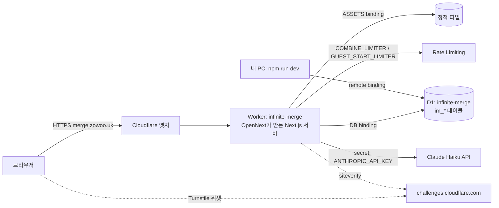

# 인피니티 머지로 배우는 Cloudflare

이 폴더는 인피니티 머지를 Cloudflare Workers + D1에 올리면서 실제로 쓴 기술을 실습 위주로 정리한 교재입니다. 모든 명령은 이 저장소에서 직접 실행해 확인했고, 출력 예시도 실제 결과입니다.

## 순서

| # | 문서 | 배우는 것 | 실습 도구 |
|---|---|---|---|
| 1 | [D1 교습서](01-d1.md) | D1이 무엇인지, binding, migration, `rows_read`로 보는 비용, 인덱스, trigger, batch, Time Travel, 용량 계산 | `npm run lab:d1`, `lab:size`, `lab:clone-remote` |
| 2 | [Workers와 이 앱의 Cloudflare 스택](02-workers-stack.md) | Worker의 실행 모델, `wrangler.jsonc` 한 줄씩, OpenNext 빌드, 로컬 실행 3가지, 배포·로그·롤백 | `learn/workers/hello-d1` 미니 Worker |
| 3 | [vars와 secret](03-secrets.md) | `.env.local` · `.dev.vars` · vars · secret의 차이, `wrangler secret put`, 번들에 키가 새는 함정 | 미니 Worker의 `/secret` |
| 4 | [Cloudflare로 막기](04-defense.md) | 같은 출처 검사, Rate Limiting binding, Turnstile, D1 일일 쿼터, WAF 규칙, kill switch | `npm run lab:hammer` |
| 5 | [PostHog로 지표 보기](05-posthog.md) | 이벤트·속성·identify, 이 앱의 이벤트 목록, 퍼널·p95·리텐션 읽기, CLI로 SQL·insight | `npm run dev:mock`, `posthog-cli api` |

처음이라면 1 → 2 → 3 → 4 순서를 권합니다. 5장은 따로 읽어도 됩니다. 각 장은 "개념 → 실습 → 함정 → 체크리스트"로 되어 있습니다.

## 시작 전에

```bash
cd infinite-merge
npm install
npx wrangler whoami          # 로그인 안 돼 있으면: npx wrangler login
npm run db:migrate:local     # 로컬 D1(.wrangler/state)에 테이블 만들기
```

## 꼭 기억할 안전 규칙

이 앱은 **로컬 `npm run dev`와 호스팅(merge.zowoo.uk)이 같은 원격 D1을 씁니다.** 그래서:

- 실습은 기본이 **로컬 D1**입니다. `lab:d1`은 `--remote`를 붙여야 원격으로 가고, 원격 쓰기는 `--write`까지 붙여야 실행됩니다.
- 운영 데이터로 연습하고 싶으면 `npm run lab:clone-remote`로 원격을 로컬에 복제한 뒤 로컬에서 하세요.
- `wrangler d1 time-travel restore`는 운영 DB 전체를 되돌립니다. 이 교재는 `info`(조회)까지만 실습합니다.

## 한눈에 보는 구조


