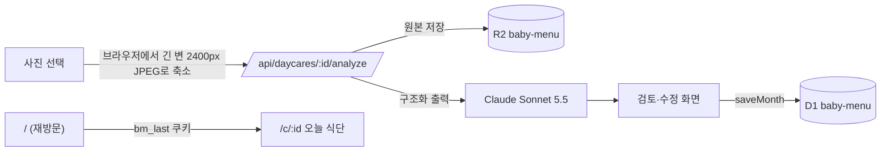

# baby-menu — 우리 아기 식단

어린이집 월간 식단표 사진을 올리면 Claude가 날짜별 간식·점심으로 정리하고, 다음부터는 앱을 열기만 해도 마지막으로 본 어린이집의 **오늘** 식단을 바로 보여주는 웹앱입니다.

- 운영 주소: https://bm.zowoo.uk
- 여러 어린이집 지원: 누구나 어린이집을 만들고(관리 비밀번호 설정), 매달 사진을 올려 식단을 구성합니다. 보기는 공유 주소(`/c/<id>`)로 누구나 가능합니다.

## 동작 방식



- **재방문 0클릭**: 어린이집 화면을 열 때마다 서버가 `bm_last` httpOnly 쿠키(400일)를 갱신하고, `/`는 이 쿠키가 있으면 해당 어린이집으로 바로 리다이렉트합니다. 다른 어린이집은 상단 이름을 눌러 고릅니다.
- **오늘 기준**은 항상 한국 시간(Asia/Seoul)입니다.
- **AI 결과 검증**: 해당 월 밖의 날짜는 버리고, 사진 요일과 실제 달력 요일이 다르면 경고합니다. 저장 전에 원본과 나란히 보며 고칠 수 있습니다.
- **편집 권한**: 어린이집별 관리 비밀번호(PBKDF2 해시). 맞추면 이 기기에 편집 쿠키를 남깁니다.
- **원본 사진 보관 180일**: R2 lifecycle 규칙 `expire-menu-photos-180d`(prefix `daycares/`)가 업로드 180일 뒤 사진을 자동 삭제합니다. 식단 텍스트(D1)는 계속 남고, 만료된 달은 "원본 보기"만 숨겨집니다. 기간을 바꾸면 `src/lib/dates.ts`의 `PHOTO_RETENTION_DAYS`도 함께 바꾸세요.
- **남용 방지**: 분석은 어린이집당 하루 10회·전체 하루 60회, 생성은 IP당 하루 5회로 제한합니다(`src/lib/server/limits.ts`).

## 로컬 실행

```bash
cp .env.example .env.local   # CLAUDE_API_KEY 입력
npm install
npm run db:migrate:local
npm run dev
```

`docs/menu.jpeg`가 샘플 식단표(2026년 10월)입니다.

## 검증

```bash
npm run lint
npm run typecheck
npm test
npm run cloudflare:build   # OpenNext 빌드 + 산출물에 API 키가 남지 않았는지 검사
```

## 배포 (Cloudflare Workers)

| 리소스 | 이름 |
|---|---|
| Worker | `baby-menu` (custom domain `bm.zowoo.uk`) |
| D1 | `baby-menu` |
| R2 | `baby-menu` (비공개, Worker의 `/api/images/*`로 제공) |

```bash
npm run db:migrate:remote          # 스키마 변경 시
npm run deploy
# 최초 1회 또는 키 교체 시
npx wrangler secret put CLAUDE_API_KEY
# 원본 사진 보관 기간 (최초 1회 설정됨)
npx wrangler r2 bucket lifecycle list baby-menu
```

- 모델은 `wrangler.jsonc`의 `CLAUDE_MODEL`(기본 `claude-sonnet-5-5`)로 바꿉니다. 인식이 부족하면 `claude-opus-5-5`로 올리고 재배포하세요.
- `placement`를 서울 리전으로 고정했습니다. 한국 요청이 HKG colo에서 실행되면 Anthropic API가 `403 Request not allowed`를 반환하기 때문입니다. 지우지 마세요.
