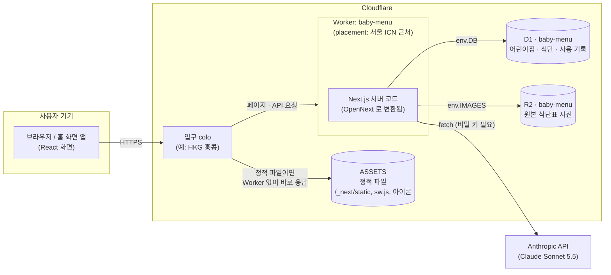
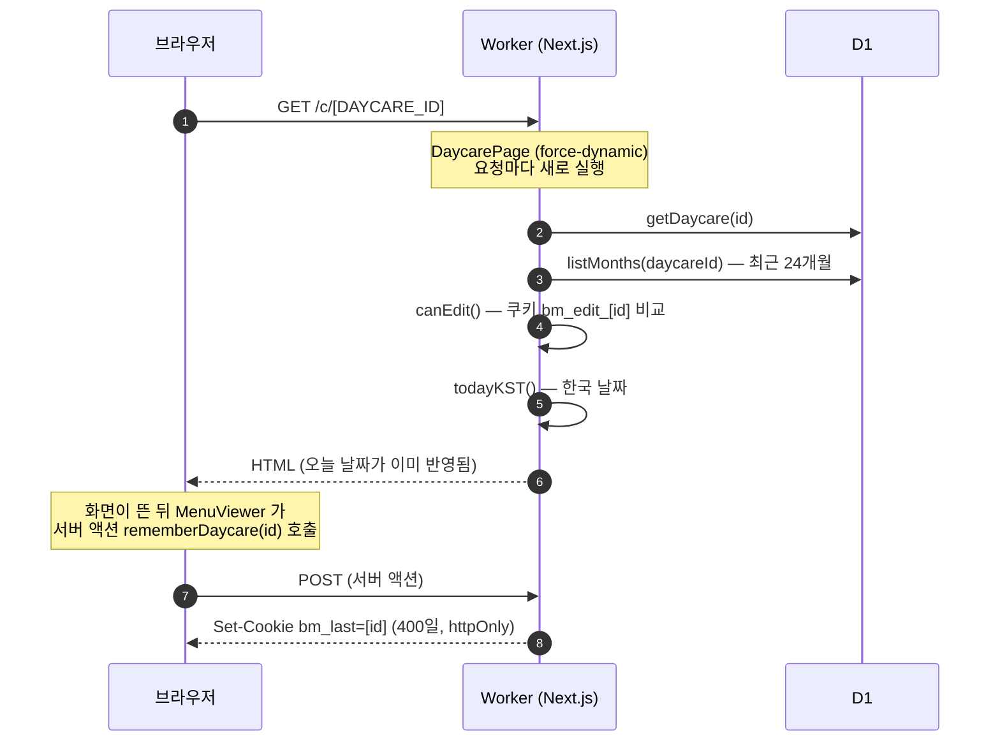
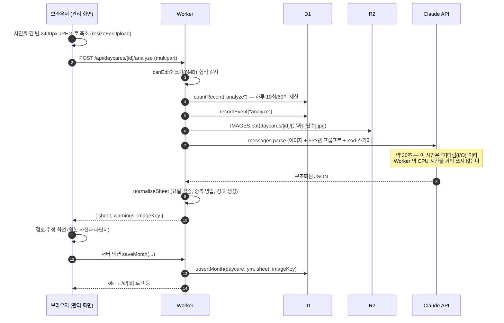
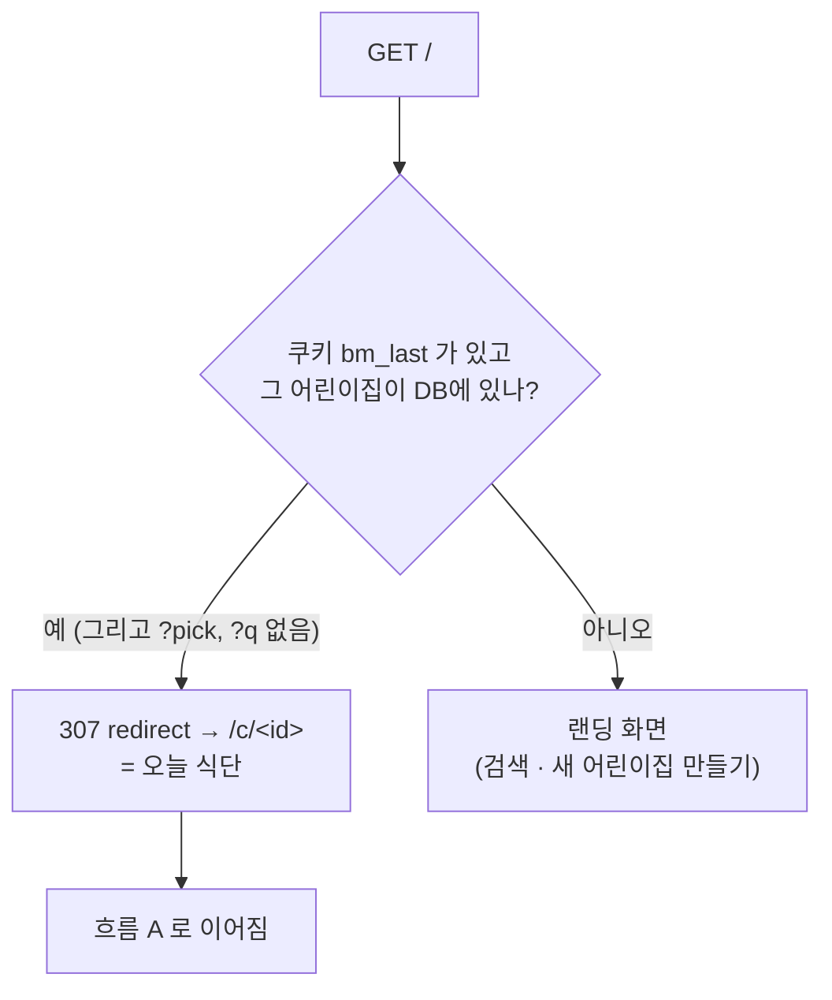
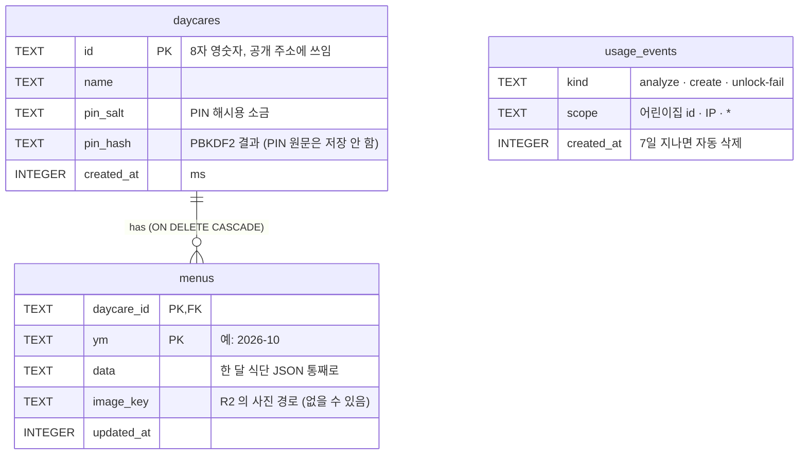

# 00. 전체 그림 — 요청 하나가 지나가는 길

> **한 줄 요약** — 폰에서 `bm.zowoo.uk` 를 열면 요청이 Cloudflare 데이터센터 → 서울에서 도는 Worker → (D1 · R2 · Claude) 순서로 지나가고, 같은 코드가 "보기 · 올리기 · 처음 열기" 세 가지 일을 한다.

- 예상 소요: 40분 (읽기 25분 + 직접 해보기 15분)
- 선행 지식: 없음. 이 장이 지도 역할이라 가장 먼저 읽습니다. (Next.js 코드 쪽 원리는 [05장](./05-nextjs-app-router.md))
- 다음 장: [01. Cloudflare Workers](./01-cloudflare-workers.md)

---

## 1. 왜 이걸 알아야 하나

AI로 앱을 만들면 "돌아가기는 하는데 **어디서 무엇이 도는지**" 모르는 채로 남기 쉽습니다.
그러면 문제가 났을 때 (예: 분석이 갑자기 502) **어느 층을 의심할지** 정하지 못합니다.
이 장의 목표는 딱 하나, 장애가 나면 "브라우저? 입구? Worker? DB? 사진 저장소? Claude?" 중 어느 칸을 봐야 하는지 머릿속 지도로 갖는 것입니다.

---

## 2. 그림으로 보는 전체 구조



요점 세 가지:

1. **브라우저는 Worker 의 주소를 모릅니다.** 항상 `bm.zowoo.uk` 로 요청하고, Cloudflare 가 알아서 가까운 입구로 받아 줍니다.
2. **정적 파일**(JS, 아이콘, `sw.js`)은 Worker 를 깨우지 않고 ASSETS 에서 바로 나갑니다. 페이지와 API 만 Worker 가 처리합니다.
3. **D1 · R2 는 Worker 코드의 변수(`env.DB`, `env.IMAGES`)로 접근합니다.** 비밀번호 같은 접속 정보가 코드에 없습니다. 이것이 "바인딩"입니다([01장](./01-cloudflare-workers.md#5-바인딩-코드가-리소스를-만나는-방식)).

### 같은 구조를 층으로 보면

```text
┌──────────────────────────────────────────────────────────────┐
│ ① 화면 (브라우저)    React 컴포넌트, 서비스 워커, 쿠키/localStorage │
├──────────────────────────────────────────────────────────────┤
│ ② 입구 (Cloudflare edge)  TLS, 도메인 → Worker 연결, 정적 파일 응답 │
├──────────────────────────────────────────────────────────────┤
│ ③ 서버 코드 (Worker)  페이지 렌더링, 서버 액션, /api/* 라우트        │
├──────────────────────────────────────────────────────────────┤
│ ④ 저장소 · 외부 서비스   D1(SQL) · R2(사진) · Anthropic(AI)       │
└──────────────────────────────────────────────────────────────┘
 장애가 나면 위에서 아래로 한 칸씩 "여기는 정상"을 확인해 내려갑니다.
```

---

## 3. 핵심 흐름 3가지

### 흐름 A. 오늘 식단 보기 — `/c/<DAYCARE_ID>`



- "오늘"은 **서버가 한국 시간으로** 계산합니다([`dates.ts`](../src/lib/dates.ts) 의 `todayKST`, 자세히는 [08장](./08-dates-kst.md)). 해외에서 열어도 어린이집 기준 오늘이 나옵니다.
- 페이지가 `force-dynamic` 인 이유는 [02장](./02-opennext-build.md#6-왜-force-dynamic-인가)에서 설명합니다.
- 화면 안에서 날짜를 넘기는 건 **서버 요청 없이** 브라우저가 처리합니다(`months` 전체를 이미 받아 둠).

### 흐름 B. 식단표 올리기 → AI 분석 → 저장



- 사진은 **분석 요청 때 먼저 R2 에 저장**됩니다(저장을 안 눌러도 남습니다). 180일 뒤 R2 규칙이 자동 삭제합니다([04장 R2](./04-r2-storage.md), 운영 방법은 [10장](./10-ops-runbook.md)).
- Claude 호출의 원리는 [06장](./06-claude-structured-output.md), 코드는 [`extract.ts`](../src/lib/server/extract.ts), 요청 처리는 [`analyze/route.ts`](../src/app/api/daycares/%5Bid%5D/analyze/route.ts) 입니다.

### 흐름 C. 다시 열면 0클릭 — `/`



- 이 분기는 [`page.tsx`](../src/app/page.tsx) 의 `redirect()` 한 줄입니다. 쿠키는 **서버가** 읽습니다(httpOnly). 쿠키 원리는 [07장](./07-auth-cookies.md).
- 그래서 "처음 이 기기에서 한 번은 `/c/<id>` 주소로 들어가야" 쿠키가 생깁니다.

> ⚠️ **쿠키는 브라우저(앱)마다 따로입니다.** 사파리에서 쌓인 쿠키가 "홈 화면에 추가한 앱"에는 없을 수 있습니다(특히 iOS).
> 그래서 홈 화면 앱은 어린이집 주소(`start_url`)를 직접 품고 시작합니다. 자세한 건 [09. PWA](./09-pwa.md).

---

## 4. 데이터는 어디에 사나



| 데이터 | 저장 위치 | 수명 | 정의된 곳 |
|---|---|---|---|
| 어린이집, 월별 식단(JSON) | **D1** `baby-menu` | 영구 | [`migrations/0001_init.sql`](../migrations/0001_init.sql) |
| 요청 제한용 사용 기록 | D1 `usage_events` | 7일 (기록할 때 같이 청소) | [`limits.ts`](../src/lib/server/limits.ts) |
| 원본 식단표 사진 | **R2** `baby-menu` (`daycares/<id>/<날짜>-<난수>.jpg`) | 180일 (R2 규칙) | [`analyze/route.ts`](../src/app/api/daycares/%5Bid%5D/analyze/route.ts) |
| "마지막에 본 어린이집" | 쿠키 `bm_last` (httpOnly, 400일) | 기기·브라우저별 | [`actions.ts`](../src/app/actions.ts) |
| "이 기기는 편집 가능" | 쿠키 `bm_edit_<id>` = sha256(id + pin_hash) | 400일, **PIN 을 바꾸면 무효** | [`auth.ts`](../src/lib/server/auth.ts) |
| 라이트/다크 테마 | 브라우저 localStorage `theme` | 기기별 | [`layout.tsx`](../src/app/layout.tsx) |

> **참고** — 한 달 식단을 `data` 컬럼에 JSON 한 덩어리로 넣었습니다. "날짜별로 SQL 검색"은 못 하지만, 이 앱은 항상 한 달을 통째로 읽고 쓰므로
> 테이블 설계가 단순해집니다. 트레이드오프는 [03장 D1](./03-d1-sql.md) 에서 다룹니다.

---

## 5. 이 앱에서는 어디에 — 기능별 파일 지도

| 기능 | 파일 | 한 줄 설명 |
|---|---|---|
| 첫 화면 · 0클릭 리다이렉트 | [`src/app/page.tsx`](../src/app/page.tsx) | `bm_last` 쿠키 → `redirect()` |
| 어린이집 식단 화면 (서버) | [`src/app/c/[id]/page.tsx`](../src/app/c/%5Bid%5D/page.tsx) | D1 에서 읽어 `MenuViewer` 에 전달 |
| 식단 화면 (브라우저) | [`src/components/menu-viewer.tsx`](../src/components/menu-viewer.tsx) | 일/월 보기, 화살표·스와이프, 날짜가 바뀌면 새로고침 |
| 관리 화면 | [`src/app/c/[id]/manage/page.tsx`](../src/app/c/%5Bid%5D/manage/page.tsx), [`manage-client.tsx`](../src/components/manage-client.tsx) | 잠금 해제 → 업로드 · 저장된 달 목록 |
| 식단 편집기 | [`month-editor.tsx`](../src/components/month-editor.tsx) | AI 결과를 사람이 고치는 폼 |
| 서버 액션 (생성·로그인·저장·삭제) | [`src/app/actions.ts`](../src/app/actions.ts) | `createDaycare`, `unlockDaycare`, `saveMonth` … |
| AI 분석 API | [`src/app/api/daycares/[id]/analyze/route.ts`](../src/app/api/daycares/%5Bid%5D/analyze/route.ts) | 검사 → R2 저장 → Claude → 정규화 |
| Claude 호출 · 프롬프트 | [`src/lib/server/extract.ts`](../src/lib/server/extract.ts) | 구조화 출력, 에러 → 사용자 메시지 |
| 결과 검증 · 정규화 | [`src/lib/sheet.ts`](../src/lib/sheet.ts), [`schema.ts`](../src/lib/schema.ts) | Zod 스키마, 요일 검증 |
| 사진 보기 | [`src/app/api/images/[...key]/route.ts`](../src/app/api/images/%5B...key%5D/route.ts) | R2 에서 읽어 전달(비공개 버킷) |
| DB 접근 | [`src/lib/server/db.ts`](../src/lib/server/db.ts) | SQL 은 여기에만 있음 |
| 비밀번호 · 쿠키 토큰 | [`src/lib/server/auth.ts`](../src/lib/server/auth.ts), [`session.ts`](../src/lib/server/session.ts) | PBKDF2, `canEdit()` |
| 사용 제한 | [`src/lib/server/limits.ts`](../src/lib/server/limits.ts) | 하루 분석 10/60회 등 |
| 날짜(KST) | [`src/lib/dates.ts`](../src/lib/dates.ts) | `todayKST`, 사진 만료 판단 |
| 바인딩 읽기 | [`src/lib/server/env.ts`](../src/lib/server/env.ts) | `getCloudflareContext()` 로 `env.DB` 등을 꺼냄 |
| 홈 화면 앱(PWA) | [`public/sw.js`](../public/sw.js), [`src/lib/pwa.ts`](../src/lib/pwa.ts), `manifest.webmanifest` 라우트들 | [09장](./09-pwa.md) |
| Cloudflare 설정 | [`wrangler.jsonc`](../wrangler.jsonc) | [01장](./01-cloudflare-workers.md) |
| 빌드 · 배포 | [`package.json`](../package.json) scripts, [`scripts/*.mjs`](../scripts) | [02장](./02-opennext-build.md) |

---

## 6. 운영 중인 리소스 목록 (대시보드에서 찾을 이름)

| 종류 | 이름 | 코드에서의 이름 | 만든/바꾸는 곳 |
|---|---|---|---|
| Worker | `baby-menu` | — | `wrangler.jsonc` 의 `name`, `npm run deploy` |
| 커스텀 도메인 | `bm.zowoo.uk` | — | `wrangler.jsonc` 의 `routes` |
| D1 데이터베이스 | `baby-menu` | `env.DB` | `d1_databases` |
| R2 버킷 | `baby-menu` | `env.IMAGES` | `r2_buckets` |
| 정적 파일 | `.open-next/assets` | `env.ASSETS` | `assets` |
| 변수(평문) | `CLAUDE_MODEL` | `env.CLAUDE_MODEL` | `vars` |
| 비밀값 | `CLAUDE_API_KEY` | `env.CLAUDE_API_KEY` | `wrangler secret put` (파일에 없음!) |
| 외부 서비스 | Anthropic API | `extract.ts` | Anthropic Console |

---

## 7. 직접 해보기 (모두 읽기 전용)

### 실습 1. 내 요청은 어느 입구로 들어올까

```bash
cd menu
bash learn/labs/cloudflare/trace-colo.sh
```

- `colo=` 와 `cf-ray` 끝 세 글자는 **입구**, `cf-placement` 는 **Worker 가 실제로 돈 곳**입니다.
- 입구와 실행 위치가 다르다는 것(예: `HKG` 입구, `remote-ICN` 실행)이 [01장의 사건](./01-cloudflare-workers.md#4-실제-사건-홍콩-colo-에서-anthropic-403)의 핵심입니다.

### 실습 2. 로컬 DB 를 열어 보기

```bash
cd menu
npm run db:migrate:local   # 처음 한 번 (이미 했다면 건너뜀)
npx wrangler d1 execute baby-menu --local --command \
  "SELECT name FROM sqlite_master WHERE type='table' ORDER BY name"
npx wrangler d1 execute baby-menu --local --command \
  "SELECT kind, scope, COUNT(*) AS n FROM usage_events GROUP BY kind, scope"
```

- 첫 명령으로 `daycares`, `menus`, `usage_events` 세 테이블을 확인합니다(`d1_migrations` 는 마이그레이션 기록용).
- `--local` 이 붙어서 **내 컴퓨터의 연습용 DB** 만 건드립니다. `--remote` 로 바꾸면 운영 DB 입니다. ⚠️ `SELECT` 만 쓰세요.

### 실습 3. 흐름 B 를 코드로 따라가기

1. [`analyze/route.ts`](../src/app/api/daycares/%5Bid%5D/analyze/route.ts) 를 위에서 아래로 읽으며 위 시퀀스 다이어그램의 화살표 번호를 코드 줄에 붙여 봅니다.
2. `return fail(…, 401 / 413 / 415 / 429 / 502 / 500)` 이 각각 **어느 칸의 실패**인지 표로 정리해 보세요(정답은 아래 퀴즈 2번과 [10장](./10-ops-runbook.md)의 증상표).

---

## 8. 흔한 실수 / 유지보수 체크리스트

- [ ] **"로컬에서 되니까 운영도 된다"는 착각** — 로컬 `wrangler dev` / `next dev` 는 실제 Cloudflare 가 아닙니다(위치·한도·네트워크가 다름). [01장](./01-cloudflare-workers.md)의 HKG 사건이 그 예입니다.
- [ ] **운영 DB 에 `--remote` 를 붙였는지 모르고 실행** — SQL 을 복붙하기 전에 `--local` / `--remote` 부터 읽는 습관.
- [ ] **스키마를 바꿨는데 운영 마이그레이션을 안 돌림** — 코드를 배포하기 **전에** `npm run db:migrate:remote`(⚠️ 운영 변경).
- [ ] **쿠키가 기기마다 따로**라는 점을 잊고 "다른 폰에서 로그인이 안 돼요"를 버그로 오해.
- [ ] **날짜는 항상 KST** — 새 기능에서 `new Date()` 로 날짜를 만들면 UTC 기준이 되어 자정 부근에 하루가 틀립니다. `todayKST()` 를 쓰세요.
- [ ] 비밀값(`CLAUDE_API_KEY`)은 **`wrangler.jsonc` 에 쓰지 않기**. `vars` 는 평문이고 저장소에 올라갑니다.

---

## 9. 퀴즈

**Q1.** 사용자가 `bm.zowoo.uk/_next/static/…js` 를 요청하면 Worker 코드가 실행될까요?

<details><summary>정답</summary>

실행되지 않습니다. 정적 파일은 ASSETS 에서 Worker 를 거치지 않고 바로 응답합니다(공식 문서: 정적 자산 요청은 Worker 를 호출하지 않고 무료).
그래서 `public/_headers` 의 캐시 규칙은 이런 정적 파일 응답에만 적용됩니다([01장 8절](./01-cloudflare-workers.md#8-정적-파일과-public_headers)).
</details>

**Q2.** 분석 API 가 `401` 을 돌려줬습니다. 4개 층(화면/입구/Worker/저장소 · 외부) 중 어디의 문제이고, 무엇을 확인하나요?

<details><summary>정답</summary>

Worker 층(앱 로직)입니다. `canEdit()` 가 거짓이라는 뜻이므로 쿠키 `bm_edit_<id>` 가 없거나, PIN 이 바뀌어 토큰이 달라졌거나, 다른 브라우저/앱(쿠키 분리)을 쓴 경우입니다.
관리 화면에서 비밀번호를 다시 입력하면 해결됩니다. Claude 문제라면 `502`(`ExtractError`) 로 나타납니다.
</details>

**Q3.** `menus.data` 에 한 달 식단을 JSON 통째로 넣은 설계의 장점 하나와 단점 하나는?

<details><summary>정답</summary>

장점: 읽고 쓰기가 한 번의 쿼리로 끝나고(`getMonth`/`upsertMonth`), AI 가 만든 구조를 그대로 저장해 스키마 변경이 쉽습니다.
단점: "알레르기 5번이 들어간 날짜 전체 검색" 같은 SQL 조회가 어렵습니다(JSON 을 꺼내서 앱 코드로 걸러야 함).
</details>

---

## 다음으로

[01. Cloudflare Workers](./01-cloudflare-workers.md) — "Worker 가 도대체 무엇이고, `wrangler.jsonc` 한 줄 한 줄이 무슨 뜻인지"를 배웁니다.
