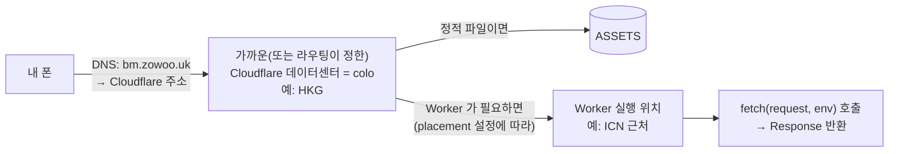
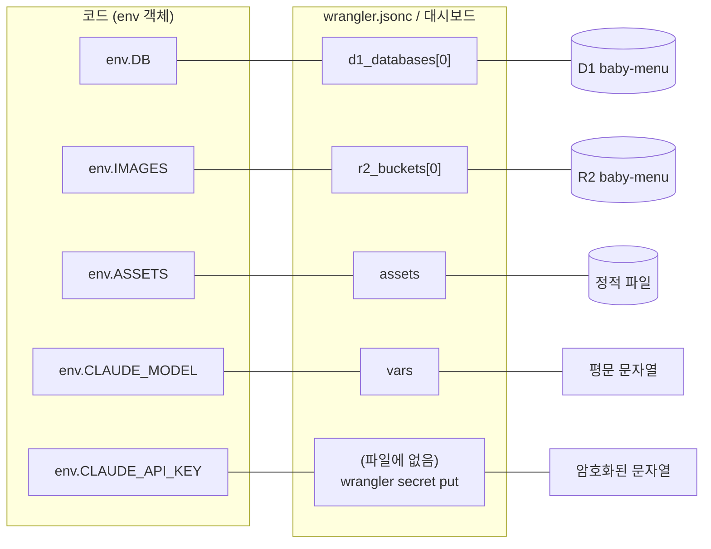

# 01. Cloudflare Workers — 서버 없는 서버

> **한 줄 요약** — Worker 는 "요청이 올 때만 깨어나는 작은 JavaScript 실행 환경(isolate)"이고, `wrangler.jsonc` 는 그 Worker 에게 **이름 · 도메인 · 저장소(D1/R2) · 실행 위치**를 알려 주는 설정 파일이다.

- 예상 소요: 90분 (읽기 50분 + 직접 해보기 40분)
- 선행: [00. 전체 그림](./00-big-picture.md)
- 이 장을 마치면: `wrangler.jsonc` 를 한 줄씩 설명할 수 있고, 대시보드에서 어디를 봐야 하는지 알고, "HKG 403 사건"을 스스로 진단할 수 있습니다.

> **참고** — Cloudflare 대시보드의 메뉴 이름과 위치는 자주 바뀝니다. 이 장의 경로는 **2026-10-14 에 공식 문서로 확인한 이름**이고,
> 확인한 문서 링크를 각 절에 달아 두었습니다. 화면이 다르면 문서 링크의 최신 설명을 따르세요.

---

## 1. 왜 필요한가

이 앱은 서버를 한 대도 직접 빌리지 않았습니다. 그런데도 `bm.zowoo.uk` 가 돌아갑니다. 그 "서버 역할"을 하는 것이 Worker 입니다.
유지보수하려면 최소한 아래를 **직접 설명**할 수 있어야 합니다.

| 질문 | 이 장에서 얻는 답 |
|---|---|
| 내 코드는 어디서, 어떤 모양으로 실행되나? | isolate, colo, 요청마다 호출되는 `fetch()` |
| 설정은 어디서 바꾸나? | `wrangler.jsonc` (그리고 대시보드의 어느 화면) |
| 왜 어떤 기능은 로컬에선 되는데 운영에선 안 되나? | 위치(colo) · 한도 · 런타임 차이 |
| DB 접속 정보는 어디 있나? | 없음 — 바인딩 |

---

## 2. Workers 란 — 그림으로

### 2-1. 서버 / 컨테이너 / isolate 비교

```text
 전통 서버(VM)          컨테이너(예: 람다 류)        Workers (V8 isolate)
┌────────────────┐    ┌────────────────────┐    ┌──────────────────────────┐
│ OS 한 대 통째로 │    │ 함수마다 프로세스    │    │ 하나의 런타임 안에서        │
│ 항상 켜져 있음   │    │ + 언어 런타임       │    │ 가벼운 "방(isolate)"만     │
│ 부팅: 분 단위    │    │ 시작: 수백 ms~초    │    │ 시작: 매우 짧음(공식 문서:   │
│                │    │ (콜드 스타트)        │    │ 컨테이너/VM 보다 ~100배)   │
└────────────────┘    └────────────────────┘    └──────────────────────────┘
   내가 관리               내가 거의 안 봄            내가 코드만 올림
```

- 공식 설명: Workers 는 V8 **isolate** 에서 돕니다. 컨테이너/VM 방식의 "콜드 스타트"를 사실상 없앴다는 것이 핵심 주장입니다.
  ([How Workers works](https://developers.cloudflare.com/workers/reference/how-workers-works/))
- isolate 는 **오래 살지 않습니다.** 런타임이 언제든 치울 수 있어서 모듈 전역 변수에 중요한 상태를 두면 안 됩니다
  (실습 1에서 눈으로 확인합니다). 이 앱이 상태를 전부 D1 · R2 · 쿠키에 두는 이유입니다.
- 한 isolate 가 여러 요청을 동시에 처리할 수 있고, 연속된 두 요청이 **다른 isolate** 로 갈 수도 있습니다.

### 2-2. 요청이 Worker 에 닿기까지



| 용어 | 뜻 | 이 앱의 예 |
|---|---|---|
| **edge** | 전 세계에 흩어진 Cloudflare 서버 전체 | — |
| **colo** | 그중 데이터센터 하나. 공항 코드 세 글자로 부름 | `HKG`(홍콩), `ICN`(인천/서울), `NRT`(도쿄) |
| **isolate** | colo 안에서 내 코드를 돌리는 가벼운 방 | — |
| **요청 모델** | 요청 1건 → `fetch()` 1번 호출 → `Response` | Next.js 가 이 위에서 페이지를 렌더링 |
| **콜드 스타트** | 처음 깨울 때의 지연. Workers 는 매우 짧음 | 체감 거의 없음 |

---

## 3. 한도 — "이 앱이 어디까지 괜찮은가"

공식 [Limits 페이지](https://developers.cloudflare.com/workers/platform/limits/)에서 2026-10-14 에 확인한 값입니다. **바뀔 수 있으니 중요한 판단 전엔 링크를 다시 보세요.**

| 항목 | Free | Paid | 이 앱과의 관계 |
|---|---|---|---|
| 요청당 **CPU 시간** | 10 ms | 기본 30초 (최대 5분) | 페이지 렌더링 · PBKDF2 가 CPU 를 씁니다 |
| 요청당 서브리퀘스트(바깥으로 보내는 fetch) | 50 | 10,000 | 분석 한 번에 Claude 호출 1회 + D1/R2 호출 |
| 메모리 | 128 MB | 128 MB | 사진을 통째로 메모리에 올림(6MB 제한이 있는 이유) |
| 하루 요청 수 | 100,000 | 제한 없음 | 가족 단위 사용에는 충분 |
| Worker 시작 시간 | 1초 | 1초 | — |
| 업로드 크기(압축 후) | 3 MiB | 10 MiB | 이 앱의 gzip 크기는 아래 참고 |

> 업로드 크기 한도는 OpenNext 문서에 적힌 값입니다([링크](https://opennext.js.org/cloudflare)). Limits 페이지에는 다른 숫자(64 MiB, 압축 전 기준)도 보이므로
> 헷갈리면 **배포 때 wrangler 가 출력하는 `gzip:` 값**을 기준으로 삼으세요. 이 앱의 2026-10-14 `--dry-run` 결과는
> `Total Upload: 7143.86 KiB / gzip: 1446.83 KiB`(약 1.4 MiB) 였습니다 → [02장](./02-opennext-build.md#7-빌드-산출물-크기-읽기).

### CPU 시간 ≠ 걸린 시간

분석 요청은 **약 30초** 걸리지만 대부분은 Claude 응답을 *기다리는* 시간입니다. 기다리는 동안은 CPU 시간으로 세지 않습니다.
CPU 를 쓰는 건 "사진을 base64 로 바꾸기", "Next.js 렌더링", "PBKDF2 해시" 같은 계산입니다.

### PBKDF2 반복 횟수 100,000

[`auth.ts`](../src/lib/server/auth.ts) 의 주석은 "Workers 의 PBKDF2 반복 횟수 상한이 100,000" 이라고 적고, 코드는 정확히 `100_000` 을 씁니다.

> ⚠️ **확인 못 한 사실** — 이 "상한"은 이 앱을 만들 때의 시행착오와 커뮤니티 글에서 온 내용입니다. 공식 Web Crypto 문서 페이지에는 숫자가 없었습니다.
> 게다가 로컬 `wrangler dev` 는 100,001 이상도 통과시킵니다([실습 1](#10-직접-해보기)). 올리고 싶다면 **운영과 같은 환경(배포한 임시 Worker)에서** 먼저 확인해야 합니다.

### `nodejs_compat` 와 `compatibility_date`

- `compatibility_date` 는 "이 날짜까지 생긴 런타임 동작 변경을 켠다"는 뜻입니다. 코드가 어느 날 갑자기 달라지지 않도록 날짜를 고정합니다.
- `nodejs_compat` 플래그는 Node.js API(`node:crypto`, `Buffer`, `process` 등)를 쓸 수 있게 합니다. 공식 문서에 따르면
  **`2026-08-04` 이후 날짜에서는 자동으로 켜지고, 그 이전 날짜면 플래그를 직접 써야** 합니다.
  이 앱의 날짜는 `2026-07-11` 이라 플래그를 명시한 것입니다. → 날짜를 올릴 땐 동작 변화를 감안해서 올리세요.
  ([Compatibility flags](https://developers.cloudflare.com/workers/configuration/compatibility-flags/))

---

## 4. 실제 사건: 홍콩 colo 에서 Anthropic 403

배포 직후 가장 중요한 기능이 깨진 실화입니다. **증상 → 가설 → 진단 → 해결** 순서로 읽어 보세요.

### 증상

- 운영에서 식단표 분석 → 화면에 "AI 서버 오류" (`502`).
- 같은 API 키, 같은 사진을 **내 컴퓨터(로컬)** 에서 쓰면 정상.
- Worker 로그에 `claude extract failed { status: 403, message: ... "Request not allowed" }`.

### 가설

"키 문제"는 아님(로컬에서 됨). "코드 문제"도 아님(같은 코드). 그럼 **실행되는 장소**가 다르다. → 어디서 돌고 있지?

### 진단

```bash
curl -s https://bm.zowoo.uk/cdn-cgi/trace | grep colo     # colo=HKG
```

한국에서 접속했는데 **입구가 홍콩(HKG)** 이었습니다. Worker 는 기본값으로 *요청이 들어온 colo* 에서 실행되므로 Anthropic API 호출도 홍콩 쪽에서 나갑니다.
Anthropic API 는 [지원 지역](https://www.anthropic.com/supported-countries) 밖에서 오는 요청을 `403 Request not allowed` 로 거절하는데,
홍콩에서 나간 요청이 바로 이 경우로 판단했습니다(우리가 *관찰*한 것은 "HKG 에서 403, 서울로 옮기자 성공"입니다).

```text
       ┌────────── placement 없음 ──────────┐
 폰 ──▶ HKG colo ──▶ Worker(HKG) ──▶ Anthropic   → 403 ❌
       └────────────────────────────────────┘

       ┌────────── placement 있음 ──────────┐
 폰 ──▶ HKG colo ─ 전달 ─▶ Worker(ICN 근처) ──▶ Anthropic   → 200 ✅
       └────────────────────────────────────┘
```

### 해결

[`wrangler.jsonc`](../wrangler.jsonc) 에 **Worker 가 실행될 위치를 서울 리전으로 고정**했습니다.

```jsonc
"placement": { "mode": "targeted", "region": "aws:ap-northeast-2" },
```

### 확인 (이것이 진짜 증거)

```bash
curl -sI https://bm.zowoo.uk/ | grep -i cf-placement
# cf-placement: remote-ICN     ← 입구는 HKG 여도 코드는 ICN 근처에서 실행됨
```

- `remote-XXX` : 입구와 다른 colo 로 보내져서 실행됨. `local-XXX` : 입구에서 그대로 실행됨. (공식 문서의 `cf-placement` 설명)
- 실제 응답에는 `cf-ray: …-HKG`(입구)와 `cf-placement: remote-ICN`(실행)이 함께 보입니다 → [`trace-colo.sh`](./labs/cloudflare/trace-colo.sh) 로 직접 확인하세요.

### 이 사건에서 배운 점

1. **로컬 성공 ≠ 운영 성공.** 위치가 달라지면 외부 서비스의 판단이 달라질 수 있습니다.
2. 장애 진단은 "무엇이 다른가?"(키 · 코드 · **위치**)를 하나씩 지우는 일입니다.
3. placement 는 **지우면 안 되는 설정**입니다. 지우면 조용히 다시 HKG 가 될 수 있습니다.

### placement 옵션 3가지 (공식 문서 요약)

| 방식 | 설정 | 언제 |
|---|---|---|
| Smart Placement | `"placement": { "mode": "smart" }` | Cloudflare 가 트래픽을 분석해 더 빠른 위치를 고름. 분석에 시간이 걸리고, **이미 Worker 가 실행된 적 있는 위치만** 고려 |
| 지역 힌트(**이 앱**) | `"placement": { "region": "aws:ap-northeast-2" }` | 한 곳의 백엔드에 붙일 때. `{provider}:{region}` 형식 |
| 호스트/호스트네임 힌트 | `"host"` · `"hostname"` | 특정 DB 서버/API 서버 가까이 |

이 앱의 `mode: "targeted"` 표기는 실제 설정 파일 그대로입니다. 공식 문서 예시는 `region` 만 적은 형태도 보여 주므로, 문서와 표기가 다르면 **배포 후 `cf-placement` 헤더로 효과를 확인**하는 것이 정답입니다.
제한: placement 는 `fetch` 핸들러에만 적용되고, 정적 파일은 요청자 가까이에서 나갑니다.
([Placement 문서](https://developers.cloudflare.com/workers/configuration/smart-placement/))

---

## 5. 바인딩: 코드가 리소스를 만나는 방식

바인딩은 "Worker 코드의 변수 이름 ↔ Cloudflare 리소스"를 이어 주는 **연결 장치**입니다.



| 코드에서 | 종류 | 설정 위치 | 값이 보이나? | 쓰는 곳 |
|---|---|---|---|---|
| `env.DB` | D1 데이터베이스 | `d1_databases` | 리소스 | [`db.ts`](../src/lib/server/db.ts), [`limits.ts`](../src/lib/server/limits.ts) |
| `env.IMAGES` | R2 버킷 | `r2_buckets` | 리소스 | [`analyze/route.ts`](../src/app/api/daycares/%5Bid%5D/analyze/route.ts), 이미지 라우트 |
| `env.ASSETS` | 정적 파일 | `assets` | 리소스 | OpenNext 가 내부적으로 사용 |
| `env.CLAUDE_MODEL` | **var**(변수) | `vars` | 평문 · 저장소에 올라감 | [`env.ts`](../src/lib/server/env.ts) |
| `env.CLAUDE_API_KEY` | **secret**(비밀값) | 대시보드/CLI | **다시 볼 수 없음** | `claudeConfig()` |

핵심 규칙:

- **var vs secret** — 코드에서는 똑같이 `env.X` 로 읽지만, secret 은 저장 후 값을 볼 수 없고 암호화됩니다.
  공식 문서도 평문 `vars` 에 민감 정보를 두지 말라고 합니다. 그래서 키는 `vars` 가 아니라 **secret** 입니다.
  ([Secrets](https://developers.cloudflare.com/workers/configuration/secrets/))
- 로컬 개발의 secret 은 `.dev.vars` 파일(gitignore 대상)에 둡니다.
- `wrangler secret put/delete` 는 **새 버전을 만들어 즉시 배포**합니다 → 키 교체는 순간적으로 운영에 반영됩니다.
- 코드는 [`env.ts`](../src/lib/server/env.ts) 의 `getEnv()` 한 곳에서만 `env` 를 꺼냅니다. 어디서 왔는지 헷갈리면 이 파일을 보세요.

---

## 6. `wrangler.jsonc` 한 줄씩

[`wrangler.jsonc`](../wrangler.jsonc) (주석 가능한 JSON). 실제 파일에서 `database_id` 값만 `<DATABASE_ID>` 로 가렸습니다.

```jsonc
{
  "$schema": "./node_modules/wrangler/config-schema.json",
  "name": "baby-menu",
  "main": ".open-next/worker.js",
  "compatibility_flags": ["nodejs_compat", "global_fetch_strictly_public"],
  "compatibility_date": "2026-07-11",
  "assets": { "directory": ".open-next/assets", "binding": "ASSETS" },
  "placement": { "mode": "targeted", "region": "aws:ap-northeast-2" },
  "routes": [ { "pattern": "bm.zowoo.uk", "custom_domain": true } ],
  "d1_databases": [
    { "binding": "DB", "database_name": "baby-menu",
      "database_id": "<DATABASE_ID>", "migrations_dir": "migrations" }
  ],
  "r2_buckets": [ { "binding": "IMAGES", "bucket_name": "baby-menu" } ],
  "vars": { "CLAUDE_MODEL": "claude-sonnet-5-5" },
  "observability": { "enabled": true }
}
```

| 키 | 의미 | 바꾸면? |
|---|---|---|
| `$schema` | 에디터 자동완성/오타 검사용. 동작과 무관 | — |
| `name` | **Worker 이름**. 대시보드의 이름이자 배포 대상 | 바꾸면 *다른 새 Worker* 가 배포됨 (기존 것은 그대로 남음) |
| `main` | 진입 파일. OpenNext 가 빌드로 만들어 줌 | 빌드 없이 배포하면 파일이 없어 실패 → 그래서 `npm run deploy` 가 빌드를 먼저 함 ([02장](./02-opennext-build.md)) |
| `compatibility_flags` | 런타임 기능 스위치. `nodejs_compat`(Node API), `global_fetch_strictly_public`(아래) | 빼면 `node:` import 가 깨질 수 있음 |
| `compatibility_date` | 런타임 동작을 이 날짜 기준으로 고정 | 올리면 새 동작이 켜짐 → 올린 뒤 꼭 테스트 |
| `assets` | 정적 파일 폴더와 바인딩 이름. 정적 요청은 Worker 를 거치지 않음 | 빌드 출력 위치가 바뀌면 같이 수정 |
| `placement` | Worker 실행 위치. **지우지 말 것** (4절) | 지우면 HKG 403 재발 가능 |
| `routes` | 어떤 주소로 오는 요청을 이 Worker 가 받나 (7절) | 주소 변경/추가 |
| `d1_databases` | D1 바인딩 + `migrations_dir`(마이그레이션 폴더) | `database_id` 가 틀리면 배포 실패 |
| `r2_buckets` | R2 바인딩 | 버킷 이름이 없으면 배포 실패 |
| `vars` | 평문 변수. 모델 이름처럼 비밀이 아닌 값 | 바꾸고 `npm run deploy` 하면 반영 |
| `observability` | 로그/트레이스 수집 켜기 ([10장](./10-ops-runbook.md)) | 끄면 대시보드 로그가 사라짐 |

**`global_fetch_strictly_public`** — 공식 설명: 전역 `fetch()` 가 같은 zone(내 도메인)의 주소를 부를 때도
"마치 공용 인터넷에서 온 것처럼" 정식 경로(Cloudflare 입구)로 보냅니다. 이 플래그가 없으면 같은 zone 요청이 Worker 를 건너뛰고 오리진으로 직행할 수 있습니다.
이 앱은 같은 도메인을 fetch 하지 않으므로 영향이 작지만, OpenNext 의 권장 설정이라 유지합니다.

**설정 파일 vs 대시보드** — 공식 문서는 Wrangler 설정 파일을 *source of truth*(기준)로 삼으라고 합니다.
대시보드에서 바꾼 환경 변수와 라우트는 **다음 `wrangler deploy` 때 파일 내용으로 덮어써집니다**(`keep_vars` 로 변수만 보존 가능).
→ 설정을 바꿀 땐 **파일을 고치고 배포**하는 습관이 안전합니다. ([Configuration](https://developers.cloudflare.com/workers/wrangler/configuration/))

---

## 7. 커스텀 도메인 `bm.zowoo.uk`

```jsonc
"routes": [ { "pattern": "bm.zowoo.uk", "custom_domain": true } ]
```

- **Custom Domain** = 호스트 이름 전체(모든 경로)를 Worker 에 연결. 배포하면 Cloudflare 가 **DNS 레코드와 인증서를 자동으로 만들어 줍니다.**
- **Route**(`example.com/*`)는 URL 패턴 일부만 연결하는 다른 방식입니다.
- 조건: 도메인(`zowoo.uk`)의 DNS 를 Cloudflare 가 관리해야 하고, 같은 호스트 이름에 이미 CNAME 이 있으면 안 됩니다.
- 도메인을 지워도 **인증서는 자동으로 지워지지 않습니다**(공식 문서 주의사항).
- 대시보드 위치: **Workers & Pages → (Worker 선택) → Settings → Domains & Routes**
  ([Custom Domains](https://developers.cloudflare.com/workers/configuration/routing/custom-domains/))

---

## 8. 정적 파일과 `public/_headers`

```text
public/                       → 빌드 → .open-next/assets/ ─┐
  sw.js        (서비스 워커)                              │ 정적 파일: Worker 를 호출하지 않고
  offline.html (오프라인 화면)                             │ ASSETS 에서 바로 응답 (공식: 요청 무료·무제한)
  icons/*      (홈 화면 아이콘)                            │
  _headers     (응답 헤더 규칙) ←──────────────────────────┘ 이 규칙은 "정적 파일 응답"에만 적용
```

- `_headers` 파일 안에서 경로별로 `Cache-Control` 같은 헤더를 줍니다. 이 앱에서는 서비스 워커(`sw.js`)가 항상 최신인지 브라우저가 매번 확인하도록
  `Cache-Control: no-cache` 를 줍니다. 서비스 워커 파일이 오래 캐시되면 **업데이트가 안 퍼지는** 사고가 납니다.
  규칙 전체는 [`public/_headers`](../public/_headers) 를 보세요.
- ⚠️ **중요한 한계** — 공식 문서: `_headers` 는 *정적 파일* 응답에만 적용되고, **Worker 가 만든 응답(페이지, API)에는 적용되지 않습니다.**
  페이지의 `Cache-Control` 이 필요하면 Next.js/Worker 코드에서 설정해야 합니다. (규칙 100개, 한 줄 2,000자 제한)
  ([_headers 문서](https://developers.cloudflare.com/workers/static-assets/headers/))
- 배포 후 실제로 적용됐는지는 눈으로 믿지 말고 **헤더로 확인**합니다:

```bash
curl -sI https://bm.zowoo.uk/sw.js | grep -i -E "^(HTTP|content-type|cache-control)"
# 기대: Cache-Control: no-cache
```

---

## 9. 대시보드 지도

Cloudflare 대시보드 <https://dash.cloudflare.com> 에서 아래 이름으로 찾습니다. (🔎 = 공식 문서에서 확인한 경로)

| 보고 싶은 것 | 경로 | 비고 |
|---|---|---|
| 🔎 Worker 목록, 배포 이력, 롤백 | **Workers & Pages → (Worker) → Deployments** | 각 버전 옆 `⋯` → **Rollback** ([문서](https://developers.cloudflare.com/workers/configuration/versions-and-deployments/rollbacks/)) |
| 🔎 실시간/과거 로그 | **Workers & Pages → Overview → (Worker) → Observability** | 보관 기간: Free 3일 / Paid 7일 ([문서](https://developers.cloudflare.com/workers/observability/logs/workers-logs/)) |
| 🔎 도메인 · 라우트 | **… → (Worker) → Settings → Domains & Routes** | 7절 |
| 🔎 변수 · secret | **… → (Worker) → Settings → Variables and Secrets** | secret 은 값을 못 봄. 변경하면 **Deploy** 필요 ([문서](https://developers.cloudflare.com/workers/configuration/secrets/)) |
| 🔎 D1: 테이블 보기, SQL 실행 | **D1 SQL database → (DB) → Tables / Console** | 직접 실행한 SQL 은 **운영 DB 에 즉시 반영** ⚠️ ([문서](https://developers.cloudflare.com/d1/get-started/)) |
| 🔎 R2: 사진 목록, 보관 규칙 | **R2 object storage → (버킷)**, 규칙은 **Settings → Object Lifecycle Rules** | 이 앱의 규칙 `expire-menu-photos-180d` ([문서](https://developers.cloudflare.com/r2/buckets/object-lifecycles/)) |
| 사용량 · 요금 | 계정 홈의 **Billing** 류 메뉴 | 정확한 이름은 화면에서 확인 (문서로 검증하지 못함) |

> **참고** — "바인딩" 목록(어떤 D1/R2 가 이 Worker 에 연결됐는지)은 Worker 의 Settings 안에서 볼 수 있지만
> 정확한 탭 이름은 확인하지 못했습니다. 가장 확실한 방법은 `npx wrangler deploy --dry-run` 이 출력하는 `Your Worker has access to the following bindings:` 표입니다.

---

## 10. 직접 해보기

모두 **내 컴퓨터에서만** 또는 **읽기 전용**입니다. `menu/` 폴더에서 시작합니다.

### 실습 1. 연습용 Worker — isolate 와 바인딩 눈으로 보기

```bash
cd learn/labs/cloudflare/local-worker-hello
npx wrangler dev --port 8799
# 다른 터미널
curl -s localhost:8799/ ; curl -s localhost:8799/       # requestsInThisIsolate 가 1 → 2
curl -s localhost:8799/secret                            # secret 이 없을 때
cp .dev.vars.example .dev.vars   # → wrangler dev 재시작 후 /secret 다시
curl -s "localhost:8799/pbkdf2?n=1000000"                # 반복 횟수 ↑ → 시간 ↑
```

자세한 관찰 포인트: [`local-worker-hello/README.md`](./labs/cloudflare/local-worker-hello/README.md). ⚠️ 이 Worker 는 **배포하지 않습니다.**
끝나면 `Ctrl+C`, `.dev.vars` 는 지우세요(gitignore 되어 있지만 습관으로).

### 실습 2. 입구와 실행 위치 비교

```bash
bash learn/labs/cloudflare/trace-colo.sh
```

그리고 [`placement-experiment.md`](./labs/cloudflare/placement-experiment.md) 의 "생각해 볼 질문" 3개에 답해 보세요.

### 실습 3. 번들에 무엇이 바인딩되는지 확인 (배포 아님)

```bash
npx wrangler deploy --dry-run --outdir /tmp/bm-dryrun
```

- `--dry-run` 은 **배포하지 않고** 번들링만 합니다. `Total Upload … gzip …` 과 `Your Worker has access to the following bindings` 표가 나옵니다.
- 표에서 `env.DB`, `env.IMAGES`, `env.ASSETS`, `env.CLAUDE_MODEL` 을 5절의 표와 대조해 보세요. `CLAUDE_API_KEY` 가 **없는 이유**도 생각해 봅니다(secret 은 배포된 Worker 에만 존재).
- 먼저 `npm run cloudflare:build` 로 `.open-next` 가 만들어져 있어야 합니다.

### 실습 4. 운영 설정 읽기 (읽기 전용)

```bash
npx wrangler deployments list     # 최근 배포 이력
npx wrangler secret list          # secret 이름만 (값은 안 보임)
npx wrangler r2 bucket lifecycle list baby-menu   # 사진 보관 규칙
```

---

## 11. 흔한 실수 / 유지보수 체크리스트

- [ ] `wrangler.jsonc` 의 **`placement` 를 정리하다가 지움** → 홍콩 403 재발. 배포 후 `cf-placement` 헤더 확인.
- [ ] **`name` 을 바꿨다가 새 Worker 가 만들어짐** → 도메인 연결/바인딩/secret 이 새 Worker 에는 없음.
- [ ] 대시보드에서 변수를 고쳤는데 **다음 배포에서 되돌아감** → 파일이 기준. 파일을 고치고 배포.
- [ ] `vars` 에 API 키를 적음 → 저장소에 노출. **secret** 으로.
- [ ] `compatibility_date` 를 올린 뒤 테스트 안 함 → 런타임 동작 변화(특히 `nodejs_compat` 관련).
- [ ] `wrangler dev` 에서 된다고 PBKDF2 반복 횟수 등을 올림 → 운영 한도는 다를 수 있음.
- [ ] 정적 파일 헤더(`_headers`)로 **페이지** 헤더를 바꾸려 함 → 적용 안 됨.
- [ ] 연습용 Worker 를 실수로 `deploy` → 계정에 불필요한 Worker 가 생김(지우려면 대시보드/`wrangler delete`).

---

## 12. 퀴즈

**Q1.** 한국에서 접속했는데 `cf-ray` 끝이 `-HKG` 이고 `cf-placement: remote-ICN` 입니다. 요청을 받은 곳과 코드가 실행된 곳은 각각 어디입니까?

<details><summary>정답</summary>

받은 곳(입구 colo): 홍콩 `HKG`. 코드가 실행된 곳: 서울 근처 `ICN`. `remote` 는 "입구와 다른 colo 로 전달되어 실행됨"을 뜻합니다.
</details>

**Q2.** 새 기능에서 `const cache = new Map()` 를 모듈 최상단에 두고 "한 번 불러온 어린이집 정보를 저장"하려 합니다. 왜 위험한가요?

<details><summary>정답</summary>

isolate 는 오래 살지 않고 언제든 교체됩니다. 요청마다 다른 isolate 로 갈 수 있어서 값이 사라지거나 서로 다른 값을 볼 수 있습니다. 상태는 D1/R2/쿠키처럼 밖에 두고,
성능용 캐시라면 "없어도 정확히 동작하는" 최적화로만 써야 합니다.
</details>

**Q3.** `CLAUDE_MODEL` 은 `wrangler.jsonc` 의 `vars` 에, `CLAUDE_API_KEY` 는 `wrangler secret put` 으로 넣은 이유는?

<details><summary>정답</summary>

`CLAUDE_MODEL` 은 비밀이 아니고 저장소에 기록으로 남는 편이 좋으니 평문 `vars` 가 맞습니다. `CLAUDE_API_KEY` 는 유출되면 요금이 나가는 비밀이라 저장소에 올라가는 `vars` 에 두면 안 됩니다.
secret 은 암호화되어 저장되고 저장 후엔 값을 볼 수 없습니다. 또한 빌드 산출물에도 키가 남지 않게 [02장](./02-opennext-build.md)의 scrub/verify 스크립트가 지킵니다.
</details>

---

## 다음으로

[02. OpenNext 빌드](./02-opennext-build.md) — Next.js 앱이 어떻게 `.open-next/worker.js` 가 되는지, 그리고 왜 빌드마다 "비밀 키 검사"를 하는지 봅니다.
