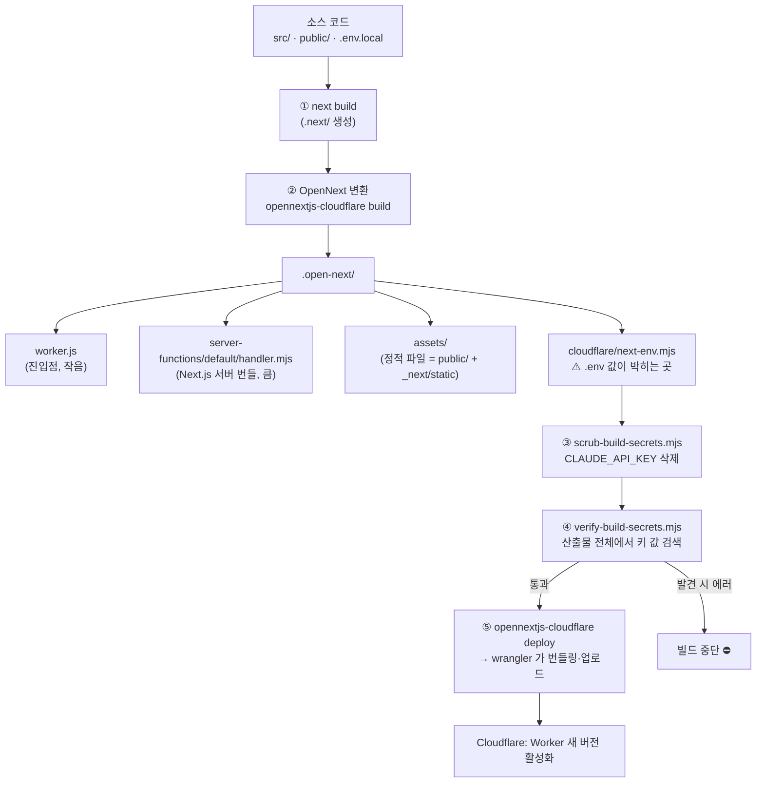
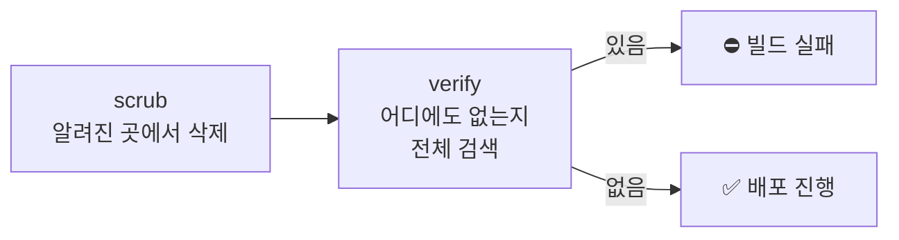

# 02. OpenNext 빌드 — Next.js 가 Worker 가 되기까지

> **한 줄 요약** — Next.js 는 원래 Node.js 서버용인데, **OpenNext** 가 빌드 결과를 Cloudflare Worker(`.open-next/worker.js`)와 정적 파일(`.open-next/assets`)로 바꿔 주고, 이 앱은 그 위에 "비밀 키가 산출물에 남지 않았는지" 검사하는 안전장치 두 개를 더 얹었다.

- 예상 소요: 70분 (읽기 40분 + 직접 해보기 30분)
- 선행: [01. Cloudflare Workers](./01-cloudflare-workers.md)
- 이 장을 마치면: `npm run deploy` 한 줄 뒤에서 일어나는 일을 설명하고, 빌드가 실패했을 때 어느 단계인지 알아봅니다.

---

## 1. 왜 필요한가

```text
 "코드를 고쳤다" ──▶ npm run deploy ──▶ "운영에 반영됐다"
                         └── 이 사이에 일어나는 일을 모르면,
                             실패했을 때(또는 무언가 새어 나갔을 때) 손쓸 수 없다.
```

특히 이 앱은 **유료 API 키**(Claude)를 다룹니다. 키가 빌드 결과물에 *문자열로 박혀* 버리면 배포 파일을 보는 누구나 쓸 수 있습니다.
그래서 "빌드가 무엇을 만들고, 거기에 무엇이 섞일 수 있는지"를 알아야 합니다.

---

## 2. 파이프라인 그림



### `.open-next/` 안에는 무엇이 있나 (2026-10-14 기준 실측)

| 경로 | 크기 | 역할 |
|---|---|---|
| `worker.js` | 약 2 KB | 진입점. 요청이 오면 → 미들웨어 → Next 서버 핸들러를 부름 |
| `server-functions/default/handler.mjs` | 약 4.8 MB | **Next.js 서버 본체**(페이지 렌더링, 서버 액션, API 라우트) |
| `assets/` | 약 3.8 MB | 정적 파일. `public/*`(sw.js, 아이콘, `_headers`) + `_next/static/*` |
| `cloudflare/` | 수십 KB | OpenNext 가 넣은 보조 코드(`init.js`, `images.js`, `next-env.mjs` 등) |
| `middleware/`, `cache/` … | 작음 | 미들웨어 핸들러, 캐시 초기 데이터 |

> **참고** — `.open-next/` 전체 크기(약 25 MB)는 `server-functions` 안의 `node_modules` 때문에 커 보이지만, **업로드는 wrangler 가 필요한 코드만 번들링**하므로 실제 크기는 아래 [7절](#7-빌드-산출물-크기-읽기)처럼 훨씬 작습니다.
> `.open-next/` 는 빌드 때마다 새로 만들어지고 `.gitignore` 에 있어서 커밋되지 않습니다.

`worker.js` 의 핵심 흐름(요약):

```text
fetch(request, env, ctx)
  → runWithCloudflareRequestContext(...)         ← getCloudflareContext() 가 동작하는 이유
  → /_next/image 요청이면 이미지 핸들러
  → middlewareHandler(request)                    ← Next 미들웨어
  → import("./server-functions/default/handler.mjs") → Next 서버가 응답 생성
```

---

## 3. `npm run …` 해부 ([`package.json`](../package.json))

| 명령 | 실제로 하는 일 | 위험 |
|---|---|---|
| `npm run dev` | `next dev` — 개발 서버. Node.js 에서 돌고 Cloudflare 바인딩은 **로컬 시뮬레이션** | 🟢 |
| `npm run build` | `next build` — Next.js 빌드만. OpenNext 변환은 안 함 | 🟢 |
| `npm run cloudflare:build` | ① `prepare-cloudflare-build.mjs` → ② `opennextjs-cloudflare build` → ③ `scrub-build-secrets.mjs` → ④ `verify-build-secrets.mjs` (앞 단계가 실패하면 뒤는 실행 안 됨: `&&`) | 🟢 (배포 아님) |
| `npm run preview` | `cloudflare:build` 후 `opennextjs-cloudflare preview` — **운영과 같은 Workers 런타임**을 내 컴퓨터에서 (공식: "Node.js 가 아니라 Workers 런타임") | 🟢 로컬 |
| `npm run deploy` | `cloudflare:build` 후 `opennextjs-cloudflare deploy` — **운영에 새 버전 배포** | 🔴 |
| `npm run db:migrate:local` / `:remote` | D1 마이그레이션 적용 (로컬 / **운영**) | 🟢 / 🔴 |

> ⚠️ `deploy` 는 안전검사(scrub/verify)를 **반드시 통과한 뒤에만** 배포합니다. 이 순서가 `deploy` 스크립트 안에 `npm run cloudflare:build &&` 로 박혀 있기 때문입니다.
> 누군가 `opennextjs-cloudflare deploy` 를 **직접** 부르면 이 검사를 건너뜁니다 → 항상 `npm run deploy` 를 쓰세요.

`prepare-cloudflare-build.mjs` 는 이전에 Cloudflare Pages 방식으로 만들던 `.pages-out/` 찌꺼기를 지웁니다. 지금은 Workers 방식이라 그 폴더가 있으면 안 되기 때문입니다.

---

## 4. 비밀 키 방어선 — 왜 scrub 과 verify 가 둘 다 있나

### 문제: `.env.local` 의 값이 빌드 결과에 박힌다

OpenNext 는 빌드할 때 `.env*` 파일의 값을 읽어 `.open-next/cloudflare/next-env.mjs` 라는 파일에 **JSON 으로 컴파일해 넣습니다.**
(OpenNext 는 `NEXTJS_ENV` 값으로 어떤 `.env` 를 읽을지 정하고, 기본은 production 입니다.)
로컬 `.env.local` 에 `CLAUDE_API_KEY=…` 가 있으면 그 줄이 **배포 파일 안에 평문으로** 들어갈 수 있습니다.

```text
.env.local ─(next build / OpenNext)─▶ .open-next/cloudflare/next-env.mjs
   CLAUDE_API_KEY=<키 값>                  export const production = {"CLAUDE_API_KEY":"<키 값>", …}   ← 이대로 업로드되면 사고
```

이 앱은 배포된 키를 **Cloudflare secret 으로만** 쓰기로 했으므로, 빌드 산출물에는 키가 *절대* 없어야 합니다.

### 방어선 1: scrub (지우기) — [`scripts/scrub-build-secrets.mjs`](../scripts/scrub-build-secrets.mjs)

1. `next-env.mjs` 의 각 줄(`export const production = {…};`)을 파싱합니다.
2. `sensitiveKeys`(현재 `CLAUDE_API_KEY`) 키를 JSON 에서 `delete` 하고 다시 씁니다.
3. 파일이 없으면 **에러로 중단**합니다("검증 불가능한 빌드는 거부"). 모양이 예상과 다르면 그것도 에러입니다.

### 방어선 2: verify (검증하기) — [`scripts/verify-build-secrets.mjs`](../scripts/verify-build-secrets.mjs)

scrub 이 제대로 지웠는지, 혹은 다른 곳으로 새지 않았는지 **독립적으로** 확인합니다.

| 검사 | 내용 |
|---|---|
| 비밀 값 수집 | 프로젝트 루트의 `.env`, `.env.*`, `.dev.vars*`(단 `.example`/`.sample` 제외)와 환경 변수에서 `sensitiveKeys` 의 **값**(8자 이상)을 모음 |
| 값 검색 | `.open-next/` 아래 **모든 파일**(32 MB 이하)에 그 값이 바이트로 들어 있는지 검사 |
| 이름 검색 | 공개 정적 파일(`.open-next/assets`, 8 MB 이하)에 `CLAUDE_API_KEY` **이름**이 있는지도 검사 — 브라우저에 내려가는 파일이라서 |
| 구조 검사 | `.open-next/worker.js` 존재, `.pages-out/` 부재 확인 |
| 결과 | 하나라도 걸리면 `throw` → `npm run deploy` 가 **배포 전에 중단** |



> **참고** — "지우기"와 "확인하기"를 분리한 이유: 지우는 코드는 *아는 위치*만 처리합니다. 다음에 OpenNext 가 다른 파일에 값을 넣게 바뀌어도
> verify 는 **값 자체를 전체에서 찾기** 때문에 잡아냅니다. 두 개는 서로의 버그를 잡는 이중 안전장치입니다.

### 직접 보기 (안전: 가짜 값 사용)

```bash
cd menu
npm run cloudflare:build       # 먼저 .open-next 생성 (1~2분)

# (a) next-env.mjs 에 어떤 키가 남았는지 "키 이름만" 확인 — 값은 출력하지 않음
node -e '
const t=require("fs").readFileSync(".open-next/cloudflare/next-env.mjs","utf8");
for (const l of t.split("\n").filter(Boolean)) {
  const m=l.match(/^export const (\w+) = (\{.*\});$/);
  if (m) console.log(m[1], "키:", Object.keys(JSON.parse(m[2])).join(", ") || "(없음)");
}'

# (b) verify 가 정말 잡는지: 가짜 값을 산출물에 심고 검사해 보기 (실제 키는 쓰지 않음)
echo "fake-canary-value-12345" > .open-next/assets/zz-canary.txt
CLAUDE_API_KEY=fake-canary-value-12345 node scripts/verify-build-secrets.mjs ; echo "exit=$?"
rm .open-next/assets/zz-canary.txt
```

(b)의 첫 실행은 `Sensitive build artifact detected: CLAUDE_API_KEY in .open-next/assets/zz-canary.txt` 로 **실패(exit=1)** 해야 정상입니다.
`rm` 후 다시 실행하면 `Verified .open-next: …` 로 통과합니다.

---

## 5. 개발 모드: `initOpenNextCloudflareForDev` 와 `getCloudflareContext`

### 문제

`next dev` 는 일반 Node.js 위에서 돕니다. 그런데 코드는 `env.DB`, `env.IMAGES` 같은 **Cloudflare 바인딩**을 씁니다. Node.js 에는 그런 게 없습니다.

### 해결 두 조각

1. [`next.config.ts`](../next.config.ts) 맨 아래의 `initOpenNextCloudflareForDev()` — `next dev` 에서도 바인딩을 쓸 수 있게 로컬 시뮬레이션을 연결합니다.
   (공식: 이 호출이 있어야 `next dev` 에서 바인딩이 동작. 바인딩은 기본적으로 *로컬 시뮬레이션* — 실제 Cloudflare 리소스가 아님.)
2. [`env.ts`](../src/lib/server/env.ts) 의 `getCloudflareContext({ async: true })` — 요청 코드 안에서 `env`, `cf`, `ctx` 를 꺼냅니다.

```text
         next dev (Node)                         배포된 Worker / npm run preview
┌────────────────────────────┐                 ┌─────────────────────────────┐
│ initOpenNextCloudflareForDev │                │ worker.js 의                   │
│   → 로컬 D1/R2 시뮬레이션     │                │ runWithCloudflareRequestContext │
│   (.wrangler/state/ 에 저장)  │                │   → 진짜(or 로컬) 바인딩         │
└──────────────┬─────────────┘                 └──────────────┬──────────────┘
               └────────────── getCloudflareContext() ─────────┘
                               → { env, cf, ctx }  (두 환경에서 같은 코드가 동작)
```

- **sync vs async** — 공식 문서: 기본은 `await` 없이 호출하지만, SSG(정적 생성) 경로에서는 `{ async: true }` 모드만 쓸 수 있다고 합니다.
  이 앱은 어디서든 안전하도록 **항상 `async: true`** 로 호출합니다([`getEnv()`](../src/lib/server/env.ts)).
- 로컬 DB 파일은 `menu/.wrangler/state/` 아래에 생기고(gitignore 대상), `npm run db:migrate:local` 이 거기에 테이블을 만듭니다. 운영 DB 와는 **완전히 별개**입니다.
- `claudeConfig()` 는 `env.CLAUDE_API_KEY ?? process.env.CLAUDE_API_KEY` 순서로 읽습니다. 로컬 `next dev` 는 `.env.local`(→ `process.env`)에서,
  운영은 secret(`env.CLAUDE_API_KEY`)에서 키를 얻습니다.

> ⚠️ **이름 충돌 주의 (확인한 사실)** — OpenNext 의 이미지 핸들러(`/_next/image`)는 `env.IMAGES` 를 Cloudflare **Images 바인딩**으로 가정합니다(`env.IMAGES.input(…)` 호출을 산출물에서 확인).
> 이 앱의 `IMAGES` 는 **R2 버킷**입니다. 지금은 `next.config.ts` 에 `images: { unoptimized: true }` 라서 그 경로를 쓰지 않아 문제가 없습니다.
> 나중에 `next/image` 최적화를 켜려면 바인딩 이름부터 바꿔야 합니다(예: `PHOTOS`).

---

## 6. 왜 `force-dynamic` 인가

[`page.tsx`](../src/app/page.tsx), [`c/[id]/page.tsx`](../src/app/c/%5Bid%5D/page.tsx), [`manage/page.tsx`](../src/app/c/%5Bid%5D/manage/page.tsx) 에는 모두

```ts
export const dynamic = "force-dynamic";
```

가 있습니다. Next.js 의 기본(`auto`)은 "가능한 한 캐시(미리 렌더링)"입니다.

- 공식 문서: `force-dynamic` 은 "요청 시점에 라우트를 매번 렌더링"하도록 강제합니다.
- 이 앱의 모든 화면은 **"오늘 날짜"** 와 **요청자의 쿠키**에 따라 결과가 달라집니다.
  빌드 시점에 한 번 만들어 둔 HTML 을 계속 보여주면 **어제 날짜의 식단**이 나가고, 다른 사람의 쿠키 상태가 섞일 수도 있습니다.
- `cookies()` 를 쓰는 페이지는 Next 가 알아서 동적으로 취급하기도 하지만, `todayKST()` 의 `new Date()` 처럼 **눈에 안 띄는 시간 의존**은 Next 가 알 수 없습니다.
  그래서 "안전벨트"로 명시합니다.

| | 정적(빌드 때 생성) | 동적(`force-dynamic`) |
|---|---|---|
| 응답 속도 | 빠름(미리 만든 파일) | 요청마다 Worker 실행(D1 조회 포함) |
| 내용 최신성 | 배포 때 고정 | 요청 시점 |
| 이 앱에 맞나 | ❌ ("오늘"이 틀림) | ✅ |
| 비용 | 정적 파일은 무료·무제한 | Worker 요청으로 집계 |

> 서비스 워커(PWA)가 HTML 을 캐시하지 않는 이유도 같습니다. [09장](./09-pwa.md)

---

## 7. 빌드 산출물 크기 읽기

Worker 는 크기 한도가 있습니다([01장](./01-cloudflare-workers.md#3-한도--이-앱이-어디까지-괜찮은가)). **배포하지 않고** 크기를 보는 방법:

```bash
cd menu
npm run cloudflare:build                                   # .open-next 가 최신이어야 함
npx wrangler deploy --dry-run --outdir /tmp/bm-dryrun      # ⚠️ 배포 아님: 번들링만
```

2026-10-14 실측 출력(요약):

```text
Read 49 files from the assets directory …/.open-next/assets
Total Upload: 7143.86 KiB / gzip: 1446.83 KiB
Your Worker has access to the following bindings:
  env.DB (baby-menu)                        D1 Database
  env.IMAGES (baby-menu)                    R2 Bucket
  env.ASSETS                                Assets
  env.CLAUDE_MODEL ("claude-sonnet-5-5")    Environment Variable
```

| 값 | 읽는 법 |
|---|---|
| `Total Upload` | Worker 코드 번들의 압축 전 크기 |
| **`gzip`** | **압축 후 크기 — 플랜 한도와 비교하는 값** (OpenNext 문서: Free 3 MiB / Paid 10 MiB). 이 앱: 약 1.4 MiB → 여유 있음 |
| `Read 49 files …assets` | 정적 파일 개수. 정적 파일은 Worker 크기에 포함되지 않음 |
| `--outdir` 안의 파일 | 번들된 JS. `ls -lS /tmp/bm-dryrun` 로 큰 순서로 보면 무엇이 큰지 짐작 가능 |

크기가 한도에 가까워지면: ① 새로 추가한 의존성 확인(`package.json`) ② `ls -lS` 로 큰 파일 확인 ③ 서버 코드에서 무거운 라이브러리를 줄이기.
(이 앱의 큰 의존성은 Next.js 자체와 `@anthropic-ai/sdk`, `zod` 입니다.)

> **참고** — 위 숫자는 *예시*입니다. 의존성을 추가하면 달라지니 직접 다시 재 보세요. 이 `--dry-run` 출력에는 내 컴퓨터의 절대 경로가 찍히므로 **공유할 때는 지우세요.**

---

## 8. 직접 해보기

1. **빌드 흐름 따라가기** — `npm run cloudflare:build` 를 실행하며 출력 순서(`prepare` → OpenNext → `Scrubbed …` → `Verified …`)를 3절의 표와 대조합니다.
2. **산출물 구경** — `ls -la .open-next .open-next/assets` 로 `worker.js`, `_headers`, `sw.js` 를 찾고, `head -40 .open-next/worker.js` 로 진입점을 읽습니다(2절의 흐름과 비교).
3. **방어선 실험** — 4절의 (a), (b) 를 실행합니다. 가짜 값만 쓰므로 안전합니다.
4. **크기 재기** — 7절의 `--dry-run`. 배포는 하지 않습니다.
5. **로컬 Workers 런타임으로 실행** — `npm run preview` (🟢 로컬). 브라우저로 안내된 주소를 열어 봅니다.
   분석 기능까지 쓰려면 wrangler 용 로컬 secret 파일 `.dev.vars`(gitignore 대상)에 키를 넣는 것이 안전합니다 — 공식 문서가 안내하는 파일은 `.dev.vars` 와 `.env` 이고 `.env.local` 은 안내에 없습니다(그리고 빌드 때 `.env.local` 값은 scrub 으로 지워집니다).
   키 없이도 화면·DB 동작은 확인할 수 있습니다.

---

## 9. 흔한 실수 / 유지보수 체크리스트

- [ ] `opennextjs-cloudflare deploy` 를 **직접** 실행 → scrub/verify 를 건너뜀. 항상 `npm run deploy`.
- [ ] 새 비밀 값을 추가했는데 두 스크립트의 `sensitiveKeys` 에 **추가하지 않음** → 같은 사고 위험. (예: 새 API 키 `FOO_KEY` 를 쓰면 `scrub-build-secrets.mjs`, `verify-build-secrets.mjs` 양쪽에 추가)
- [ ] `NEXT_PUBLIC_` 접두사를 붙여 비밀 값을 만듦 → **브라우저 JS 에 그대로 박힘**. 비밀 값은 접두사 없이, 서버 코드에서만.
- [ ] `.open-next/` 나 `.next/` 를 커밋하려 함 → `.gitignore` 에 있음. 생성물입니다.
- [ ] 빌드 없이 `wrangler deploy` → `main` 파일(`.open-next/worker.js`)이 없거나 오래된 것일 수 있음.
- [ ] 로컬 `npm run dev` 에서 되는 것으로 안심 → 배포 전 `npm run preview`(Workers 런타임)로 한 번 더.
- [ ] `export const dynamic = "force-dynamic"` 를 새 페이지에서 빼먹음 → 빌드 때 만들어진 HTML 이 나가 "오늘"이 틀려질 수 있음.
- [ ] `verify` 가 실패했는데 스크립트를 고쳐서 통과시킴 → 먼저 **왜 값이 산출물에 들어갔는지**부터 찾으세요(그게 이 검사의 존재 이유).

---

## 10. 퀴즈

**Q1.** `scrub` 와 `verify` 를 하나로 합치면 안 되는 이유는?

<details><summary>정답</summary>

scrub 은 "알려진 위치(`next-env.mjs`)에서 지우는" 일이고, verify 는 "산출물 전체에 값이 없는지 *독립적으로* 확인하는" 일입니다. 합치면 지우는 코드의 버그나 새 위치를 같은 코드가 못 보고 지나칠 수 있습니다.
분리해 두면 OpenNext 가 업데이트되어 값을 다른 파일에 넣더라도 verify 가 잡아냅니다.
</details>

**Q2.** 새 페이지를 만들었는데 `export const dynamic = "force-dynamic"` 를 빼먹었고, 그 페이지는 `todayKST()` 로 오늘 날짜를 보여줍니다. 어떤 문제가 생길 수 있나요?

<details><summary>정답</summary>

쿠키 같은 요청 정보를 쓰지 않으면 Next 가 페이지를 정적으로 판단해 **빌드 시점의 날짜로 미리 렌더링**할 수 있습니다. 그러면 배포한 날의 날짜가 계속 나옵니다. `new Date()` 같은 시간 의존은 Next 가 자동으로 감지하지 못합니다.
</details>

**Q3.** `npm run deploy` 가 실패하며 `Sensitive build artifact detected: CLAUDE_API_KEY in .open-next/…` 가 나왔습니다. 올바른 대응 순서는?

<details><summary>정답</summary>

① 배포되지 않았음을 확인(실패했으므로 운영은 이전 버전 그대로). ② 어느 파일에 들어갔는지 에러 메시지의 경로를 보고, 왜 거기에 들어갔는지(새 `.env` 파일? `NEXT_PUBLIC_`? 소스에 하드코딩?) 원인을 찾아 고칩니다.
③ 키가 **이미 외부(커밋·공개 번들)에 노출됐을 가능성**이 있으면 Anthropic Console 에서 키를 폐기하고 새 키로 교체([10장](./10-ops-runbook.md)). ④ 다시 빌드해 통과를 확인한 뒤 배포. 스크립트를 느슨하게 고쳐서 통과시키지 않습니다.
</details>

---

## 다음으로

[03. D1 과 SQL](./03-d1-sql.md) 또는 운영 쪽으로 곧장 가려면 [10. 운영 런북](./10-ops-runbook.md).
