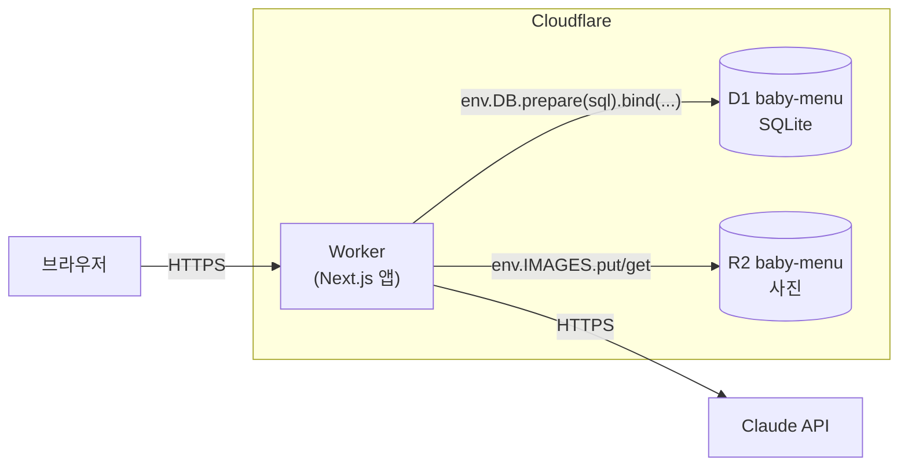
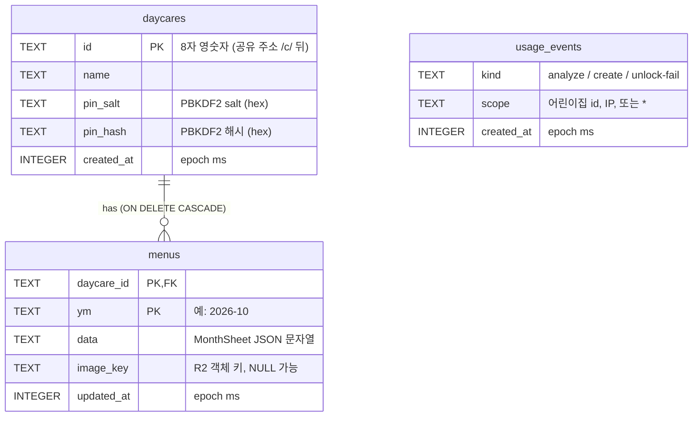
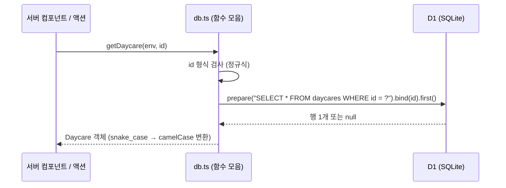
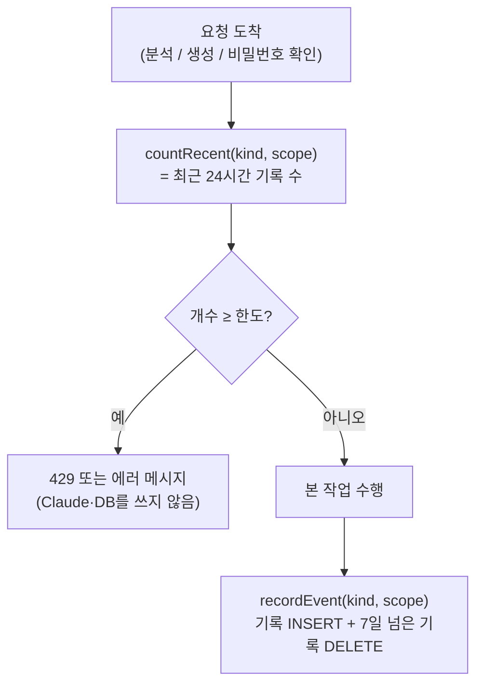

# 03. D1 — 서버리스 SQLite 데이터베이스

> **한 줄 요약**: D1은 Cloudflare가 호스팅하는 **SQLite**입니다. 이 앱은 어린이집, 월별 식단, 남용 방지 기록을 전부 D1 한 개(`baby-menu`)에 저장하고, 코드에서는 `env.DB`라는 바인딩으로 SQL을 보냅니다.

⏱ 예상 학습 시간 40분 · 선수 지식: SQL `SELECT`/`INSERT` 정도

---

## 1. 왜 필요한가

Workers는 요청이 끝나면 메모리가 사라지는 **상태 없는(stateless)** 환경입니다. 식단 데이터를 변수에 담아 두면 다음 요청에서는 없습니다. 그래서 어딘가에 영구 저장소가 필요하고, 이 앱은 그 역할을 D1에 맡겼습니다.

| 저장해야 하는 것 | 어디에 | 이유 |
|---|---|---|
| 어린이집 이름, 관리 비밀번호 해시 | D1 `daycares` | 작은 텍스트, 조회·조건 검색 필요 |
| 월별 식단(텍스트) | D1 `menus` | 날짜별 구조화 데이터, 수정·삭제 필요 |
| 하루 사용량 카운터 | D1 `usage_events` | "최근 24시간에 몇 번?"을 세는 집계 필요 |
| 원본 식단표 사진 | R2 ([04장](./04-r2-storage.md)) | 큰 바이너리 파일은 DB 대신 객체 저장소 |

> 💡 **Supabase(Postgres)가 아니라 D1을 쓴 이유**: Worker와 같은 Cloudflare 안에 있어 바인딩 한 줄로 연결되고, 비밀번호·접속 문자열이 필요 없습니다. 이 앱처럼 작은 데이터와 단순한 쿼리에는 충분합니다. 반대로 실시간 구독, 복잡한 권한 정책(RLS)이 필요하면 Supabase가 더 맞습니다.

---

## 2. 그림으로 보기

### 2-1. 앱에서 D1이 놓인 자리



### 2-2. 테이블 관계 (ER 다이어그램)



`usage_events`는 어느 테이블과도 외래키로 연결되어 있지 않습니다. `scope`가 어린이집 id일 수도, IP일 수도, `*`(전체)일 수도 있기 때문입니다.

### 2-3. 코드에서 SQL이 실행되는 길



---

## 3. 이 앱에서는 어디에

| 무엇 | 파일 |
|---|---|
| 스키마 | [`migrations/0001_init.sql`](../migrations/0001_init.sql) |
| 읽기/쓰기 함수 | [`src/lib/server/db.ts`](../src/lib/server/db.ts) |
| 사용량 제한 | [`src/lib/server/limits.ts`](../src/lib/server/limits.ts) |
| `env.DB` 꺼내기 | [`src/lib/server/env.ts`](../src/lib/server/env.ts) |
| 바인딩 선언 | [`wrangler.jsonc`](../wrangler.jsonc)의 `d1_databases` |
| 연습용 SQL | [`labs/data/`](./labs/data/) |

### 3-1. 바인딩: `env.DB`는 어디서 오나

`wrangler.jsonc`의 이 블록이 "코드의 `env.DB`는 D1 `baby-menu`다"라고 연결합니다.

```jsonc
"d1_databases": [
  {
    "binding": "DB",                  // 코드에서 env.DB 로 접근
    "database_name": "baby-menu",     // 콘솔에 보이는 이름
    "database_id": "<DATABASE_ID>",   // 콘솔/CLI가 알려주는 UUID (실제 값은 wrangler.jsonc 참고)
    "migrations_dir": "migrations"    // 마이그레이션 SQL 폴더
  }
]
```

`getEnv()`([`env.ts`](../src/lib/server/env.ts))가 OpenNext의 `getCloudflareContext()`로 이 바인딩 묶음을 가져옵니다. **로컬 개발에서는 같은 이름의 가짜(로컬 SQLite 파일) D1**이, **운영에서는 진짜 D1**이 들어옵니다. 코드는 어느 쪽인지 모릅니다.

### 3-2. 읽기: 준비된 질의 + `bind`

```ts
const row = await env.DB.prepare("SELECT * FROM daycares WHERE id = ?").bind(id).first<DaycareRow>();
```

- `?` 자리에 `bind`가 값을 **따로** 전달합니다. SQL 문장과 값이 섞이지 않으므로 SQL 인젝션이 일어나지 않습니다.
- `first()`는 첫 행(없으면 `null`), `all()`은 `{ results: [...] }`, `run()`은 쓰기용입니다.

> ⚠️ 이렇게 쓰면 안 됩니다. `id`에 `' OR '1'='1` 같은 값이 오면 문장 자체가 바뀝니다.
> ```ts
> env.DB.prepare(`SELECT * FROM daycares WHERE id = '${id}'`)   // ❌ 문자열 이어붙이기
> ```

[`getDaycare`](../src/lib/server/db.ts)는 여기에 방어를 한 겹 더합니다. SQL에 보내기 전에 `/^[a-z0-9]{4,16}$/`로 id 모양부터 검사합니다.

### 3-3. 검색: LIKE와 와일드카드 이스케이프

`searchDaycares`는 `LIKE`를 쓰는데, 사용자가 `%`나 `_`를 입력하면 그것이 와일드카드로 해석됩니다(SQL 인젝션은 아니지만 의도와 다른 결과). 그래서 `\`, `%`, `_` 앞에 `\`를 붙이고 `ESCAPE '\'`를 선언합니다.

### 3-4. 쓰기: UPSERT와 `COALESCE`

월별 식단 저장은 "있으면 갱신, 없으면 삽입"입니다. SQLite의 `INSERT ... ON CONFLICT DO UPDATE`(UPSERT)로 한 문장에 처리합니다.

```sql
INSERT INTO menus (daycare_id, ym, data, image_key, updated_at) VALUES (?, ?, ?, ?, ?)
ON CONFLICT (daycare_id, ym) DO UPDATE SET
  data       = excluded.data,
  image_key  = COALESCE(excluded.image_key, menus.image_key),
  updated_at = excluded.updated_at
```

| 표현 | 뜻 |
|---|---|
| `ON CONFLICT (daycare_id, ym)` | 기본키가 겹치면(이미 그 달이 있으면) |
| `excluded.data` | 방금 넣으려던 새 값 |
| `menus.image_key` | 이미 저장돼 있던 기존 값 |
| `COALESCE(a, b)` | a가 `NULL`이면 b, 아니면 a |

그래서 **수정 화면에서 텍스트만 고쳐 저장하면**(새 사진이 없어서 `image_key`가 `NULL`) 기존 원본 사진 링크가 지워지지 않습니다. 직접 눈으로 확인하는 실습이 [4장](#4-직접-해보기)에 있습니다.

### 3-5. JSON을 TEXT 한 칸에 담은 이유와 대가

`menus.data`는 한 달 전체(날짜별 간식·점심·알레르기 번호 등)를 JSON 문자열 하나로 담습니다.

| | JSON을 TEXT로 저장 (현재) | 날짜별 정규화 테이블 |
|---|---|---|
| 저장/조회 | 한 줄 쓰기, 한 줄 읽기 | 하루=한 행, JOIN 필요 |
| AI 결과와 모양 | 그대로 저장 | 변환 코드 필요 |
| "10월 13일의 점심만" 검색 | 앱에서 JSON 파싱 | SQL로 직접 |
| 스키마 변경 | 코드에서 옵션 필드 처리 | 마이그레이션 필요 |
| 데이터 검증 | 저장 전 앱(zod)에서 | DB 제약 조건으로 |

이 앱은 "한 달을 통째로 읽어서 화면에 뿌린다"가 거의 전부라서 TEXT 한 칸이 단순하고 빠릅니다.

⚠️ **주의할 점**
- 읽을 때 `JSON.parse(row.data) as MonthSheet`는 타입을 **믿는** 것일 뿐 검증하지 않습니다. 검증은 저장 시점(`saveMonth`의 `MonthSheetSchema.safeParse`)에서 합니다. 나중에 `MonthSheet`에 필드를 추가하면 **예전 행에는 그 필드가 없다**는 점을 코드가 견뎌야 합니다.
- 필요하면 SQLite 내장 `json_extract(data, '$.days[0].date')`로 SQL 안에서도 꺼낼 수 있습니다(실습 포함).

### 3-6. 인덱스와 사용량 제한(`usage_events`)

```sql
CREATE INDEX usage_events_lookup ON usage_events (kind, scope, created_at);
```

남용 방지는 "최근 24시간에 이 `kind`+`scope`로 기록이 몇 개인가"를 세서 한도와 비교합니다.



| kind | scope | 한도 (`LIMITS`) |
|---|---|---|
| `analyze` | 어린이집 id | 하루 10회 |
| `analyze` | `*` (전체) | 하루 60회 |
| `create` | 접속 IP | 하루 5회 |
| `unlock-fail` | 접속 IP | 하루 20회 (실패할 때만 기록) |

알아 둘 점:

- **"하루"는 달력의 하루가 아니라 최근 24시간(롤링)** 입니다. `created_at > Date.now() - 24시간`.
- 인덱스가 `(kind, scope, created_at)` 순서라서 `countRecent`의 조건과 딱 맞아 인덱스만 훑고 끝납니다(아래 실습에서 `EXPLAIN QUERY PLAN`으로 확인).
- 청소용 `DELETE ... WHERE created_at < ?`는 인덱스의 첫 열이 `kind`라서 전체 훑기(SCAN)가 됩니다. 테이블이 7일치만 남아 아주 작으므로 괜찮습니다. 데이터가 커지면 `created_at` 단독 인덱스를 고려합니다.
- `recordEvent`는 `INSERT`와 `DELETE`를 `env.DB.batch([...])`로 묶어 한 번에 보냅니다. D1의 `batch`는 순서대로 실행되며 하나라도 실패하면 전체가 취소됩니다.
- 확인(`countRecent`)과 기록(`recordEvent`) 사이는 원자적이지 않아서, 동시에 요청이 몰리면 한도를 한두 번 넘길 수 있습니다. 비용 상한 용도로는 허용 가능한 오차입니다.
- 분석 API는 Claude를 부르기 **전에** 기록합니다. 실패해도 횟수가 차감되지만, 그래야 실패를 반복해 비용을 쓰는 것을 막습니다.

### 3-7. 외래키와 `ON DELETE CASCADE`

`menus.daycare_id REFERENCES daycares(id) ON DELETE CASCADE`는 두 가지를 보장합니다.

1. 존재하지 않는 어린이집의 식단은 저장할 수 없습니다.
2. 어린이집 행을 지우면 그 식단 행도 함께 지워집니다.

D1은 외래키 검사가 켜져 있습니다(아래 실습으로 직접 확인).

---

## 4. 직접 해보기

> 이 장의 실습은 **모두 `--local`(내 컴퓨터의 연습용 DB)** 입니다. 운영 데이터는 건드리지 않습니다.
> 사전 준비: `menu/` 폴더에서 `npm install` 후 `npm run db:migrate:local`(이미 했다면 "No migrations to apply!"가 나옵니다).

### 실습 1 — 로컬 DB 구경하기

```bash
# 테이블/인덱스 목록 (d1_migrations 는 wrangler가 적용 이력을 적어 두는 테이블)
npx wrangler d1 execute baby-menu --local --command \
  "SELECT name, type FROM sqlite_master WHERE name NOT LIKE 'sqlite_%' ORDER BY type, name"

# 어떤 마이그레이션이 적용됐나
npx wrangler d1 migrations list baby-menu --local
```

로컬 데이터가 실제로 저장되는 곳은 `.wrangler/state/v3/d1/` 아래의 `.sqlite` 파일입니다(gitignore 대상). 지우고 `npm run db:migrate:local`을 다시 하면 로컬이 처음 상태로 돌아갑니다. 운영 DB와는 무관합니다.

### 실습 2 — UPSERT와 COALESCE 눈으로 보기

[`labs/data/d1-playground.sql`](./labs/data/d1-playground.sql)을 실행합니다. 연습용 테이블 `lab_scratch`를 만들고, 같은 달을 두 번 저장하고(두 번째는 사진 없이), 마지막에 지웁니다.

```bash
npx wrangler d1 execute baby-menu --local --file learn/labs/data/d1-playground.sql
```

출력에서 이 세 가지를 찾아보세요.

1. `image_key`가 두 번째 저장 후에도 `daycares/demo1234/...jpg`로 **남아 있다** (COALESCE)
2. `first_date`가 `2026-10-14`로 나온다 (`json_extract`)
3. `EXPLAIN QUERY PLAN`의 `detail`이 `SEARCH ... USING INDEX ...`이다 (인덱스 사용)

자세한 설명은 [`labs/data/d1-playground.md`](./labs/data/d1-playground.md)에 있습니다.

### 실습 3 — 외래키와 CASCADE

```bash
npx wrangler d1 execute baby-menu --local --file learn/labs/data/d1-foreign-key.sql        # child_rows_after: 0
npx wrangler d1 execute baby-menu --local --file learn/labs/data/d1-foreign-key-error.sql  # FOREIGN KEY constraint failed
```

두 번째 파일은 **일부러 실패**합니다. 에러가 난 뒤 연습 테이블이 남아 있지 않은 것도 확인해 보세요. `--file`은 한 덩어리로 실행되어, 중간에 실패하면 앞 문장까지 되돌려집니다.

### 실습 4 — 마이그레이션 흐름 이해하기

새 컬럼이 필요하다고 가정해 봅시다(예: 어린이집 메모). **`0001_init.sql`을 고치면 안 됩니다.** 이미 적용된 파일이기 때문입니다.

```bash
# 1) 번호가 붙은 새 파일 생성 (migrations/0002_*.sql)
npx wrangler d1 migrations create baby-menu add_daycare_memo
# 2) 파일을 열어 SQL 작성: ALTER TABLE daycares ADD COLUMN memo TEXT;
# 3) 로컬에서 먼저 적용하고 앱을 돌려 확인
npm run db:migrate:local
# 4) 문제 없으면 운영에 적용 (아래 ⚠️ 참고)
```

> 이 실습은 읽고 따라 해 보되, 만든 `0002_*.sql` 파일은 커밋하기 전에 지우세요(연습이므로). 로컬 DB에는 적용 이력이 남으므로, 정말 해 봤다면 위의 "로컬 DB 지우기"로 초기화하면 됩니다.

### 운영 DB를 읽기 전용으로 점검하기 ⚠️

아래는 **운영(`--remote`)** 에 닿는 명령입니다. 읽기만 하는 것만 모았습니다. 결과에 실제 어린이집 정보가 있으니 화면 공유/캡처에 주의하세요.

```bash
# ⚠️ 운영: 행 개수만 세기 (읽기)
npx wrangler d1 execute baby-menu --remote --command \
  "SELECT (SELECT COUNT(*) FROM daycares) AS daycares, (SELECT COUNT(*) FROM menus) AS menus"

# ⚠️ 운영: 아직 적용 안 된 마이그레이션이 있나 (읽기)
npx wrangler d1 migrations list baby-menu --remote
```

> ⚠️ 절대 습관으로 만들지 말 것: `--remote`와 `UPDATE`/`DELETE`/`DROP`의 조합. 운영 데이터를 바꿀 일이 있으면 먼저 백업(아래)하고, `WHERE` 조건을 `SELECT`로 먼저 확인한 뒤 실행합니다.

---

## 5. 흔한 실수 / 유지보수 체크리스트

### 흔한 실수

| 증상 | 원인 | 해결 |
|---|---|---|
| 로컬에서는 되는데 운영에서 `no such table` | 운영에 마이그레이션 미적용 | `npm run db:migrate:remote` |
| 로컬에서 `no such table` | 로컬 DB를 처음 만들었거나 지움 | `npm run db:migrate:local` |
| 명령을 쳤는데 운영 데이터가 안 바뀜(또는 반대) | `--local`/`--remote` 혼동 | 출력 첫머리의 `Resource location: local/remote` 확인 |
| 마이그레이션이 이미 적용돼서 수정이 반영 안 됨 | 적용된 파일을 직접 수정 | 새 번호 파일(`0002_...`)로 변경 |
| 필드를 추가했더니 옛 달이 깨짐 | `data` JSON에 새 필드가 없음 | 필드를 옵션으로 처리하거나 `UPDATE`로 채움 |
| 컬럼 타입이나 제약 조건을 바꾸고 싶은데 `ALTER TABLE`로 안 됨 | SQLite의 `ALTER TABLE` 기능 제한 | 새 테이블 생성 → 데이터 복사 → 교체 (마이그레이션 1개로) |

### 운영 점검 명령 모음

| 하고 싶은 일 | 명령 | 비고 |
|---|---|---|
| DB 크기·상태 | `npx wrangler d1 info baby-menu` | 읽기 |
| 백업(SQL 덤프) | `npx wrangler d1 export baby-menu --remote --output <파일>.sql` | ⚠️ `pin_hash`가 들어 있음. **git 밖**에 보관 |
| 스키마만 덤프 | `... d1 export ... --no-data` | 데이터 제외 옵션 |
| 시점 복구 정보 | `npx wrangler d1 time-travel info baby-menu` | 읽기. 복구(`restore`)는 ⚠️ 되돌리기 어려움 |
| 느린 쿼리 확인 | `npx wrangler d1 insights baby-menu` | 실험적 기능 |

- **Time Travel**: D1이 자동으로 보관하는 과거 시점으로 DB를 되돌리는 기능입니다. 보관 기간 등 정확한 조건은 [공식 문서](https://developers.cloudflare.com/d1/reference/time-travel/)에서 확인하세요. `migrations apply`는 적용이 끝난 뒤 백업이 잡힌다고 안내합니다(`npx wrangler d1 migrations apply --help` 참고).
- 콘솔에서는 Cloudflare 대시보드의 **Storage & databases → D1**에서 `baby-menu`를 열어 테이블과 쿼리를 볼 수 있습니다. 메뉴 이름은 개편될 수 있으니 안 보이면 대시보드 검색을 쓰세요.

### 배포 전 체크리스트

- [ ] 스키마를 바꿨다면 새 번호의 마이그레이션 파일이 있다
- [ ] 로컬에서 `npm run db:migrate:local` 후 앱을 돌려 봤다
- [ ] **운영 마이그레이션을 코드 배포보다 먼저** 적용했다 (새 코드가 새 컬럼을 읽는데 컬럼이 없으면 에러)
- [ ] 새 SQL은 모두 `prepare(...).bind(...)`를 쓴다 (문자열 이어붙이기 금지)

---

## 6. 퀴즈

**Q1.** `image_key`가 `NULL`인 채로 같은 달을 다시 저장해도 기존 원본 사진 링크가 살아 있는 이유는?

<details>
<summary>정답 보기</summary>

UPSERT의 `image_key = COALESCE(excluded.image_key, menus.image_key)` 때문입니다. 새 값(`excluded`)이 `NULL`이면 기존 값(`menus.image_key`)을 그대로 씁니다.

</details>

**Q2.** 개발 PC에서 `npx wrangler d1 execute baby-menu --command "DELETE FROM menus"`처럼 `--local`/`--remote`를 **둘 다 빼고** 실행하면 어디에 적용될까요? 그리고 항상 어떤 습관을 들여야 할까요?

<details>
<summary>정답 보기</summary>

이 저장소의 wrangler 4.110에서는 플래그가 없으면 **로컬**에 실행되고 "Use --remote if you want to access the remote instance"라고 안내합니다(직접 확인한 동작이며 버전에 따라 다를 수 있습니다). 어느 쪽이든 **항상 `--local` 또는 `--remote`를 명시**하고, 실행 직후 출력의 `Resource location:`을 확인하는 습관이 안전합니다.

</details>

**Q3.** `usage_events`에서 "하루 10회" 제한은 매일 자정에 초기화될까요?

<details>
<summary>정답 보기</summary>

아니요. `created_at > 지금 - 24시간`으로 세는 **롤링 24시간**입니다. 어제 오후 3시에 쓴 횟수는 오늘 오후 3시가 지나야 빠집니다. 또 `recordEvent`가 7일 지난 기록은 지웁니다.

</details>

---

## 더 공부하기

- [Cloudflare D1 문서](https://developers.cloudflare.com/d1/) · [Worker 바인딩 API](https://developers.cloudflare.com/d1/worker-api/) · [마이그레이션](https://developers.cloudflare.com/d1/reference/migrations/) · [Time Travel](https://developers.cloudflare.com/d1/reference/time-travel/) · [한도](https://developers.cloudflare.com/d1/platform/limits/) · [요금](https://developers.cloudflare.com/d1/platform/pricing/)
- SQLite: [UPSERT](https://www.sqlite.org/lang_upsert.html) · [EXPLAIN QUERY PLAN](https://www.sqlite.org/eqp.html) · [JSON 함수](https://www.sqlite.org/json1.html)

다음 장: [04. R2 — 사진 저장소](./04-r2-storage.md)
