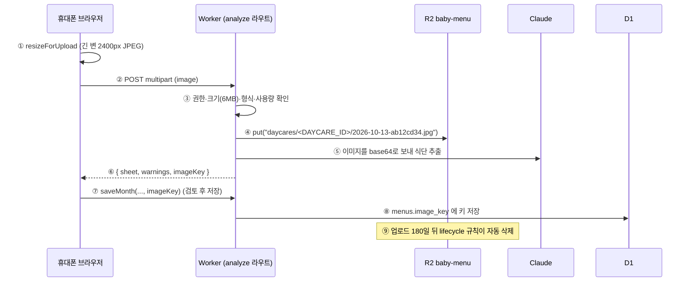
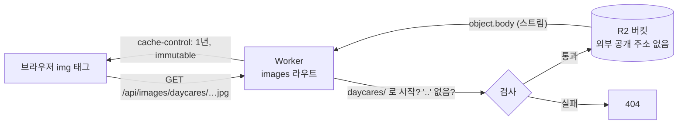
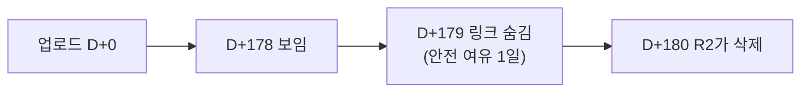

# 04. R2 — 사진 저장소와 자동 삭제

> **한 줄 요약**: R2는 Cloudflare의 **객체 저장소**(S3와 비슷한 "파일 창고")입니다. 이 앱은 월간 식단표 원본 사진을 R2 버킷 `baby-menu`에 넣고, **180일 뒤 Cloudflare가 알아서 지우도록** 규칙을 걸어 두었습니다.

⏱ 예상 학습 시간 35분 · 선수 지식: [03장 D1](./03-d1-sql.md)

---

## 1. 왜 필요한가

### 사진을 D1에 넣지 않는 이유

| | D1 (SQL) | R2 (객체 저장소) |
|---|---|---|
| 잘하는 것 | 작은 구조화 데이터, 조건 검색, 집계 | 큰 파일(사진, 영상, 백업) 통째로 저장 |
| 사진을 넣으면 | 행이 커지고 한도·성능에 부담 | 정상적인 사용법 |
| 만료 삭제 | 직접 코드로 | **lifecycle 규칙**으로 자동 |
| 이 앱에서 | 어린이집·식단 텍스트·**사진의 주소(키)** | **사진 본체** |

즉 D1의 `menus.image_key`에는 사진이 아니라 **사진의 이름표(키)** 만 적혀 있고, 실제 파일은 R2에 있습니다.

### 6개월 지난 사진을 지우는 이유

사진은 시간이 갈수록 쌓이고 저장 용량에 비례해 요금이 늘어납니다. 식단 **텍스트는 D1에 계속 남기고**, 확인용 원본 사진만 180일 뒤 지우면 "대조는 충분히 가능하고 저장소는 무한정 늘지 않는" 균형이 됩니다.

---

## 2. 그림으로 보기

### 2-1. 사진 한 장의 일생



### 2-2. 사진은 비공개 버킷 → Worker를 거쳐서만 나간다



버킷에는 인터넷에 직접 열린 주소가 없습니다. 오직 Worker의 `IMAGES` 바인딩으로만 읽고 쓸 수 있습니다.

### 2-3. 키(이름표)의 구조

```
daycares / <DAYCARE_ID> / 2026-10-13 - ab12cd34 . jpg
└───┬───┘   └────┬─────┘   └───┬────┘   └──┬───┘  └┬┘
 lifecycle    어린이집      업로드한 날   랜덤 8자   확장자
 규칙의 대상   id (KST)   (만료 판단용)   (중복 방지)
```

R2에는 진짜 "폴더"가 없고, `/`가 들어간 긴 이름(키)일 뿐입니다. 그래도 접두어(`daycares/`)로 규칙을 걸고 목록을 나눌 수 있습니다.

---

## 3. 이 앱에서는 어디에

| 무엇 | 파일 |
|---|---|
| 업로드·키 생성 | [`src/app/api/daycares/[id]/analyze/route.ts`](../src/app/api/daycares/%5Bid%5D/analyze/route.ts) |
| 사진 내보내기 | [`src/app/api/images/[...key]/route.ts`](../src/app/api/images/%5B...key%5D/route.ts) |
| 만료 판단 | [`src/lib/dates.ts`](../src/lib/dates.ts)의 `photoStillStored` |
| 만료된 키 숨기기 | [`src/lib/server/db.ts`](../src/lib/server/db.ts)의 `toStoredMonth` |
| 브라우저에서 줄이기 | [`src/lib/resize-image.ts`](../src/lib/resize-image.ts) |
| 바인딩 선언 | [`wrangler.jsonc`](../wrangler.jsonc)의 `r2_buckets` |
| 연습 | [`labs/data/r2-key-lab.mjs`](./labs/data/r2-key-lab.mjs) |

### 3-1. 바인딩

```jsonc
"r2_buckets": [
  { "binding": "IMAGES", "bucket_name": "baby-menu" }   // 코드에서 env.IMAGES
]
```

코드에서 쓰는 API는 단 두 개입니다.

```ts
await env.IMAGES.put(imageKey, bytes, { httpMetadata: { contentType: file.type } }); // 저장
const object = await env.IMAGES.get(objectKey);   // 없으면 null, 있으면 object.body (ReadableStream)
```

### 3-2. 키를 만드는 코드와 "날짜를 키에 넣은 이유"

```ts
const imageKey = `daycares/${daycare.id}/${todayKST()}-${crypto.randomUUID().slice(0, 8)}.${ext}`;
```

- **어린이집 id**가 들어 있어서 `saveMonth`가 "이 어린이집 소유의 사진인지"(`startsWith("daycares/<id>/")`)를 검사할 수 있습니다. 다른 어린이집 사진을 내 식단에 붙이는 것을 막습니다.
- **랜덤 8자**로 같은 날 여러 번 올려도 이름이 겹치지 않습니다. 또 주소를 쉽게 추측할 수 없습니다.
- **업로드한 날짜(한국 시간)** 가 핵심입니다. 이유는 아래와 같습니다.

R2는 객체를 지울 뿐, "지웠다"고 D1에 알려 주지 않습니다. 그러면 D1에는 이미 사라진 사진의 키가 남아 **깨진 이미지 링크**가 보입니다. 그래서 앱은 DB를 조회할 때마다 **키에 적힌 날짜만 보고** 만료 여부를 계산합니다.

```ts
// src/lib/dates.ts
export function photoStillStored(imageKey: string | null, today: string): boolean {
  if (!imageKey) return false;
  const uploaded = /\/(\d{4}-\d{2}-\d{2})-[^/]+$/.exec(imageKey)?.[1];   // 키에서 날짜 뽑기
  if (!uploaded || !isIsoDate(uploaded)) return true;                      // 날짜 없는 옛 키는 "있다"고 가정
  return addDays(uploaded, PHOTO_RETENTION_DAYS - 1) > today;              // 179일째부터 숨김
}
```



> 💡 왜 하루 일찍 숨길까요? lifecycle 삭제가 정확히 그 시각에 일어난다는 보장이 없으므로(시차·지연), 링크를 하루 먼저 숨겨서 "눌렀더니 404"를 피합니다. 삭제 시점의 정확한 보장은 [공식 문서](https://developers.cloudflare.com/r2/buckets/object-lifecycles/)에서 확인하세요.

### 3-3. images 라우트: 비공개 버킷을 안전하게 여는 법

```ts
const objectKey = key.map(decodeURIComponent).join("/");
if (!objectKey.startsWith("daycares/") || objectKey.includes("..")) return new Response("Not found", { status: 404 });
const object = await env.IMAGES.get(objectKey);
```

- 경로 조각을 **디코드한 뒤에** 검사합니다. (`%2e%2e` 같은 우회로 `..`를 숨기는 시도를 막으려는 순서입니다.)
- `daycares/` 로 시작하는 키만 내보냅니다. 버킷에 다른 것이 있어도 이 라우트로는 안 나갑니다.
- 응답 헤더 `cache-control: public, max-age=31536000, immutable`: 키마다 파일이 영원히 같으므로(랜덤 값 포함) 브라우저가 1년 캐시해도 안전합니다. 같은 사진을 다시 볼 때 네트워크를 거의 안 씁니다.

> ⚠️ **누구나 볼 수 있나?** 이 라우트는 로그인 검사를 하지 않습니다. 주소(`/api/images/daycares/<id>/날짜-랜덤8자.jpg`)를 아는 사람은 누구나 볼 수 있습니다. 식단 보기가 공유 주소로 누구나 가능한 앱이므로 의도한 설계이고, 랜덤 값이 사실상 비밀번호 역할을 합니다. 개인정보가 담긴 사진을 다루게 된다면 이 라우트에 권한 검사를 넣어야 합니다.

### 3-4. 삭제는 두 단계가 다르다

| 동작 | D1 | R2 |
|---|---|---|
| 월 식단 삭제 (`removeMonth`) | 행 삭제 | **사진은 그대로 남음** → 180일 뒤 규칙이 삭제 |
| 올리고 저장 안 하고 닫음 | 변화 없음 | 사진은 올라가 있음 → 180일 뒤 규칙이 삭제 |
| 같은 달 다시 올림 | 새 키로 교체 | 이전 사진은 남음 → 180일 뒤 삭제 |

그래서 lifecycle 규칙이 **저장소 청소부이자 고아 파일 정리**를 겸합니다. 즉시 지워야 하는 사정(개인정보 삭제 요청 등)이 생기면 `removeMonth`에서 `env.IMAGES.delete(key)`를 호출하도록 코드를 늘려야 합니다.

### 3-5. lifecycle(생애주기) 규칙

운영 버킷에 걸려 있는 규칙(읽기 전용 명령으로 확인한 결과입니다).

| 규칙 이름 | 대상 접두어 | 동작 |
|---|---|---|
| `expire-menu-photos-180d` | `daycares/` | 생성 후 **180일 뒤 객체 삭제**, 미완성 멀티파트 업로드는 1일 뒤 정리 |
| `Default Multipart Abort Rule` | 전체 | 미완성 멀티파트 업로드 7일 뒤 정리 (R2 기본 규칙) |

> 두 곳의 값은 **반드시 같아야** 합니다. 코드의 `PHOTO_RETENTION_DAYS = 180`(`dates.ts`)과 R2의 `--expire-days 180`. 한쪽만 바꾸면 "링크는 보이는데 사진이 없는" 또는 "사진이 있는데 링크를 숨기는" 어긋남이 생깁니다.

### 3-6. 브라우저에서 먼저 줄이는 이유 (2400px JPEG)

```ts
const bitmap = await createImageBitmap(file, { imageOrientation: "from-image" });
const scale = Math.min(1, maxEdge / Math.max(bitmap.width, bitmap.height));   // 2400보다 크면만 줄임
canvas.toBlob(resolve, "image/jpeg", 0.86);
```

| 선택 | 이유 |
|---|---|
| 긴 변 **2400px** | 식단표의 작은 글씨와 알레르기 번호를 AI가 읽을 만큼은 크게, 업로드·AI 처리 비용은 줄이게 |
| **JPEG**, 품질 0.86 | 사진은 PNG보다 훨씬 작음. 글씨 가장자리는 뭉개지지 않는 선 |
| `imageOrientation: "from-image"` | 휴대폰 사진의 EXIF 회전 정보를 반영해 **눕거나 뒤집히지 않게** |
| `Math.min(1, …)` | 원본이 작으면 키우지 않음 |
| 서버의 6MB 상한 | 줄이기에 실패한 비정상 요청도 서버가 한 번 더 막음 |

휴대폰 원본(수 MB)을 그대로 보내면 업로드가 느리고, AI에 보내는 이미지가 커질수록 처리 시간과 비용이 늘며, AI 쪽 이미지 크기 한도에도 걸릴 수 있습니다([Claude 비전 문서](https://platform.claude.com/docs/en/build-with-claude/vision) 참고).

### 3-7. 비용을 이해하는 틀 (숫자는 공식 요금표에서)

R2 요금은 크게 세 가지로 나뉩니다. **현재 단가는 반드시 [R2 요금 페이지](https://developers.cloudflare.com/r2/pricing/)에서 확인하세요.**

| 항목 | 설명 | 이 앱에서 |
|---|---|---|
| 저장 용량 | GB × 보관 기간 | 한 달 사진 1장 ≈ 1~2MB × 어린이집 수 × 최대 6개월. 규칙이 없으면 계속 증가 |
| 작업(operation) | 쓰기/목록은 Class A, 읽기는 Class B | 업로드 1회 = 쓰기 1회, 사진 보기 = 읽기 (브라우저 캐시로 줄어듦) |
| 인터넷 전송(egress) | 데이터가 밖으로 나갈 때 | R2는 egress 요금이 없는 것이 특징으로 안내됨 (요금 페이지 확인) |

---

## 4. 직접 해보기

### 실습 1 — 키 만들기·만료 계산 (설치 불필요)

```bash
# menu/ 폴더에서
node learn/labs/data/r2-key-lab.mjs
```

키가 어떻게 만들어지는지, 179일째에 링크가 숨겨지는지, 위험한 경로가 거부되는지를 출력으로 확인합니다. 파일 끝의 **도전 과제 3개**를 직접 고쳐 보세요(예: 보관 기간을 90으로 바꾸면 어디서 실패하는지).

### 실습 2 — 로컬 R2에 파일 넣고 꺼내기 (`--local`)

`next dev`/`wrangler dev`가 쓰는 **내 컴퓨터 안의 가짜 R2**에서 연습합니다(저장 위치: `.wrangler/state/v3/r2/`). 운영 버킷과 무관합니다.

```bash
echo "hello r2 lab" > /tmp/lab.txt
npx wrangler r2 object put baby-menu/daycares/labdemo/2026-10-14-lab00001.txt \
  --local --file /tmp/lab.txt --content-type text/plain          # 넣기
npx wrangler r2 object get baby-menu/daycares/labdemo/2026-10-14-lab00001.txt \
  --local --file /tmp/lab-back.txt && cat /tmp/lab-back.txt       # 꺼내기
npx wrangler r2 object delete baby-menu/daycares/labdemo/2026-10-14-lab00001.txt --local   # 지우기
rm -f /tmp/lab.txt /tmp/lab-back.txt
```

> 이 wrangler 버전(4.110)에는 `r2 object list`가 없어서 객체 **목록**은 대시보드에서 봅니다. `delete` 뒤에 `get`을 하면 `The specified key does not exist.` 에러가 나는 것이 정상입니다.

### 실습 3 — 앱으로 확인하기 (로컬)

1. `npm run dev` → 어린이집을 만들고 사진을 올려 분석합니다 (로컬 R2에 저장됨).
2. 브라우저 개발자도구 → Network에서 `analyze` 응답의 `imageKey` 를 복사합니다.
3. `http://localhost:3000/api/images/<imageKey>` 를 열면 사진이 보입니다.
4. 주소를 `…/api/images/daycares/../x` 처럼 바꿔 보면 404가 나옵니다.

### 운영 버킷 읽기 전용 점검 ⚠️

```bash
# ⚠️ 운영: lifecycle 규칙 목록 (읽기)
npx wrangler r2 bucket lifecycle list baby-menu
```

기대하는 출력은 3-5절의 표와 같은 두 규칙입니다. `expire-menu-photos-180d`가 `Enabled: Yes`이고 접두어가 `daycares/`인지 확인하세요.

<details>
<summary>⚠️ (참고용) 규칙을 만드는 명령 — 이미 만들어져 있으므로 실행하지 마세요</summary>

```bash
# 운영 버킷을 변경하는 명령입니다. 규칙을 바꿀 때만, 코드의 PHOTO_RETENTION_DAYS 도 함께 바꾸고 실행하세요.
npx wrangler r2 bucket lifecycle add baby-menu expire-menu-photos-180d daycares/ \
  --expire-days 180 --abort-multipart-days 1
```

옵션은 `npx wrangler r2 bucket lifecycle add --help`로 확인한 것입니다(`--expire-days`, `--expire-date`, `--ia-transition-days`, `--abort-multipart-days` 등).
대시보드에서는 R2 → `baby-menu` 버킷 → Settings의 Object lifecycle rules 근처에서 볼 수 있지만, 화면 구성은 바뀔 수 있으니 안 보이면 문서를 참고하세요.

</details>

---

## 5. 흔한 실수 / 유지보수 체크리스트

| 증상 | 원인 | 해결 |
|---|---|---|
| 원본 보기 링크가 갑자기 사라짐 | 업로드 179일 경과(정상) | 필요하면 사진을 다시 올림. 보관 기간은 `PHOTO_RETENTION_DAYS` + lifecycle 동시 변경 |
| 원본 보기를 누르면 404 | 코드와 규칙의 일수 불일치, 또는 로컬 R2에 없는 키 | 3-5절 확인, `r2-key-lab.mjs`로 계산 검증 |
| 사진이 눕거나 뒤집혀 올라감 | `imageOrientation: "from-image"` 제거 | 해당 옵션 유지 |
| 업로드가 413 | 6MB 초과 (리사이즈 실패 시) | 클라이언트 리사이즈 경로 확인 |
| 로컬에서 올린 사진이 운영에서 안 보임 | 로컬 R2와 운영 R2는 별개 | 정상. 운영에서 다시 올림 |
| `r2 object get`이 운영에서 동작 | `--remote`를 쓴 경우 | 연습은 `--local`만 |

**정기 점검 (분기별 1회 정도)**

- [ ] `npx wrangler r2 bucket lifecycle list baby-menu` 로 규칙이 살아 있는지 (⚠️ 운영, 읽기)
- [ ] 대시보드의 R2 용량 그래프가 계속 증가하지 않는지 (규칙이 일하고 있다는 증거)
- [ ] [R2 요금 페이지](https://developers.cloudflare.com/r2/pricing/)의 무료 구간과 현재 사용량 비교

---

## 6. 퀴즈

**Q1.** 월 식단을 삭제(`removeMonth`)하면 R2의 사진도 바로 사라질까요?

<details>
<summary>정답 보기</summary>

아니요. `removeMonth`는 D1 행만 지웁니다. 사진은 R2에 남아 있다가 업로드 180일 뒤 lifecycle 규칙이 지웁니다. 즉시 지우려면 코드에 `env.IMAGES.delete(키)`를 추가해야 합니다.

</details>

**Q2.** 키에 업로드 날짜를 넣은 가장 큰 이유는?

<details>
<summary>정답 보기</summary>

R2가 객체를 지워도 D1은 모르기 때문에, DB에 남은 키만 보고도 "이제 사진이 없을 것"이라고 계산해 깨진 링크를 숨기기 위해서입니다(`photoStillStored`). 키 하나에 (어린이집 소유권, 만료 판단, 중복 방지)가 모두 들어 있습니다.

</details>

**Q3.** 보관 기간을 180일에서 365일로 늘리고 싶습니다. 어디를 바꿔야 하나요?

<details>
<summary>정답 보기</summary>

두 곳을 함께 바꿉니다. ① 코드의 `PHOTO_RETENTION_DAYS`(`src/lib/dates.ts`, 테스트·`r2-key-lab.mjs`의 기대값 포함) ② R2 lifecycle 규칙을 새 일수로 교체(⚠️ 운영 변경: 기존 규칙을 제거/교체하고 `--expire-days 365`로 추가). 이미 180일이 지나 삭제된 사진은 되살릴 수 없습니다. 순서는 **규칙을 먼저 늘리고 → 코드 배포** 가 안전합니다.

</details>

---

## 더 공부하기

- [R2 소개](https://developers.cloudflare.com/r2/) · [Workers API](https://developers.cloudflare.com/r2/api/workers/workers-api-reference/) · [Object lifecycles](https://developers.cloudflare.com/r2/buckets/object-lifecycles/) · [요금](https://developers.cloudflare.com/r2/pricing/)
- 이 앱이 사진을 AI에 보내는 부분은 Claude 구조화 출력 장에서 다룹니다 ([커리큘럼](./README.md) 참고).

이전 장: [03. D1](./03-d1-sql.md) · 다음 장: [05. Next.js App Router](./05-nextjs-app-router.md)
