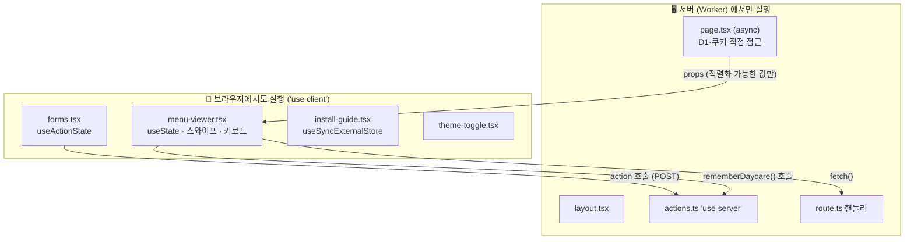
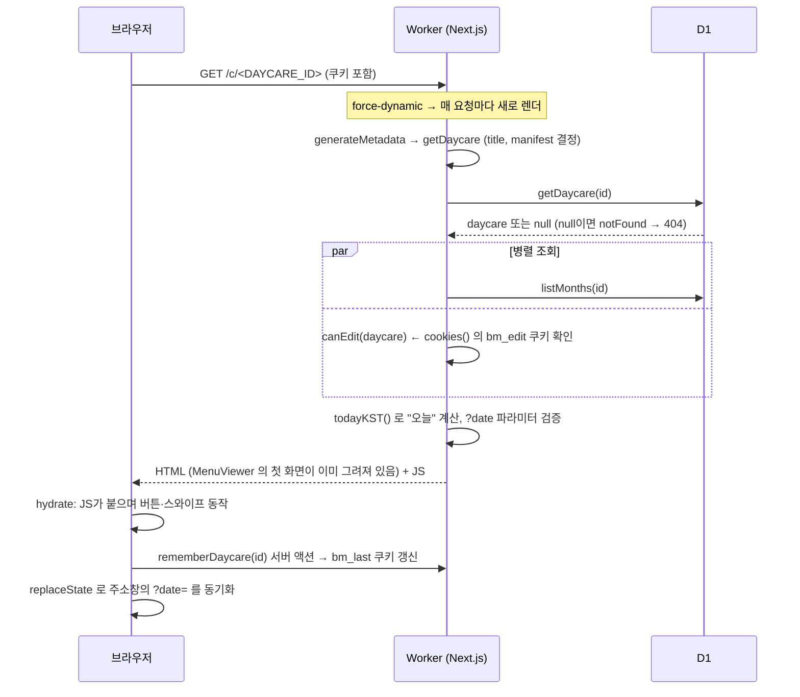
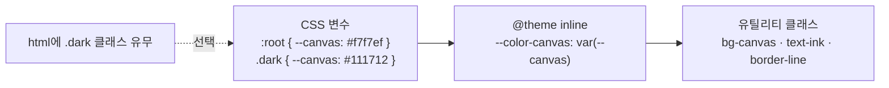

# 05. Next.js App Router — 이 앱의 화면과 서버가 만나는 곳

> **한 줄 요약**: Next.js App Router에서는 **폴더 구조가 곧 주소(URL)** 이고, 같은 프로젝트 안에서 **서버에서만 도는 코드(서버 컴포넌트·서버 액션·라우트 핸들러)** 와 **브라우저에서 도는 코드(클라이언트 컴포넌트)** 를 파일 단위로 나눠 씁니다. 이 앱의 DB 조회, 쿠키, 사진 업로드는 모두 서버 쪽에서 일어납니다.

⏱ 예상 학습 시간 60분 · 선수 지식: React 기본(컴포넌트, props, state)

> 📌 이 저장소는 **Next.js 16.2 / React 19**입니다. AI가 학습한 옛 버전 지식과 다른 점이 있으니, 애매하면 `node_modules/next/dist/docs/`(설치된 버전의 공식 문서 사본)를 먼저 확인하세요.

---

## 1. 왜 필요한가

Next.js 없이 같은 앱을 만들려면 "화면(React) + API 서버(Express 등) + 라우팅 + 빌드 설정"을 따로 이어 붙여야 합니다. App Router는 이 셋을 한 프로젝트에 묶고, **어떤 코드가 어디서 실행되는지**를 파일 이름과 `"use client"`/`"use server"` 한 줄로 구분합니다.

| 하고 싶은 일 | App Router의 도구 | 이 앱의 예 |
|---|---|---|
| 주소마다 화면 | `page.tsx` 파일 | `/c/<DAYCARE_ID>` 식단 화면 |
| DB를 읽어서 화면 그리기 | **서버 컴포넌트** (`async` 함수) | `getDaycare` + `listMonths` |
| 클릭·스와이프 같은 상호작용 | **클라이언트 컴포넌트** (`"use client"`) | `menu-viewer.tsx` |
| 폼 제출·저장 | **서버 액션** (`"use server"`) | `createDaycare`, `saveMonth` |
| JSON·파일·스트림을 돌려주는 주소 | **라우트 핸들러** (`route.ts`) | 분석 API, 사진, manifest |
| `<title>` 등 | **metadata API** | `generateMetadata` |

---

## 2. 그림으로 보기

### 2-1. 폴더 = 주소

```
src/app/
├─ layout.tsx                      ← 모든 화면을 감싸는 틀 (<html>, <body>, 테마 스크립트)
├─ globals.css                     ← Tailwind + 색상 변수
├─ page.tsx                        ← /                  (랜딩, 마지막 어린이집으로 redirect)
├─ actions.ts                      ← 서버 액션 모음 ("use server")
├─ manifest.webmanifest/route.ts   ← /manifest.webmanifest        (GET)
├─ c/[id]/
│  ├─ page.tsx                     ← /c/<DAYCARE_ID>               식단 보기
│  ├─ manifest.webmanifest/route.ts← /c/<DAYCARE_ID>/manifest.webmanifest
│  └─ manage/page.tsx              ← /c/<DAYCARE_ID>/manage        비밀번호 → 업로드/수정
└─ api/
   ├─ daycares/[id]/analyze/route.ts  ← POST /api/daycares/<ID>/analyze   사진 업로드+AI 분석
   └─ images/[...key]/route.ts        ← GET  /api/images/daycares/<ID>/<파일>   사진 내보내기
```

- `[id]`는 **동적 구간**: 주소의 그 자리 값이 `params.id`로 들어옵니다.
- `[...key]`는 **캐치올**: `a/b/c`처럼 여러 조각이 `string[]`로 들어옵니다 (사진 키에 `/`가 있어서 사용).

### 2-2. 서버 코드와 브라우저 코드의 경계



핵심 규칙 세 가지:

1. 파일 맨 위에 `"use client"`가 **없으면** 서버 컴포넌트입니다. (기본값)
2. 서버 컴포넌트가 클라이언트 컴포넌트에 넘기는 **props는 JSON처럼 직렬화 가능한 값**이어야 합니다(함수·클래스 인스턴스 불가). 그래서 `page.tsx`는 `daycare` 전체가 아니라 `{ id, name }`만 넘깁니다. **`pinHash` 같은 민감 값이 브라우저로 새지 않게 하는 효과**도 있습니다.
3. 클라이언트 컴포넌트에서 DB 같은 서버 전용 코드를 import 하면 안 됩니다.

### 2-3. 요청 → 화면: `/c/<DAYCARE_ID>` 한 번의 여행



hydrate 이후의 두 일(`rememberDaycare`로 쿠키 갱신, `replaceState`로 주소 동기화)은 화면이 이미 보인 **뒤에** 일어납니다. 그래서 사용자는 서버 응답이 오자마자 오늘 식단을 봅니다 ("클릭 없이 오늘 식단"의 기술적 근거).

### 2-4. 폼 제출 → 서버 액션 → 리다이렉트

```mermaid
sequenceDiagram
  participant U as UnlockForm (client)
  participant S as unlockDaycare (server action)
  participant D as D1
  U->>S: <form action={action}> 제출 (POST, FormData)
  S->>D: getDaycare / countRecent(unlock-fail, ip)
  alt 비밀번호 틀림
    S-->>U: { error: "비밀번호가 맞지 않아요." } (state 로 돌아옴)
  else 맞음
    S->>S: cookies().set(bm_edit_<id>, 토큰)
    S-->>U: redirect(/c/<id>/manage)
  end
```



---

## 3. 이 앱에서는 어디에

### 3-1. 서버 컴포넌트가 곧 "데이터 가져오기"

[`src/app/c/[id]/page.tsx`](../src/app/c/%5Bid%5D/page.tsx)는 `async` 함수이고 **그 안에서 바로 D1을 부릅니다.** 별도의 API 호출이나 `useEffect` 로딩 스피너가 없습니다.

```tsx
export default async function DaycarePage({ params, searchParams }: Props) {
  const [{ id }, sp] = await Promise.all([params, searchParams]);   // ← Next 16: 둘 다 Promise
  const env = await getEnv();
  const daycare = await getDaycare(env, id);
  if (!daycare) notFound();                                        // 404 화면
  const [months, editable] = await Promise.all([listMonths(env, daycare.id), canEdit(daycare)]);
  ...
  return <MenuViewer key={`${daycare.id}-${date}`} daycare={{ id: daycare.id, name: daycare.name }} ... />;
}
```

> 📌 **Next 15+ 에서 `params`/`searchParams`는 Promise** 입니다(`await` 필수). `cookies()`, `headers()`도 비동기입니다. 옛 예제를 그대로 복사하면 에러가 납니다.

`Promise.all`로 서로 의존하지 않는 조회를 동시에 시작해 대기 시간을 줄입니다.

### 3-2. `export const dynamic = "force-dynamic"`

```tsx
export const dynamic = "force-dynamic";
```

이 한 줄이 "이 페이지는 **요청마다 새로 렌더**하라"는 뜻입니다. 이 앱에서는 필수입니다.

- 화면 내용이 **"오늘 날짜"** 에 따라 달라집니다. 빌드 때 미리 만들어 두면 어제 식단이 나옵니다.
- 루트(`/`)는 **쿠키(`bm_last`)** 를 읽어 `redirect` 합니다. 쿠키는 사람마다 다릅니다.

> Next 16의 새 캐싱 모델(Cache Components)이 아니라 **이전 모델의 라우트 세그먼트 설정**입니다. 이 앱은 해당 기능을 켜지 않았으므로 정상 동작합니다. 자세히는 [공식 가이드](https://nextjs.org/docs/app/guides/caching-without-cache-components)와 `node_modules/next/dist/docs/01-app/02-guides/caching-without-cache-components.md`.

### 3-3. 쿠키와 redirect — 0클릭 재방문의 핵심

[`src/app/page.tsx`](../src/app/page.tsx)의 일부:

```tsx
const lastId = (await cookies()).get(LAST_DAYCARE_COOKIE)?.value;
const last = lastId ? await getDaycare(env, lastId) : null;
if (last && !pick && !q) redirect(`/c/${last.id}`);
```

| 함수 | 알아 둘 점 |
|---|---|
| `cookies()` | **비동기**. 서버 컴포넌트에서는 읽기만, 서버 액션/라우트 핸들러에서는 쓰기(`set`/`delete`)도 가능 |
| `redirect()` | **예외를 던져** 렌더를 멈춥니다. 그래서 `try/catch` **안에** 넣으면 안 됩니다 |
| `httpOnly` 쿠키 | 브라우저 JS가 못 읽습니다 → 쿠키 설정은 반드시 서버 액션(`rememberDaycare`)이 대신 |

쿠키 옵션은 [`actions.ts`](../src/app/actions.ts)의 `cookieOptions`: `httpOnly`, `sameSite: "lax"`, 운영에서만 `secure`, `path: "/"`, 400일. (인증 쪽 자세한 이야기는 인증 장에서 다룹니다.)

### 3-4. 서버 액션: `"use server"`

[`actions.ts`](../src/app/actions.ts) 맨 위의 `"use server"`는 "이 파일의 export 함수들은 서버에서 실행되고, 브라우저에서는 **POST 요청으로 호출하는 문 앞 번호표**만 받는다"는 선언입니다.

호출 방법이 두 가지 있고 이 앱이 둘 다 씁니다.

**① 폼의 `action`에 연결 + `useActionState`** — [`forms.tsx`](../src/components/forms.tsx)

```tsx
const [state, action, pending] = useActionState<FormState, FormData>(createDaycare, {});
return <form action={action}> ... {state.error && <p>{state.error}</p>} ... {pending ? "만드는 중…" : "만들고 식단표 올리기"} </form>
```

| 반환값 | 뜻 |
|---|---|
| `state` | 액션이 마지막으로 **반환한 값**(`{ error?: string }`). 실패 메시지를 화면에 표시 |
| `action` | `<form action>`에 넘기는 함수 |
| `pending` | 제출 중이면 `true` → 버튼 비활성화/문구 변경 |

액션은 `(이전 상태, FormData)`를 받습니다. 그래서 `createDaycare(_prev, formData)`의 첫 인자 `_prev`는 쓰지 않아도 자리가 있습니다. `UnlockForm`은 `unlockDaycare.bind(null, daycareId)`로 **첫 인자(어린이집 id)를 미리 채워** 넘깁니다.

**② 클라이언트 코드에서 함수처럼 직접 호출** — `menu-viewer.tsx`의 `void rememberDaycare(daycare.id)`, `month-editor.tsx`의 `await saveMonth(...)`.

> 🔐 **서버 액션은 "공개된 POST 주소"입니다.** 화면에서 버튼을 숨겨도 누구나 요청을 보낼 수 있으므로 **액션 안에서 직접 권한·입력을 검사**해야 합니다. `saveMonth`는 정확히 그렇게 합니다: `canEdit`(쿠키 토큰) → 연·월 범위 → `MonthSheetSchema.safeParse`(zod) → `imageKey`가 이 어린이집 것인지. ([공식 보안 가이드](https://nextjs.org/docs/app/guides/server-actions)도 같은 권고)
> 반대로 `rememberDaycare`는 쿠키 하나를 세팅할 뿐이라 id 모양(정규식)만 검사합니다.

### 3-5. 라우트 핸들러: `route.ts`

HTTP 메서드 이름의 함수를 export 하면 그 주소가 API가 됩니다.

| 파일 | 메서드 | 하는 일 |
|---|---|---|
| [`api/daycares/[id]/analyze/route.ts`](../src/app/api/daycares/%5Bid%5D/analyze/route.ts) | POST | 사진 multipart 수신 → R2 저장 → Claude 호출 → JSON |
| [`api/images/[...key]/route.ts`](../src/app/api/images/%5B...key%5D/route.ts) | GET | R2 객체를 스트림으로 응답 |
| [`manifest.webmanifest/route.ts`](../src/app/manifest.webmanifest/route.ts) | GET | 앱 설치 정보(JSON) — 기본형 |
| [`c/[id]/manifest.webmanifest/route.ts`](../src/app/c/%5Bid%5D/manifest.webmanifest/route.ts) | GET | 어린이집별 설치 정보 — 없는 id면 404 |

**왜 업로드는 서버 액션이 아니라 라우트 핸들러일까?** 서버 액션 요청 본문은 기본 **1MB 상한**이 있습니다([공식 문서](https://nextjs.org/docs/app/api-reference/config/next-config-js/serverActions#bodysizelimit)). 2400px로 줄인 사진도 이를 넘기 쉬워서, 파일은 `fetch`로 일반 POST 라우트에 보내는 구조가 자연스럽습니다. 또 분석은 30초 넘게 걸리는 긴 요청이라 `fetch` + 경과 시간 표시가 다루기 쉽습니다.

manifest 라우트가 `route.ts`인 이유: 폴더 이름이 `manifest.webmanifest`라서 주소가 `/manifest.webmanifest`가 되고, `Response`로 `content-type: application/manifest+json`을 직접 지정할 수 있기 때문입니다 (PWA 장에서 자세히).

### 3-6. metadata — `<title>`과 manifest 링크

- 루트 [`layout.tsx`](../src/app/layout.tsx)의 `export const metadata`: 기본 제목, 설명, `manifest: "/manifest.webmanifest"`.
- `c/[id]/page.tsx`의 `generateMetadata`: **DB를 조회해** 어린이집 이름으로 제목을 만들고, `manifest`를 `/c/<id>/manifest.webmanifest`로 **덮어씁니다**.
- 하위의 metadata는 상위의 같은 **최상위 키를 통째로 교체**합니다(깊은 병합 아님). 그래서 `appleWebApp`처럼 객체인 키는 덮어쓸 때 필요한 속성을 모두 다시 적어야 합니다.
- `viewport`(`themeColor` 등)는 `metadata`와 분리된 별도 export입니다.

[공식 문서](https://nextjs.org/docs/app/api-reference/functions/generate-metadata)

### 3-7. 클라이언트에서 URL을 직접 바꾸기 (`replaceState`)

[`menu-viewer.tsx`](../src/components/menu-viewer.tsx)에서 날짜 화살표를 누르면 서버를 다시 부르지 않고 `useState`만 바꿉니다. 대신 주소창은 `syncUrl`이 맞춥니다.

```ts
window.history.replaceState(null, "", `${window.location.pathname}${query ? `?${query}` : ""}`);
```

- 오늘이면 `?date`를 **생략**해서 주소가 항상 깨끗하고, 다른 날이면 `?date=2026-10-14`가 붙어 **공유·새로고침해도 같은 날**이 열립니다.
- `replaceState`는 뒤로가기 기록을 쌓지 않습니다(`pushState`는 쌓음).
- Next.js는 이 네이티브 History API 호출을 라우터와 동기화해 줍니다 ([문서](https://nextjs.org/docs/app/getting-started/linking-and-navigating#native-history-api)).
- `page.tsx`가 `MenuViewer`에 `key={daycare.id-date}`를 주는 이유: 서버에서 날짜가 달라진 채 새로 들어오면 **컴포넌트를 새로 만들어** `useState` 초기값이 새 날짜로 시작되게 하려는 것입니다.

같은 파일의 `visibilitychange`/`pageshow` 리스너는 홈 화면 앱이 **다음 날** 재개될 때 `todayKST()`가 달라졌으면 `location.replace`로 새로 불러옵니다.

### 3-8. `useSyncExternalStore` — React 밖의 값을 구독하기

[`install-guide.tsx`](../src/components/install-guide.tsx)는 "지금 환경이 iOS인가? 설치 이벤트를 받았나? 안내를 닫았나?" 같은 **React 바깥의 값**을 읽습니다.

```tsx
const env = useSyncExternalStore(subscribe, detectEnvironment, () => "unknown" as const);
```

| 인자 | 역할 |
|---|---|
| `subscribe` | 값이 바뀔 때 알려 줄 구독 함수 (`pwa-client.ts`의 `listeners`) |
| `getSnapshot` | 지금 값을 읽는 함수 (`detectEnvironment`, localStorage 읽기 등) |
| `getServerSnapshot` | 서버 렌더·하이드레이션 때 쓸 값 → 서버와 브라우저의 첫 화면이 같아져 **hydration 불일치가 없음** |

`useEffect` 안에서 `setState`로 같은 일을 하면 불필요한 재렌더와 lint 규칙(`react-hooks/set-state-in-effect`) 문제가 생겨 이 방식을 썼습니다. [React 문서](https://react.dev/reference/react/useSyncExternalStore)

### 3-9. Tailwind v4 색상 토큰과 다크 모드 깜빡임(FOUC) 방지

[`globals.css`](../src/app/globals.css)의 구조를 그림으로 보면:



- 색은 **이름 있는 변수**(`canvas`, `ink`, `panel`, `accent`…)로만 쓰고, 컴포넌트는 `bg-canvas text-ink`처럼 이름만 압니다. 다크 모드는 `.dark` 클래스가 붙으면 변수 값만 바뀌어 **컴포넌트를 건드릴 필요가 없습니다**.
- `@variant dark (&:where(.dark, .dark *));`는 `dark:` 접두어 유틸리티가 미디어쿼리가 아니라 **`.dark` 클래스** 기준이 되게 합니다.
- **FOUC**(Flash of Unstyled Content): 서버가 HTML을 보낼 때는 사용자의 테마를 모릅니다(localStorage는 브라우저에만 있음). React가 켜진 뒤에 `.dark`를 붙이면 흰 화면이 번쩍합니다. 그래서 `layout.tsx`의 `<head>`에 **인라인 `<script>`** 를 넣어 첫 그림 전에 클래스를 붙입니다. `<html suppressHydrationWarning>`는 "서버 HTML과 달리 이 속성이 바뀌어 있어도 경고하지 말라"는 표시입니다.

---

## 4. 직접 해보기

### 실습 1 — 서버 컴포넌트 vs 클라이언트 컴포넌트 눈으로 구분하기

```bash
npm run dev      # http://localhost:3000
```

1. 어린이집 하나를 만들고(로컬 DB), 식단을 올려 `/c/<DAYCARE_ID>`를 엽니다.
2. 브라우저에서 **소스 보기(View Source)** 를 해 보세요. 오늘 식단 텍스트가 **HTML 안에 이미 들어 있습니다** (서버가 그려서 보냄).
3. 같은 화면에서 개발자도구 → Network → `Fetch/XHR`를 켜고 화살표(다음 날)를 누릅니다. **새 요청이 없는 것**을 확인하세요 (`useState`만 바뀜).
4. 주소창을 보세요. `?date=`가 바뀌었습니다 (`replaceState`).

### 실습 2 — 서버 액션 호출 보기

개발자도구 Network에서 "Fetch/XHR" 필터로 페이지를 새로고침하면 `POST` 요청이 하나 보입니다(`rememberDaycare`). 응답 헤더에 `set-cookie: bm_last=…; HttpOnly`가 있는지 확인하세요. 개발자도구 Application → Cookies에서 값은 보이지만 `document.cookie`로는 읽히지 않습니다(httpOnly).

### 실습 3 — 서버 액션에 로그 한 줄 심기

[`labs/nextjs/server-action-lab.md`](./labs/nextjs/server-action-lab.md)를 따라 해 보세요. 액션에 `console.log`를 넣고 **어느 터미널에 찍히는지**(브라우저가 아니라 `npm run dev`를 띄운 터미널) 확인한 뒤 `git checkout -- 파일`로 되돌립니다.

### 실습 4 — 다크 모드 깜빡임 직접 만들어 보기 (되돌릴 것)

1. `src/app/layout.tsx`에서 `<script dangerouslySetInnerHTML=... />` 줄을 **주석 처리**합니다.
2. 다크 모드로 바꾼 뒤 새로고침을 반복해 보세요. 흰 화면이 잠깐 번쩍이는 것이 보입니다.
3. `git checkout -- src/app/layout.tsx`로 되돌립니다.

---

## 5. 흔한 실수 / 유지보수 체크리스트

| 증상 | 원인 | 해결 |
|---|---|---|
| `params.id`가 `undefined`/타입 에러 | Next 15+부터 `params`가 Promise | `const { id } = await params` |
| `cookies().get` 에러 | `cookies()`가 비동기 | `(await cookies()).get(...)` |
| 식단이 어제 것으로 보임 | 페이지가 정적으로 캐시됨 | `export const dynamic = "force-dynamic"` 확인 |
| `redirect`가 안 먹고 에러 캐치됨 | `try/catch` 안에서 호출 | `redirect`를 `try` 밖으로 |
| `Functions cannot be passed directly to Client Components` | 서버→클라이언트 props에 함수/클래스 | 직렬화 가능한 값만, 액션은 `"use server"` 파일에서 import |
| 클라이언트 번들에 서버 코드가 섞임 | `"use client"` 파일이 `db.ts` 등을 import | 데이터는 서버 컴포넌트에서 가져와 props로 |
| 새로고침하면 hydration 경고 | 서버와 브라우저 첫 렌더 값이 다름 (`localStorage`, `Date.now()`) | `useSyncExternalStore`의 서버 스냅샷 / 마운트 후 갱신 |
| 서버 액션에서 큰 파일이 413 | 액션 본문 1MB 제한 | 라우트 핸들러로 업로드 |
| 브라우저 콘솔에 서버 `console.log`가 안 보임 | 서버 코드는 서버 로그에 찍힘 | `npm run dev` 터미널 / 운영은 Workers 로그 |

**수정 후 체크리스트**

- [ ] `npm run lint && npm run typecheck && npm test`
- [ ] 새 서버 액션에 **권한 검사 + 입력 검증**이 들어 있다
- [ ] 클라이언트로 넘기는 props에 `pinHash` 같은 민감 값이 없다
- [ ] 날짜에 따라 달라지는 페이지에 `force-dynamic`이 있다
- [ ] 화면을 바꿨다면 모바일(약 390px)과 데스크톱, 라이트·다크 모두 확인

---

## 6. 퀴즈

**Q1.** `page.tsx`가 `MenuViewer`에 `daycare` 객체 전체 대신 `{ id, name }`만 넘기는 이유 두 가지는?

<details>
<summary>정답 보기</summary>

① 클라이언트 컴포넌트 props는 브라우저로 전송되므로, `pinSalt`/`pinHash` 같은 **민감 필드가 새지 않게** 하려고. ② 필요한 값만 직렬화해 보내 **전송량을 줄이고** 의존을 명확히 하려고.

</details>

**Q2.** 날짜 화살표를 눌렀을 때 서버 요청이 생기지 않는데도 주소창의 `?date=`가 바뀌는 이유는?

<details>
<summary>정답 보기</summary>

날짜는 클라이언트의 `useState`로 바꾸고, 주소창은 `window.history.replaceState`로 **직접** 갱신하기 때문입니다. 서버 렌더가 필요 없어서 요청이 없고, 새로고침/공유 시에는 `?date=`를 `page.tsx`가 읽어 같은 날을 렌더합니다.

</details>

**Q3.** 로그인 화면이 없는 상태에서 누군가 `saveMonth`를 임의의 데이터로 호출하려 합니다. 무엇이 막아 주나요?

<details>
<summary>정답 보기</summary>

버튼을 숨긴 것이 아니라 **액션 안의 검사**가 막습니다. `canEdit`이 `bm_edit_<id>` 쿠키 토큰(`sha256(id + pinHash)`)을 서버에서 검증하고, 이어서 연·월 범위, zod 스키마(`MonthSheetSchema`), `imageKey` 소유권을 확인합니다. 서버 액션은 공개된 POST 주소로 취급해야 한다는 원칙의 실제 예입니다.

</details>

---

## 더 공부하기

- [Server and Client Components](https://nextjs.org/docs/app/getting-started/server-and-client-components) · [Mutating data(서버 액션)](https://nextjs.org/docs/app/getting-started/mutating-data) · [Route Handlers](https://nextjs.org/docs/app/api-reference/file-conventions/route)
- [cookies](https://nextjs.org/docs/app/api-reference/functions/cookies) · [redirect](https://nextjs.org/docs/app/api-reference/functions/redirect) · [generateMetadata](https://nextjs.org/docs/app/api-reference/functions/generate-metadata)
- React: [useActionState](https://react.dev/reference/react/useActionState) · [useSyncExternalStore](https://react.dev/reference/react/useSyncExternalStore)
- [Tailwind v4 Theme 변수](https://tailwindcss.com/docs/theme) · [OpenNext for Cloudflare](https://opennext.js.org/cloudflare) (Next.js를 Workers로 빌드하는 도구 — 배포 장에서 다룹니다)

이전 장: [04. R2](./04-r2-storage.md) · 학습 순서 전체: [커리큘럼](./README.md)
