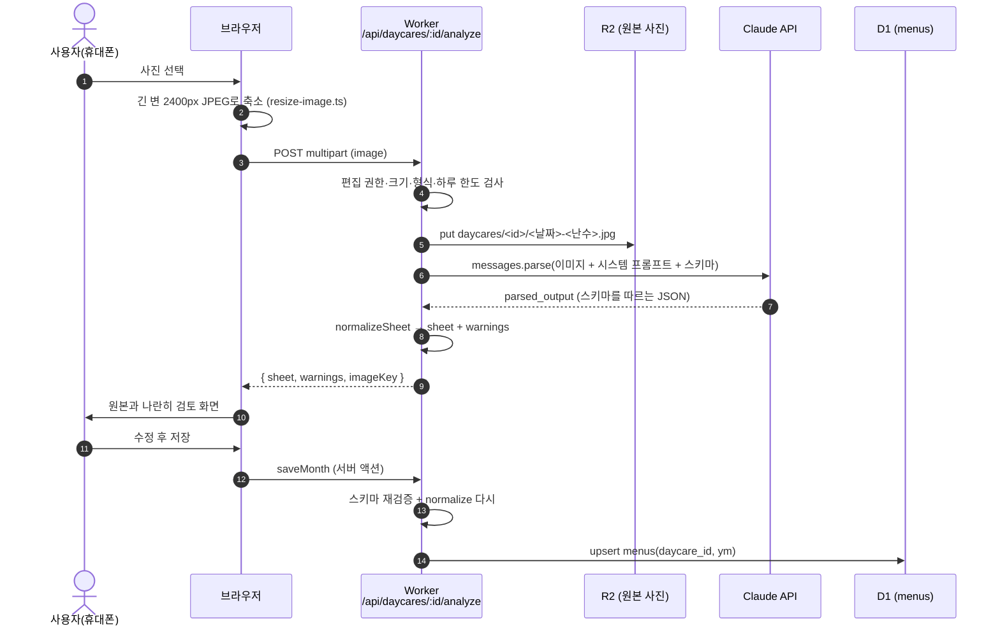
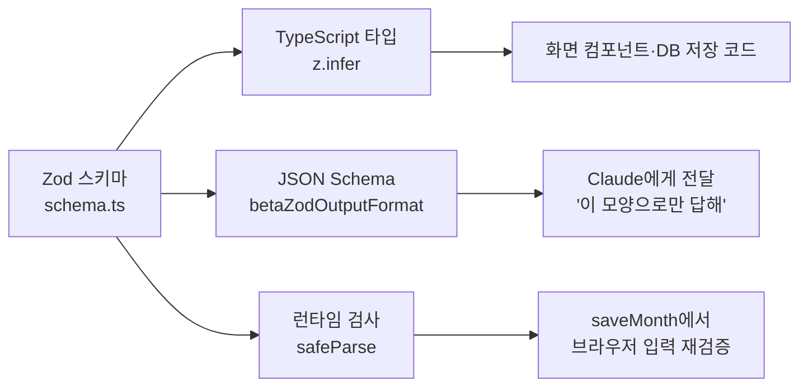
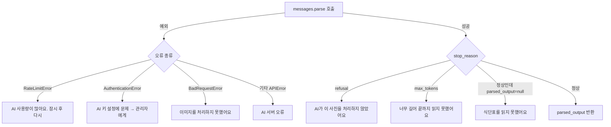
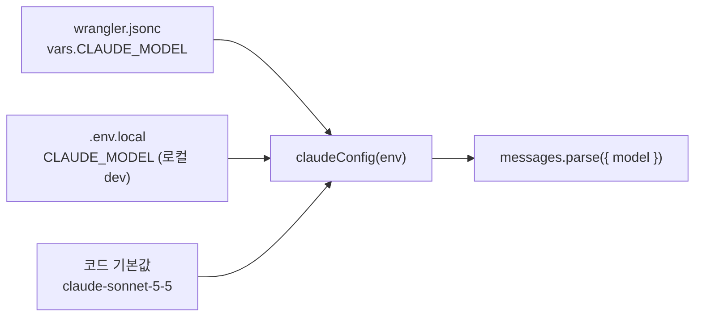

# 06. Claude 구조화 출력 — 사진 한 장이 DB 행이 되기까지

> **한 줄 요약**: 식단표 사진을 Claude에게 보내고, **Zod 스키마로 모양을 강제**해서 JSON을 받은 뒤, **코드로 한 번 더 점검**하고, **사람이 눈으로 확인**한 다음에 저장한다. AI를 "믿는" 게 아니라 "세 겹으로 걸러서 쓰는" 구조다.

⏱ 예상 학습 시간 40분 · 선수 지식: 전체 구조(01장)와 Workers 기초(02장) · 커리큘럼은 [README](./README.md) · 난이도 ★★☆

---

## 1. 왜 필요한가

AI에게 "이 사진 읽어서 알려줘"라고만 하면 이런 결과가 돌아옵니다.

```text
10월 13일 화요일 점심은 현미밥, 모듬버섯국(5,6번 알레르기)... 간식은 대략 치즈랑 주스 같아요.
```

사람이 읽기엔 좋지만 **프로그램은 쓸 수 없습니다.** 날짜별 카드를 그리려면 `{ date, lunch: [{ name, allergens }] }` 같은 **정해진 모양의 데이터**가 필요하죠. 그래서 두 가지 장치가 필요합니다.

| 문제 | 해결 장치 | 이 앱의 코드 |
|---|---|---|
| 모양이 매번 다르게 나온다 | **구조화 출력** (스키마를 API에 함께 전달) | [`schema.ts`](../src/lib/schema.ts), `betaZodOutputFormat` |
| 모양은 맞는데 내용이 틀린다 (요일, 다른 달 날짜 …) | **정규화·검증 코드** | [`sheet.ts`](../src/lib/sheet.ts) |
| 코드가 못 잡는 오독 (메뉴 글자 하나) | **사람의 검토 화면** | [`month-editor.tsx`](../src/components/month-editor.tsx) |

---

## 2. 그림으로 보기

### 2-1. 전체 파이프라인



### 2-2. "세 겹의 체"

```text
        Claude가 읽은 결과
               │
   ┌───────────▼───────────┐
   │ ① 스키마 (Zod)         │  모양이 틀리면 아예 못 통과
   │   "필드가 이 타입이어야 함"│
   └───────────┬───────────┘
   ┌───────────▼───────────┐
   │ ② normalizeSheet       │  다른 달 날짜 제거, 요일 불일치 경고,
   │   "내용이 말이 되는가"    │  중복 병합, 알레르기 번호 정리
   └───────────┬───────────┘
   ┌───────────▼───────────┐
   │ ③ 사람 (검토 화면)       │  원본 사진과 나란히 보고 수정
   └───────────┬───────────┘
               ▼
        D1 저장 (saveMonth가 ①②를 한 번 더 실행)
```

> 💡 **saveMonth가 ①②를 또 하는 이유**: 브라우저가 보낸 데이터는 *언제든 조작될 수 있기* 때문입니다. 분석 단계에서 검사했더라도, 저장 직전에 서버가 다시 검사해야 안전합니다. ([`actions.ts`](../src/app/actions.ts)의 `saveMonth`)

---

## 3. 이 앱에서는 어디에 있나

| 단계 | 파일 | 핵심 |
|---|---|---|
| 사진 축소 | [`resize-image.ts`](../src/lib/resize-image.ts) | `createImageBitmap(..., { imageOrientation: "from-image" })`로 EXIF 회전 반영, 긴 변 2400px, JPEG 품질 0.86 |
| 업로드·한도 | [`analyze/route.ts`](../src/app/api/daycares/[id]/analyze/route.ts) | 6MB 제한, jpeg/png/webp만, 어린이집당 하루 10회·전체 60회 |
| 스키마 | [`schema.ts`](../src/lib/schema.ts) | `MonthSheetSchema` 하나가 타입(`z.infer`)·AI 스키마·저장 검증을 모두 담당 |
| Claude 호출 | [`extract.ts`](../src/lib/server/extract.ts) | 프롬프트, 호출 옵션, 오류 변환 |
| 키·모델 설정 | [`env.ts`](../src/lib/server/env.ts) | `claudeConfig()` — 키는 secret, 모델은 `CLAUDE_MODEL` |
| 정규화 | [`sheet.ts`](../src/lib/sheet.ts) | `normalizeSheet()` |
| 테스트 | [`extract.test.ts`](../src/__tests__/extract.test.ts), [`sheet.test.ts`](../src/__tests__/sheet.test.ts) | 가짜 클라이언트로 호출 모양과 오류 처리 검증 |

### 3-1. Zod 스키마 = 단일 진실 공급원 (Single Source of Truth)

```ts
// src/lib/schema.ts (일부)
export const MenuItemSchema = z.object({
  name: z.string(),
  allergens: z.array(z.number().int()),
});

export const DayMenuSchema = z.object({
  date: z.string().describe("YYYY-MM-DD"),
  weekday: z.string().describe("사진에 적힌 요일 한 글자(월~일). 적혀 있지 않으면 빈 문자열"),
  closed: z.boolean(),
  closedReason: z.string().nullable(),
  morningSnack: z.array(MenuItemSchema),
  lunch: z.array(MenuItemSchema),
  afternoonSnack: z.array(MenuItemSchema),
  kcal: z.number().nullable(),
  // ...
});
```

스키마 **하나**에서 세 가지가 나옵니다.



- `.describe("...")` 문구는 AI에게 전달되는 **필드 설명**이 됩니다. 프롬프트의 일부라고 생각하세요. (`weekday`에 "계산하지 말고 사진에 적힌 글자"라는 뜻을 담은 이유가 이것)
- `nullable()`을 쓴 필드(`kcal`, `event` …)는 "사진에 없으면 `null`"을 허용한다는 뜻입니다. 필드를 아예 빼는 것보다 **`null`로 명시**하게 하는 편이 구조가 안정적입니다.

### 3-2. 호출 코드 읽기

```ts
// src/lib/server/extract.ts (발췌)
response = await anthropic.beta.messages.parse({
  model: input.model,                 // 'claude-sonnet-5-5' (env CLAUDE_MODEL)
  max_tokens: 16000,
  betas: ["server-side-fallback-2026-07-01"],
  fallbacks: "default",
  system: EXTRACT_SYSTEM_PROMPT,
  output_config: { format: betaZodOutputFormat(MonthSheetSchema), effort: "medium" },
  messages: [{
    role: "user",
    content: [
      { type: "image", source: { type: "base64", media_type, data } },
      { type: "text", text: "이 식단표 사진을 스키마에 맞게 추출해 주세요. ..." },
    ],
  }],
});
```

한 줄씩 풀어 봅시다.

| 옵션 | 의미 | 왜 이 값? |
|---|---|---|
| `beta.messages.parse` | 응답을 받아 **스키마로 자동 파싱**까지 해 주는 SDK 메서드. 결과는 `response.parsed_output` | `create`는 문자열만 줌 → 직접 `JSON.parse`+검사해야 함 |
| `betaZodOutputFormat(schema)` | Zod → JSON Schema 변환 + 파싱 함수 묶음 | 스키마를 한 곳에서만 관리 |
| `content: [image, text]` | **비전 입력**: 이미지 블록 + 지시 텍스트를 한 메시지에 | Worker가 방금 받은 사진 바이트를 base64로 그대로 실어 보냄 (R2에서 다시 읽지 않음) |
| `system` | 역할·규칙 (4장에서 자세히) | 매번 똑같은 규칙 |
| `effort: "medium"` | 모델이 쏟을 노력의 정도 (`low`~`max`) | 표 읽기는 어려운 추론이 아니라 꼼꼼함의 문제. 정확도 대비 시간·비용 균형 |
| `max_tokens: 16000` | **출력** 상한. 입력 크기가 아님 | 22일치 JSON이 충분히 들어가는 크기 + 비스트리밍 한계 이내 (아래 3-3) |
| `betas` + `fallbacks: "default"` | 정책상 거절이 나면 **서버가 대체 모델로 재시도** | 식단표가 오탐으로 거절될 때 사용자가 헛걸음하지 않게 |
| `maxRetries: 1` | SDK의 자동 재시도 횟수 (생성자에서 설정) | 일시 오류는 1번 더, 그 이상은 사용자에게 알림 |

### 3-3. 왜 스트리밍을 안 쓰고 16000인가

개발 중에 `max_tokens`를 32000으로 줬더니 SDK가 이런 오류를 냈습니다.

```text
Streaming is required for operations that may take longer than 10 minutes.
```

SDK는 `max_tokens`로 걸릴 시간을 **어림해서**(`3600초 × max_tokens ÷ 128000`) 10분을 넘을 것 같으면 비스트리밍 요청 자체를 막습니다. 계산하면 `max_tokens`가 약 21,000을 넘는 순간 걸립니다. (`node_modules/@anthropic-ai/sdk/client.js`의 `calculateNonstreamingTimeout`) 선택지는 둘이었습니다.

```text
A. 스트리밍으로 바꾼다  → 코드가 길어지고, 조각을 이어 붙여 JSON을 완성해야 함
B. max_tokens를 낮춘다  → 22일치 JSON엔 16000이면 충분 (실측 약 33초에 완료)
```

이 앱은 **B**를 택했습니다. 응답이 짧고 사용자는 어차피 "읽는 중…" 화면(경과 시간 표시)을 보고 있기 때문이에요. 달 단위가 아니라 **연 단위** 같은 훨씬 큰 입력을 다루게 되면 그때 스트리밍을 검토하세요.

> ⚠️ `max_tokens`가 너무 작으면 JSON이 중간에 잘리고 `stop_reason === "max_tokens"`가 됩니다. 이 경우 `parsed_output`은 `null`이라서 코드가 "식단표가 너무 길어 끝까지 읽지 못했어요."로 안내합니다.

---

## 4. 시스템 프롬프트 설계 읽는 법

[`extract.ts`](../src/lib/server/extract.ts)의 `EXTRACT_SYSTEM_PROMPT`는 **규칙 목록**입니다. 각 규칙은 실제 식단표에서 만난 **구체적인 함정**에 대응합니다.

| 규칙(요약) | 막으려는 실수 |
|---|---|
| "사진에 적힌 글자만 옮긴다. 불확실하면 `note`에 남긴다" | AI가 그럴듯한 메뉴를 **지어내는** 것(환각) |
| "weekday는 사진의 글자 그대로, 계산 금지" | AI가 요일을 계산해 **틀린 날짜를 슬쩍 맞춰버림** → 코드의 요일 검증이 무력화됨 |
| `모듬버섯국5,6` → name `모듬버섯국`, allergens `[5,6]` | 알레르기 번호가 이름에 붙어 버림 |
| 괄호 대체 메뉴는 하나로 합친다 | `백김치(백깍두기)` 가 두 줄로 갈라짐 |
| 쉼표로 나뉜 간식은 각각 별도 항목 | `유아치즈2,당근주스` 가 한 항목 |
| 휴원일은 `closed=true` + 사유 | 휴원일에 빈 메뉴가 "오류"로 보임 |
| `445/16` → kcal 445, protein 16 | 열량/단백질 구분 실패 |

### 프롬프트를 쓸 때의 원칙

```text
✅ 한 규칙 = 한 가지 함정 + 예시 한 줄    (예: "모듬버섯국5,6" → ...)
✅ "무엇을 하라" + "무엇은 하지 마라"를 함께
✅ 코드가 이미 검증하는 것은 AI가 '계산'하지 못하게 (요일)
❌ 규칙을 느낌으로 계속 추가 → 서로 충돌해 결과가 흔들림
❌ 사진 한 장에만 맞춘 규칙 (다른 어린이집 양식에서 깨짐)
```

> 💡 시스템 프롬프트는 **호출마다 동일**합니다. 그래서 나중에 비용을 줄이고 싶다면 프롬프트 캐싱 같은 기능을 검토할 수 있어요. 다만 이 앱은 한 달에 한 번 쓰는 구조라 지금은 의미가 작습니다. (비용 최적화는 "측정 후에" 하는 게 원칙)

---

## 5. 오류를 사용자 말로 바꾸기

[`extract.ts`](../src/lib/server/extract.ts)는 SDK 오류를 **사용자가 이해할 문장**으로 바꿔 `ExtractError`로 던집니다. API 라우트는 이 오류만 502로 돌려주고, 나머지는 로그만 남깁니다.



- 오류의 **상세 내용(status, message)** 은 `console.error`로 서버 로그에만 남깁니다. 사용자에겐 보이지 않아요.
- Cloudflare 대시보드의 Workers 로그(Observability)에서 `claude extract failed`를 검색하면 상태 코드를 볼 수 있습니다. 실제로 홍콩 colo 문제로 `403 Request not allowed`가 나왔을 때 이 로그로 원인을 찾았습니다. (→ 02장 Workers의 placement 사례)

---

## 6. 정규화: `normalizeSheet`가 하는 일

AI 결과를 **그대로 믿지 않고** [`sheet.ts`](../src/lib/sheet.ts)가 다듬습니다.

| 점검 | 동작 | 사용자에게 |
|---|---|---|
| 날짜 형식·달 | `YYYY-MM-DD`가 아니거나 해당 연·월이 아니면 **제외** | 경고 "N월 날짜가 아니라 제외했어요" |
| 요일 | 사진 요일 ≠ 달력 요일이면 **실제 요일로 교정** | 경고 "사진에는 '목'요일로 읽혔지만 달력상 수요일" |
| 중복 날짜 | 같은 날이 두 번 → 뒤쪽으로 병합 | 경고 |
| 알레르기 번호 | 1~99 정수만, 중복 제거, 오름차순 | (조용히) |
| 열량 0 | `0` → `null` | (조용히) |
| 빈 항목 | 이름이 빈 항목 제거 | (조용히) |
| 빈 메뉴 | 휴원일이 아닌데 메뉴가 전부 비면 | 경고 "메뉴가 비어 있어요" |
| 정렬 | 날짜순 | — |

이 경고들이 검토 화면의 노란 상자에 나옵니다. **요일 검증이 특히 강력한 이유**: 날짜 하나를 잘못 읽으면 보통 요일도 같이 어긋나기 때문에, 오독이 거의 항상 걸러집니다. 그래서 프롬프트에서 AI가 요일을 "계산"하지 못하게 막아 두었습니다.

---

## 7. 모델 고르기 · 바꾸기



`claudeConfig()`의 우선순위: **Worker 바인딩(`env.CLAUDE_MODEL`) → `process.env.CLAUDE_MODEL`(로컬) → 코드 기본값**.

### 운영 모델 바꾸는 순서

```bash
cd menu
# 1) wrangler.jsonc 의 vars.CLAUDE_MODEL 을 원하는 모델 ID로 수정 (예: claude-opus-5-5)
# 2) 검증 + 배포
npm test && npm run typecheck
npm run deploy          # ⚠️ 운영 배포
```

- 모델 ID는 [Anthropic 모델 문서](https://docs.anthropic.com/en/docs/about-claude/models)에서 **정확한 문자열**을 확인하세요. 철자가 틀리면 `BadRequestError`("이미지를 처리하지 못했어요")로 보여서 원인을 찾기 어렵습니다.
- `wrangler.jsonc`가 기준(source of truth)입니다. 대시보드에서 변수를 바꿔도 다음 `deploy` 때 파일 값으로 돌아올 수 있어요.
- **API 키**는 변수가 아니라 **secret**입니다: `npx wrangler secret put CLAUDE_API_KEY`. 코드·`wrangler.jsonc`·Git에 절대 넣지 않습니다. (빌드 산출물에 키가 남지 않았는지 `npm run cloudflare:build`가 검사)

### 선택 기준 (경험칙)

| 상황 | 선택 |
|---|---|
| 지금처럼 인쇄된 표, 글자가 선명 | 기본 모델(Sonnet 5.5)로 충분했음 (10월 샘플 22일 전부 정확) |
| 손글씨·흐린 사진·복잡한 양식에서 오독이 잦음 | 더 큰 모델(Opus)로 올려 같은 사진을 비교 |
| 비용·속도가 중요 | 더 작은 모델 + 검토 화면에 의존 (먼저 정확도를 측정!) |

**바꾸기 전에 반드시 같은 사진으로 비교**하세요 — [labs/claude/prompt-lab.md](./labs/claude/prompt-lab.md).

---

## 8. 비용과 지연시간을 "측정"하는 법

이 문서에는 단가 숫자를 일부러 적지 않았습니다. 가격은 바뀌고, 외워 둔 값은 곧 틀립니다. 대신 **측정하는 방법**을 알아 두세요.

1. **토큰 수**: 응답의 `usage`에 `input_tokens`, `output_tokens`가 들어 있습니다. (이미지도 입력 토큰으로 계산됨)
   ```ts
   console.log("usage", response.usage); // 임시로 넣고, 확인 후 지우기
   ```
2. **비용** = 토큰 × 그 모델의 현재 단가 → [Anthropic 가격 페이지](https://www.anthropic.com/pricing)
3. **실제 사용량**은 [Anthropic 콘솔](https://console.anthropic.com)의 Usage에서 확인.
4. **지연시간**: 이 앱은 화면에 경과 초를 보여줍니다. 샘플(22일) 기준 **약 33초**였습니다.
5. **상한선(방어)**: [`limits.ts`](../src/lib/server/limits.ts)의 `analyzePerDaycare: 10`, `analyzeGlobal: 60`(하루). 공개 URL이라 누군가 반복 호출해도 비용이 무한정 늘지 않습니다.

> 이미지를 2400px로 줄여 보내는 이유도 비용·속도입니다. 휴대폰 원본(3000×4000, 4MB+)은 업로드가 느리고 이미지 한도에 걸릴 수 있어요. 단, 작은 글씨가 뭉개질 만큼 줄이면 정확도가 떨어지므로 2400px를 *함부로 낮추지* 마세요.

---

## 9. 왜 저장 전에 사람이 검토하나

- AI는 *대체로* 맞지만 **틀릴 때 확신에 차서 틀립니다.**
- 이 앱의 데이터는 아기가 먹는 음식·**알레르기 번호**입니다. 틀린 정보의 대가가 큽니다.
- 그래서 설계 원칙: **"AI는 초안을 만들고, 사람이 확정한다."** 검토 화면은 원본 사진 옆에서 날짜별로 고칠 수 있고, 요일 불일치 같은 경고가 어디를 먼저 볼지 알려 줍니다.

---

## 10. 직접 해보기

| 실습 | 파일 | 비용 |
|---|---|---|
| 스키마가 JSON Schema로 바뀌는 모습과 검증 실패 메시지 보기 | [`labs/claude/schema-lab.mjs`](./labs/claude/schema-lab.mjs) | 무료 (API 호출 없음) |
| 가짜 클라이언트 테스트 읽고 오류 케이스 하나 추가하기 | [`extract.test.ts`](../src/__tests__/extract.test.ts) → [11장](./11-testing-and-quality.md) | 무료 |
| 프롬프트 규칙 바꿔 보고 결과 비교 | [`labs/claude/prompt-lab.md`](./labs/claude/prompt-lab.md) | ⚠️ API 비용 발생 (로컬 전용) |

```bash
cd menu
node learn/labs/claude/schema-lab.mjs
```

---

## 11. 흔한 실수 · 유지보수 체크리스트

- [ ] `CLAUDE_API_KEY`는 `wrangler secret`과 `.env.local`에만. **`NEXT_PUBLIC_`을 붙이면 브라우저에 노출**됩니다.
- [ ] 스키마를 고치면(필드 추가·삭제) → `schema.ts` 수정 → `normalizeSheet`·화면 컴포넌트·**이미 저장된 데이터(D1에 JSON으로 저장됨)** 호환성 확인. 옛 데이터에 새 필드가 없으면 화면이 깨질 수 있습니다.
- [ ] 프롬프트를 고치면 → 같은 샘플로 전후 비교 → `npm test`
- [ ] 모델을 바꾸면 → 같은 샘플로 정확도·시간 비교 후 배포
- [ ] 분석이 갑자기 502가 되면 → Workers 로그에서 `claude extract failed`의 status 확인 (403이면 지역/placement, 401이면 키, 429면 한도)
- [ ] 한도(10회/60회)에 걸리면 "내일 다시" 메시지가 나옵니다. 임시 해제는 코드의 `LIMITS` 수정 + 배포.
- [ ] 비용이 갑자기 늘면 → 콘솔 Usage + `usage_events` 테이블(D1)의 `analyze` 건수 확인

---

## 12. 퀴즈

**Q1.** 스키마를 통과한 결과에도 `normalizeSheet`가 필요한 이유는?

<details><summary>정답 보기</summary>

스키마는 *모양*(타입)만 검사합니다. `"2026-11-02"`는 문자열이므로 형식은 통과하지만 10월 식단표에는 들어가면 안 되는 날짜입니다. 요일이 달력과 맞는지, 중복·빈 메뉴는 없는지 같은 *내용*은 코드로 따로 점검해야 합니다.
</details>

**Q2.** 프롬프트에서 "weekday는 계산하지 말고 사진에 적힌 글자를 그대로 넣어라"고 한 이유는?

<details><summary>정답 보기</summary>

요일 불일치가 *오독을 잡는 감지기*이기 때문입니다. AI가 날짜에 맞춰 요일을 계산해 채우면 항상 일치하게 되어 감지기가 꺼집니다. 사진에 적힌 그대로 받아야 "날짜를 잘못 읽었는지"를 코드(`normalizeSheet`)가 알아챌 수 있습니다.
</details>

**Q3.** 운영 모델을 Opus로 바꾸려면 어느 파일을 고치고 무엇을 해야 하나? 키는 어디에 있나?

<details><summary>정답 보기</summary>

`wrangler.jsonc`의 `vars.CLAUDE_MODEL`을 수정하고 `npm run deploy`로 배포합니다(전에 같은 사진으로 정확도를 비교). 키는 변수가 아니라 Cloudflare **secret**(`wrangler secret put CLAUDE_API_KEY`)에 있고, 로컬에서는 `.env.local`에 있습니다. 코드와 Git에는 없습니다.
</details>

---

⬅️ 이전: 05장 R2 저장소 · ➡️ 다음: [07 인증과 쿠키](./07-auth-cookies.md) · 전체 목록은 [README](./README.md)
