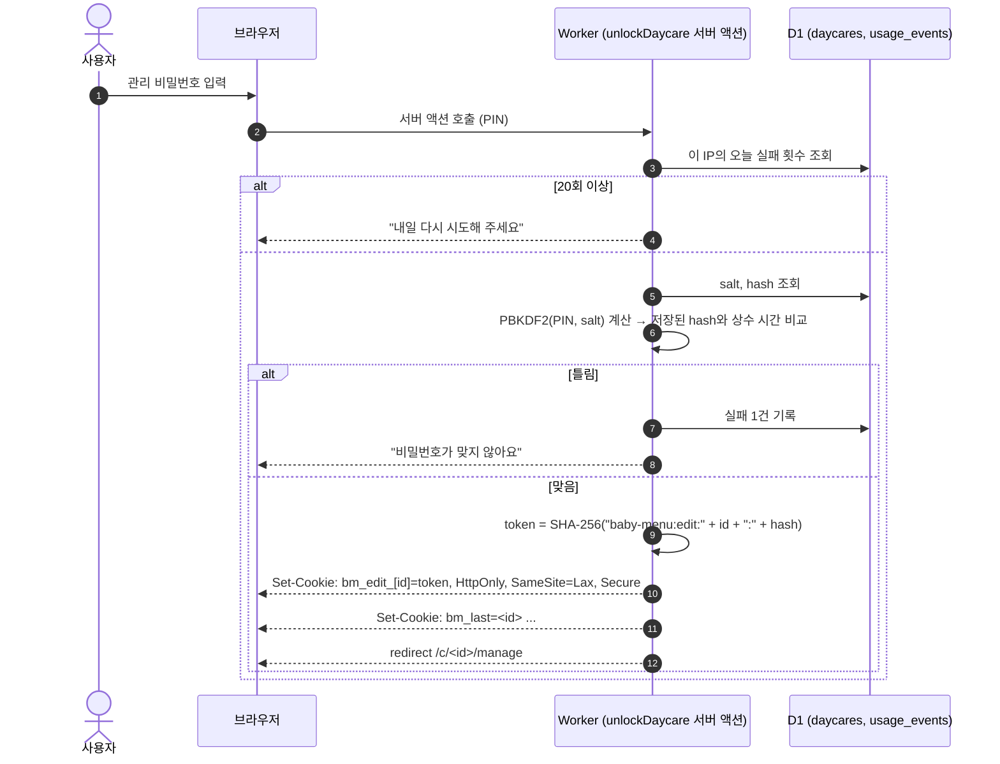
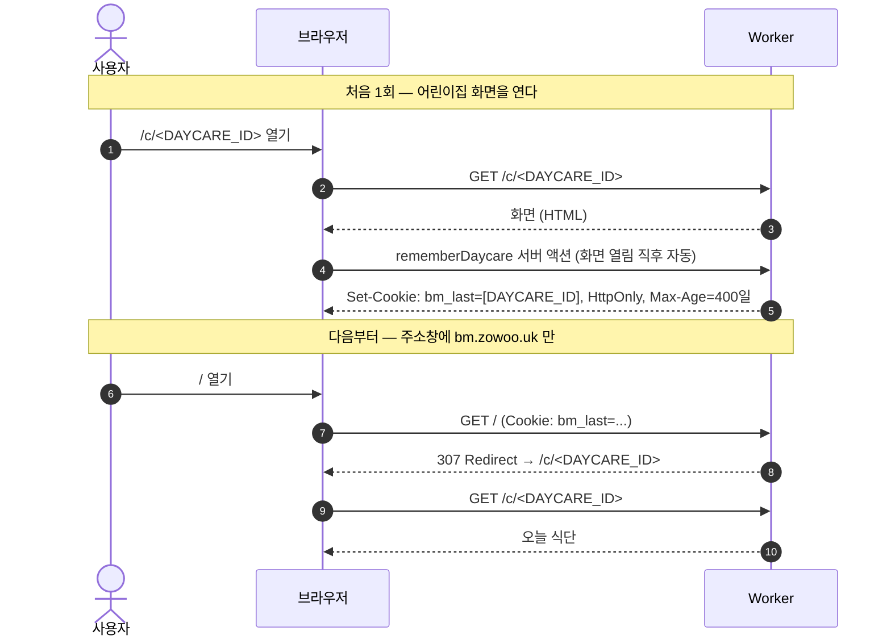
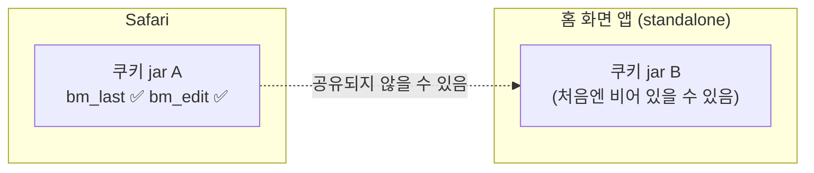

# 07. 인증과 쿠키 — 로그인 없는 "비밀번호 + 기기 기억"

> **한 줄 요약**: 이 앱엔 회원가입이 없다. 어린이집마다 **관리 비밀번호(PIN) 하나**를 정하고, 맞게 입력하면 그 기기에 **편집 쿠키**를 남긴다. 그리고 "마지막으로 본 어린이집"을 **서버 쿠키**로 기억해서 `/` 에 들어오면 **클릭 없이** 바로 오늘 식단으로 보낸다.

⏱ 예상 학습 시간 45분 · 선수 지식: HTTP 요청/응답, 쿠키가 무엇인지 · 난이도 ★★☆ · 커리큘럼은 [README](./README.md)

---

## 1. 왜 필요한가

요구사항은 두 개였고, 서로 반대 방향입니다.

| 요구 | 의미 |
|---|---|
| 식단 **보기**는 누구나 | 가족에게 주소만 알려 주면 됨 → 인증 없음 |
| 식단 **올리기·고치기·지우기**는 관리자만 | 아무나 남의 어린이집 식단을 덮어쓰면 안 됨 → 인증 필요 |

회원가입·이메일·소셜 로그인은 "한 달에 한 번 쓰는 앱"에 과합니다. 그래서 **어린이집 단위 비밀번호**만 둡니다. 대신 이런 질문에 답할 수 있어야 해요.

1. 비밀번호를 DB에 어떻게 저장하나? (유출돼도 괜찮게)
2. 맞게 입력한 뒤 "이 기기는 인증됨"을 어떻게 기억하나?
3. 비밀번호를 바꾸면 이미 인증된 기기들은?
4. "마지막으로 본 어린이집"은 어디에 기억하나? 왜 거기인가?

---

## 2. 그림으로 보기

### 2-1. 비밀번호 입력 → 편집 쿠키



### 2-2. 이후 요청에서 권한 확인

```text
 브라우저                       Worker                               D1
    │  Cookie: bm_edit_<id>=T     │                                    │
    │ ───────────────────────────►│                                    │
    │                             │── SELECT pin_hash WHERE id=... ───►│
    │                             │◄──────────────── pin_hash ─────────│
    │                             │  expected = SHA-256(... + pin_hash)│
    │                             │  T == expected ?                   │
    │◄── 맞으면 편집 UI / 저장 허용 ─│  (틀리면 UnlockForm, 서버 액션은 거부)│
```

**쿠키 값을 DB에 저장하지 않습니다.** 서버는 요청마다 "DB의 `pin_hash`로 정답을 *다시 계산*해서 비교"합니다. 그래서 PIN이 바뀌면(→ `pin_hash`가 바뀌면) 기존 쿠키가 **저절로 무효**가 됩니다.

### 2-3. 제로클릭: "마지막 어린이집" 쿠키



---

## 3. 이 앱에서는 어디에 있나

| 역할 | 파일 | 포인트 |
|---|---|---|
| 해시·검증·토큰 | [`auth.ts`](../src/lib/server/auth.ts) | `hashPin`, `verifyPin`, `editToken`, 쿠키 이름·수명 상수 |
| 쿠키 설정·서버 액션 | [`actions.ts`](../src/app/actions.ts) | `cookieOptions`, `createDaycare`, `unlockDaycare`, `rememberDaycare`, `saveMonth` |
| 권한 확인 | [`session.ts`](../src/lib/server/session.ts) | `canEdit(daycare)` — 서버 컴포넌트·API·서버 액션이 공통 사용 |
| 제로클릭 리다이렉트 | [`page.tsx`](../src/app/page.tsx) | `bm_last` 쿠키 → `redirect(/c/<id>)` |
| 쿠키 심기 | [`menu-viewer.tsx`](../src/components/menu-viewer.tsx) | 화면 열릴 때 `rememberDaycare(daycare.id)` |
| 남용 방지 | [`limits.ts`](../src/lib/server/limits.ts) | 생성·분석·비밀번호 실패 횟수 제한 |
| 어린이집별 manifest | [`pwa.ts`](../src/lib/pwa.ts) | 홈 화면 앱의 `start_url`을 `/c/<id>`로 고정 |

---

## 4. 비밀번호 저장: PBKDF2

### 4-1. 해시란

**해시** = 입력을 되돌릴 수 없는 고정 길이 값으로 바꾸는 함수. DB에는 PIN이 아니라 해시만 있으므로, DB가 새어도 PIN 원문은 바로 보이지 않습니다.

그런데 그냥 SHA-256 한 번이면 부족합니다. PIN은 짧아서(예: 숫자 4자리 = 1만 가지) 공격자가 전부 계산해 보면 됩니다. 그래서 두 가지를 더합니다.

| 장치 | 하는 일 | 코드 |
|---|---|---|
| **salt** (소금) | 어린이집마다 다른 무작위 값을 섞음. 같은 PIN이어도 해시가 다름 → 미리 계산한 표(레인보우 테이블) 무력화 | `crypto.getRandomValues(new Uint8Array(16))` |
| **반복(iterations)** | 해시를 10만 번 겹쳐 계산해 한 번 계산이 느려지게 함 → 대입 공격이 느려짐 | `ITERATIONS = 100_000` |

```text
 PIN "demo-1234" ─┐
                  ├─► PBKDF2-SHA256 (10만 번 반복) ─► 256비트 해시 (hex 64자)
 salt (무작위 16바이트) ─┘

 DB(daycares) 에 저장: pin_salt, pin_hash        ← PIN 원문은 없음
```

### 4-2. 왜 하필 100,000회인가

코드 주석에 있듯 **Cloudflare Workers가 허용하는 PBKDF2 반복 횟수의 상한이 100,000**입니다. 보안 권고(더 많은 반복)와 플랫폼 제약 사이에서 *허용되는 최댓값*을 쓴 것이죠. 상한을 넘기면 Workers에서 동작하지 않을 수 있으니 값을 올릴 땐 반드시 [Workers 문서](https://developers.cloudflare.com/workers/runtime-apis/web-crypto/)에서 현재 제한을 확인하세요. 로컬 Node에서는 더 큰 값도 돌아가기 때문에 *로컬에선 되는데 배포하니 안 되는* 함정이 생깁니다.

> 💡 **PIN 변경 시 반복 횟수를 바꿔도 되나?** 현재 구조에서는 `iterations`를 DB에 저장하지 않고 코드 상수로 쓰므로, 값을 바꾸면 **기존 모든 해시가 검증 실패**합니다. 바꾸려면 컬럼을 추가하는 마이그레이션이 필요합니다.

### 4-3. 상수 시간 비교

```ts
function safeEqual(a: string, b: string): boolean {
  if (a.length !== b.length) return false;
  let diff = 0;
  for (let i = 0; i < a.length; i += 1) diff |= a.charCodeAt(i) ^ b.charCodeAt(i);
  return diff === 0;
}
```

`a === b`는 첫 글자부터 비교하다 **처음 다른 곳에서 바로 멈춥니다.** 응답 시간 차이로 "몇 번째 글자까지 맞았는지"를 추측당할 수 있어요(타이밍 공격). 위 함수는 *항상 끝까지* 비교합니다.

---

## 5. 편집 쿠키(edit token)의 설계

```ts
// auth.ts
editToken(daycareId, pinHash) = SHA-256(`baby-menu:edit:${daycareId}:${pinHash}`)
```

| 성질 | 이유 |
|---|---|
| **추측 불가** | `pin_hash`는 DB에만 있고 외부에 안 나옴. 공격자가 쿠키 값을 만들려면 `pin_hash`를 알아야 함 |
| **어린이집별로 다름** | `daycareId`가 섞임 → A 어린이집 쿠키로 B를 열 수 없음 |
| **PIN을 바꾸면 자동 무효** | `pin_hash`가 바뀌면 정답이 바뀜 |
| **서버에 세션 저장소 불필요** | 매번 재계산 → 별도 테이블·secret 없음 (단순함) |

**한계도 알아 둡니다.** DB를 읽을 수 있는 사람은 `pin_hash`로 정답 쿠키도 계산할 수 있습니다. 다만 DB를 읽을 수 있다면 어차피 데이터를 직접 고칠 수 있으므로 *추가로 얻는 권한*은 크지 않습니다. 이 단순함이 이 앱의 규모에 맞는 선택입니다. 사용자 계정·결제가 생기면 그땐 별도 세션 저장소와 서버 secret이 필요합니다.

---

## 6. 쿠키 옵션 하나하나

```ts
// actions.ts
const cookieOptions = {
  httpOnly: true,
  sameSite: "lax" as const,
  secure: process.env.NODE_ENV === "production",
  path: "/",
  maxAge: LONG_COOKIE_MAX_AGE,      // 60*60*24*400 = 400일
};
```

| 옵션 | 의미 | 막는 것 |
|---|---|---|
| `httpOnly` | 브라우저 JS(`document.cookie`)가 **읽지 못함** | XSS로 쿠키가 탈취되는 것 |
| `sameSite: "lax"` | 다른 사이트에서 날아오는 *POST* 같은 요청에는 쿠키를 안 붙임 (링크 클릭으로 들어오는 GET에는 붙음) | CSRF (남이 내 쿠키로 대신 저장 요청) |
| `secure` | HTTPS에서만 전송 (운영에서만 켬 — 로컬 `http://localhost`에선 꺼야 동작) | 평문 전송 |
| `path: "/"` | 사이트 전체에서 사용 | — |
| `maxAge` 400일 | 브라우저가 허용하는 최대치 근처. "한 달에 한 번" 쓰는 앱이라 짧으면 매번 다시 입력하게 됨 | 잦은 재입력 |

추가로 Next.js **서버 액션은 `Origin`과 `Host` 헤더를 비교**해 다른 출처에서의 호출을 막습니다(Next.js 공식 문서의 Data Security 가이드). `SameSite=Lax`와 겹쳐 CSRF를 이중으로 막는 셈이에요.

> 🔍 **브라우저 개발자도구에서 확인**: Application(앱) 탭 → Cookies → `bm_last`, `bm_edit_<id>`가 보이고 HttpOnly 열에 체크가 있어야 정상입니다. 콘솔에서 `document.cookie`를 쳐도 이 두 쿠키는 **나오지 않아요.**

---

## 7. 왜 "마지막 어린이집"을 localStorage가 아니라 서버 쿠키에?

| | localStorage | 서버가 읽는 쿠키 (`bm_last`) |
|---|---|---|
| 서버가 읽을 수 있나 | ❌ (JS만 접근) | ✅ 요청에 자동 포함 |
| `/` 에서 바로 리다이렉트 | ❌ 화면을 먼저 그린 뒤 JS가 이동 → **깜빡임·한 번 더 로딩** | ✅ 서버가 HTML 대신 **307 리다이렉트**를 즉시 응답 |
| 제로클릭 요구 충족 | 부분적 | **충족** |

```text
localStorage 방식:  / 로드 → 빈 화면/홈 화면 잠깐 → JS 실행 → 이동 → 식단   (느리고 깜빡임)
쿠키 방식       :  / 요청 → 서버가 쿠키 보고 즉시 307 → 식단                 (체감 한 번에)
```

`page.tsx`의 핵심 두 줄:

```ts
const lastId = (await cookies()).get(LAST_DAYCARE_COOKIE)?.value;
...
if (last && !pick && !q) redirect(`/c/${last.id}`);   // pick/q 가 있으면 검색 화면 유지
```

`?pick=1`은 "다른 어린이집 고르기"입니다. 이게 없으면 리다이렉트 때문에 영영 목록 화면에 갈 수 없겠죠.

> 쿠키를 심는 시점은 **어린이집 화면이 열린 직후** (`menu-viewer.tsx`의 `useEffect` → `rememberDaycare` 서버 액션)입니다. 서버 컴포넌트(페이지 렌더링 중)에서는 쿠키를 *쓸 수 없어서*(읽기 전용) 서버 액션을 한 번 더 부르는 구조예요.

---

## 8. 홈 화면 앱(PWA)과 쿠키 분리 (iOS)

> PWA 설치 자체는 [09 PWA](./09-pwa.md)에서 다룹니다. 여기서는 *쿠키 관점*만 봅니다.

> ⚠️ **iOS 동작은 버전에 따라 다를 수 있습니다.** 아래는 "그럴 수 있다고 가정하고 방어적으로 설계했다"는 설명이지, 모든 iOS에서 확인된 사실이 아닙니다. 실제 기기에서 확인하세요.

**가설**: iOS에서 *홈 화면에 추가한 웹앱*은 Safari와 **저장소(쿠키·localStorage)를 따로** 가질 수 있다.



그렇다면 홈 화면 앱을 처음 열었을 때 `bm_last`가 없어서 `/`가 **홈(검색) 화면**으로 갈 수 있습니다. 제로클릭이 깨지는 거죠. 그래서 두 겹으로 방어했습니다.

1. **어린이집별 manifest** — 어린이집 화면(`/c/<id>`)은 `/c/<id>/manifest.webmanifest`를 가리키고, 여기의 `start_url`이 `/c/<id>`로 *고정*돼 있습니다. 홈 화면 아이콘을 누르면 쿠키와 상관없이 그 어린이집으로 바로 열려요. ([`pwa.ts`](../src/lib/pwa.ts)의 `buildManifest`)
2. **열리면 다시 쿠키를 심음** — 그 화면에서 `rememberDaycare`가 호출되므로 홈 화면 앱의 쿠키 jar에도 `bm_last`가 생깁니다.

반면 **편집 쿠키는 따로 옮길 방법이 없으므로** 홈 화면 앱 안에서 관리 화면에 처음 들어가면 비밀번호를 **한 번 다시 입력**해야 할 수 있습니다. 이건 정상입니다.

---

## 9. 남용 방지: 횟수 제한 ([`limits.ts`](../src/lib/server/limits.ts))

공개 URL이라 누구나 호출할 수 있습니다. D1의 `usage_events(kind, scope, created_at)` 테이블에 사건을 기록하고, "최근 24시간 N건 이상이면 거부"합니다.

| 종류(kind) | 범위(scope) | 하루 상한 | 막는 것 |
|---|---|---|---|
| `analyze` | 어린이집 id | 10 | 한 어린이집이 AI 비용을 독점 |
| `analyze` | `*` (전체) | 60 | 전체 AI 비용 폭주 |
| `create` | IP | 5 | 어린이집 대량 생성 |
| `unlock-fail` | IP | 20 | 비밀번호 대입 |

- IP는 `cf-connecting-ip` 헤더에서 읽습니다. Cloudflare가 붙여 주는 값이라 클라이언트가 임의로 바꿀 수 없습니다. (로컬 개발에서는 헤더가 없어 `"local"`로 취급)
- 오래된 기록은 `recordEvent`가 호출될 때마다 **7일 지난 것을 삭제**해서 테이블이 커지지 않습니다.
- ⚠️ 비밀번호 **성공**은 기록하지 않고 **실패만** 기록합니다. 정상 사용자가 막히지 않게 하려는 설계입니다.

---

## 10. 위협 모델: 무엇을 막고, 무엇은 못 막나

| 위협 | 막나? | 설명 |
|---|---|---|
| DB가 유출됨 → PIN 원문 노출 | ✅ 부분 | salt+PBKDF2라 바로 보이지 않음. 단, **약한 PIN은 대입으로 풀릴 수 있음** |
| 비밀번호 대입 시도 (온라인) | ✅ 부분 | IP당 하루 20회 실패 제한. 하지만 **IP를 바꿔 가며** 시도하면 총 시도 수는 늘어남 |
| **약한 PIN** (예: `1234`, 이름·이니셜처럼 추측하기 쉬운 값) | ❌ | 길이 4 이상만 요구. 추측하기 쉬우면 제한 안에서도 맞힐 수 있음 → **긴 값 권장** |
| XSS로 쿠키 탈취 | ✅ | `httpOnly`라 JS가 못 읽음 |
| 남의 사이트에서 대신 저장 요청 (CSRF) | ✅ | `SameSite=Lax` + 서버 액션 Origin 검사 |
| 공유 기기·분실한 휴대폰 | ❌ | 편집 쿠키가 400일 유지 → 폰을 가진 사람은 편집 가능. (잠금화면이 1차 방어) |
| 링크를 아는 사람의 **보기** | ❌ (의도) | 보기는 공개. 민감한 개인정보를 식단표에 넣지 않는다는 전제 |
| 다른 어린이집 데이터 수정 | ✅ | 토큰에 `daycareId` 포함, 저장 시 `imageKey`가 `daycares/<id>/`로 시작하는지도 검사 |
| PIN 분실 | ❌ 기능 없음 | 앱에 "비밀번호 변경/찾기" 화면이 없음 → 이 장의 11절 "운영: 비밀번호를 바꿔야 할 때" 참고 |

> 이 표를 읽을 때의 마음가짐: "완벽한 보안"이 아니라 **"식단표 앱에 맞는 수준"** 을 의식적으로 고른 것입니다. 데이터가 더 민감해지거나 사용자가 늘면 계정 체계(이메일 로그인 등)로 올라가야 합니다.

---

## 11. 직접 해보기

### 실습 A — 해시·반복·salt·토큰 눈으로 보기 (무료·안전)

```bash
cd menu
node learn/labs/auth/pbkdf2-lab.mjs
```

확인할 것: ① 같은 PIN인데 salt가 다르면 해시가 완전히 다름 ② 반복 횟수에 따라 걸리는 시간이 늘어남 ③ PIN을 바꾸면 편집 토큰이 바뀜. 가짜 PIN(`demo-1234`)만 쓰며 DB·네트워크에 접근하지 않습니다.

### 실습 B — 내 브라우저에서 쿠키 보기

1. 앱을 열고 개발자도구 → Application → Cookies
2. `bm_last`(어린이집 id), `bm_edit_<id>`(편집 권한)의 **HttpOnly 체크**, **Expires**(약 400일 뒤)를 확인
3. 콘솔에서 `document.cookie` 입력 → 두 쿠키가 *나오지 않는지* 확인
4. `bm_edit_<id>`를 삭제하고 관리 화면 새로고침 → 비밀번호 입력 화면으로 돌아가는지 확인

### 운영: 비밀번호를 바꿔야 할 때 (앱에 기능이 없어서 DB에서 직접)

> ⚠️ **운영 DB를 수정합니다.** 반드시 대상 id를 확인하고, 새 PIN은 터미널 기록·Git에 남기지 마세요.

순서만 설명합니다.

1. [`pbkdf2-lab.mjs`](./labs/auth/pbkdf2-lab.mjs)의 `derive()`와 같은 방식으로 **새 salt와 해시**를 계산한다 (iterations = 100000, SHA-256, 256비트, 둘 다 hex 문자열).
2. `npx wrangler d1 execute baby-menu --remote --command "UPDATE daycares SET pin_salt='<새 salt>', pin_hash='<새 hash>' WHERE id='<DAYCARE_ID>'"` — 먼저 `--local`로 연습하세요.
3. 이 어린이집의 **기존 편집 쿠키는 모두 자동 무효**가 됩니다. 각 기기에서 새 PIN을 한 번 입력.

자주 쓸 일이라면 "현재 비밀번호 확인 후 변경" 화면을 만드는 편이 안전합니다.

---

## 12. 흔한 실수 · 유지보수 체크리스트

- [ ] 새 서버 액션·API를 만들 때 **반드시 `canEdit(daycare)`** 를 호출했는가? (권한 확인을 빼먹으면 누구나 쓸 수 있는 API가 됨)
- [ ] 클라이언트에서 받은 값(`imageKey`, `sheet`, `ym` …)을 **서버가 다시 검증**하는가? (`saveMonth`처럼)
- [ ] 쿠키를 서버 컴포넌트 렌더링 중에 *쓰려고* 하지 않았는가? (서버 액션/라우트 핸들러에서만 가능)
- [ ] `ITERATIONS`를 바꾸면 기존 비밀번호가 전부 무효 — 바꿀 계획이 있다면 마이그레이션 먼저
- [ ] 로컬에서 `secure: true`면 쿠키가 안 심겨 로그인이 안 되는 것처럼 보입니다 (`NODE_ENV` 조건 유지)
- [ ] 비밀번호·토큰·`.env*` 파일 내용을 Git·채팅·문서에 붙이지 않았는가? (이 학습 자료의 예시는 전부 가짜 값)
- [ ] 비밀번호를 쉬운 단어로 정했다면 위협 모델 표의 "약한 PIN" 행을 다시 읽기

---

## 13. 퀴즈

**Q1.** 편집 쿠키 값을 DB에 저장하지 않는데도 어떻게 서버가 "맞는 쿠키"인지 알까? PIN을 바꾸면 기존 쿠키는 어떻게 될까?

<details><summary>정답 보기</summary>

요청마다 DB의 `pin_hash`와 `daycareId`로 `SHA-256("baby-menu:edit:<id>:<pin_hash>")`를 다시 계산해 쿠키 값과 비교합니다. PIN을 바꾸면 `pin_hash`가 바뀌어 정답이 달라지므로, 기기에 남은 옛 쿠키는 불일치로 자동 무효가 됩니다.
</details>

**Q2.** 마지막으로 본 어린이집을 localStorage가 아니라 서버가 읽는 쿠키에 저장한 이유는?

<details><summary>정답 보기</summary>

`/` 요청을 받는 서버가 값을 읽어 곧바로 `redirect()`(HTTP 307)할 수 있기 때문입니다. localStorage는 JS가 실행된 뒤에야 읽을 수 있어서 화면이 먼저 그려지고 깜빡이며 이동하게 됩니다. "아무 클릭 없이 바로 오늘 식단" 요구를 쿠키가 만족시킵니다.
</details>

**Q3.** PBKDF2 반복 횟수를 600,000으로 올려 배포했더니 로컬에서는 되는데 운영에서 비밀번호 확인이 실패한다. 어디를 의심해야 하고, 올리고 싶다면 무엇이 필요한가?

<details><summary>정답 보기</summary>

Cloudflare Workers의 PBKDF2 반복 횟수 상한(100,000)을 의심합니다. Node 로컬은 더 큰 값도 계산해 주어 차이가 생깁니다. 또 반복 횟수는 DB에 저장되지 않는 코드 상수라 값을 바꾸면 기존 해시가 모두 검증 실패합니다. 올리려면 플랫폼 제한을 확인하고, 해시와 함께 iterations를 저장하는 컬럼 + 기존 사용자 마이그레이션 계획이 필요합니다.
</details>

---

⬅️ 이전: [06 Claude 구조화 출력](./06-claude-structured-output.md) · ➡️ 다음: [08 날짜와 한국 시간](./08-dates-kst.md) · 전체 목록은 [README](./README.md)
