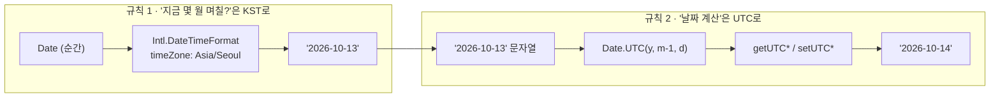
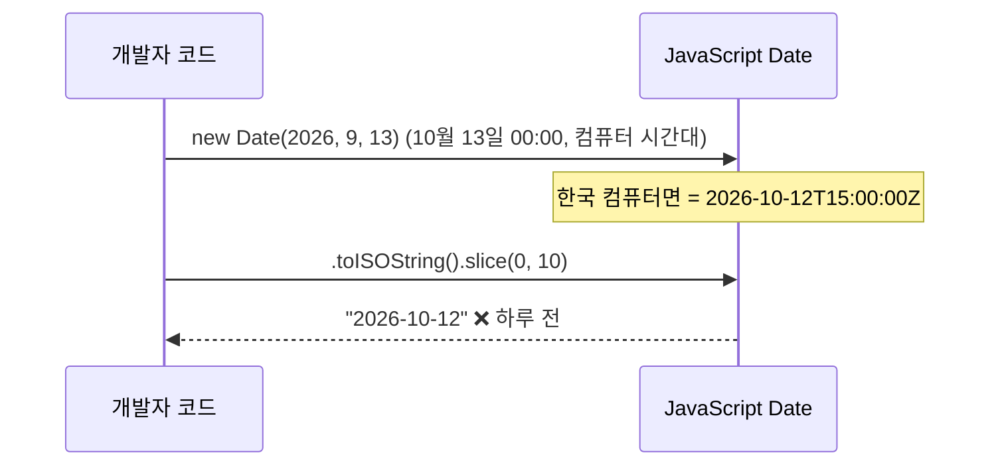
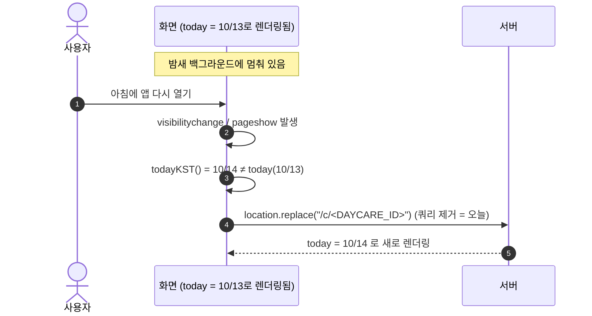

# 08. 날짜와 한국 시간 — "오늘"이 하루 틀어지지 않게

> **한 줄 요약**: 서버는 UTC 시계를 쓰고 사용자는 한국에 있다. "오늘 식단"이 새벽·자정 근처에 어제 것으로 보이지 않으려면 **모든 "오늘"을 `Asia/Seoul` 기준으로 계산**하고, 날짜끼리의 계산은 **UTC로만** 해야 한다.

⏱ 예상 학습 시간 30분 · 선수 지식: JavaScript `Date` 기초 · 난이도 ★★☆ · 커리큘럼은 [README](./README.md)

---

## 1. 왜 필요한가

이 앱의 핵심 약속은 **"열기만 하면 오늘 식단"** 입니다. 그런데 "오늘"은 *누구의 시계*로 정할까요?

```text
  한국 사용자 (UTC+9)                 Cloudflare Worker (UTC)
  ─────────────────────               ─────────────────────────
  10월 13일 화요일 오전 7:30     ═══   10월 12일 월요일 22:30  ← 서버 입장에서는 아직 "어제"
```

서버가 `new Date().toISOString().slice(0, 10)` 같은 흔한 코드로 "오늘"을 만들면, **한국 시간 00:00~08:59 사이에는 어제 날짜**가 나옵니다. 하필 아이 등원 준비하는 아침 시간대에요. 반대로 휴대폰 시계(로컬 시간대)에 맡기면, 한국 밖에서 접속하거나 시간대 설정이 다른 기기에서 어긋납니다.

그래서 원칙은 하나입니다.

> **"오늘" = 어린이집이 있는 곳의 달력 = 항상 `Asia/Seoul`**

---

## 2. 그림으로 보기

### 2-1. 하루가 어긋나는 시간대

| 한국 시각 (KST) | 같은 순간의 UTC | 서버(UTC)가 보는 날짜 | 한국 날짜와 |
|---|---|---|---|
| 10/13 **00:00** | 10/12 15:00 | 10/12 | ❌ 하루 어긋남 |
| 10/13 07:30 (등원 준비) | 10/12 22:30 | 10/12 | ❌ 하루 어긋남 |
| 10/13 **08:59** | 10/12 23:59 | 10/12 | ❌ 하루 어긋남 |
| 10/13 **09:00** | 10/13 00:00 | 10/13 | ✅ 같음 |
| 10/13 23:59 | 10/13 14:59 | 10/13 | ✅ 같음 |

> 정리: **한국 00:00 ~ 08:59 의 9시간** 동안 UTC 날짜는 한국보다 하루 늦습니다.

### 2-2. 이 앱의 두 규칙



- **규칙 1**: "지금 순간"을 *달력 날짜*로 바꿀 때만 시간대가 필요하다 → `todayKST()`
- **규칙 2**: `YYYY-MM-DD`는 이미 달력 날짜다. 더하고 빼고 요일을 구할 땐 시간대가 끼어들 틈이 없게 **UTC로만** 계산한다 → `addDays`, `weekdayKo`

### 2-3. 날짜 계산에 로컬 시간대가 섞이면 생기는 버그



*내 컴퓨터(한국)에서는 그럴듯하게 동작*하다가, 서버(UTC)에 올리면 틀리는 가장 흔한 날짜 버그입니다.

---

## 3. 이 앱에서는 어디에 있나

[`src/lib/dates.ts`](../src/lib/dates.ts) 한 파일에 모았습니다. 화면·서버·테스트가 모두 이 파일의 함수만 씁니다.

| 함수 | 하는 일 | 시간대 |
|---|---|---|
| `todayKST(now?)` | 지금(또는 `now`)의 한국 달력 날짜 `YYYY-MM-DD` | **KST** (Intl) |
| `isIsoDate(s)` | `2026-02-30` 같은 존재하지 않는 날짜 걸러냄 | UTC |
| `addDays(date, n)` | 날짜 ± n일 (월·연·윤년 경계 자동) | UTC |
| `weekdayKo(date)` | `"목"`처럼 한글 요일 | UTC |
| `isWeekend`, `ymOf`, `toYm`, `daysInMonth`, `formatKoreanDate` | 보조 | UTC |
| `nearestDate(sorted, from, ±1)` | 화살표 이동: 식단이 있는 가장 가까운 날 | 문자열 비교 |
| `photoStillStored(imageKey, today)` | 원본 사진이 아직 R2에 남아 있는지(180일) | UTC |

### 3-1. `todayKST` 읽기

```ts
export function todayKST(now: Date = new Date()): string {
  return new Intl.DateTimeFormat("en-CA", {
    timeZone: "Asia/Seoul",
    year: "numeric", month: "2-digit", day: "2-digit",
  }).format(now);
}
```

- `Intl.DateTimeFormat`에 `timeZone`을 주면 **내 컴퓨터 시간대와 무관하게** 그 지역의 달력 날짜가 나옵니다.
- 로케일을 `"en-CA"`(캐나다 영어)로 고른 건 **날짜 형식이 `YYYY-MM-DD`** 이기 때문입니다. 별도 문자열 조립이 필요 없어요.
- 인자 `now`를 받게 만든 이유: **테스트에서 "지금"을 마음대로 정하기 위해서**입니다. (`new Date("2026-10-12T15:30:00Z")` 같은 순간을 넣어 검증)

### 3-2. `addDays`가 UTC로 계산하는 이유

```ts
function toUtc(date: string): Date {
  const [y, m, d] = date.split("-").map(Number);
  return new Date(Date.UTC(y, m - 1, d));       // 항상 UTC 자정
}

export function addDays(date: string, days: number): string {
  const d = toUtc(date);
  d.setUTCDate(d.getUTCDate() + days);           // UTC 기준으로 날짜 증가
  return d.toISOString().slice(0, 10);           // UTC 기준으로 문자열화
}
```

시작도 UTC, 계산도 UTC, 되돌릴 때도 UTC. **한 번도 로컬 시간대를 통과하지 않으므로** 어느 컴퓨터에서 실행해도 같은 결과가 나옵니다. (한국에는 서머타임이 없지만, 이렇게 짜 두면 서머타임 있는 지역의 컴퓨터에서 개발해도 안전합니다.)

---

## 4. 요일 검증과의 관계

AI가 식단표 사진에서 읽은 날짜가 맞는지 확인하는 장치가 **요일 비교**입니다 ([06장](./06-claude-structured-output.md)).

```text
사진:  "7(수)"  →  date: 2026-10-07, weekday: "수"
달력:  weekdayKo("2026-10-07")  →  "수"      ✅ 일치

사진:  "7(목)" 로 읽혔다면      →  달력은 "수"  ❌ 불일치 → 경고
```

`weekdayKo`가 UTC 기준이라서, **사용자가 어느 나라에서 저장하든** 같은 날짜는 같은 요일이 됩니다. 시간대가 끼어 있으면 검증 장치 자체가 흔들리겠죠.

---

## 5. 화면 쪽: 앱을 열어 둔 채로 날짜가 바뀌면

서버가 올바른 "오늘"을 내려줘도 문제가 하나 남습니다.

> 홈 화면에 추가한 앱을 **밤새 켜 둔 채** 아침에 다시 열면, 브라우저가 *어제 렌더링한 화면을 그대로 되살려* 어제 식단이 보입니다. (모바일 브라우저는 백그라운드의 페이지를 멈췄다 재개하고, 뒤로가기 캐시(bfcache)도 같은 현상을 만듭니다.)

[`menu-viewer.tsx`](../src/components/menu-viewer.tsx)의 해결책:

```ts
useEffect(() => {
  // 홈 화면 앱·bfcache는 다음 날 새로고침 없이 재개된다. 날짜가 바뀌었으면 새 "오늘"로 다시 연다.
  function refreshIfDayChanged() {
    if (document.visibilityState === "visible" && todayKST() !== today)
      window.location.replace(window.location.pathname);
  }
  document.addEventListener("visibilitychange", refreshIfDayChanged);
  window.addEventListener("pageshow", refreshIfDayChanged);
  return () => { /* 두 리스너 제거 */ };
}, [today]);
```



| 부분 | 이유 |
|---|---|
| `visibilitychange` | 탭/앱이 다시 *보이게* 될 때 (홈 화면 앱 재개) |
| `pageshow` | 뒤로가기 캐시(bfcache)에서 복원될 때 — 이때는 `visibilitychange`가 안 올 수 있음 |
| `document.visibilityState === "visible"` | 화면이 보일 때만 이동 (백그라운드에서 갑자기 이동하지 않음) |
| `location.replace` (assign 아님) | 히스토리에 어제 화면을 남기지 않음 → 뒤로가기 꼬임 방지 |
| `location.pathname`만 사용 | `?date=...&view=month` 를 버리고 **오늘로** 복귀. (`syncUrl`이 오늘 날짜일 땐 `?date`를 지워 URL을 깔끔하게 유지하는 것과 짝) |

> 💡 클라이언트의 `todayKST()`와 서버의 `todayKST()`는 **같은 함수**입니다. 한쪽만 KST를 쓰고 다른 쪽이 로컬 시간대를 쓰면, 비교 자체가 어긋나 무한 새로고침이 생길 수 있어요.

### ⚠️ 함정: HTML을 캐시하면 새로고침 무한루프가 생긴다

```text
오프라인 + 서비스 워커가 '어제 HTML'을 캐시에서 내줌
  → 화면 로드: today = 10/13(어제 값)
  → 앱이 보임 → todayKST() = 10/14 ≠ 10/13
  → location.replace(...) → 또 캐시에서 같은 어제 HTML
  → 반복 반복 반복 …  (화면 깜빡임·배터리 소모)
```

그래서 [09 PWA 장](./09-pwa.md)에서 다루는 서비스 워커([`public/sw.js`](../public/sw.js))는 **페이지(HTML)를 캐시하지 않습니다.** 페이지 이동은 *항상 네트워크*로 가고, 실패하면 `offline.html`을 보여줍니다. "오늘 식단"은 본질적으로 매일 바뀌는 데이터라서 캐시된 화면이 오히려 해롭기 때문이에요. 나중에 "오프라인에서도 어제 식단 보기"를 만들고 싶다면, 이 루프를 먼저 해결(예: 오프라인 상태에서는 재시도하지 않기, 시도 횟수를 `sessionStorage`에 기록)해야 합니다.

---

## 6. 테스트가 지켜 주는 것

[`dates.test.ts`](../src/__tests__/dates.test.ts)

| 테스트 | 지키는 약속 |
|---|---|
| `todayKST` — UTC 저녁은 한국 기준 다음 날 | `2026-10-12T15:30Z` → `2026-10-13`, `14:59:59Z` → `2026-10-12` (경계 1초 차이) |
| `todayKST` — 월말 경계 | `2026-10-31T16:00Z` → `2026-11-01` |
| 달력 보조 — 2026-10-01은 목, 10-13은 화 | 요일 계산, `formatKoreanDate` |
| `addDays` 월·연 경계 | `10-31 +1 → 11-01`, `01-01 -1 → 이전 해 12-31` |
| `isIsoDate` | `2026-02-30`, `2026-10-1` 거부 |
| `nearestDate` 양방향 | 화살표 이동이 식단 없는 날(주말)을 건너뜀 |
| `photoStillStored` | 업로드 179일째부터 원본 링크 숨김 (R2는 180일에 삭제), 키에 날짜가 없으면 그대로 둠 |

**경계 시각을 테스트하는 습관**이 중요합니다. 날짜 버그는 "대부분 맞고 가끔 틀리는" 형태라서, 평소 값으로는 절대 안 잡혀요. 자정 직전·직후, 월말, 윤년을 꼭 넣으세요.

---

## 7. 직접 해보기

```bash
cd menu
node learn/labs/dates/kst-lab.mjs
# 내 컴퓨터 시간대를 바꿔서도 돌려 보기 — KST 결과는 그대로, 순진한 방법은 달라질 수 있음
TZ=America/New_York node learn/labs/dates/kst-lab.mjs
TZ=Pacific/Auckland node learn/labs/dates/kst-lab.mjs
```

관찰 포인트

1. 한국 새벽 시각에서 `순진한 방법`과 `todayKST`가 어긋나는 행 (`X`)
2. `new Date(2026, 9, 13).toISOString()`이 컴퓨터 시간대에 따라 다르게 나옴
3. 윤년(`2028-02-28 +1`)과 월·연 경계에서 `addDays`가 맞게 동작

도전 과제 (선택): [`dates.test.ts`](../src/__tests__/dates.test.ts)에 `2027-12-31 +1 → 2028-01-01`을 추가하고 `npm test`로 통과 확인. ([11장 테스트](./11-testing-and-quality.md)의 "테스트 추가하기" 참고)

---

## 8. 흔한 실수 · 유지보수 체크리스트

- [ ] `new Date().toISOString().slice(0, 10)` 로 "오늘"을 만들지 않았는가? → `todayKST()`
- [ ] `new Date("2026-10-13")` (문자열 파싱)은 **UTC 자정**, `new Date(2026, 9, 13)`은 **로컬 자정** — 둘이 다릅니다. 섞어 쓰면 하루 어긋나요. 이 앱에서는 `dates.ts` 함수만 쓰기.
- [ ] 월이 **0부터** 시작하는 것(`Date.UTC(y, m - 1, d)`)을 잊지 않았는가?
- [ ] 서버 컴포넌트가 `todayKST()`로 `today`를 만들고 **props로 내려주는** 구조를 유지하는가? (서버·클라이언트가 각자 "오늘"을 다르게 계산하면 hydration 불일치·깜빡임)
- [ ] 새 기능에서 "지금 날짜가 필요"하면 `dates.ts`에 함수를 추가하고 **테스트에서 `now`를 주입**할 수 있게 만들었는가?
- [ ] 캐시(서비스 워커·CDN·`force-dynamic` 해제)를 도입할 때 "오늘 값이 캐시에 박히지 않는가"를 먼저 점검했는가?
- [ ] 다른 나라 어린이집을 지원하게 된다면: 시간대를 `daycares` 테이블 컬럼으로 두고 `todayKST` → `todayIn(timeZone)`으로 일반화 (지금은 한국 전용 가정이 코드 전체에 있음)

---

## 9. 퀴즈

**Q1.** 서버 코드에서 `new Date().toISOString().slice(0, 10)`으로 오늘을 구하면, 한국 시간으로 몇 시부터 몇 시 사이에 하루 틀어질까?

<details><summary>정답 보기</summary>

한국 시간 **00:00 ~ 08:59** 입니다. 이때 UTC는 아직 전날 15:00~23:59라 UTC 날짜가 어제입니다. 한국 09:00에 UTC도 같은 날짜가 됩니다.
</details>

**Q2.** `addDays`는 왜 `new Date(2026, 9, 13)` 대신 `Date.UTC(...)`와 `setUTCDate`를 쓰는가?

<details><summary>정답 보기</summary>

로컬 시간대를 한 번도 거치지 않게 하려는 것입니다. `new Date(y, m, d)`는 그 컴퓨터 시간대의 자정이라, `toISOString()`으로 문자열을 만들면 한국 컴퓨터에서 하루 전 날짜가 나옵니다. UTC로 시작·계산·출력을 모두 하면 어느 컴퓨터에서 돌려도 결과가 같고, 테스트도 안정적입니다.
</details>

**Q3.** 서비스 워커가 HTML을 캐시해 오프라인에서 그대로 내주면 `menu-viewer.tsx`의 날짜 변경 감지는 어떤 문제를 일으킬 수 있나?

<details><summary>정답 보기</summary>

어제 렌더링된 HTML이 `today`=어제를 들고 있어서 화면이 뜨자마자 `todayKST() !== today`가 되고, `location.replace`로 다시 로드하면 또 같은 캐시된 HTML이 나와 **무한 새로고침 루프**가 됩니다. 그래서 이 앱의 서비스 워커는 페이지를 캐시하지 않고 항상 네트워크를 먼저 시도하며, 실패했을 때만 `offline.html`을 보여줍니다.
</details>

---

⬅️ 이전: [07 인증과 쿠키](./07-auth-cookies.md) · ➡️ 다음: [09 PWA](./09-pwa.md) · 전체 목록은 [README](./README.md)
