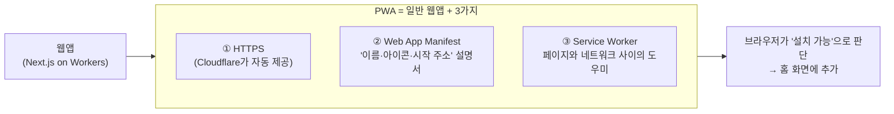
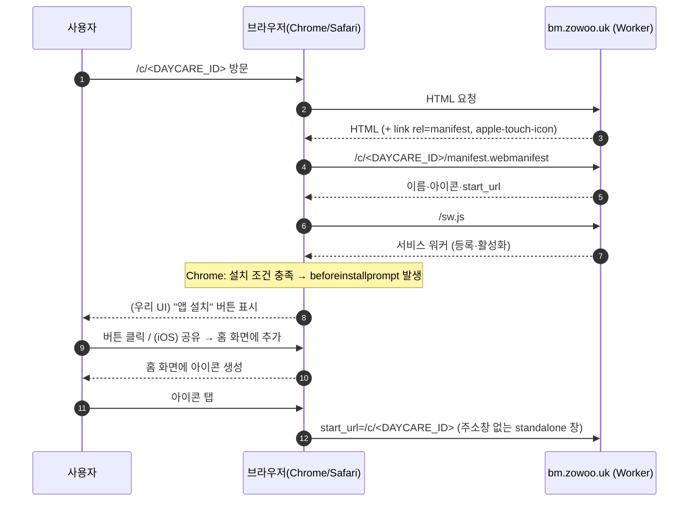
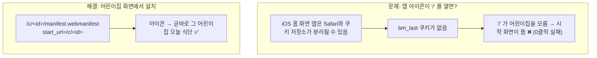
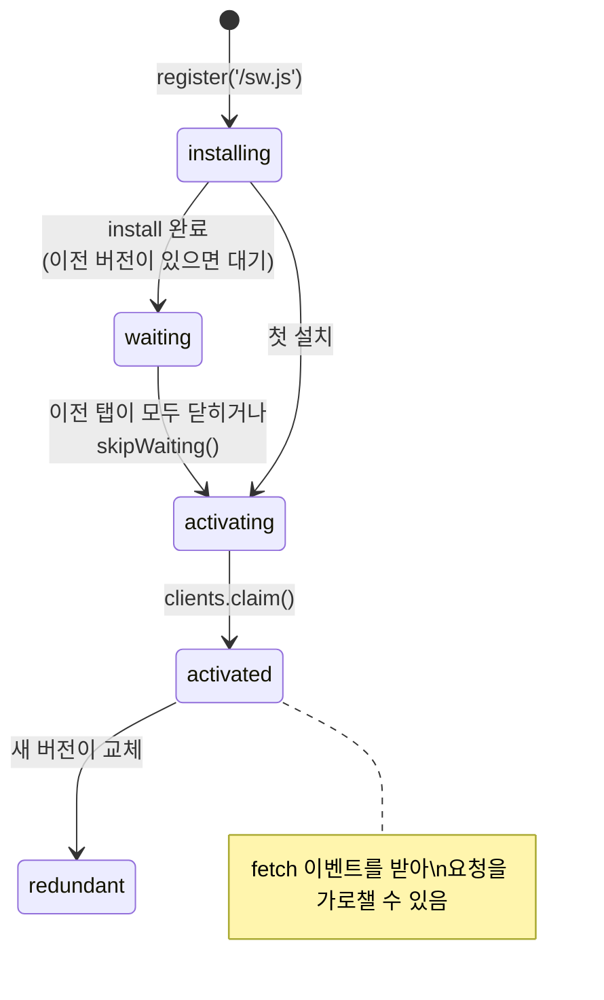
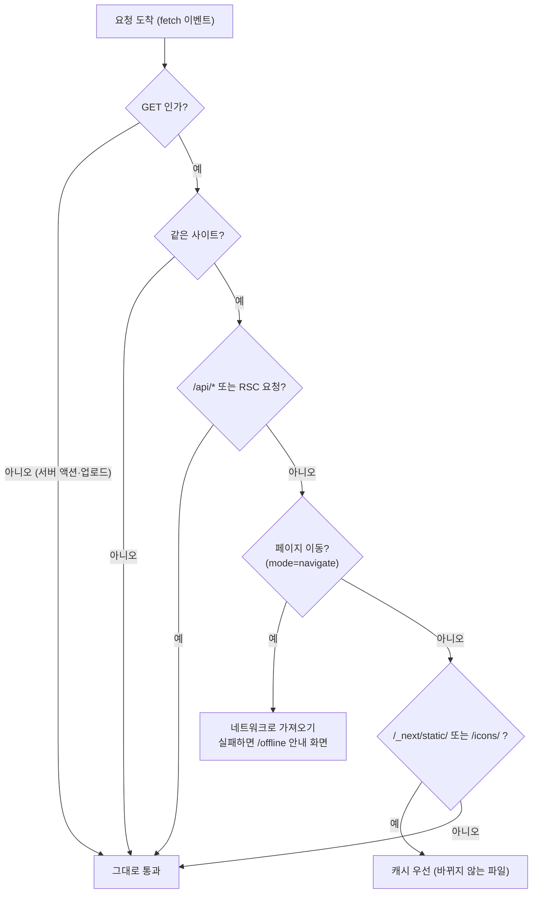
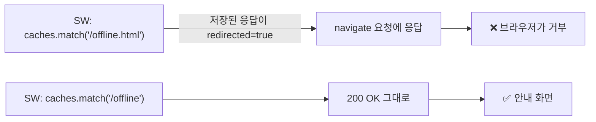
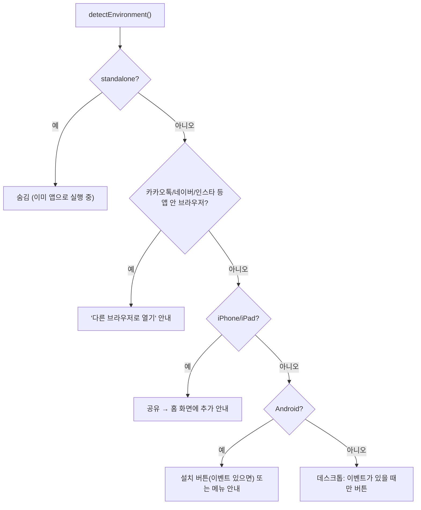

# 09. PWA — 홈 화면에 설치되는 웹앱

> **한 줄 요약**: PWA는 "웹사이트에 설명서(manifest)와 도우미 프로그램(서비스 워커)을 붙여서, 휴대폰 홈 화면에 아이콘으로 설치되고 앱처럼 열리게 만든 것"입니다. 이 앱은 코드 한 벌로 Android·iOS 모두 설치됩니다.

⏱ 읽기 35분 + 실습 30분 · 선수 지식: [00 전체 그림](00-big-picture.md)

---

## 1. 왜 필요한가

이 앱의 핵심은 "아이콘 한 번 눌러서 오늘 식단 보기"입니다. 브라우저 북마크로도 되지만 PWA로 설치하면 이렇게 달라집니다.

| | 브라우저 탭 | PWA(홈 화면 설치) |
|---|---|---|
| 여는 방법 | 브라우저 열기 → 북마크/주소 | **홈 화면 아이콘 한 번** |
| 화면 | 주소창·탭 막대가 있음 | **주소창 없이 전체 화면**(standalone) |
| 시작 화면 | 흰 화면 → 로딩 | 앱 아이콘이 있는 **시작 화면(splash)** |
| 인터넷 끊김 | 브라우저 오류 화면 | 우리가 만든 **안내 화면** |
| 앱 스토어 | 필요 없음 | **필요 없음**(심사·수수료도 없음) |
| 업데이트 | 배포하면 바로 | 배포하면 바로(사용자가 할 일 없음) |

## 2. PWA의 세 가지 재료



| 재료 | 이 앱의 파일 | 하는 일 |
|---|---|---|
| HTTPS | (Cloudflare 자동) | 서비스 워커는 HTTPS(또는 `localhost`)에서만 켜집니다 |
| manifest | [`src/lib/pwa.ts`](../src/lib/pwa.ts), 라우트 2개 | 이름, 아이콘, 시작 주소, 색상을 브라우저에 알려 줌 |
| 서비스 워커 | [`public/sw.js`](../public/sw.js) | 정적 파일 캐시, 인터넷이 없을 때 안내 화면 |
| 아이콘/시작 화면 | `public/icons/`, `public/splash/`, `src/app/apple-icon.png` | 홈 화면 아이콘, iOS 시작 화면 |
| 설치 안내 UI | [`src/components/install-guide.tsx`](../src/components/install-guide.tsx), [`src/lib/pwa-client.ts`](../src/lib/pwa-client.ts) | "앱 설치" 버튼, iOS 안내, 카카오톡 안내 |

## 3. 설치는 어떻게 일어나나



- **Android Chrome**은 설치 가능해지면 `beforeinstallprompt` 이벤트를 줍니다. 우리 앱은 이걸 잡아 두었다가 "앱 설치" 버튼을 누를 때 `prompt()`로 설치 창을 띄웁니다.
- **iOS Safari**에는 이 이벤트가 없습니다. 사용자가 직접 **공유 → 홈 화면에 추가**를 눌러야 해서, 앱이 안내 문구를 보여 줍니다.
- 운영 서버에서 Chrome이 `beforeinstallprompt`를 실제로 발생시키는 것을 Playwright로 확인했습니다(= 설치 조건 충족).

## 4. manifest 읽는 법

운영 주소의 실제 응답을 봅니다(읽기 전용).

```bash
curl -s https://bm.zowoo.uk/manifest.webmanifest | python3 -m json.tool
```

| 필드 | 이 앱의 값 | 의미 |
|---|---|---|
| `id` | `/` 또는 `/c/<DAYCARE_ID>` | 앱의 **신분증**. 같은 id는 같은 앱, 다르면 다른 앱으로 설치됩니다 |
| `name` / `short_name` | `꿈땅 식단` / `꿈땅` | 설치 창·아이콘 밑 이름(짧은 이름은 12자 이내로 자름) |
| `start_url` | `/c/<DAYCARE_ID>` | 아이콘을 눌렀을 때 **처음 열리는 주소** |
| `scope` | `/` | 앱 창 안에서 이동해도 되는 범위. 밖으로 나가면 브라우저 창으로 열립니다 |
| `display` | `standalone` | 주소창 없이 앱처럼 |
| `background_color` | `#f7f7ef` | 시작 화면 배경(앱 배경과 같은 색) |
| `theme_color` | `#426550` | 상단 상태 표시줄 색 |
| `icons` | 192·512·maskable 512 | 아래 5장 참고 |

### 왜 어린이집마다 manifest가 따로 있나



- 그래서 **어린이집 식단 화면에서 설치**해야 합니다. 시작 화면(`/`)에서 설치하면 `start_url`이 `/`입니다.
- 어린이집이 여러 개면 각각 따로 설치할 수 있습니다(`id`가 다름).
- 이 판단의 근거와 한계는 [07 인증과 쿠키](07-auth-cookies.md)를 보세요.

## 5. 아이콘 — 종류가 왜 이렇게 많나

```
 ┌───────────── 512×512 ─────────────┐
 │  ░░░ 바깥 10%: OS가 잘라 낼 수 있음 ░░░ │
 │  ░  ┌────── 안전 영역(중앙 80%) ──────┐ ░ │
 │  ░  │       ◯ ◯ ◯                    │ ░ │   maskable 아이콘은
 │  ░  │     ╭─────────╮                │ ░ │   그림이 이 안에만 있어야
 │  ░  │     │  밥그릇   │                │ ░ │   원형·둥근 사각형으로
 │  ░  │     ╰─────────╯                │ ░ │   잘려도 안 깨져요
 │  ░  └─────────────────────────────────┘ ░ │
 └────────────────────────────────────────────┘
```

| 파일 | 크기 | 용도 |
|---|---|---|
| `public/icons/icon-192.png`, `icon-512.png` | 192, 512 | Android 홈 화면·설치 창 (`purpose: any`) |
| `public/icons/icon-maskable-512.png` | 512 | Android가 원형/둥근 사각형으로 자를 때 (`purpose: maskable`) |
| `src/app/apple-icon.png` | 180 | iOS 홈 화면 아이콘. **불투명**이어야 함(투명하면 검게 채워짐) |
| `public/splash/splash-*.png` | 기기별 | iOS 시작 화면(없으면 하얀 화면이 먼저 뜸) |

- 아이콘 원본은 **Codex CLI의 이미지 생성**으로 그린 `docs/brand/icon-master.png` 한 장입니다. 그림이 중앙 60%에 모여 있어서 `any`와 `maskable`에 같은 이미지를 씁니다.
- 나머지는 [`scripts/generate-pwa-assets.py`](../scripts/generate-pwa-assets.py)가 마스터에서 만듭니다. 디자인을 바꾸려면 마스터만 바꾸고 스크립트를 다시 실행하세요.
- iOS 시작 화면은 기기 화면 크기와 **정확히 맞는 파일**만 씁니다. 그래서 `src/lib/pwa.ts`의 `SPLASH_SCREENS` 목록과 파일 이름 규칙(`splash-<픽셀폭>x<픽셀높이>.png`)이 같아야 하고, 테스트가 파일 존재와 실제 픽셀 크기까지 검사합니다. 새 iPhone이 나오면 이 목록에 한 줄을 추가하세요.

## 6. 서비스 워커 — 이 앱에서는 일부러 조금만 한다

### 6.1 생명주기



- 우리 `sw.js`는 `install`에서 `skipWaiting()`, `activate`에서 `clients.claim()`을 해서 **새 버전이 바로 적용**됩니다.
- 등록할 때 `updateViaCache: "none"`을 쓰고, `public/_headers`로 `/sw.js`를 `Cache-Control: no-cache`로 내보냅니다. 서비스 워커 파일 자체가 캐시에 갇히면 업데이트가 영영 안 되기 때문입니다.
- 캐시 이름에 `VERSION`(`bm-static-v1`)이 들어 있어서, `sw.js`를 고칠 때 **`VERSION`을 올리면** `activate`에서 옛 캐시를 지웁니다.

### 6.2 무엇을 가로채고 무엇을 놔두나



| 요청 | 처리 | 이유 |
|---|---|---|
| 로그인·저장·삭제(POST, 서버 액션) | 통과 | 가로채면 저장이 깨질 수 있음 |
| `/api/daycares/*/analyze`, `/api/images/*` | 통과 | 업로드·원본 사진은 항상 서버로 |
| 페이지 이동 | **네트워크 우선**, 실패 시 안내 화면 | "오늘" 식단이라 항상 최신이어야 함 |
| `/_next/static/*`, `/icons/*` | 캐시 우선 | 파일 이름에 해시가 있어 내용이 안 바뀜 |

### 6.3 왜 페이지를 캐시하지 않나 (설계 결정)

"인터넷이 없어도 어제 본 식단을 보여 주면 좋지 않나?"를 일부러 포기했습니다.

1. **어제 식단이 오늘로 보입니다.** HTML에는 "오늘 날짜"가 서버에서 계산되어 들어 있습니다. 캐시된 HTML을 내보내면 다음 날에도 어제가 "오늘"로 표시됩니다.
2. **무한 새로고침 위험.** [`menu-viewer.tsx`](../src/components/menu-viewer.tsx)는 앱을 다시 열었을 때 한국 날짜가 바뀌었으면 `location.replace`로 새로 고칩니다. 오프라인 캐시가 어제 HTML을 계속 돌려주면 "날짜 다름 → 새로고침 → 같은 어제 HTML → 날짜 다름…"이 반복됩니다([08 날짜와 시간대](08-dates-kst.md)).
3. `/`는 쿠키에 따라 리다이렉트하는 동적 페이지라 캐시와 맞지 않습니다.

> 💡 **교훈**: 캐시는 속도를 주는 대신 "낡은 값을 보여 줄 위험"을 줍니다. 값이 매일 바뀌는 앱이라면 어떤 요청을 캐시해도 되는지 하나씩 따져야 합니다. 직접 비교해 보는 실습이 아래 **실습 2**입니다.

## 7. 배포 중에 실제로 겪은 일 (사례 연구)

**증상**: 처음 만든 서비스 워커가 `/offline.html`을 미리 캐시하도록 했습니다. 로컬 프리뷰에서 `curl -I /offline.html`을 해 보니 `307 Temporary Redirect`, `Location: /offline`이었습니다.

**원인**: Cloudflare Workers의 정적 파일 서빙은 기본 설정(`html_handling`)으로 `.html` 확장자를 떼는 주소를 표준으로 봅니다. 그래서 `/offline.html`은 `/offline`으로 넘어갑니다.

**왜 문제인가**: 페이지 이동 요청은 리다이렉트를 자동으로 따라가지 않는 모드(`redirect: "manual"`)입니다. 서비스 워커가 "리다이렉트를 거친 응답"을 돌려주면 브라우저가 **네트워크 오류로 거부**합니다. 즉 오프라인 안내 화면이 뜨지 않을 뻔했습니다.

**해결**: 서비스 워커가 최종 주소 `/offline`을 쓰도록 바꾸고, Playwright로 오프라인 상태에서 안내 화면이 뜨는 것을 확인했습니다.



같은 맥락으로 `public/_headers`(Workers Assets가 읽는 헤더 설정 파일)도 이번에 추가했습니다. `/sw.js`는 `no-cache`, `/_next/static/*`은 1년 `immutable`입니다. 자세한 구조는 [01 Cloudflare Workers](01-cloudflare-workers.md)를 보세요.

## 8. Android와 iOS는 이렇게 다릅니다

> ⚠️ 아래는 일반적으로 알려진 동작이며 OS·브라우저 버전에 따라 달라질 수 있습니다. 이 저장소에서는 실제 휴대폰으로 설치를 시험하지 못했고, 데스크톱 Chrome(Playwright)과 모바일 화면·User-Agent 에뮬레이션으로 검증했습니다.

| | Android (Chrome) | iOS (Safari) |
|---|---|---|
| 설치 방법 | "앱 설치" 버튼 / ⋮ 메뉴 → 앱 설치 | 공유 → 홈 화면에 추가 |
| 설치 이벤트 | `beforeinstallprompt` 있음 | 없음 (안내 문구로 대체) |
| 카카오톡 등 앱 안 브라우저 | 설치 불가 → **다른 브라우저로 열기** | 설치 불가 → **Safari로 열기** |
| 쿠키·저장소 | 브라우저와 공유 | 홈 화면 앱은 **분리될 수 있음** |
| 시작 화면 | `background_color` + 아이콘 자동 | `apple-touch-startup-image` 필요 |
| 아이콘 | manifest의 `icons` | `apple-touch-icon`(불투명 PNG) |
| 상태 표시줄 | `theme_color` | `statusBarStyle: "default"` |

이 앱에서 `viewportFit: "cover"`나 `black-translucent` 상태 표시줄은 쓰지 않았습니다. 화면을 노치 아래까지 확장하면 고정 저장 버튼과 머리글이 노치·홈 표시줄에 가려져 safe-area 여백 작업이 추가로 필요하기 때문입니다.

## 9. 설치 안내 UI의 작동 원리

[`pwa-client.ts`](../src/lib/pwa-client.ts)가 환경을 하나로 분류합니다.



- React에서 "바깥 세계의 값(브라우저 환경, 이벤트로 바뀌는 값)"을 읽을 때는 `useSyncExternalStore`를 씁니다. 서버 렌더링 때는 `"unknown"`으로 두어 화면을 그리지 않고, 브라우저에서 환경을 알게 되면 그때 나타납니다(서버/클라이언트 HTML 불일치 방지).
- "닫기"를 누르면 `localStorage`의 `bm:install-dismissed`에 기억해 다시 안 보입니다. 다시 보려면 그 키를 지우세요.

## 10. 직접 해보기

### 실습 1 — DevTools로 PWA 속살 보기 (10분)

1. Chrome에서 `https://bm.zowoo.uk/c/<DAYCARE_ID>`를 엽니다.
2. DevTools(F12) → **Application** 탭.
3. **Manifest**: 이름, 아이콘 미리보기, `Installability` 경고 확인.
4. **Service workers**: 상태 `activated`, 범위 `/`. `Update on reload`를 켜고 새로 고침하면 매번 최신 `sw.js`를 받습니다.
5. **Cache storage → `bm-static-v1`**: 미리 저장한 `/offline`과 아이콘 목록 확인.
6. **Network 탭**에서 `Offline` 체크 후 새로 고침 → "인터넷에 연결되어 있지 않아요" 화면이 뜨는지 확인(끝나면 체크 해제).

### 실습 2 — 캐시 전략 비교 (10분, 로컬)

```bash
node learn/labs/pwa/server.mjs     # http://localhost:5173
```

- 세 버튼(`network-first`, `cache-first`, `stale-while-revalidate`)을 번갈아 몇 번씩 누르며 **응답 시각**이 어떻게 변하는지 봅니다.
- 관찰 포인트: `cache-first`는 처음 값에 계속 머뭅니다(= "오늘 식단"에 쓰면 사고). `network-first`는 늘 최신입니다. `stale-while-revalidate`는 한 박자 늦은 값을 먼저 줍니다.
- 이어서 DevTools → Application → Cache storage에서 저장된 응답을 보고, Network 탭을 Offline으로 바꿔 세 전략이 오프라인에서 어떻게 다른지 봅니다.

### 실습 3 — 내 휴대폰에 설치 (10분, 실기기)

**Android (Chrome)**

1. 어린이집 식단 화면을 열고 맨 아래 **앱 설치** 버튼을 누릅니다(또는 ⋮ → 앱 설치).
2. 홈 화면에 둥근 아이콘이 생기는지, 아이콘을 눌렀을 때 주소창 없이 열리는지 확인합니다.

**iPhone (Safari)**

1. Safari에서 어린이집 식단 화면을 엽니다(카카오톡에서 받은 링크라면 "Safari로 열기").
2. 공유 → **홈 화면에 추가**.
3. 아이콘을 눌러 열었을 때 곧바로 오늘 식단이 열리는지 확인합니다. 관리(업로드)를 하려면 **관리 비밀번호를 앱 안에서 한 번 더** 입력해야 할 수 있습니다.

**확인 체크리스트**

- [ ] 아이콘이 잘리지 않고 예쁘게 보인다
- [ ] 아이콘 이름이 어린이집 이름으로 나온다
- [ ] 시작 화면(흰 화면이 아닌 베이지 화면)이 잠깐 나온다
- [ ] 열면 곧바로 오늘 식단이 보인다
- [ ] 비행기 모드에서 열면 안내 화면이 나온다
- [ ] 하루 지난 뒤 다시 열면 그날 식단으로 바뀐다

### 실습 4 — 서비스 워커 업데이트 (선택)

1. `public/sw.js`의 `VERSION`을 `"v2"`로 올려 로컬 프리뷰(`npm run preview`)를 실행합니다.
2. DevTools → Application → Cache storage에서 `bm-static-v1`이 지워지고 `bm-static-v2`가 생기는지 확인합니다.
3. 확인이 끝나면 `git checkout -- public/sw.js`로 되돌립니다.

## 11. 문제 해결

| 증상 | 가능한 원인 | 확인·해결 |
|---|---|---|
| 설치 버튼이 안 뜬다 | 이미 설치됨 / "닫기"를 눌렀음 / 앱 안 브라우저 | 홈 화면 확인, `localStorage`의 `bm:install-dismissed` 삭제, Chrome으로 열기 |
| iOS에서 안내가 안 뜬다 | 이미 standalone으로 실행 중 | 앱이 아니라 Safari 탭에서 열어 보기 |
| 아이콘을 바꿨는데 그대로 | 홈 화면 아이콘은 설치 시점에 복사됨 | 앱을 삭제하고 다시 설치 |
| 배포했는데 이전 화면이 보인다 | 오래된 서비스 워커/정적 캐시 | `VERSION` 올림, DevTools에서 `Unregister` 후 새로 고침 |
| iOS 앱에서 로그인(관리)이 풀린다 | 홈 화면 앱은 Safari와 쿠키가 별개일 수 있음 | 앱 안에서 관리 비밀번호를 한 번 입력 |
| 앱을 열면 시작 화면이 나온다 | `/`에서 설치해서 `start_url`이 `/` | 어린이집 화면에서 다시 설치 |
| 오프라인에서 흰 화면 | 서비스 워커가 아직 활성화되기 전에 오프라인이 됨 | 온라인에서 한 번 열고 다시 시도 |

## 12. 유지보수 체크리스트

- [ ] `sw.js`를 수정했다 → `VERSION` 올림, `npm test`(서비스 워커를 vm에서 돌려 보는 테스트가 있음), 로컬 프리뷰로 오프라인 확인
- [ ] 아이콘 디자인을 바꿨다 → 마스터 교체 → `python3 scripts/generate-pwa-assets.py` → 앱 재설치 안내
- [ ] 새 정적 경로를 추가했다 → `public/_headers` 캐시 규칙을 정할 것
- [ ] 새 iPhone 크기 → `SPLASH_SCREENS`와 생성 스크립트에 같은 줄을 추가
- [ ] 페이지 캐시를 도입하려 한다 → 6.3의 두 가지 문제(어제 식단, 무한 새로고침)를 먼저 해결할 것

## 13. 퀴즈

**Q1.** 서비스 워커가 서버 액션(로그인·저장) 요청을 그냥 통과시키는 이유는?

<details><summary>정답</summary>
서버 액션은 POST입니다. 서비스 워커가 가로채 캐시 응답을 주거나 실패시키면 저장·로그인이 조용히 깨질 수 있습니다. 그래서 GET이 아닌 요청은 `fetch` 핸들러가 `return`으로 건드리지 않습니다(`sw.js`의 첫 검사, 테스트로 보호).
</details>

**Q2.** `cache-first`로 "오늘 식단" 페이지를 캐시하면 어떤 일이 일어나나?

<details><summary>정답</summary>
첫 방문 때의 HTML(그날의 날짜가 박혀 있음)을 계속 보여 줍니다. 다음 날에도 어제 식단이 "오늘"로 표시되고, 날짜 변경 감지 새로고침과 맞물리면 무한 새로고침 위험도 있습니다. 실습 2에서 `cache-first`가 처음 값에 머무는 것으로 확인할 수 있습니다.
</details>

**Q3.** 어린이집 화면이 아니라 `/`에서 설치하면 iPhone에서 무엇이 불편해질 수 있나?

<details><summary>정답</summary>
`start_url`이 `/`가 됩니다. iOS 홈 화면 앱은 Safari와 쿠키 저장소가 분리될 수 있어 `bm_last` 쿠키가 없고, 그러면 `/`가 마지막 어린이집을 모르는 채 시작 화면을 보여 줍니다. 어린이집별 manifest의 `start_url`이 이 문제를 피하는 장치입니다.
</details>

---

### 더 읽을 거리

- MDN — [Progressive web apps](https://developer.mozilla.org/docs/Web/Progressive_web_apps)
- web.dev — [Learn PWA](https://web.dev/learn/pwa)
- Next.js — PWA 가이드(이 저장소의 `node_modules/next/dist/docs/01-app/02-guides/progressive-web-apps.md`)
- Cloudflare — [Workers Static Assets: Headers](https://developers.cloudflare.com/workers/static-assets/headers/)

다음 장 → [10 운영 런북](10-ops-runbook.md)
