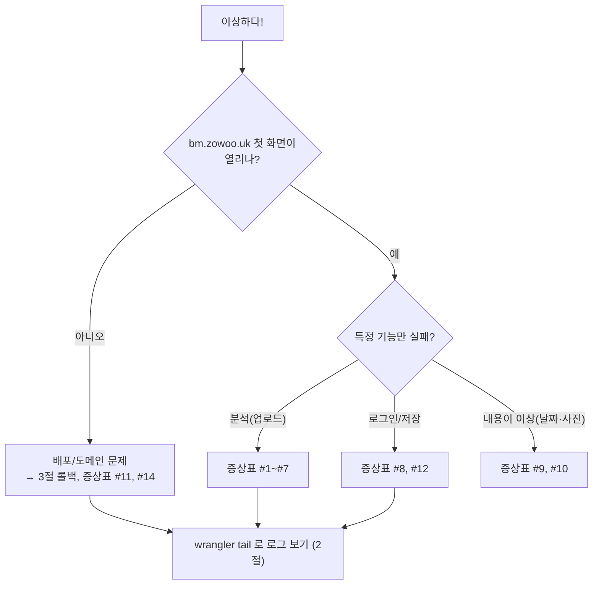
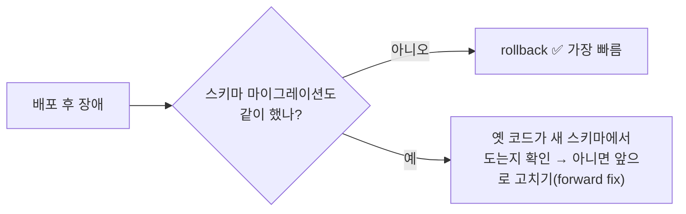
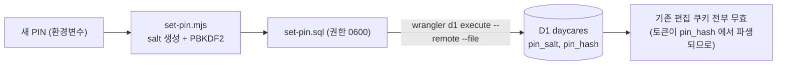

# 10. 운영 런북 — 문제가 났을 때, 그리고 평소에

> **한 줄 요약** — 이 장은 "무슨 일이 생겼을 때 어디를 보고 무엇을 칠지"를 증상별로 모아 둔 **실전 매뉴얼**이다. 읽기 전용 확인 → 원인 좁히기 → (필요할 때만) 운영 변경 순서를 지킨다.

- 예상 소요: 80분 (읽기 40분 + 실습 40분) — 하지만 **필요할 때 펼쳐 보는 문서**입니다.
- 선행: [01](./01-cloudflare-workers.md), [02](./02-opennext-build.md)
- 표기: 🟢 읽기 전용 · 🟡 로컬만 · 🔴 **운영에 영향 — 의도했을 때만**

> **참고** — 이 장의 `wrangler` 명령은 4.110 에서 확인했습니다(`deployments list`, `secret list`, `r2 bucket lifecycle list`, `d1 time-travel info`, `d1 export --local` 은 실제 실행).
> 가격·한도 숫자는 2026-10-14 에 공식 페이지에서 읽은 값이며 바뀔 수 있습니다. 링크를 함께 둡니다.

---

## 1. 왜 필요한가

AI 로 만든 앱의 가장 큰 리스크는 코드가 아니라 **"고장 났을 때 아는 사람이 없다"** 입니다. 이 장은 미래의 나를 위한 메모입니다.



---

## 2. 로그 보기

### 실시간: `wrangler tail` 🟢

```bash
cd menu
npx wrangler tail baby-menu --status error --format pretty          # 에러 요청만
npx wrangler tail baby-menu --search "claude extract failed"         # 앱이 남긴 console 메시지로 찾기
npx wrangler tail baby-menu --method POST --ip self                  # 내가 보낸 POST 만
```

옵션(확인한 목록): `--format json|pretty`, `--status ok|error|canceled`, `--method`, `--header`, `--search`, `--ip`(`self` 가능), `--sampling-rate`, `--version-id`.
꺼내려면 `Ctrl+C`. 다른 터미널에서 문제 기능을 눌러 재현하면서 봅니다.

앱이 남기는 대표 로그 문구 ([`extract.ts`](../src/lib/server/extract.ts), [`analyze/route.ts`](../src/app/api/daycares/%5Bid%5D/analyze/route.ts)):

| 로그 문구 | 의미 |
|---|---|
| `claude extract failed { status: 403, … }` | Anthropic 이 요청을 거절 → **위치(placement)** 의심 |
| `claude extract failed { status: 401, … }` | 키가 틀리거나 폐기됨 |
| `claude extract failed { status: 429, … }` | Anthropic 쪽 사용량 제한 |
| `analyze failed …` | 위에 없는 예상 밖 오류 (스택 확인) |

> ⚠️ 로그에는 방문자 IP 같은 정보가 섞입니다. 이슈 트래커나 채팅에 **그대로 붙여넣지 마세요.**

### 과거 로그: 대시보드 Observability 🟢

**Workers & Pages → Overview → (Worker `baby-menu`) → Observability**. 보관 기간은 Free 3일 / Paid 7일입니다.
`wrangler.jsonc` 의 `"observability": { "enabled": true }` 가 켜져 있어야 쌓입니다.
([공식 문서](https://developers.cloudflare.com/workers/observability/logs/workers-logs/))

---

## 3. 배포와 롤백

### 3-1. 배포 전 점검표

```bash
cd menu
npm run lint && npm run typecheck && npm test          # 🟢 코드 점검
npm run preview                                         # 🟢 Workers 런타임으로 로컬 확인
git status --short                                      # 의도한 파일만 바뀌었나
```

스키마(테이블)를 바꿨다면 **코드 배포보다 먼저**:

```bash
npm run db:migrate:remote      # 🔴 운영 DB 마이그레이션. 적용 전에 백업(5절)을 받아 두세요
```

### 3-2. 배포 🔴

```bash
npm run deploy                 # 🔴 빌드(+키 검사) → 운영 새 버전 활성화
```

### 3-3. 배포 후 30초 확인

```bash
curl -s -o /dev/null -w "%{http_code}\n" https://bm.zowoo.uk/                      # 200 (쿠키 없으면 랜딩)
curl -sI https://bm.zowoo.uk/ | grep -i cf-placement                               # remote-ICN 인지 (HKG 403 방지)
curl -sI https://bm.zowoo.uk/sw.js | grep -i -E "^(HTTP|cache-control)"            # no-cache 인지
npx wrangler deployments list | head -12                                           # 방금 배포가 맨 아래에 있는지
```

그리고 폰으로 `/c/<DAYCARE_ID>` 를 열어 **오늘 날짜의 식단이 나오는지** 눈으로 봅니다.

### 3-4. 이력과 롤백

```bash
npx wrangler deployments list     # 🟢 최근 배포 10개 (Created / Author / Source / Message / Version)
npx wrangler deployments status   # 🟢 지금 운영 중인 버전
npx wrangler versions list        # 🟢 최근 버전 10개
npx wrangler rollback <VERSION_ID> -m "분석 502 발생으로 롤백"    # 🔴 이전 버전으로 되돌림
```

- `deployments list` 출력의 `Source` 로 무슨 일인지 알 수 있습니다: `Upload`(코드 배포), `Secret Change`(secret 변경) 등.
- `rollback` 옵션: `[version-id]`, `-m/--message`, `-y/--yes`, `--name`. 대시보드로는 **Deployments → 버전 옆 `⋯` → Rollback**.
- 공식 제약: 최근 100개 버전까지만 롤백 가능, **바인딩된 리소스(D1/R2)의 데이터는 되돌아가지 않음**.
  스키마를 바꾼 뒤 옛 코드로 롤백하면 "코드는 옛날, DB는 새 구조"가 되어 오류가 날 수 있습니다. ([문서](https://developers.cloudflare.com/workers/configuration/versions-and-deployments/rollbacks/))



---

## 4. 비밀값 · 모델 · 비밀번호

### 4-1. Claude API 키 교체 🔴

```text
① Anthropic Console 에서 새 키 발급
② npx wrangler secret put CLAUDE_API_KEY      ← 프롬프트에 붙여넣기 (명령줄 인자로 쓰지 않음)
③ 바로 새 버전이 배포됨 (Source: Secret Change)
④ 분석을 한 번 시도해 확인 (또는 wrangler tail 에서 401 이 없는지)
⑤ 확인되면 Console 에서 옛 키 폐기
⑥ 로컬 .env.local 도 새 키로 (gitignore 대상)
```

- `npx wrangler secret list` 🟢 은 **이름만** 보여 줍니다(예: `CLAUDE_API_KEY  secret_text`). 값은 누구도 다시 볼 수 없습니다.
- 키는 `wrangler.jsonc` 의 `vars` 에 넣지 않습니다([01장](./01-cloudflare-workers.md#5-바인딩-코드가-리소스를-만나는-방식)). 빌드 검사는 [02장](./02-opennext-build.md#4-비밀-키-방어선--왜-scrub-과-verify-가-둘-다-있나).
- 키가 노출됐다고 의심되면 ⑤를 **먼저** 하고 ②를 이어서 해도 됩니다(잠깐 분석이 막히는 것이 요금 사고보다 낫습니다).

### 4-2. 모델 바꾸기 🔴

[`wrangler.jsonc`](../wrangler.jsonc) 의 `vars.CLAUDE_MODEL` 한 줄:

```jsonc
"vars": { "CLAUDE_MODEL": "claude-sonnet-5-5" }     // 인식이 부족하면 "claude-opus-5-5" 로
```

1. 파일을 고치고 → 2. (선택) 로컬에서 `.env.local` 의 `CLAUDE_MODEL` 로 샘플 `docs/menu.jpeg` 를 먼저 분석해 비교 → 3. `npm run deploy`.
대시보드의 Variables 에서 직접 고쳐도 되지만 **다음 배포 때 파일 값으로 덮어써집니다**([01장 6절](./01-cloudflare-workers.md#6-wranglerjsonc-한-줄씩)).

비용 감각 (공식 [가격 페이지](https://platform.claude.com/docs/en/about-claude/pricing), 2026-10-14):

| 모델 | 입력 | 출력 |
|---|---|---|
| Sonnet 5.5 | $2 / MTok | $10 / MTok |
| Opus 5.5 | $4 / MTok | $20 / MTok |

→ 같은 사진을 Opus 로 읽으면 대략 **2배** 비용입니다. 이 앱의 `max_tokens` 는 16,000 이므로 출력만 보면 **한 번 분석의 상한**은
Sonnet ≈ 16,000 × $10 / 1,000,000 = **$0.16 + 입력 소액**, Opus ≈ $0.32 입니다(계산한 상한이며 실제는 대개 훨씬 적습니다. 실제 사용량은 Console 의 Usage 에서 확인).
앱의 하루 상한(어린이집당 10회, 전체 60회)이 걸려 있어 **최악의 하루 요금**도 대략 Sonnet $10 / Opus $19 수준으로 묶입니다.

### 4-3. 어린이집 관리 비밀번호(PIN) 바꾸기 🔴

**원리** — D1 `daycares` 테이블에는 PIN 원문이 없고 `pin_salt`(16바이트 무작위, hex)와 `pin_hash`(PBKDF2 · SHA-256 · 100,000회 · 256비트, hex)만 있습니다.
로그인은 입력값을 같은 방식으로 해시해 `pin_hash` 와 비교합니다([`auth.ts`](../src/lib/server/auth.ts)). 그래서 바꾸려면 **새 salt/hash 를 만들어 `UPDATE`** 하면 됩니다.



사용하는 도구: [`labs/cloudflare/set-pin.mjs`](./labs/cloudflare/set-pin.mjs) (DB 에 접속하지 않고 SQL 파일만 만듭니다. 로컬 D1 로 검증함).

**① 리허설 (로컬, 🟡)** — 가짜 어린이집으로 먼저 해 봅니다.

```bash
cd menu
STATE=$(mktemp -d)                                  # 연습용 임시 DB 위치
npx wrangler d1 migrations apply baby-menu --local --persist-to "$STATE"
npx wrangler d1 execute baby-menu --local --persist-to "$STATE" \
  --command "INSERT INTO daycares VALUES ('labtest01','연습','00','00',0)"
DAYCARE_ID=labtest01 NEW_PIN='lab-pin-1234' node learn/labs/cloudflare/set-pin.mjs "$STATE/set-pin.sql"
npx wrangler d1 execute baby-menu --local --persist-to "$STATE" --file "$STATE/set-pin.sql"
rm -rf "$STATE"
```

**② 운영 적용 (🔴)**

```bash
cd menu
npx wrangler d1 execute baby-menu --remote --command "SELECT id, name FROM daycares"    # 🟢 대상 id 확인

printf '새 비밀번호: '; read -rs NEW_PIN; echo; export NEW_PIN        # 화면·히스토리에 남기지 않기
DAYCARE_ID=<DAYCARE_ID> node learn/labs/cloudflare/set-pin.mjs ./set-pin.sql
npx wrangler d1 execute baby-menu --remote --file ./set-pin.sql      # 🔴 여기서 실제로 바뀜
rm -f ./set-pin.sql; unset NEW_PIN
```

**③ 확인** — 관리 화면에서 새 비밀번호로 잠금이 풀리고, 옛 비밀번호는 안 되는지 확인합니다.

- 모든 기기의 편집 쿠키가 무효가 되므로 **각 기기에서 새 PIN 을 한 번 다시 입력**해야 합니다.
- 같은 IP 에서 하루 20번 틀리면 잠깁니다(`LIMITS.unlockFailPerIp`). 추측하기 쉬운 PIN 일수록 이 제한이 유일한 방어입니다.
- PIN 이 들어간 명령은 셸 히스토리에 남지 않게 위처럼 `read -s` 를 쓰세요. 이 저장소·채팅·문서에 PIN 을 적지 마세요.
- `set-pin.sql` 에는 salt/hash 가 들어 있으니 **적용 직후 삭제**합니다(저장소 폴더 안에 두면 `git add` 사고 위험이 있으니 `/tmp` 쓰는 것도 방법).

---

## 5. 데이터 백업과 복구

### 5-1. 내보내기 (SQL 파일) 🟢

```bash
mkdir -p ~/baby-menu-backups                                           # 저장소 "밖"
npx wrangler d1 export baby-menu --remote --output ~/baby-menu-backups/baby-menu-$(date +%F).sql
```

옵션(공식 문서): `--output`(필수), `--local`/`--remote`, `--table`, `--no-schema`, `--no-data`.
⚠️ 파일에는 **모든 식단과 `pin_hash`** 가 들어 있습니다. 저장소 안에 두면 `*.sql` 이 gitignore 대상이 아니라 커밋될 수 있으니 **저장소 밖**에 두세요.
로컬 연습: `npx wrangler d1 export baby-menu --local --output /tmp/x.sql` (4.110 에서 확인).

### 5-2. Time Travel — 되돌리기

```bash
npx wrangler d1 time-travel info baby-menu          # 🟢 지금 시점의 bookmark 출력 (restore 명령 예시도 나옴)
npx wrangler d1 time-travel restore baby-menu --timestamp <시각>   # 🔴 DB 를 그 시점으로 "덮어씀"
```

- 공식 문서: 보관은 Paid 최대 30일 / Free 최대 7일. `restore` 는 **제자리 덮어쓰기**이고 진행 중 쿼리는 취소되며, **되돌리는 bookmark 를 출력**하므로 실수해도 취소할 수 있습니다.
- `--timestamp` 는 Unix 초 또는 RFC3339 문자열입니다. 복구 **전에** `info` 로 bookmark 를 메모해 두세요.
- Time Travel 은 **D1 만** 되돌립니다. R2 사진은 대상이 아닙니다.
  ([문서](https://developers.cloudflare.com/d1/reference/time-travel/))

| 상황 | 추천 |
|---|---|
| 방금 실수로 달 하나를 삭제 | Time Travel `info` → `restore` (또는 화면에서 사진 다시 분석) |
| 마이그레이션 직후 망가짐 | `info` 로 bookmark 확인 → restore |
| 장기 보관용 사본 | `d1 export` 정기 실행 |

---

## 6. 사진(R2) 보관 기간

```bash
npx wrangler r2 bucket lifecycle list baby-menu       # 🟢
```

현재 규칙(실제 출력):

```text
name:     Default Multipart Abort Rule   prefix: (all prefixes)   Abort incomplete multipart uploads after 7 days
name:     expire-menu-photos-180d        prefix: daycares/        Expire objects after 180 days, Abort incomplete multipart uploads after 1 days
```

- 업로드 **180일 뒤** `daycares/` 아래 사진이 지워집니다. 공식 문서상 삭제는 만료 후 **대체로 24시간 안에** 일어납니다.
- 앱은 키에 들어 있는 업로드 날짜로 만료를 판단해, 하루 일찍(179일째) "원본 보기" 링크를 숨깁니다([`dates.ts`](../src/lib/dates.ts) `photoStillStored`).
- **기간을 바꾸려면 두 곳을 같이**: ① R2 규칙(대시보드 **R2 object storage → 버킷 → Settings → Object Lifecycle Rules**, 또는 `lifecycle add/remove/set`), ② `dates.ts` 의 `PHOTO_RETENTION_DAYS`.
  CLI 옵션은 `lifecycle add` 의 세부 플래그를 이 문서에서 확인하지 못했으니 공식 문서([링크](https://developers.cloudflare.com/r2/buckets/object-lifecycles/))를 보세요.
- 🔴 규칙을 줄이면 **이미 올라간 사진 중 새 기준을 넘긴 것이 삭제**될 수 있습니다. 되돌릴 수 없습니다.

---

## 7. 비용과 한도 감각

| 서비스 | 무료 구간(2026-10-14 공식 페이지 기준) | 이 앱에서 |
|---|---|---|
| Workers | Free: 하루 100,000 요청, 요청당 CPU 10 ms ([한도](https://developers.cloudflare.com/workers/platform/limits/)) | 가족 규모는 요청 수 여유. **CPU 10 ms 는 빠듯할 수 있음** — 플랜은 대시보드 Billing 에서 확인 |
| Workers 로그 | Free 3일 보관 / 하루 20만 이벤트, Paid 7일 | — |
| D1 | Free: 하루 읽기 500만 행 / 쓰기 10만 행, 저장 5 GB ([가격](https://developers.cloudflare.com/d1/platform/pricing/)) | 화면 한 번에 몇 행. 매우 여유 |
| R2 | 월 10 GB-month 저장 · Class A 100만 · Class B 1,000만 · **송신(egress) 무료** ([가격](https://developers.cloudflare.com/r2/pricing/)) | 사진 수 MB × 어린이집 수. 180일 삭제로 더 작음 |
| Claude API | 무료 구간 없음, 토큰 과금 ([가격](https://platform.claude.com/docs/en/about-claude/pricing)) | **가장 큰 변동 비용.** 앱 상한 + Console 의 지출 한도 설정 권장 |

- 요금 사고 방지 3중 장치: ① 앱의 하루 상한(분석 10/60회, [`limits.ts`](../src/lib/server/limits.ts)) ② Console 의 지출/사용량 한도 ③ 월 1회 Usage 확인(8절).
- 현재 사용량 확인(🟢, 분석 횟수 — `created_at` 은 밀리초):

```bash
npx wrangler d1 execute baby-menu --remote --command \
 "SELECT kind, scope, COUNT(*) AS n FROM usage_events WHERE created_at > (strftime('%s','now') - 86400) * 1000 GROUP BY kind, scope ORDER BY n DESC"
```

---

## 8. 증상 → 원인 → 확인 → 해결 (장애 대응표)

| # | 증상 | 가장 흔한 원인 | 먼저 확인 (🟢) | 해결 |
|---|---|---|---|---|
| 1 | 분석 실패 "AI 서버 오류"(502), 로그 `status: 403` | Worker 가 **홍콩 등 비지원 위치**에서 실행([01장](./01-cloudflare-workers.md#4-실제-사건-홍콩-colo-에서-anthropic-403)) | `curl -sI https://bm.zowoo.uk/ \| grep -i cf-placement` → `remote-ICN` 인가? `wrangler.jsonc` 에 `placement` 있나? | placement 복구 후 🔴 배포 |
| 2 | 분석 실패 "AI 키 설정에 문제" | 키 오류·폐기·미설정(401) | `npx wrangler secret list` 에 `CLAUDE_API_KEY` 있나? 로그 `status: 401` | 4-1 키 교체 |
| 3 | 분석 실패 "AI 사용량이 많아요" | Anthropic 쪽 제한(429) | 로그 `status: 429`, Console 의 사용량·한도 | 잠시 후 재시도, 한도 상향 |
| 4 | "이미지를 AI가 처리하지 못했어요" / "식단표가 너무 길어" / "AI가 이 사진을 처리하지 않았어요" | 사진 문제(흐림·너무 큼·식단표 아님), 출력 토큰 초과 | 원본 사진 확인 | 더 선명한 사진, 한 달 한 장씩 |
| 5 | "오늘 분석 횟수를 모두 썼어요"(429) | 앱 하루 상한(10/60회) | 7절의 `usage_events` 쿼리 | 24시간 대기, 급하면 🔴 `limits.ts` 상수 조정 후 배포 |
| 6 | "사진이 너무 커요"(413) / "JPG, PNG, WEBP 만"(415) | 6 MB 초과 / 형식 | 브라우저가 축소하지 못한 경우(예: HEIC) | JPEG 로 변환해 재업로드 |
| 7 | 분석이 401 "편집 권한이 없어요" | 편집 쿠키 없음/무효(다른 앱·PIN 변경) | 관리 화면에서 비번 입력 화면이 뜨나 | 비밀번호 재입력 |
| 8 | 비밀번호를 쳐도 계속 잠김 | ① 틀림 ② 20회 실패 잠금 ③ 쿠키 차단(사생활 모드·앱 안 브라우저) | 개발자 도구 → Application → Cookies 에 `bm_edit_…` 생기나 | 정상 브라우저에서 시도 / 다음 날 / 4-3 으로 PIN 재설정 |
| 9 | "원본 보기"가 안 보이거나 깨짐 | 180일 경과(179일째부터 숨김) 또는 R2 객체 삭제 | 6절 `lifecycle list`, R2 대시보드에서 객체 | 정상 동작. 필요하면 사진 재업로드 |
| 10 | "오늘" 화면이 어제 식단 | 탭/앱이 오래 켜져 있음, 오래된 캐시 | 앱 완전 종료 후 재실행; 서버 시간 문제는 아님(서버가 KST 계산) | 새로고침. 계속되면 서비스 워커가 HTML 을 캐시하는지 점검([09장](./09-pwa.md)) |
| 11 | 배포 직후 500 / 하얀 화면 | 코드 오류, 빠뜨린 마이그레이션 | `wrangler tail baby-menu --status error` | 3-4 롤백 후 원인 수정 |
| 12 | 로그에 `no such table` | 운영 DB 마이그레이션 누락 | `npx wrangler d1 execute baby-menu --remote --command "SELECT name FROM sqlite_master WHERE type='table'"` | 🔴 `npm run db:migrate:remote` |
| 13 | 빌드가 `Sensitive build artifact detected` 로 중단 | 키가 산출물에 섞임 | 에러의 파일 경로 | [02장 Q3](./02-opennext-build.md#10-퀴즈) 순서대로 |
| 14 | `bm.zowoo.uk` 자체가 안 열림 | 도메인 연결·Worker 상태 | 대시보드 **Worker → Settings → Domains & Routes** 상태, `wrangler deployments list` | 도메인 재연결 / 롤백 |
| 15 | 분석이 30초 넘게 걸림 | 정상 범위(약 30초). 사진이 복잡하면 더 | `wrangler tail` 에서 같은 요청의 소요 시간 | 기다리기. 반복적으로 타임아웃이면 로그 확인 |

> **진단 원칙** — "무엇이 다른가?"를 하나씩 지웁니다: 키 / 코드 / **위치** / 데이터 / 쿠키(기기). HKG 사건이 그 사례입니다.

---

## 9. 매월 루틴 체크리스트

**식단표가 오면 (월 1회, 10분)**
- [ ] 관리 화면에서 사진 업로드 → AI 분석 대기(~30초)
- [ ] 경고(요일 불일치·빈 날) 확인, 알레르기 번호가 원본과 같은지 눈으로 대조
- [ ] 저장 → `/c/<DAYCARE_ID>` 에서 오늘·내일 식단 확인, 폰에서도 확인

**점검 (월 1회, 5분)**
- [ ] Observability 에서 에러 요청이 눈에 띄게 늘지 않았나
- [ ] Anthropic Console 의 사용량·잔액
- [ ] `usage_events` 쿼리로 분석 횟수 이상 징후(7절)
- [ ] `npx wrangler r2 bucket lifecycle list baby-menu` 에 `expire-menu-photos-180d` 가 `enabled: Yes`
- [ ] `npx wrangler d1 export … --output ~/baby-menu-backups/…` (저장소 밖)

**분기마다**
- [ ] `npm outdated` 로 Next.js·OpenNext·wrangler 업데이트 확인(보안 패치 우선). 올린 뒤 `lint → typecheck → test → preview → deploy`
- [ ] `compatibility_date` 는 급히 올리지 않기(올리면 반드시 로컬 `preview` 확인)

---

## 10. 직접 해보기 (모두 🟢 읽기 전용 또는 🟡 로컬)

1. `npx wrangler deployments list` 와 `npx wrangler secret list` 를 실행해 출력의 각 줄이 무엇인지 설명해 보기.
2. `npx wrangler r2 bucket lifecycle list baby-menu` 의 두 규칙 차이를 6절 표와 대조.
3. `npx wrangler d1 time-travel info baby-menu` 를 실행하고 출력의 bookmark 를 메모하기 (restore 는 **하지 않기**).
4. 4-3 ① 리허설을 그대로 실행하고, 마지막에 `STATE` 폴더가 지워졌는지 확인.
5. `npx wrangler tail baby-menu --format pretty` 를 켜 두고 폰에서 `/c/<DAYCARE_ID>` 를 새로고침해 로그에 한 줄이 찍히는지 보기.
6. 8절 표에서 **#1 과 #2 를 로그만 보고 구분**하는 방법(둘 다 502)을 말로 설명해 보기.

---

## 11. 흔한 실수

- [ ] 운영 SQL 을 `--remote` 인지 모른 채 실행 → 항상 명령을 소리 내어 읽고 실행.
- [ ] `d1 export` 파일을 저장소 안에 두고 커밋 → `pin_hash` 와 개인 데이터 유출. 저장소 밖에 보관.
- [ ] PIN 을 채팅/문서/명령줄 인자에 씀 → 히스토리·로그에 남음. 환경변수 + `read -s`.
- [ ] 장애 때 곧장 코드를 고침 → 먼저 **롤백으로 서비스를 살리고** 원인은 나중에.
- [ ] 로그를 이슈에 통째로 붙여 넣음 → IP·헤더가 섞여 있음.
- [ ] Time Travel 로 되돌리고 R2 사진도 돌아왔다고 착각 → D1 만 되돌아갑니다.

---

## 12. 퀴즈

**Q1.** 배포 직후 분석이 502 입니다. 로그에는 `status: 403` 이 있습니다. 가장 먼저 칠 명령 하나는?

<details><summary>정답</summary>

`curl -sI https://bm.zowoo.uk/ | grep -i cf-placement` — `remote-ICN` 이 아니거나 헤더가 없다면 placement 문제입니다. `wrangler.jsonc` 에 `placement` 가 남아 있는지 확인하고, 없다면 복구 후 배포합니다.
</details>

**Q2.** PIN 을 바꿨더니 집 PC 는 괜찮은데 아내의 폰에서는 관리 화면이 다시 비밀번호를 묻습니다. 버그인가요?

<details><summary>정답</summary>

정상입니다. 편집 쿠키의 값이 `sha256(id + pin_hash)` 라서 `pin_hash` 가 바뀌면 이전 쿠키는 전부 무효가 됩니다. 각 기기에서 새 PIN 을 한 번 입력하면 됩니다. (PC 에서 안 물은 것은 아직 그 쿠키로 편집 화면을 다시 열지 않았기 때문일 수 있습니다.)
</details>

**Q3.** 사진 보관 기간을 180일에서 90일로 줄이려 합니다. 바꿔야 하는 곳 두 군데와, 줄일 때의 주의점은?

<details><summary>정답</summary>

R2 lifecycle 규칙(`expire-menu-photos-180d` 를 90일로)과 `src/lib/dates.ts` 의 `PHOTO_RETENTION_DAYS`. 주의: 이미 90일을 넘긴 사진이 곧바로(대체로 24시간 안에) 삭제되어 복구할 수 없습니다.
</details>

---

## 다음으로

[11. 테스트와 품질](./11-testing-and-quality.md) 또는 [12. 용어집과 다음 학습](./12-glossary-and-next-steps.md).
