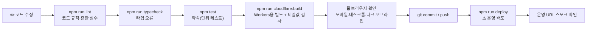
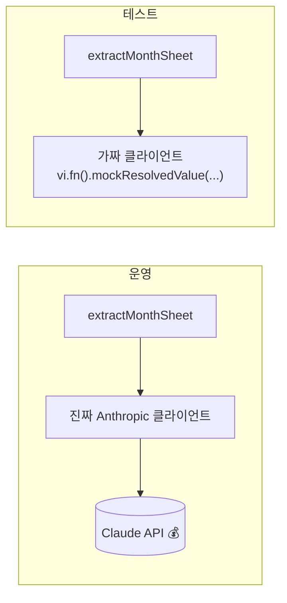
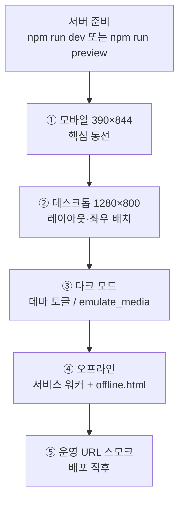

# 11. 테스트와 품질 — "고쳤는데 다른 게 깨졌네?"를 막는 법

> **한 줄 요약**: 이 앱은 **① 린트 → ② 타입체크 → ③ 단위 테스트 → ④ Cloudflare 빌드 → ⑤ 브라우저로 실제 확인** 순서로 점검한다. 자동 테스트(①~④)가 "깨지지 않았다"를 지켜 주고, 마지막 사람의 눈(⑤)이 화면·실제 동작을 확인한다.

⏱ 예상 학습 시간 50분 · 선수 지식: [06](./06-claude-structured-output.md), [08](./08-dates-kst.md) · 난이도 ★★☆ · 커리큘럼은 [README](./README.md)

---

## 1. 왜 필요한가

AI와 함께 코드를 고치면 속도가 빠른 만큼 **"고친 곳 말고 다른 곳이 조용히 깨지는"** 일이 잦습니다. 이 앱에서 깨지면 안 되는 약속은 이런 것들이죠.

| 약속 | 깨지면 |
|---|---|
| 한국 시간 기준 "오늘" | 아침에 어제 식단이 뜸 |
| AI 결과에서 다른 달·요일 불일치를 걸러냄 | 틀린 날짜의 식단이 저장됨 |
| 서비스 워커가 POST·API를 건드리지 않음 | 식단 저장·AI 분석이 먹통 |
| API 키가 빌드 결과물에 없음 | 키가 외부에 노출 |

사람이 매번 전부 확인할 수는 없으니, **약속을 코드(테스트)로 적어 두고 기계가 대신 확인**하게 합니다.

---

## 2. 그림으로 보기

### 2-1. 품질 관문 (Quality Gates)



```text
빠르고 싸다 ◄──────────────────────────────────────► 느리고 비싸다 (그래서 마지막에)
   lint  →  typecheck  →  test  →  build  →  브라우저  →  deploy  →  운영 확인
  (수 초)    (수 초)       (1초)    (1~2분)   (사람이 직접)
```

앞 단계에서 걸리면 뒤 단계는 볼 필요가 없습니다. **싼 검사부터** 돌리는 게 원칙입니다.

### 2-2. 이 앱의 테스트 피라미드 (정직한 버전)

```text
                 ▲ 적음 / 느림 / 현실적
                ╱ ╲
               ╱ 5 ╲   Playwright 수동 점검 (화면·모바일·오프라인·운영)
              ╱─────╲
             ╱   4   ╲  cloudflare:build 의 비밀값 검증 스크립트
            ╱─────────╲
           ╱     3     ╲ vitest 단위 테스트: 날짜·정규화·Claude(mock)·PWA
          ╱─────────────╲
         ╱       2       ╲ typecheck (타입이 곧 테스트)
        ╱─────────────────╲
       ╱         1         ╲ lint
      ▼ 많음 / 빠름 / 좁은 범위
```

> ⚠️ **자동 테스트가 *없는* 것**: 서버 액션(`actions.ts`), D1 쿼리(`db.ts`), React 화면. 이 부분은 ⑤번 브라우저 점검과 [10장 운영](./README.md)의 로그 확인으로 보완합니다. 새로 위험한 로직을 만들 때는 *순수 함수로 떼어내* 테스트 가능하게 만드는 게 이 저장소의 방침입니다 (`sheet.ts`, `dates.ts`, `pwa.ts`가 그 예).

---

## 3. 이 앱에서는 어디에 있나

### 3-1. 파일 배치

```text
menu/
├─ vitest.config.ts          ← 테스트 환경 (node), include: src/__tests__/**/*.test.ts, '@' 별칭
├─ src/__tests__/
│   ├─ dates.test.ts         ← 한국 시간·달력·사진 만료
│   ├─ sheet.test.ts         ← AI 결과 정규화·편집기 텍스트 변환
│   ├─ extract.test.ts       ← Claude 호출 (가짜 클라이언트)
│   └─ pwa.test.ts           ← manifest·아이콘·서비스 워커 동작
└─ package.json              ← lint / typecheck / test / cloudflare:build 스크립트
```

### 3-2. 각 테스트가 지키는 것

| 파일 | 대상 코드 | 지키는 약속 | 외부 접근 |
|---|---|---|---|
| [`dates.test.ts`](../src/__tests__/dates.test.ts) | [`dates.ts`](../src/lib/dates.ts) | KST "오늘"(UTC 경계), 월·연 경계, 존재하지 않는 날짜 거부, `nearestDate`, 사진 만료(179일) | 없음 |
| [`sheet.test.ts`](../src/__tests__/sheet.test.ts) | [`sheet.ts`](../src/lib/sheet.ts) | 다른 달 제외·정렬, 요일 불일치 경고+교정, 연·월 확정값 우선, 알레르기 번호 정리·0 열량, 빈 메뉴 경고, 편집기 텍스트 왕복 | 없음 |
| [`extract.test.ts`](../src/__tests__/extract.test.ts) | [`extract.ts`](../src/lib/server/extract.ts) | 모델·이미지·연월 힌트로 호출, `thinking` 미사용, 거절/토큰초과/파싱실패 → 사용자용 오류 | **없음 (가짜 클라이언트)** |
| [`pwa.test.ts`](../src/__tests__/pwa.test.ts) | [`pwa.ts`](../src/lib/pwa.ts), [`public/sw.js`](../public/sw.js) | manifest 필드(홈/어린이집별 `start_url`), 아이콘 파일 실존, maskable 아이콘, 오프라인 페이지·apple-icon 실존, 서비스 워커의 "건드리지 않을 요청" | 없음 |

---

## 4. 두 가지 재미있는 테스트 기법

### 4-1. 가짜(mock) 클라이언트로 외부 API를 흉내내기

실제 Claude를 부르면 **돈이 들고, 느리고, 결과가 매번 달라서** 테스트가 불안정해집니다. 그래서 `extractMonthSheet(input, client?)`는 두 번째 인자로 클라이언트를 받게 만들어 두었습니다. (의존성 주입)

```ts
// extract.test.ts (발췌)
function fakeClient(response: object) {
  const parse = vi.fn().mockResolvedValue(response);          // "호출되면 이 응답을 돌려줘"
  return { client: { beta: { messages: { parse } } } as unknown as Anthropic, parse };
}

it("거절·토큰 초과·파싱 실패는 사용자용 오류로 바꾼다", async () => {
  for (const response of [
    { stop_reason: "refusal",   parsed_output: null },
    { stop_reason: "max_tokens", parsed_output: null },
    { stop_reason: "end_turn",   parsed_output: null },
  ]) {
    const { client } = fakeClient(response);
    await expect(extractMonthSheet(input, client)).rejects.toBeInstanceOf(ExtractError);
  }
});
```



- `parse.mock.calls[0][0]`로 **"어떤 인자로 불렀는지"** 를 꺼내 검사합니다 (모델 이름이 맞는지, 이미지가 실렸는지, 연월 힌트가 프롬프트에 들어갔는지).
- 진짜 AI의 *정확도*는 이 테스트로 알 수 없습니다. 그건 [`prompt-lab.md`](./labs/claude/prompt-lab.md)처럼 **사람이 샘플로 비교**하는 영역입니다.

### 4-2. 서비스 워커를 `node:vm` 샌드박스에서 실행하기

`public/sw.js`는 브라우저의 서비스 워커 환경(`self`, `caches`, `fetch` 이벤트)에서만 돕니다. 이걸 테스트하려고 [`pwa.test.ts`](../src/__tests__/pwa.test.ts)는 **파일을 문자열로 읽어 가짜 `self`를 준 샌드박스에서 실행**합니다.

```ts
import vm from "node:vm";

const handlers: Record<string, Handler> = {};
const self = {
  location: { origin: "https://bm.zowoo.uk" },
  addEventListener: (type, handler) => { handlers[type] = handler; },   // 등록된 이벤트 핸들러를 가로챔
  skipWaiting: vi.fn(), clients: { claim: vi.fn() },
};
vm.runInNewContext(readFileSync("public/sw.js", "utf8"), { self, URL, caches: {...}, fetch: vi.fn(...) });

// 이제 fetch 이벤트를 직접 만들어 던져 본다
const event = { request: { url, method: "POST", mode: "navigate", headers: {...} }, respondWith: vi.fn() };
handlers.fetch(event);
expect(event.respondWith).not.toHaveBeenCalled();     // "응답을 가로채지 않았다" = 건드리지 않음
```

| 케이스 | 기대 |
|---|---|
| `POST` (서버 액션) | `respondWith` **호출 안 함** |
| `/api/…`, `?_rsc=`, `rsc` 헤더, 다른 출처 | **호출 안 함** |
| 페이지 이동(`navigate`), `/_next/static/…` | **호출함** (네트워크 우선 / 캐시) |
| 그 밖의 파일(`/some-other.json`) | **호출 안 함** |

> 💡 서비스 워커의 버그는 "저장이 안 돼요", "분석이 안 돼요"처럼 *엉뚱한 곳*에서 나타납니다. 그래서 **"절대 가로채면 안 되는 요청"** 을 테스트로 못 박아 둔 겁니다.

---

## 5. 명령어 한눈에

| 명령 | 하는 일 | 언제 |
|---|---|---|
| `npm run lint` | ESLint (Next.js 규칙 + React hooks 규칙 등) | 수정 후 매번 |
| `npm run typecheck` | `tsc --noEmit` — 타입 오류만 검사, 파일 안 만듦 | 수정 후 매번 |
| `npm test` | `vitest run` — 1회 실행 후 종료 | 수정 후 매번 |
| `npm run test:watch` | 파일 저장할 때마다 자동 재실행 | 테스트 쓰며 개발할 때 |
| `npm run cloudflare:build` | ① `.pages-out` 정리 → ② OpenNext로 Workers 번들 → ③ 빌드 결과에서 키 값 **지움** → ④ 키 값이 남아 있으면 **빌드 실패** | 배포 전 |
| `npm run preview` | 위 빌드 + 로컬에서 Workers 런타임으로 실행 | 서비스 워커·쿠키 등 "운영과 같은 환경" 확인 |
| `npm run deploy` | 빌드 + **운영 배포** ⚠️ | 모든 점검 통과 후에만 |

**왜 `npm run build`(Next 빌드)만으로는 부족한가?** 이 앱은 Next.js를 Cloudflare Workers에서 돌리기 위해 OpenNext가 한 번 더 변환합니다. 일반 빌드가 통과해도 변환 단계나 Workers 런타임(Node API 제약 등)에서만 터지는 문제가 있어서 `cloudflare:build`까지 확인합니다. 또 이 단계의 ③④가 **API 키가 배포 파일에 박히는 사고**를 막는 마지막 안전장치입니다.

> 🔍 `npm run dev`는 Next 개발 서버라서 **서비스 워커를 등록하지 않습니다**(운영 빌드에서만 등록). 서비스 워커·설치·오프라인은 `npm run preview`나 운영 URL에서 확인하세요.

---

## 6. Playwright(MCP)로 실제 화면 확인하기

자동 테스트가 못 보는 것(레이아웃 깨짐, 모바일 터치, 다크 모드, 오프라인 화면)은 브라우저를 직접 조종해서 봅니다. 이 저장소에서는 **Claude Code의 Playwright MCP 도구**로 AI가 브라우저를 조작하고 스냅샷·스크린샷을 찍어 확인하는 방식을 씁니다.

### 점검 순서 (이 앱에서 쓰는 레시피)



| 단계 | 확인할 것 | 도구 예 (Playwright MCP) |
|---|---|---|
| ① 모바일 390px | 오늘 식단이 한 화면에 보이나, 좌우 스와이프·화살표, 하단 고정 버튼이 가려지지 않나, 텍스트 넘침 | `browser_resize` → `browser_navigate` → `browser_snapshot` / `browser_take_screenshot` |
| ② 데스크톱 1280px | 월 전체 달력+목록, 편집기에서 원본 사진 펼침 | `browser_resize` |
| ③ 다크 모드 | 글자·배경 대비, 깜빡임(FOUC) 없음 | 테마 버튼 클릭 또는 `browser_emulate_media` |
| ④ 오프라인 | 서비스 워커 등록(`navigator.serviceWorker.ready`), 네트워크를 끊고 이동하면 `offline.html`, `/` 리다이렉트는 그대로 | `browser_evaluate`, `browser_run_code_unsafe`로 컨텍스트 오프라인 전환 |
| ⑤ 운영 스모크 | 홈 `/` → 마지막 어린이집 리다이렉트(쿠키가 있을 때), manifest·아이콘 200, 콘솔 오류 없음 | `browser_network_requests`, `browser_console_messages` |

- 스냅샷(`browser_snapshot`)은 화면을 **텍스트 트리**로 보여 주고, 스크린샷은 **그림**으로 남깁니다. 요소를 클릭하려면 스냅샷의 참조(ref)를 씁니다.
- 결과 파일은 `.playwright-mcp/`에 쌓이는데 `.gitignore` 대상이라 **커밋하지 않습니다.**
- 실제 iPhone·Android 설치 동작은 이 방식으로 **검증할 수 없습니다** (실기기 필요). 어디까지 확인했고 무엇이 남았는지를 보고에 정직하게 적는 것이 규칙입니다.

---

## 7. 직접 해보기: 테스트 하나 추가하기 (TDD 한 바퀴)

**목표**: `isWeekend`가 토·일만 `true`를 주는지 보장하는 테스트를 추가한다.

**① 먼저 실패하는 테스트를 쓴다** — [`dates.test.ts`](../src/__tests__/dates.test.ts)의 `describe("calendar helpers", ...)` 안에 추가:

```ts
import { addDays, formatKoreanDate, isIsoDate, isWeekend, nearestDate, /* ... */ } from "@/lib/dates";   // isWeekend 추가

it("isWeekend는 토·일만 true", () => {
  expect(isWeekend("2026-10-10")).toBe(true);   // 토
  expect(isWeekend("2026-10-11")).toBe(true);   // 일
  expect(isWeekend("2026-10-12")).toBe(false);  // 월
});
```

**② 실행** — 보통은 구현이 이미 있어 바로 통과합니다. 진짜 TDD 감각을 보려면 `dates.ts`의 `isWeekend`를 **일부러 잘못 고쳐**(`day === 0` 만 비교) 보고, 테스트가 *빨간색으로 깨지는지* 확인한 뒤 되돌리세요.

```bash
cd menu
npm run test:watch      # 저장할 때마다 자동 재실행. 종료는 q
```

**③ 전체 관문 통과 확인**

```bash
npm run lint && npm run typecheck && npm test
```

### 좋은 테스트의 모양

| 원칙 | 예 |
|---|---|
| 이름이 **약속 문장** | `"UTC 저녁은 한국 기준 다음 날이다"` — 실패 메시지만 봐도 무엇이 깨졌는지 보임 |
| **경계값**을 넣는다 | 자정 직전/직후, 월말, 179일째 vs 180일째 |
| 한 테스트는 **한 가지** 약속 | 여러 개를 섞으면 실패 원인을 찾기 어려움 |
| 외부(네트워크·DB·시간)를 **주입**한다 | `todayKST(now)`, `extractMonthSheet(input, client)` |
| 구현이 아니라 **행동**을 검사 | 내부 변수 이름이 아니라 입력→출력 |

---

## 8. 배포 전 회귀 점검표 (Regression Checklist)

복사해서 쓰세요. 고친 범위에 해당하는 줄만 체크해도 됩니다.

**자동**
- [ ] `npm run lint` 통과
- [ ] `npm run typecheck` 통과
- [ ] `npm test` 통과 (실패를 `.skip` 하거나 기대값을 억지로 바꿔 통과시키지 않기)
- [ ] `npm run cloudflare:build` 통과 (비밀값 검사 포함)

**화면 (해당 변경이 있을 때)**
- [ ] 모바일 390px: 오늘 식단 · 다른 날짜 이동 · 월 전체 · 편집기 저장 버튼이 가려지지 않음
- [ ] 데스크톱 1280px: 레이아웃 · 편집기 좌우 배치
- [ ] 다크 모드: 대비 · 깜빡임 없음
- [ ] 제로클릭: 쿠키 지운 상태에서 `/c/<DAYCARE_ID>`를 한 번 연 뒤 `/` → 같은 어린이집으로 이동
- [ ] 편집 권한: 비밀번호 틀림/맞음, 쿠키 삭제 후 다시 잠김
- [ ] PWA: manifest·아이콘 200, 서비스 워커 등록, 오프라인에서 `offline.html`

**배포 후 (운영)**
- [ ] 운영 URL에서 홈/어린이집 화면 로드, 콘솔 오류 없음
- [ ] 분석을 *돈 들여* 돌리는 확인은 꼭 필요할 때만 (한도: 어린이집당 하루 10회)
- [ ] Cloudflare 대시보드 로그에서 새 오류가 없는지 확인
- [ ] 커밋·푸시 전 `git status`, `git diff --staged`로 `.env*`·키·`.playwright-mcp/`가 섞이지 않았는지 확인

---

## 9. 흔한 실수 · 유지보수 체크리스트

- [ ] **실패한 테스트를 지워서** 통과시키지 않았는가? 먼저 "코드가 틀렸나, 테스트(약속)가 틀렸나"를 구분하기. 약속이 정말 바뀐 거라면 테스트를 바꾸고 이유를 커밋 메시지에 남기기.
- [ ] 외부 API를 부르는 테스트를 만들지 않았는가? (비용·불안정) → mock 사용
- [ ] 테스트가 **현재 시각**에 의존하지 않는가? (내일 돌리면 깨지는 테스트) → 시각을 인자로 주입
- [ ] `lint`를 끄거나 `eslint-disable`로 덮지 않았는가? 경고는 보통 진짜 문제의 신호입니다. (예: `react-hooks/set-state-in-effect`를 지키려고 이 저장소는 ref 콜백/`useSyncExternalStore`를 씁니다)
- [ ] `public/sw.js`를 고쳤다면 `pwa.test.ts`가 여전히 "건드리지 않을 요청"을 지키는가? 캐시 이름의 `VERSION`을 올렸는가?
- [ ] 모든 점검을 통과한 뒤에만 `npm run deploy`. 배포는 되돌리기 번거로운 **운영 변경**입니다.

---

## 10. 퀴즈

**Q1.** `extract.test.ts`가 실제 Claude를 호출하지 않는데도 의미가 있는 이유는? 그 테스트로 알 수 *없는* 것은?

<details><summary>정답 보기</summary>

호출 *방식*(모델·이미지·연월 힌트·옵션)과 응답 *처리*(거절/토큰 초과/파싱 실패를 사용자용 오류로 변환)를 빠르고 공짜로, 항상 같은 결과로 검증할 수 있기 때문입니다. 알 수 없는 것은 AI가 사진을 *얼마나 정확히 읽는지*입니다. 그건 실제 샘플로 사람이 비교해야 합니다 (`prompt-lab.md`).
</details>

**Q2.** `npm run build`가 성공했는데도 배포 전에 `npm run cloudflare:build`를 또 돌려야 하는 이유 두 가지는?

<details><summary>정답 보기</summary>

① Next.js 앱을 Cloudflare Workers용으로 변환(OpenNext)하는 단계와 Workers 런타임 제약에서만 나오는 오류를 미리 잡기 위해서. ② 빌드 결과물에서 `CLAUDE_API_KEY` 같은 비밀값을 지우고, 남아 있으면 빌드를 실패시키는 검사가 이 명령에 들어 있어서 (키가 배포 파일에 섞이는 사고 방지).
</details>

**Q3.** 서비스 워커 테스트에서 "`POST`와 `/api/*`는 `respondWith`가 호출되지 않아야 한다"를 굳이 못 박는 이유는?

<details><summary>정답 보기</summary>

서버 액션(식단 저장·비밀번호 확인)은 POST이고, AI 분석은 `/api/…`입니다. 서비스 워커가 이런 요청을 가로채 캐시하거나 오프라인 페이지로 바꿔 버리면 저장·분석이 조용히 실패하고, 증상은 "버튼을 눌러도 안 돼요"처럼 서비스 워커와 무관해 보이게 나타나 원인 찾기가 매우 어렵습니다. 그래서 "절대 건드리지 않을 요청"을 테스트로 고정합니다.
</details>

---

⬅️ 이전: 10장 운영 · 전체 목록은 [README](./README.md) · ➡️ 다음: [12 용어집과 다음 단계](./12-glossary-and-next-steps.md)
