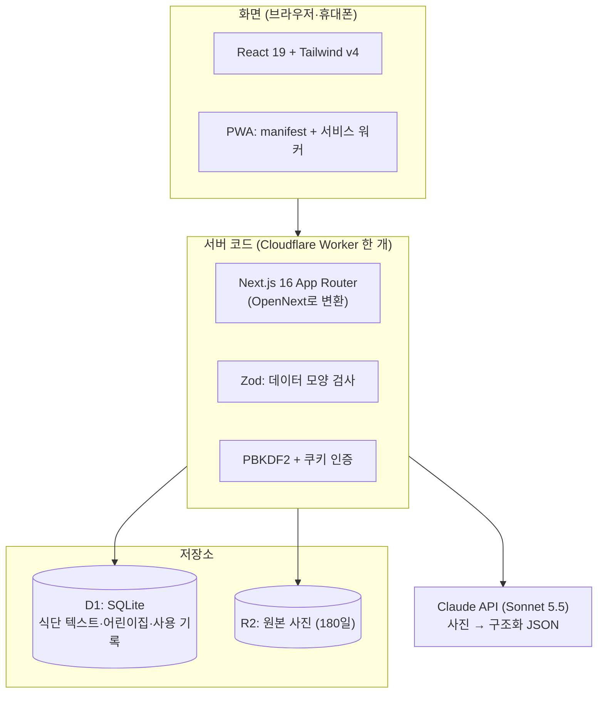
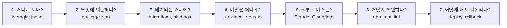
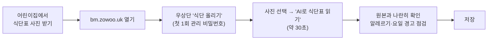
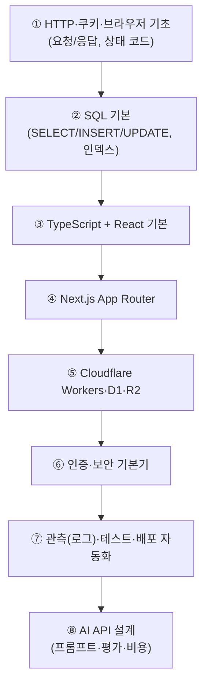

# 12. 용어집 · AI가 만든 앱 인수받는 법 · 다음 공부

> **한 줄 요약**: 이 앱을 혼자 유지보수하기 위한 "사전 + 점검표 + 다음 공부 지도"입니다. AI로 앱을 만들 때 기술 스펙을 놓치는 습관을 고치는 방법도 여기에 있습니다.

---

## 1. 이 앱의 기술 스택 한 장 요약



| 기술 | 역할 | 버전/설정은 어디서 보나 | 장 |
|---|---|---|---|
| Cloudflare Workers | 서버 코드가 실행되는 곳 | [`wrangler.jsonc`](../wrangler.jsonc) | [01](01-cloudflare-workers.md) |
| OpenNext (`@opennextjs/cloudflare`) | Next.js를 Workers용으로 변환 | [`package.json`](../package.json), `open-next.config.ts` | [02](02-opennext-build.md) |
| D1 | SQL 데이터베이스(SQLite) | [`migrations/`](../migrations) | [03](03-d1-sql.md) |
| R2 | 사진 파일 보관 | `wrangler.jsonc`의 `r2_buckets` | [04](04-r2-storage.md) |
| Next.js App Router | 화면·API·서버 액션 | [`src/app/`](../src/app) | [05](05-nextjs-app-router.md) |
| Claude API + Zod | 사진 읽기 | [`src/lib/server/extract.ts`](../src/lib/server/extract.ts) | [06](06-claude-structured-output.md) |
| PBKDF2 + 쿠키 | 비밀번호·로그인 상태 | [`src/lib/server/auth.ts`](../src/lib/server/auth.ts) | [07](07-auth-cookies.md) |
| 날짜(KST) | "오늘" 계산 | [`src/lib/dates.ts`](../src/lib/dates.ts) | [08](08-dates-kst.md) |
| PWA | 홈 화면 설치 | [`public/sw.js`](../public/sw.js), [`src/lib/pwa.ts`](../src/lib/pwa.ts) | [09](09-pwa.md) |
| Vitest, ESLint, Playwright | 품질 확인 | [`package.json`](../package.json) | [11](11-testing-and-quality.md) |

## 2. 용어집

### 인프라·배포

| 용어 | 쉬운 설명 |
|---|---|
| **Worker** | Cloudflare 서버에서 돌아가는 우리 코드 한 덩어리. 서버를 직접 빌리지 않고 "요청이 올 때만" 실행됩니다 |
| **isolate** | Worker를 실행하는 아주 가벼운 격리 공간. 컨테이너/VM보다 시작이 빨라서 첫 요청도 거의 안 느립니다 |
| **colo** | Cloudflare 데이터센터 이름(ICN=서울, HKG=홍콩). 요청이 처음 닿는 곳 |
| **edge** | 사용자와 가까운 곳에서 코드를 실행하는 구조 |
| **placement** | Worker가 실행될 위치를 고르는 설정. 이 앱은 서울로 고정(홍콩에서는 Anthropic이 403을 줌) |
| **binding** | Worker 코드가 `env.DB`, `env.IMAGES`처럼 다른 Cloudflare 자원을 쓰게 연결해 주는 이름표 |
| **secret** | 코드에 넣으면 안 되는 비밀 값(API 키). `wrangler secret put`으로 따로 저장 |
| **wrangler** | Cloudflare 개발·배포용 명령줄 도구 |
| **OpenNext** | Next.js 앱을 Workers에서 돌게 번들해 주는 어댑터 |
| **custom domain** | `bm.zowoo.uk` 같은 내 도메인을 Worker에 연결하는 것 |
| **lifecycle rule** | R2 파일을 일정 기간 뒤 자동 삭제하는 규칙 |
| **observability** | 로그·지표를 보는 기능. 대시보드와 `wrangler tail`에서 볼 수 있음 |

### 웹 앱

| 용어 | 쉬운 설명 |
|---|---|
| **App Router** | Next.js의 폴더 기반 주소 체계(`src/app/c/[id]/page.tsx` → `/c/아무값`) |
| **서버 컴포넌트 / 클라이언트 컴포넌트** | 서버에서 그려 보내는 부품 / 브라우저에서 움직이는 부품(`"use client"`) |
| **서버 액션** | 폼 제출 같은 동작을 서버 함수로 바로 호출하는 Next.js 기능(`"use server"`) |
| **route handler** | `route.ts`로 만드는 API 주소(분석·이미지·manifest) |
| **force-dynamic** | 요청마다 새로 그리라는 설정(오늘 날짜가 매일 바뀌므로 필요) |
| **hydration** | 서버가 보낸 HTML에 브라우저가 동작을 붙이는 과정 |
| **Tailwind** | 클래스 이름으로 스타일을 쓰는 CSS 도구 |
| **FOUC** | 스타일이 늦게 적용되어 화면이 깜빡이는 현상(다크 모드 스크립트로 방지) |

### 데이터·AI

| 용어 | 쉬운 설명 |
|---|---|
| **D1 / SQLite** | 파일 하나짜리 SQL 데이터베이스 / Cloudflare가 서비스로 제공하는 형태 |
| **migration** | 테이블 구조 변경을 번호 붙은 SQL 파일로 기록해 순서대로 적용하는 방식 |
| **upsert** | 있으면 수정, 없으면 추가(`ON CONFLICT … DO UPDATE`) |
| **prepared statement / bind** | SQL에 값을 `?`로 넣어 SQL 인젝션을 막는 방법 |
| **Zod** | "이 데이터는 이런 모양이어야 한다"를 코드로 쓰고 검사하는 라이브러리 |
| **구조화 출력** | AI 답변을 자유 문장이 아니라 정해진 JSON 모양으로 받는 기능 |
| **토큰** | AI가 글자를 세는 단위. 입력·출력 토큰이 비용의 기준 |
| **fallback(대체 모델)** | 정책상 거절 등으로 실패했을 때 서버가 다른 모델로 재시도하는 설정 |
| **프롬프트** | AI에게 주는 지시문(`EXTRACT_SYSTEM_PROMPT`) |

### 보안·시간

| 용어 | 쉬운 설명 |
|---|---|
| **PBKDF2 / salt / 해시** | 비밀번호를 되돌릴 수 없는 값으로 바꿔 저장하는 방법 / 같은 비밀번호도 다르게 만드는 임의 값 |
| **httpOnly 쿠키** | 자바스크립트로 읽을 수 없는 쿠키(탈취 방지) |
| **rate limit** | 하루에 몇 번까지만 허용하는 남용 방지 |
| **KST** | 한국 표준시(UTC+9). 서버는 UTC로 돌기 쉬워서 "오늘" 계산에 주의가 필요 |

### PWA

| 용어 | 쉬운 설명 |
|---|---|
| **PWA** | 홈 화면에 설치되는 웹앱 |
| **manifest** | 앱 이름·아이콘·시작 주소를 적은 설명서 |
| **service worker** | 네트워크 요청 사이에서 일하는 브라우저 안의 도우미 |
| **standalone** | 주소창 없이 앱처럼 보이는 표시 방식 |
| **maskable 아이콘** | OS가 원형 등으로 잘라도 안전한 아이콘 |
| **start_url / scope** | 아이콘을 눌렀을 때 열리는 주소 / 앱으로 다룰 범위 |

## 3. AI가 만든 앱을 "내 앱"으로 만드는 점검표

AI로 앱을 만들면 동작은 하는데 **왜 그렇게 되는지 모르는 부분**이 생깁니다. 아래 순서로 한 번씩 확인하면 기술 스펙을 놓치지 않습니다. (10분이면 훑을 수 있어요.)



| # | 질문 | 어디를 보나 | 이 앱의 답 |
|---|---|---|---|
| 1 | 어떤 서버에서 어디 지역으로 도나? | `wrangler.jsonc` | Cloudflare Worker, 서울 고정 |
| 2 | 어떤 라이브러리와 버전을 쓰나? | `package.json`, `package-lock.json` | Next 16, React 19, OpenNext, Zod, Anthropic SDK |
| 3 | 데이터는 어디에 저장되고 스키마는? | `migrations/`, `src/lib/server/db.ts` | D1 3개 테이블, R2 사진 |
| 4 | 비밀 값은 어디에 있고 코드에 새지 않나? | `.gitignore`, `scripts/*secrets*` | Cloudflare secret, 빌드 시 비밀 검사 |
| 5 | 돈이 드는 외부 호출은? | `src/lib/server/extract.ts`, `limits.ts` | Claude 호출(분석 횟수 제한 있음) |
| 6 | "고장 났다"를 어떻게 알아채나? | `src/__tests__/`, `npm test` | 테스트 + 로그(`wrangler tail`) |
| 7 | 배포와 되돌리기는 어떻게? | `package.json` scripts, [10장](10-ops-runbook.md) | `npm run deploy`, `wrangler rollback` |
| 8 | 사용자 입력은 어디서 검사하나? | `src/lib/schema.ts`, `src/lib/sheet.ts` | Zod 스키마 + 정규화 |
| 9 | 누가 무엇을 할 수 있나? | `src/app/actions.ts`, `session.ts` | 보기=누구나, 올리기·수정=관리 비밀번호 |
| 10 | 매일/매달 사람이 해야 할 일은? | 이 문서의 4장 | 매달 사진 1장 업로드 |

### AI에게 물어볼 때 쓰는 질문 템플릿

그냥 "고쳐 줘"보다 이렇게 물으면 이해와 안전이 같이 따라옵니다.

```text
[변경 전] 이 변경이 건드리는 파일과 데이터를 먼저 목록으로 알려줘.
[변경 중] 왜 이 방법을 골랐고, 다른 방법은 뭐가 있었는지 한 줄씩 설명해줘.
[변경 후] 이 변경이 잘못되면 어떻게 알 수 있고, 어떻게 되돌릴 수 있는지 알려줘.
[새 기술] 이 라이브러리/서비스를 쓰지 않으면 어떻게 되는지, 비용과 한도는 얼마인지 공식 문서 링크와 함께 알려줘.
[배포 전] 운영 데이터나 비용에 영향을 주는 단계가 있으면 따로 표시해줘.
```

> 💡 AI가 "된다"고 말한 것과 **실제로 확인한 것**을 구분하세요. 좋은 보고는 "무엇을 어떻게 확인했고(테스트/로그/화면), 무엇은 못 했는지"를 같이 적습니다. 이 앱의 작업 보고도 그 형식을 따랐습니다(실기기 설치를 못 해봤다는 말까지 포함).

## 4. 사용자 입장의 월간 루틴 (90초)



- 사진은 **정면에서, 그림자 없이, 전체가 나오게** 찍으면 인식이 좋아집니다.
- 이상하게 읽힌 칸은 저장 전에 직접 고칠 수 있습니다.
- 한 달에 한 번이라 분석 횟수 제한(어린이집당 하루 10회)에 걸릴 일은 거의 없습니다.

## 5. 다음에 공부하면 좋은 순서

이 앱을 계속 손볼 사람에게 투자 대비 효과가 큰 순서입니다.



| 주제 | 먼저 볼 곳 | 이 저장소의 대응 장 |
|---|---|---|
| HTTP, 쿠키, PWA | [MDN Web Docs](https://developer.mozilla.org/) | [07](07-auth-cookies.md), [09](09-pwa.md) |
| SQL/SQLite | [SQLite 공식 문서](https://www.sqlite.org/lang.html) | [03](03-d1-sql.md) |
| TypeScript / React | [TypeScript Handbook](https://www.typescriptlang.org/docs/), [react.dev](https://react.dev/learn) | [05](05-nextjs-app-router.md) |
| Next.js | [Next.js Learn](https://nextjs.org/learn) | [05](05-nextjs-app-router.md) |
| Cloudflare | [Workers 문서](https://developers.cloudflare.com/workers/), [D1](https://developers.cloudflare.com/d1/), [R2](https://developers.cloudflare.com/r2/) | [01](01-cloudflare-workers.md), [03](03-d1-sql.md), [04](04-r2-storage.md) |
| 검증 라이브러리 | [Zod 문서](https://zod.dev/) | [06](06-claude-structured-output.md) |
| Claude API | [Claude 문서](https://platform.claude.com/docs) | [06](06-claude-structured-output.md) |
| 보안 기본기 | [OWASP Cheat Sheet Series](https://cheatsheetseries.owasp.org/) | [07](07-auth-cookies.md) |

> 링크는 변경될 수 있습니다. 안 열리면 제목으로 검색하세요.

### 이 앱을 직접 확장해 보는 과제 (난이도순)

1. ⭐ 홈 화면 문구를 바꾸고 `npm run preview`로 확인한 뒤 `git checkout`으로 되돌리기
2. ⭐ 오늘이 주말이면 "다음 식단일 보기" 버튼 문구 바꾸기 ([08](08-dates-kst.md) 참고)
3. ⭐⭐ 관리 화면에 "관리 비밀번호 바꾸기" 폼 추가 ([07](07-auth-cookies.md), [05](05-nextjs-app-router.md) 참고)
4. ⭐⭐ 월 전체 식단을 이미지/PDF로 내보내기
5. ⭐⭐⭐ 알레르기 번호를 사용자별로 등록해 해당 메뉴를 강조 표시
6. ⭐⭐⭐ 푸시 알림("오늘 간식은…") — 서비스 워커의 `push` 이벤트와 서버 발송이 필요([09](09-pwa.md) 참고)

각 과제는 "실패하는 테스트를 먼저 쓰고 구현"하는 흐름([11](11-testing-and-quality.md))으로 연습하면 가장 안전합니다.

---

← 이전 [11 테스트와 품질](11-testing-and-quality.md) · 처음으로 [README](README.md)
