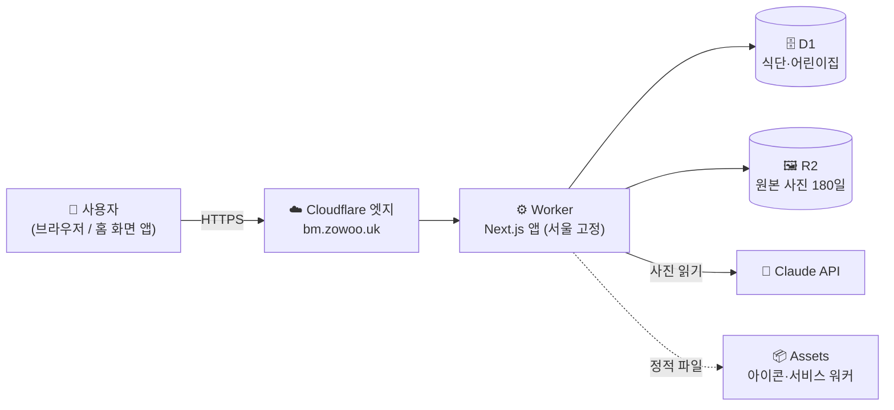
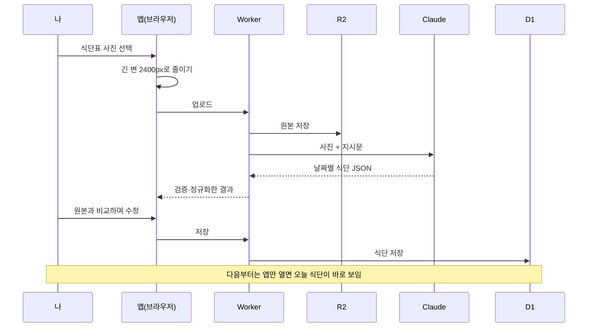
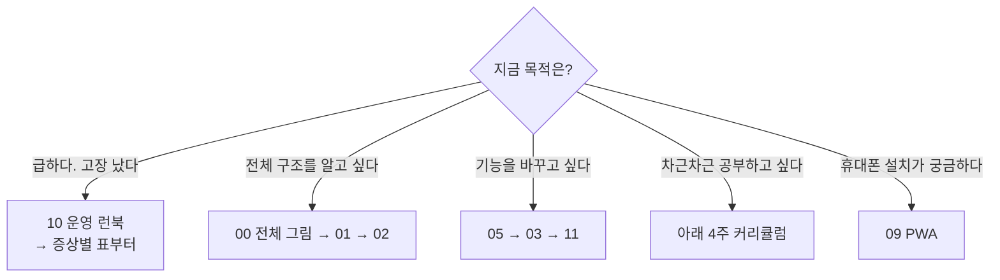
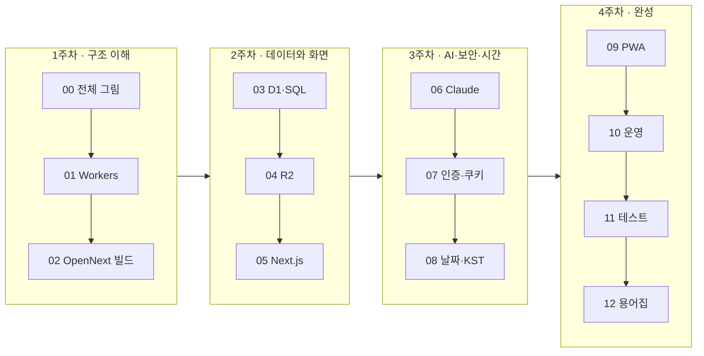

# 우리 아기 식단 — 학습 자료 (learn)

AI와 함께 만든 이 앱을 **내가 직접 이해하고 유지보수할 수 있게** 만드는 학습 자료입니다. 코드가 어떻게 도는지, Cloudflare 콘솔에서 무엇을 보고 어디를 설정하는지, 고장 났을 때 어디부터 확인하는지를 그림과 실습으로 정리했습니다.

- 운영 주소: https://bm.zowoo.uk
- 코드 위치: 이 폴더의 상위(`menu/`)
- 모든 실습은 **내 컴퓨터(로컬)에서만** 돌고 운영 데이터를 건드리지 않습니다. 운영을 조회하거나 바꾸는 명령은 ⚠️로 따로 표시했습니다.

---

## 1. 한눈에 보는 앱 지도



사진 한 장이 식단이 되기까지:



## 2. 어디서부터 읽을까



### 🚨 급할 때 (30분 코스)

| 순서 | 읽을 것 | 얻는 것 |
|---|---|---|
| 1 | [10 운영 런북](10-ops-runbook.md)의 "증상별 점검표" | 어디를 봐야 할지 |
| 2 | [00 전체 그림](00-big-picture.md) | 요청이 지나가는 길 |
| 3 | [01 Cloudflare Workers](01-cloudflare-workers.md)의 "콘솔에서 볼 곳" | 대시보드 위치 |

## 3. 커리큘럼 (4주, 주 3~4시간)



| 장 | 제목 | 읽기 | 실습 | 이 장을 끝내면 할 수 있는 것 |
|---|---|---|---|---|
| [00](00-big-picture.md) | 전체 그림 | 25분 | — | 요청이 브라우저→Worker→D1/R2/Claude로 가는 길을 설명할 수 있다 |
| [01](01-cloudflare-workers.md) | Cloudflare Workers | 50분 | 30분 | `wrangler.jsonc`를 줄마다 설명하고 대시보드에서 Worker·바인딩·로그 위치를 찾는다 |
| [02](02-opennext-build.md) | OpenNext 빌드와 배포 | 30분 | 20분 | `npm run deploy`가 하는 일을 단계별로 설명한다 |
| [03](03-d1-sql.md) | D1과 SQL | 45분 | 40분 | 로컬 DB를 조회하고 마이그레이션을 이해한다 |
| [04](04-r2-storage.md) | R2 저장소 | 30분 | 15분 | 사진 보관 기간(180일)이 어디서 어떻게 지켜지는지 안다 |
| [05](05-nextjs-app-router.md) | Next.js App Router | 50분 | 30분 | 화면·API·서버 액션이 어느 파일인지 찾고 작은 변경을 한다 |
| [06](06-claude-structured-output.md) | Claude 구조화 출력 | 50분 | 20분 | 프롬프트·모델·검증을 조정하는 위치를 안다 |
| [07](07-auth-cookies.md) | 인증과 쿠키 | 45분 | 20분 | 비밀번호 저장 방식과 "다시 열면 바로 보이는" 원리를 설명한다 |
| [08](08-dates-kst.md) | 날짜와 시간대 | 30분 | 15분 | "오늘" 계산 버그의 원인을 알고 테스트로 막는다 |
| [09](09-pwa.md) | PWA | 35분 | 30분 | 홈 화면 설치 구조를 이해하고 실기기에 설치한다 |
| [10](10-ops-runbook.md) | 운영 런북 | 40분 | 20분 | 로그 확인, 롤백, 모델 변경, 비밀번호 변경, 비밀 값 교체를 한다 |
| [11](11-testing-and-quality.md) | 테스트와 품질 | 40분 | 30분 | 배포 전 점검을 하고 테스트를 하나 추가한다 |
| [12](12-glossary-and-next-steps.md) | 용어집·점검표·다음 공부 | 25분 | — | AI가 만든 앱을 점검하는 질문 목록을 쓴다 |

총 약 **8시간 읽기 + 4.5시간 실습**.

## 4. 이 자료를 쓰는 방법

모든 장은 같은 순서로 구성되어 있습니다.

```text
한 줄 요약 → 왜 필요한가 → 그림 → 이 앱에서는 어디에 → 직접 해보기 → 흔한 실수/체크리스트 → 퀴즈
```

- **그림(mermaid)**: GitHub에서 열면 자동으로 그려집니다. VS Code에서는 "Markdown Preview Mermaid Support" 확장이 필요할 수 있습니다.
- **`이 앱에서는 어디에`**: 실제 파일로 이동하는 링크입니다. 글만 읽지 말고 파일을 꼭 열어 보세요.
- **퀴즈**: 정답은 접혀 있습니다(`<details>`). 먼저 생각하고 펼치세요.
- **실습 코드**: [`labs/`](labs/README.md)에 있고, 로컬 전용입니다.

### 실습 안전 규칙

| 표시 | 뜻 |
|---|---|
| 🟢 로컬 전용 | 내 컴퓨터 안에서만 동작. 마음껏 실행 |
| 🟡 읽기 전용 | 운영·외부 서비스를 **조회만** 함 |
| ⚠️ 운영 영향 | 운영 데이터·비용·배포에 영향. 의미를 이해한 뒤에만 |

- 실습용 Worker는 이름이 `baby-menu-lab-…`처럼 달라서 운영 `baby-menu`와 섞이지 않습니다.
- 유료 자원을 새로 만드는 실습은 없습니다. Claude API를 호출하는 실습은 ⚠️로 표시하고 기본은 실행하지 않습니다.

## 5. 이 자료에 적용한 원칙

- **운영 값은 적지 않습니다.** 관리 비밀번호, API 키, D1 ID, 계정 ID, 어린이집 ID는 `<PLACEHOLDER>`로 둡니다(공개 호스트 이름은 제외).
- **확인하지 못한 것은 확인하지 못했다고 적습니다.** 예: 실제 iOS 기기 설치는 직접 시험하지 못했습니다([09](09-pwa.md)).
- **공식 문서를 우선합니다.** Cloudflare 대시보드 메뉴 이름이나 명령어 옵션은 바뀔 수 있어, 각 장에 공식 문서 링크와 `--help` 확인 방법을 함께 적었습니다.

## 6. 문서도 코드처럼 관리하기

코드가 바뀌면 문서도 함께 바꿔야 오래 쓸 수 있습니다.

| 이럴 때 | 고칠 문서 |
|---|---|
| `wrangler.jsonc` 설정 변경 (리전, 바인딩, 모델) | 01, 10 |
| 새 테이블·마이그레이션 | 03 |
| 사진 보관 기간 변경 | 04, 그리고 `src/lib/dates.ts`의 `PHOTO_RETENTION_DAYS` |
| 프롬프트·스키마 변경 | 06 |
| 인증·쿠키 변경 | 07 |
| 서비스 워커·아이콘 변경 | 09 |
| 새 테스트 규칙 | 11 |

> AI에게 코드를 바꾸게 할 때 "관련 `learn/` 문서도 함께 갱신해 줘"를 붙이면 문서가 낡는 것을 막을 수 있습니다.

---

시작은 → **[00 전체 그림](00-big-picture.md)**
