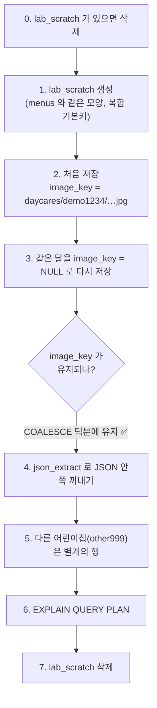

# 실습: D1 연습장 (로컬 전용)

[03장 D1](../../03-d1-sql.md)에서 배운 UPSERT, `COALESCE`, `json_extract`, 인덱스, 외래키를 **내 컴퓨터의 연습용 DB**에서 직접 확인합니다.

> ✅ 모든 명령이 `--local`입니다. 운영 DB는 건드리지 않습니다.
> ✅ 앱의 진짜 테이블(`daycares`, `menus`, `usage_events`)은 읽지도 쓰지도 않고, `lab_` 로 시작하는 연습용 테이블만 만들고 지웁니다.

## 준비

```bash
cd menu                      # 이 저장소의 menu 폴더
npm install
npm run db:migrate:local     # 로컬 DB 테이블 만들기 (이미 했다면 "No migrations to apply!")
```

## 실습 A — UPSERT와 COALESCE (`d1-playground.sql`)

```bash
npx wrangler d1 execute baby-menu --local --file learn/labs/data/d1-playground.sql
```

SQL 파일이 하는 일을 순서대로 보면:



### 출력에서 확인할 것 (JSON 결과의 `results` 안)

| 단계 | 기대하는 값 | 의미 |
|---|---|---|
| 3 이후 `SELECT` | `"data": "{\"days\":[{\"date\":\"2026-10-14\"}]}"` | `data`는 새 값으로 **교체됨** |
| 같은 행 | `"image_key": "daycares/demo1234/2026-10-13-aaaa1111.jpg"` | `NULL`로 덮어쓰지 않고 **유지됨** |
| 같은 행 | `"updated_at": 2000` | 항상 새 값으로 갱신 |
| 4 | `"first_date": "2026-10-14"` | TEXT 안의 JSON을 SQL로 읽음 |
| 5 | 두 행 (`demo1234`, `other999`) | 기본키가 `(daycare_id, ym)`이라서 같은 `ym`도 어린이집별로 따로 |
| 6 | `SEARCH lab_scratch USING INDEX sqlite_autoindex_lab_scratch_1 (daycare_id=? AND ym=?)` | 기본키에서 만들어진 인덱스로 바로 찾음 (`SCAN`이면 전체 훑기) |
| 7 | `results: []` | 연습용 테이블이 지워졌음 |

### 직접 바꿔 보기

1. 3단계 `NULL`을 `'daycares/demo1234/2026-10-15-bbbb2222.jpg'`로 바꿔 다시 실행 → `image_key`가 **바뀌는지** 확인
2. 3단계의 `COALESCE(excluded.image_key, lab_scratch.image_key)`를 그냥 `excluded.image_key`로 바꿔 실행 → `image_key`가 `null`이 되는 것을 확인 (COALESCE가 없을 때의 사고)
3. 6단계 쿼리의 `WHERE`에서 `daycare_id = 'demo1234' AND` 부분을 지우고(`ym`만 조건) 실행 → 계획이 `SCAN`으로 바뀐다. **복합 기본키는 앞 열부터** 써야 인덱스가 먹힌다는 뜻

## 실습 B — 외래키와 CASCADE (`d1-foreign-key*.sql`)

```bash
# 어린이집(부모)을 지우면 식단(자식)도 같이 지워진다
npx wrangler d1 execute baby-menu --local --file learn/labs/data/d1-foreign-key.sql
# 기대: child_rows_before: 2 → child_rows_after: 0

# 부모 없는 자식을 넣으면 막힌다 (에러가 나는 것이 정답!)
npx wrangler d1 execute baby-menu --local --file learn/labs/data/d1-foreign-key-error.sql
# 기대: FOREIGN KEY constraint failed

# --file 은 한 덩어리로 실행되므로 에러 시 앞의 CREATE TABLE 도 되돌려진다. 비어 있어야 정상:
npx wrangler d1 execute baby-menu --local --command "SELECT name FROM sqlite_master WHERE name LIKE 'lab_%'"
```

## 실습 C — 앱이 실제로 쓰는 쿼리의 실행 계획 (읽기 전용)

앱의 쿼리가 인덱스를 타는지 `EXPLAIN QUERY PLAN`으로 확인합니다. 아무것도 바꾸지 않습니다.

```bash
npx wrangler d1 execute baby-menu --local --command "
EXPLAIN QUERY PLAN SELECT COUNT(*) AS n FROM usage_events WHERE kind = 'analyze' AND scope = 'x' AND created_at > 1;
EXPLAIN QUERY PLAN DELETE FROM usage_events WHERE created_at < 1;
EXPLAIN QUERY PLAN SELECT ym, data, image_key, updated_at FROM menus WHERE daycare_id = 'x' ORDER BY ym DESC LIMIT 24;"
```

이 저장소에서 확인한 결과:

| 쿼리 (코드 위치) | 계획 | 해석 |
|---|---|---|
| `countRecent` ([limits.ts](../../../src/lib/server/limits.ts)) | `SEARCH ... USING COVERING INDEX usage_events_lookup (kind=? AND scope=? AND created_at>?)` | 인덱스만 읽고 끝 (가장 빠른 형태) |
| `recordEvent`의 청소 `DELETE` | `SCAN usage_events` | `created_at`이 인덱스 첫 열이 아니라 전체 훑기. 테이블이 작아서 OK |
| `listMonths` ([db.ts](../../../src/lib/server/db.ts)) | `SEARCH menus USING INDEX sqlite_autoindex_menus_1 (daycare_id=?)` | 복합 기본키의 앞 열로 검색 |

## 정리가 잘 됐는지 확인

```bash
npx wrangler d1 execute baby-menu --local --command "SELECT name FROM sqlite_master WHERE name LIKE 'lab_%'"
```

`results`가 `[]`이면 깨끗합니다. 혹시 남아 있으면:

```bash
npx wrangler d1 execute baby-menu --local --command "DROP TABLE IF EXISTS lab_scratch; DROP TABLE IF EXISTS lab_child; DROP TABLE IF EXISTS lab_parent;"
```

## 도전 과제

1. `usage_events`에 `INSERT`로 연습 기록 3개를 직접 넣은 뒤(`kind='lab'`, `scope='me'`, `created_at`은 `strftime('%s','now')*1000`), 앱의 `countRecent`와 같은 조건으로 `COUNT(*)`를 세어 보세요. 끝나면 `DELETE FROM usage_events WHERE kind='lab'`로 정리합니다. (로컬 DB 한정)
2. "최근 24시간" 대신 "오늘 00:00 이후"로 세려면 SQL이 어떻게 달라질까요? 한국 시간 기준으로 하루를 자르려면 어떤 문제가 생길까요? (학습 순서는 [커리큘럼](../../README.md)에서 날짜·시간대 장을 찾아보세요.)
