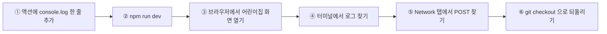

# 실습: 서버 액션에 로그를 심고 따라가 보기

[05장 Next.js App Router](../../05-nextjs-app-router.md)의 "서버 액션은 서버에서 돈다"를 눈으로 확인하는 실습입니다. **로컬에서만** 실행하며 운영과 무관합니다. 끝나면 `git checkout`으로 원래대로 되돌립니다.



## 준비

```bash
cd menu
npm install
npm run db:migrate:local      # 로컬 DB 테이블
npm run dev -- -p 3111        # 다른 서버와 겹치지 않게 3111 포트 사용
```

로컬에 어린이집이 없다면 `http://localhost:3111`에서 하나 만드세요(로컬 DB에만 저장됩니다). 주소창의 `/c/<DAYCARE_ID>`에서 `<DAYCARE_ID>`가 그 어린이집의 id입니다.

> ⚠️ **되돌리기 전에 확인**: 이 실습은 `src/app/actions.ts` 파일을 임시로 고칩니다. 그 파일에 **아직 커밋하지 않은 내 수정이 있다면** `git checkout --`가 그것까지 지웁니다. 먼저 `git status --short src/app/actions.ts`가 **아무것도 출력하지 않는지**(깨끗한지) 확인하세요. 수정이 있다면 실습을 하지 말거나 먼저 커밋/스태시하세요.

## 1단계 — 로그 한 줄 추가

[`src/app/actions.ts`](../../../src/app/actions.ts)의 `rememberDaycare` 맨 윗줄에 추가합니다.

```ts
export async function rememberDaycare(daycareId: string): Promise<void> {
  console.log("[lab] rememberDaycare called with", daycareId);   // ← 추가
  if (!/^[a-z0-9]{4,16}$/.test(daycareId)) return;
  ...
```

## 2단계 — 어디에 찍히는지 확인

1. 브라우저에서 `http://localhost:3111/c/<DAYCARE_ID>`를 엽니다.
2. **브라우저 개발자도구 Console** 을 보세요 → `[lab]` 로그는 **없습니다.**
3. **`npm run dev`를 실행한 터미널**을 보세요 → 아래처럼 찍힙니다.

```
[lab] rememberDaycare called with <DAYCARE_ID>
 POST /c/<DAYCARE_ID> 200 in 97ms (next.js: 3ms, application-code: 94ms)
   └─ ƒ rememberDaycare("<DAYCARE_ID>") in 4ms src/app/actions.ts
```

배운 것: **서버 액션은 서버 프로세스에서 실행되므로 로그도 서버에 남습니다.** 운영에서는 이 로그가 터미널이 아니라 Workers 로그(Cloudflare 대시보드/`wrangler tail`)로 갑니다. 같은 서버 코드를 보려면 장소를 바꿔 찾아야 한다는 점을 기억해 두세요.

> 그리고 로그의 `POST /c/<DAYCARE_ID>` 를 보세요. 서버 액션은 **현재 페이지 주소로 POST** 를 보냅니다. 별도의 `/api/...` 주소가 없습니다.

## 3단계 — 브라우저 쪽에서 찾아보기

1. 개발자도구 → **Network** → 필터 `Fetch/XHR` → 페이지 새로고침
2. 이름이 `<DAYCARE_ID>` 이고 메서드가 **POST**인 요청을 클릭합니다.
3. **Request Headers**에서 `next-action: <긴 해시>` 헤더를 찾으세요 (어떤 액션을 부르는지 알려 주는 번호표).
4. **Response Headers**에서 `set-cookie: bm_last=…; HttpOnly` 를 찾으세요.
5. Application → Cookies 에서는 `bm_last`가 보이지만, 콘솔에 `document.cookie`를 쳐 보면 **나오지 않습니다**(httpOnly).

## 4단계 — 스스로 바꿔 보기 (선택)

같은 파일에서 실험해 보세요. 한 번에 하나만 바꾸고 터미널/브라우저를 관찰합니다.

| 실험 | 기대 결과 | 배우는 점 |
|---|---|---|
| `rememberDaycare` 안에서 일부러 `throw new Error("lab")` | 터미널에 에러가 찍힙니다. 브라우저 쪽에서 무엇이 보이는지(콘솔, 에러 오버레이)는 직접 관찰해 보세요. 호출부는 `void rememberDaycare(...)`라서 결과를 기다리지 않습니다 | 호출하는 쪽이 결과를 기다리는가 |
| 정규식 검사를 `{4,16}` → `{20,30}` 으로 (먼저 개발자도구 Application → Cookies 에서 `bm_last` 삭제) | `bm_last` 쿠키가 다시 세팅되지 않음 → `/` 로 돌아가도 redirect 안 됨 | 검사 한 줄이 "0클릭 재방문"을 좌우 |
| `console.log`에 `(await headers()).get("user-agent")` 출력 (파일 상단에 `headers`는 이미 import 되어 있음) | 접속 기기 정보가 서버 로그에 찍힘 | 서버에서는 요청 헤더를 읽을 수 있다 |

## 5단계 — 되돌리기 (꼭!)

```bash
# 개발 서버를 Ctrl+C 로 끈 뒤
git checkout -- src/app/actions.ts
git status --short src/app/actions.ts     # 아무것도 안 나오면 원상복구 완료
```

## 이 실습이 보여 주는 것

- 서버 액션 = "서버에서 실행되는 함수 + 현재 주소로 가는 POST"
- 화면에 안 보이는 일은 **서버 로그**와 **Network 탭** 두 곳에서 추적한다
- 액션의 첫 줄에서 하는 **검사(정규식·권한)** 가 곧 보안 경계다

## 도전 과제

1. `createDaycare` 에도 로그를 심고, 이름이 아니라 **결과 `id`만** 찍어 보세요. 왜 `pin`은 절대 로그에 찍으면 안 될까요?
2. `unlockDaycare` 에서 비밀번호가 틀리면 `recordEvent`로 `usage_events`에 기록합니다. 로컬 DB에서 `SELECT kind, scope, created_at FROM usage_events` 로 쌓이는 것을 확인해 보세요 ([D1 연습장](../data/d1-playground.md) 방법 참고). 틀린 입력 21번이면 어떻게 될까요? (`LIMITS.unlockFailPerIp`) ⚠️ 로컬에서는 접속 IP가 항상 같아 **내 로컬 비밀번호 확인이 24시간 잠길** 수 있습니다. 끝나면 `npx wrangler d1 execute baby-menu --local --command "DELETE FROM usage_events WHERE kind = 'unlock-fail'"` 로 풀어 주세요.
