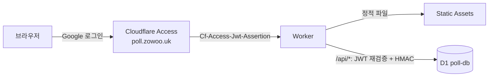

# poll — 모두의 투표

Google 계정이 있는 누구나 Cloudflare Access로 로그인해서 주제를 만들고 익명으로 투표하는 웹앱입니다.
운영 주소: `https://poll.zowoo.uk`

- 로그인: Cloudflare Access + Google IdP가 담당합니다. 앱에는 로그인 화면이 없습니다.
- 익명성: DB에는 이메일이 없습니다. 투표자는 질문마다 다른 HMAC 값(`voter_hash`)으로만 구분됩니다.
- 스택: Cloudflare Workers(Static Assets) + D1. 프런트엔드는 빌드 없는 바닐라 JS(ES modules)와 CSS입니다.

## 구조

```text
poll/
├── wrangler.jsonc          # Worker·D1·Access 설정 (vars). 관리자 목록은 secret
├── migrations/             # D1 스키마 (0001 테이블, 0002 쓰기 레이트 리밋)
├── src/
│   ├── index.js            # 진입점: /api/* 라우팅, 인증, CSRF, 레이트 리밋
│   ├── auth.js             # Access JWT 검증(RS256, iss, aud, exp), 도메인/관리자 판정, DEV 우회
│   ├── crypto.js           # voter_hash / creator_hash / 레이트 리밋 키 (HMAC-SHA256)
│   ├── polls.js            # 질문 목록·생성·조회·투표·수정·삭제 (D1)
│   ├── ratelimit.js        # 사용자별 분당 쓰기 횟수 제한 (D1)
│   └── validate.js         # 입력 길이·타입 검증
├── public/                 # 정적 파일 (index.html, app.js, style.css, _headers(CSP), fonts/)
├── test/                   # vitest (@cloudflare/vitest-plugin, Workers 런타임 + 로컬 D1)
└── scripts/check-deploy.mjs # 배포 전 설정 검사 (DEV_EMAIL 미포함, workers.dev 비활성 등)
```



### 요청 흐름 (`/api/*`)

1. Access가 로그인하지 않은 요청을 Google 로그인으로 302 리다이렉트합니다.
2. Worker가 `Cf-Access-Jwt-Assertion`을 직접 검증합니다. 서명은 팀 도메인 JWKS(`/cdn-cgi/access/certs`)로 확인하고, `iss`·`aud`·`exp`를 검사합니다. email claim이 있어야 합니다(없으면 403).
   - `ALLOWED_DOMAIN`이 `*`이면 모든 계정을 받습니다. 현재 운영 설정입니다.
   - 도메인을 넣으면 그 도메인과 `ADMIN_EMAILS`만 받습니다.
3. 상태 변경(POST/PUT/DELETE)은 `Content-Type: application/json`과 `Origin: https://poll.zowoo.uk`일 때만 받습니다(CSRF 방지).
4. 레이트 리밋은 두 단계입니다.
   - 모든 요청에 `RATE_LIMITER` 바인딩(120회/분, 위치별 근사치)을 적용합니다.
   - 쓰기 요청은 D1 카운터로 사용자당 분당 30회까지 정확히 제한합니다.
   - 질문 만들기는 사용자당 하루(UTC 기준) 10개까지입니다. 관리자는 예외이고, 검증에 실패한 요청은 세지 않습니다.
   - 키는 이메일의 HMAC 값입니다.
5. 투표 저장·수정은 `DB.batch` 하나로 원자적으로 처리합니다. 기존 선택을 지우고 새로 넣으며, 각 문장이 마감 여부를 다시 확인합니다.

### API

| Method | Path | 설명 |
|---|---|---|
| GET | `/api/me` | 내 이메일, 관리자 여부 |
| GET | `/api/polls?status=open\|closed&page=N` | 목록 (최신순, 20개씩, 공개 가능한 집계 포함) |
| POST | `/api/polls` | 질문 만들기 |
| GET | `/api/polls/:id` | 상세, 내 선택, 결과(공개 조건 충족 시), 관리 권한 |
| PUT | `/api/polls/:id` | 수정 (작성자/관리자) |
| DELETE | `/api/polls/:id` | 삭제 (작성자/관리자, 선택지·투표 함께 삭제) |
| POST | `/api/polls/:id/ballot` | 투표/투표 수정 `{ "option_ids": [...] }` |

## 로컬 개발

```bash
cd poll
npm ci              # npm 10 에서 `npm install` 은 edgesOut 오류가 날 수 있어 lockfile 기반 ci 사용
npm run db:migrate:local
npm run dev          # http://localhost:8799 (DEV_EMAIL 계정으로 로그인한 것처럼 동작)
npm test
```

- `npm run dev`는 `wrangler dev --var DEV_EMAIL:... --var VOTER_SECRET:...`로 실행됩니다. DEV 우회는 이 명령에서만 켜집니다.
- DEV 우회는 요청 호스트가 `localhost`/`127.0.0.1`일 때만 동작합니다. 배포된 Worker에 `DEV_EMAIL`이 들어가도 무시되며, 테스트로 확인합니다.
- `wrangler dev`는 기본적으로 route 호스트(`poll.zowoo.uk`)로 URL을 바꿉니다. 그래서 `--local-upstream localhost:8799`를 함께 씁니다.
- 폴더의 `.env*` 파일은 wrangler가 자동으로 읽지 않도록 `CLOUDFLARE_LOAD_DEV_VARS_FROM_DOT_ENV=false`로 막아 두었습니다.

## 배포

```bash
cd poll
npm run deploy
# = npm test → npm run check:deploy → D1 migrations apply --remote → wrangler deploy
```

- `cf deploy`는 쓰지 않고 `wrangler deploy`만 씁니다.
- `workers_dev: false`, `preview_urls: false`이므로 `*.workers.dev`로는 접근할 수 없습니다(1042).
- `check:deploy`는 다음 경우 배포를 막습니다.
  - 배포 바인딩에 `DEV_EMAIL`이 있음
  - `wrangler.jsonc`에 이메일 주소가 있음
  - workers.dev 또는 preview가 켜져 있음
  - `ALLOWED_SERVICE_TOKENS`가 비어 있지 않음
- 스키마를 바꾸면 `migrations/000N_*.sql`을 추가하고 `npm run db:migrate:remote`를 실행합니다.

### 처음 한 번 하는 설정 (이미 완료됨)

1. D1: `wrangler d1 create poll-db` → `wrangler.jsonc`의 `database_id`
2. Access 앱 `poll.zowoo.uk` (Self-hosted)
   - 정책: Allow — Everyone. 로그인 수단은 Google IdP 하나뿐이라 결과적으로 "Google 계정 누구나"입니다.
   - IdP: Google (`70f7d8de-…`)
   - 세션 24h
   - 생성 후 AUD를 `wrangler.jsonc`의 `ACCESS_AUD`에 넣습니다.
3. `VOTER_SECRET` 설정 (아래 참고)

## VOTER_SECRET 취급 (중요)

`voter_hash = HMAC-SHA256(VOTER_SECRET, "${poll_id}:${email}")`, `creator_hash`도 같은 키를 씁니다.

- **변경 금지.** 값이 바뀌면 다음이 모두 깨집니다.
  - 기존 투표자가 "새 사람"으로 인식되어 중복 투표가 가능해집니다.
  - 내 선택 표시와 작성자 권한도 사라집니다.
- **백업 필요.** Cloudflare에 올린 secret은 다시 읽을 수 없습니다. 최초 생성 값은 이 Mac의 키체인에 저장되어 있습니다.
  ```bash
  security find-generic-password -s poll.zowoo.uk-VOTER_SECRET -a poll -w   # 화면에 출력되니 주의
  ```
  비밀번호 관리자 등 안전한 곳으로 옮겨 보관하세요.
- 설정 방법은 `wrangler secret put VOTER_SECRET` 하나뿐입니다. repo, 로그, `wrangler.jsonc`에 넣지 않습니다.
- 유출이 의심되면 secret을 바꾸고 기존 투표를 초기화해야 합니다(질문 삭제 또는 새 DB). 이 경우 "새 투표"로 공지합니다.

## 관리자 변경

`ADMIN_EMAILS`(쉼표 구분)는 공개 저장소에 두지 않으려고 Worker secret으로 둡니다.

```bash
npx wrangler secret put ADMIN_EMAILS   # 프롬프트에 a@x.com,b@y.com 입력, 즉시 반영(재배포 불필요)
npx wrangler secret list               # 이름만 보임
```

- secret은 다시 읽을 수 없으니 현재 목록은 따로 기록해 두세요.
- `wrangler deploy`는 secret을 지우지 않습니다. 대시보드의 일반 변수(Text)는 다음 배포 때 지워지므로 쓰지 않습니다.
- 관리자는 모든 질문을 수정·삭제할 수 있지만 개별 투표 내용은 볼 수 없습니다. 볼 수 있는 API가 없습니다.

## 공개 운영 시 알아둘 것

- **Zero Trust 좌석 한도.** Access로 로그인한 사람마다 계정의 Zero Trust 좌석(seat)을 하나씩 씁니다.
  - Free 플랜은 50명까지입니다. 다른 Access 앱 사용자도 같은 한도를 나눠 씁니다.
  - 한도를 넘으면 새 사용자는 로그인할 수 없습니다.
  - 확인: `cf zero-trust access users list`
  - 정리: `cf zero-trust seats edit`로 오래 안 쓴 좌석을 회수합니다.
  - 50명보다 크게 열려면 유료 플랜을 쓰거나, Access 대신 Worker가 Google OAuth를 직접 처리하도록 바꿔야 합니다.
- **Google OAuth 동의 화면.** Access IdP가 쓰는 OAuth 클라이언트의 앱이 *Testing* 상태이면 등록한 테스트 사용자만 로그인됩니다. *In production*으로 게시해야 합니다.
- **스팸·부적절한 주제.** 질문 만들기는 하루 10개로 제한됩니다. 관리자(`ADMIN_EMAILS`)는 어떤 질문이든 수정·삭제할 수 있습니다.
- **익명성의 한계.** 앱 화면과 API로는 누가 무엇을 골랐는지 볼 수 없습니다. 다만 `VOTER_SECRET`과 DB를 함께 가진 운영자는 이메일 후보를 대입해 투표자를 확인할 수 있습니다.
- **로그 설정.** `invocation_logs: false`를 유지합니다. 요청 헤더에 이메일이 들어 있기 때문입니다.
- **배포 후 확인.**
  - 로그인 없이 접속하면 302
  - workers.dev 비활성
  - DB에 `@` 없음(`SELECT`)

## 디자인

- 시각 언어: Polymarket 스타일 — 카드, 퍼센트 pill, 밑줄 탭, 압축체 숫자. 숫자 글꼴은 Barlow Condensed(OFL)를 `public/fonts/`에서 자체 호스팅합니다.
- 모션: prompt-motion.com의 UI 모션 원칙을 따릅니다.
  - 약간만 넘치는 spring
  - blur 전환
  - 늘어나며 이동하는 탭 밑줄
  - 막대 그리기와 숫자 카운트업
  - 버튼 → 로더 → 체크 morph
- `prefers-reduced-motion`이면 모션을 끕니다.
- 라이트/다크: 기본은 라이트이고, `localStorage.theme`에 저장합니다.
- CSP가 `'self'`만 허용하므로 외부 CDN·폰트를 쓰지 않습니다.
