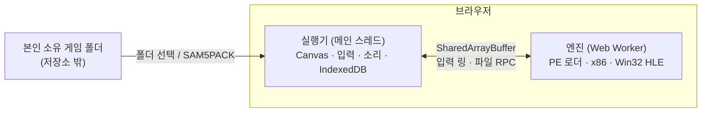

# s5 — 브라우저에서 돌리는 Win32 게임 에뮬레이터 (삼국지 5 황금판 1.10r)

[English](README_EN.md) · [中文](README_ZH.md) · [아키텍처 상세](docs/ARCHITECTURE.md) · [시각화 가이드(HTML)](docs/visual-guide.html)

Windows 9x용 게임 실행 파일(`SAM5GOLD25_KO_1.10r.exe`)을 **설치·플러그인·서버 연산 없이 브라우저 안에서** 실행하는 프로젝트의 공개 가능한 부분입니다.
x86 CPU 에뮬레이션, Win32 API 고수준 에뮬레이션(HLE), 화면·입력·소리 연결, 게임 데이터 패키징, Cloudflare 개인 배포까지의 구조를 담았습니다.
다른 사람이 **자신의 게임 에뮬레이터를 만들 때 코드·아키텍처를 참고**할 수 있도록 공개합니다.

> [!IMPORTANT]
> **게임은 포함되어 있지 않습니다.** 삼국지 5의 저작권은 KOEI(현 KOEI TECMO)에 있습니다.
> 이 저장소에는 게임 실행 파일, `.s5` 데이터, 음악·효과음·영상, 게임에서 추출한 글꼴·커서·모듈(`runtime.bin`), 스크린샷이 없습니다.
> 실행하려면 **본인이 합법적으로 소유한 게임 파일**이 필요하며, 게임 파일과 파생물을 재배포하지 마세요.

## 무엇이 들어 있나

```text
s5/
├── mac-bundle/                 # 실행기(launcher) — 브라우저 에뮬레이터 본체
│   ├── web/index.html          #   게임 화면 셸
│   ├── web/assets/worker-*.js  #   엔진: PE 로더 · x86 CPU · Win32 HLE · 가상 시계 (Web Worker)
│   ├── web/assets/main-*.js    #   화면(Canvas) · 입력 링 · IME · WebAudio · AVI 디코더
│   ├── web/assets/import-*.js  #   게임 폴더 / SAM5PACK 가져오기와 SHA-256 검증
│   ├── web/assets/store-*.js   #   IndexedDB 저장소 · 세대(generation) 관리
│   ├── web/assets/saves-*.js   #   세이브 관리(내보내기·가져오기·백업)
│   ├── web/coi-serviceworker.js#   로컬용 cross-origin isolation (MIT, Guido Zuidhof)
│   ├── server.py, start.command#   Python 표준 라이브러리 로컬 서버 (loopback)
│   └── web/private/runtime.bin #   ✗ 미포함: 게임에서 파생된 데이터 — 직접 준비
├── deploy/                     # Cloudflare 개인 배포 + 빌드 도구
│   ├── scripts/build.mjs       #   dist/ 와 SAM5PACK 게임 팩 생성
│   ├── scripts/patch-engine.mjs#   빌드 타임 엔진 속도 패치 (정확 문자열 치환)
│   ├── scripts/serve-local.mjs #   배포와 같은 헤더의 로컬 서버
│   ├── web/*.js                #   어댑터: 자동 다운로드 · 속도 · 터치 · 소리
│   ├── src/worker.js           #   Access JWT 재검증 + 비공개 R2 pack 제공
│   ├── test/*.test.mjs         #   node:test (게임 없이 9개, 빌드 후 13개)
│   └── wrangler.jsonc          #   <PLACEHOLDER> 를 본인 값으로 바꿔 사용
└── docs/                       # 아키텍처 문서(ko/en/zh) · 시각화 가이드
```

> 실행기(`mac-bundle/web/assets`)는 Vite 빌드 산출물(minified)만 남아 있고 원본 TypeScript 소스는 없습니다.
> 그래서 엔진 개선은 `deploy/scripts/patch-engine.mjs`처럼 **빌드 때 검증 가능한 문자열 치환**으로 합니다.

## 한눈에 보는 구조



자세한 내용은 [docs/ARCHITECTURE.md](docs/ARCHITECTURE.md), 그림으로 보려면 [docs/visual-guide.html](docs/visual-guide.html)(브라우저로 열기)을 보세요.

## 빠른 시작

### 0. 준비물

- 본인 소유 `SAM5GOLD25_KO_1.10r` 게임 폴더 (exe SHA-256 `10574a01…8f64cc72` 만 지원)
- 게임에서 파생한 `runtime.bin` (글리프·커서·모듈, 형식은 [ARCHITECTURE 5장](docs/ARCHITECTURE.md#5-게임-데이터-sam5pack)) → `mac-bundle/web/private/runtime.bin`
- Chrome/Edge 등 Chromium 계열 브라우저 (Safari는 현재 미동작), Python 3 또는 Node.js 20+

### 1. 로컬에서 실행 (가장 간단)

```sh
cd s5/mac-bundle
python3 server.py --directory web --port 8000 --open   # 또는 macOS 에서 start.command 더블클릭
```

`http://localhost:8000` 에서 게임 폴더를 선택하면 브라우저 IndexedDB에 저장되고, 다음부터는 바로 시작합니다.
세이브는 **같은 브라우저·같은 주소(포트 포함)** 에만 남습니다.

### 2. 빌드와 테스트

```sh
cd s5/deploy
npm ci
npm test                                   # 게임 없이: 엔진 패치·pack 형식·Worker 인증 테스트
SAM5_GAME_DIR=/path/to/your/game npm run build   # dist/ + build/pack.bin (둘 다 Git 제외)
npm test                                   # 빌드 산출물까지 13개 검증
npm run serve:local                        # http://localhost:8787 (자동 다운로드 포함, loopback)
```

`SAM5_BUNDLE_WEB`로 실행기 위치, `SAM5_GAME_DIR`로 게임 위치를 바꿀 수 있습니다.

### 3. Cloudflare 개인 배포 (선택)

1. `deploy/wrangler.jsonc`의 `<GAME_HOSTNAME>`, `<TEAM>`, `<ACCESS_AUD>`, `<YOU@EXAMPLE.COM>`을 본인 값으로 바꿉니다.
2. Cloudflare Zero Trust에서 그 hostname 전체를 보호하는 Access 애플리케이션을 만들고, 본인 이메일만 허용합니다.
3. 비공개 R2 버킷을 만듭니다: `npx wrangler r2 bucket create sam5-personal-gamepacks`
4. `npm run deploy` (build → test → pack 업로드 → `wrangler deploy`)

| 구성 | 역할 |
|---|---|
| Workers Static Assets | 실행기·어댑터, `_headers`로 COOP/COEP (SharedArrayBuffer) |
| Worker | `/gamepacks/*`만 처리, Access JWT를 다시 검증(fail closed) |
| 비공개 R2 | 게임 pack(약 36MB, Static Assets 파일 제한 25MiB 초과) |
| Cloudflare Access | 본인만 접근. `workers.dev`·preview URL은 꺼서 우회 차단 |

접근 제한은 DRM이 아닙니다. **본인 소유 게임을 본인만 쓰는 개인 배포**로만 사용하세요. 공개 URL로 게임을 배포하면 저작권 침해입니다.

## 주요 설계 포인트

- **브라우저가 게임을 실행**: 서버는 파일만 줍니다. 화면 스트리밍이 아닙니다.
- **동기 Win32 API ↔ 비동기 웹 API**: Worker가 `Atomics.wait`로 멈추고 메인 스레드가 IndexedDB 작업 후 깨웁니다.
- **block JIT는 API hook 앞에서 멈춤**: 외부 상호작용은 hook에서만 일어나므로, 그 경계에서만 입력·시계를 확인해도 의미가 같습니다. 이 패치로 에뮬레이션 계산이 약 4.7배 빨라졌습니다.
- **가상 시계**: 명령어 수 기반 시간 + 벽시계 동기화 + idle 감지. 속도 1~4x는 대기만 줄이고 게임 로직은 그대로입니다.
- **세이브 보호**: 다시 가져오기는 이전 세대 세이브를 지우므로, 자동 다운로드는 "가져온 게임 없음"일 때만 동작합니다.
- **minified 코드를 고치지 않는 어댑터**: 사용자가 했을 행동(파일 선택, 클릭)을 대신하고 검증·저장은 실행기에 맡깁니다.

## 알려진 제약

- 실행기 원본 소스와 `runtime.bin` 생성 도구는 포함되어 있지 않습니다.
- Safari/iPad: 엔진이 `Invalid file RPC buffer`로 멈춥니다(WebKit 호환 문제).
- 데스크톱 Chromium 기준 검증. 모바일 실기기와 소리 청취는 부분 검증입니다.

## 라이선스

- 이 디렉터리의 코드와 문서: 저장소 루트 [`LICENSE`](../LICENSE) (MIT).
- `mac-bundle/web/coi-serviceworker.js`: MIT, Guido Zuidhof ([`coi-serviceworker.LICENSE.txt`](mac-bundle/web/coi-serviceworker.LICENSE.txt)).
- 삼국지 5 및 관련 상표·게임 데이터: KOEI TECMO 소유. 이 프로젝트는 KOEI TECMO와 관계가 없습니다.
