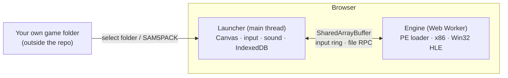

# s5 — A Win32 Game Emulator That Runs in the Browser (Romance of the Three Kingdoms V Gold Edition 1.10r)

[한국어](README.md) · [中文](README_ZH.md) · [Architecture](docs/ARCHITECTURE_EN.md) · [Visual guide (HTML, Korean)](docs/visual-guide.html)

This is the publishable part of a project that runs a Windows 9x game executable (`SAM5GOLD25_KO_1.10r.exe`) **entirely in the browser, with no installation, plugins, or server-side computation**.
It covers x86 CPU emulation, high-level emulation (HLE) of the Win32 API, wiring up display, input, and sound, game data packaging, and personal deployment on Cloudflare.
It is published so that others can **use the code and architecture as a reference when building their own game emulators**.

> [!IMPORTANT]
> **The game is not included.** The copyright of Romance of the Three Kingdoms V (Sangokushi V) belongs to KOEI (now KOEI TECMO).
> This repository contains no game executable, no `.s5` data, no music, sound effects, or video, no fonts, cursors, or modules extracted from the game (`runtime.bin`), and no screenshots.
> To run it you need **game files that you legally own**. Do not redistribute the game files or anything derived from them.

## What's Inside

```text
s5/
├── mac-bundle/                 # launcher — the browser emulator itself
│   ├── web/index.html          #   game screen shell
│   ├── web/assets/worker-*.js  #   engine: PE loader · x86 CPU · Win32 HLE · virtual clock (Web Worker)
│   ├── web/assets/main-*.js    #   display (Canvas) · input ring · IME · WebAudio · AVI decoder
│   ├── web/assets/import-*.js  #   game folder / SAM5PACK import and SHA-256 verification
│   ├── web/assets/store-*.js   #   IndexedDB storage · generation management
│   ├── web/assets/saves-*.js   #   save management (export · import · backup)
│   ├── web/coi-serviceworker.js#   cross-origin isolation for local use (MIT, Guido Zuidhof)
│   ├── server.py, start.command#   local server using only the Python standard library (loopback)
│   └── web/private/runtime.bin #   ✗ not included: game-derived data — prepare it yourself
├── deploy/                     # personal Cloudflare deployment + build tools
│   ├── scripts/build.mjs       #   builds dist/ and the SAM5PACK game pack
│   ├── scripts/patch-engine.mjs#   build-time engine speed patch (exact string replacement)
│   ├── scripts/serve-local.mjs #   local server with the same headers as the deployment
│   ├── web/*.js                #   adapters: auto-download · speed · touch · sound
│   ├── src/worker.js           #   re-verifies the Access JWT + serves the private R2 pack
│   ├── test/*.test.mjs         #   node:test (9 tests without the game, 13 after a build)
│   └── wrangler.jsonc          #   replace <PLACEHOLDER> with your own values before use
└── docs/                       # architecture docs (ko/en/zh) · visual guide
```

> Only the Vite build output (minified) of the launcher (`mac-bundle/web/assets`) remains; the original TypeScript sources are not available.
> That is why engine improvements are done as **build-time, verifiable string replacements**, like `deploy/scripts/patch-engine.mjs`.

## Architecture at a Glance



For details, see [docs/ARCHITECTURE_EN.md](docs/ARCHITECTURE_EN.md); for diagrams, open [docs/visual-guide.html](docs/visual-guide.html) in a browser.

## Quick Start

### 0. Prerequisites

- Your own copy of the `SAM5GOLD25_KO_1.10r` game folder (only the exe with SHA-256 `10574a01…8f64cc72` is supported)
- A game-derived `runtime.bin` (glyphs · cursors · modules; for the format see [ARCHITECTURE section 5](docs/ARCHITECTURE_EN.md#5-game-data-sam5pack)) → `mac-bundle/web/private/runtime.bin`
- A Chromium-based browser such as Chrome or Edge (Safari currently does not work), and Python 3 or Node.js 20+

### 1. Run Locally (simplest)

```sh
cd s5/mac-bundle
python3 server.py --directory web --port 8000 --open   # or double-click start.command on macOS
```

Select the game folder at `http://localhost:8000`; it is stored in the browser's IndexedDB, and from then on the game starts immediately.
Saves persist only in **the same browser at the same address (including the port)**.

### 2. Build and Test

```sh
cd s5/deploy
npm ci
npm test                                   # without the game: engine patch · pack format · Worker auth tests
SAM5_GAME_DIR=/path/to/your/game npm run build   # dist/ + build/pack.bin (both excluded from Git)
npm test                                   # verifies 13 checks including build outputs
npm run serve:local                        # http://localhost:8787 (with auto-download, loopback)
```

Use `SAM5_BUNDLE_WEB` to change the launcher location and `SAM5_GAME_DIR` to change the game location.

### 3. Personal Cloudflare Deployment (optional)

1. In `deploy/wrangler.jsonc`, replace `<GAME_HOSTNAME>`, `<TEAM>`, `<ACCESS_AUD>`, and `<YOU@EXAMPLE.COM>` with your own values.
2. In Cloudflare Zero Trust, create an Access application that protects that entire hostname, and allow only your own email.
3. Create a private R2 bucket: `npx wrangler r2 bucket create sam5-personal-gamepacks`
4. `npm run deploy` (build → test → upload pack → `wrangler deploy`)

| Component | Role |
|---|---|
| Workers Static Assets | Launcher and adapters; COOP/COEP via `_headers` (SharedArrayBuffer) |
| Worker | Handles only `/gamepacks/*`; re-verifies the Access JWT (fail closed) |
| Private R2 | Game pack (about 36MB, exceeding the 25MiB Static Assets file limit) |
| Cloudflare Access | Only you can access it. `workers.dev` and preview URLs are turned off to block bypass |

Access restriction is not DRM. Use this **only as a personal deployment where you use a game you own, for yourself**. Distributing the game from a public URL is copyright infringement.

## Key Design Points

- **The browser runs the game**: the server only hands out files. This is not screen streaming.
- **Synchronous Win32 API ↔ asynchronous web APIs**: the Worker blocks on `Atomics.wait`, and the main thread wakes it after finishing the IndexedDB operation.
- **The block JIT stops in front of API hooks**: since external interaction happens only in hooks, checking input and the clock only at that boundary gives the same semantics. This patch made the emulation computation about 4.7x faster.
- **Virtual clock**: instruction-count-based time + wall-clock synchronization + idle detection. Speeds of 1–4x only shorten waits; game logic is unchanged.
- **Save protection**: re-importing deletes the previous generation's saves, so auto-download runs only when there is "no imported game".
- **Adapters that don't modify minified code**: they perform the actions a user would (selecting files, clicking) and leave verification and storage to the launcher.

## Known Limitations

- The launcher's original sources and the tool that generates `runtime.bin` are not included.
- Safari/iPad: the engine stops with `Invalid file RPC buffer` (a WebKit compatibility issue).
- Verified on desktop Chromium. Real mobile devices and audio listening are only partially verified.

## License

- Code and documents in this directory: the repository root [`LICENSE`](../LICENSE) (MIT).
- `mac-bundle/web/coi-serviceworker.js`: MIT, Guido Zuidhof ([`coi-serviceworker.LICENSE.txt`](mac-bundle/web/coi-serviceworker.LICENSE.txt)).
- Romance of the Three Kingdoms V and related trademarks and game data are owned by KOEI TECMO. This project is not affiliated with KOEI TECMO.
