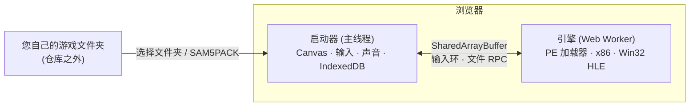

# s5 — 在浏览器中运行的 Win32 游戏模拟器（三国志5 黄金版 1.10r）

[한국어](README.md) · [English](README_EN.md) · [架构详解](docs/ARCHITECTURE_ZH.md) · [可视化指南（HTML，韩语）](docs/visual-guide.html)

这是一个项目中可公开的部分：它能让 Windows 9x 游戏可执行文件（`SAM5GOLD25_KO_1.10r.exe`）**无需安装、无需插件、无需服务器运算，直接在浏览器内运行**。
内容涵盖 x86 CPU 模拟、Win32 API 高层模拟（HLE）、画面·输入·声音的对接、游戏数据打包，以及 Cloudflare 个人部署的完整结构。
公开的目的是让其他人在**构建自己的游戏模拟器时，可以参考代码与架构**。

> [!IMPORTANT]
> **本仓库不包含游戏。** 三国志5 的版权归 KOEI（现 KOEI TECMO）所有。
> 本仓库中没有游戏可执行文件、`.s5` 数据、音乐·音效·视频，也没有从游戏中提取的字体·光标·模块（`runtime.bin`）和截图。
> 运行时需要**您合法拥有的游戏文件**，请勿再分发游戏文件及其衍生物。

## 包含内容

```text
s5/
├── mac-bundle/                 # 启动器（launcher）— 浏览器模拟器本体
│   ├── web/index.html          #   游戏画面外壳
│   ├── web/assets/worker-*.js  #   引擎：PE 加载器 · x86 CPU · Win32 HLE · 虚拟时钟 (Web Worker)
│   ├── web/assets/main-*.js    #   画面(Canvas) · 输入环 · IME · WebAudio · AVI 解码器
│   ├── web/assets/import-*.js  #   游戏文件夹 / SAM5PACK 导入与 SHA-256 校验
│   ├── web/assets/store-*.js   #   IndexedDB 存储 · 世代(generation)管理
│   ├── web/assets/saves-*.js   #   存档管理（导出·导入·备份）
│   ├── web/coi-serviceworker.js#   本地用 cross-origin isolation (MIT, Guido Zuidhof)
│   ├── server.py, start.command#   仅用 Python 标准库的本地服务器 (loopback)
│   └── web/private/runtime.bin #   ✗ 未包含：游戏衍生数据 — 请自行准备
├── deploy/                     # Cloudflare 个人部署 + 构建工具
│   ├── scripts/build.mjs       #   生成 dist/ 和 SAM5PACK 游戏包
│   ├── scripts/patch-engine.mjs#   构建时引擎加速补丁（精确字符串替换）
│   ├── scripts/serve-local.mjs #   与部署环境响应头相同的本地服务器
│   ├── web/*.js                #   适配器：自动下载 · 速度 · 触控 · 声音
│   ├── src/worker.js           #   重新校验 Access JWT + 提供私有 R2 pack
│   ├── test/*.test.mjs         #   node:test（无游戏时 9 个，构建后 13 个）
│   └── wrangler.jsonc          #   将 <PLACEHOLDER> 替换为自己的值后使用
└── docs/                       # 架构文档(ko/en/zh) · 可视化指南
```

> 启动器（`mac-bundle/web/assets`）只保留了 Vite 构建产物（已压缩 minified），没有原始 TypeScript 源码。
> 因此引擎改进采用 `deploy/scripts/patch-engine.mjs` 这样的**构建时可校验的字符串替换**方式。

## 结构一览



详细内容请见 [docs/ARCHITECTURE_ZH.md](docs/ARCHITECTURE_ZH.md)，图示版本请用浏览器打开 [docs/visual-guide.html](docs/visual-guide.html)。

## 快速开始

### 0. 准备工作

- 您自己拥有的 `SAM5GOLD25_KO_1.10r` 游戏文件夹（仅支持 exe SHA-256 为 `10574a01…8f64cc72` 的版本）
- 从游戏派生的 `runtime.bin`（字形·光标·模块，格式见 [ARCHITECTURE 第 5 章](docs/ARCHITECTURE_ZH.md)）→ `mac-bundle/web/private/runtime.bin`
- Chrome/Edge 等 Chromium 系浏览器（Safari 目前无法运行），以及 Python 3 或 Node.js 20+

### 1. 本地运行（最简单）

```sh
cd s5/mac-bundle
python3 server.py --directory web --port 8000 --open   # 或在 macOS 上双击 start.command
```

在 `http://localhost:8000` 选择游戏文件夹后，数据会保存到浏览器的 IndexedDB，之后即可直接启动。
存档只会保留在**同一浏览器、同一地址（含端口）**下。

### 2. 构建与测试

```sh
cd s5/deploy
npm ci
npm test                                   # 无需游戏：引擎补丁·pack 格式·Worker 认证测试
SAM5_GAME_DIR=/path/to/your/game npm run build   # dist/ + build/pack.bin（均已排除在 Git 之外）
npm test                                   # 连同构建产物共校验 13 项
npm run serve:local                        # http://localhost:8787（含自动下载，loopback）
```

可通过 `SAM5_BUNDLE_WEB` 更改启动器位置，通过 `SAM5_GAME_DIR` 更改游戏位置。

### 3. Cloudflare 个人部署（可选）

1. 将 `deploy/wrangler.jsonc` 中的 `<GAME_HOSTNAME>`、`<TEAM>`、`<ACCESS_AUD>`、`<YOU@EXAMPLE.COM>` 替换为自己的值。
2. 在 Cloudflare Zero Trust 中创建一个保护该 hostname 全部路径的 Access 应用，仅允许自己的邮箱。
3. 创建私有 R2 存储桶：`npx wrangler r2 bucket create sam5-personal-gamepacks`
4. 执行 `npm run deploy`（build → test → 上传 pack → `wrangler deploy`）

| 组成 | 作用 |
|---|---|
| Workers Static Assets | 启动器·适配器，通过 `_headers` 设置 COOP/COEP (SharedArrayBuffer) |
| Worker | 仅处理 `/gamepacks/*`，重新校验 Access JWT（fail closed） |
| 私有 R2 | 游戏 pack（约 36MB，超过 Static Assets 25MiB 文件限制） |
| Cloudflare Access | 仅限本人访问。关闭 `workers.dev`·preview URL 以阻断绕过 |

访问限制不是 DRM。请**仅作为“本人使用自己拥有的游戏”的个人部署**来使用。通过公开 URL 分发游戏属于侵犯版权。

## 主要设计要点

- **由浏览器运行游戏**：服务器只提供文件，并非画面流式传输。
- **同步 Win32 API ↔ 异步 Web API**：Worker 通过 `Atomics.wait` 挂起，主线程完成 IndexedDB 操作后将其唤醒。
- **block JIT 在 API hook 之前停止**：外部交互只发生在 hook 处，因此仅在该边界检查输入和时钟，语义不变。此补丁使模拟计算提速约 4.7 倍。
- **虚拟时钟**：基于指令数的时间 + 墙上时钟同步 + idle 检测。1~4x 倍速只缩短等待时间，游戏逻辑保持不变。
- **存档保护**：重新导入会删除上一世代的存档，因此自动下载仅在“没有已导入的游戏”时才会运行。
- **不修改 minified 代码的适配器**：代替用户执行其会做的操作（选择文件、点击），校验与存储交由启动器处理。

## 已知限制

- 不包含启动器原始源码和 `runtime.bin` 生成工具。
- Safari/iPad：引擎会因 `Invalid file RPC buffer` 而停止（WebKit 兼容问题）。
- 仅在桌面 Chromium 上验证。移动真机和声音试听仅为部分验证。

## 许可证

- 本目录中的代码和文档：仓库根目录 [`LICENSE`](../LICENSE)（MIT）。
- `mac-bundle/web/coi-serviceworker.js`：MIT，Guido Zuidhof（[`coi-serviceworker.LICENSE.txt`](mac-bundle/web/coi-serviceworker.LICENSE.txt)）。
- 三国志5 及相关商标·游戏数据归 KOEI TECMO 所有。本项目与 KOEI TECMO 无任何关联。
