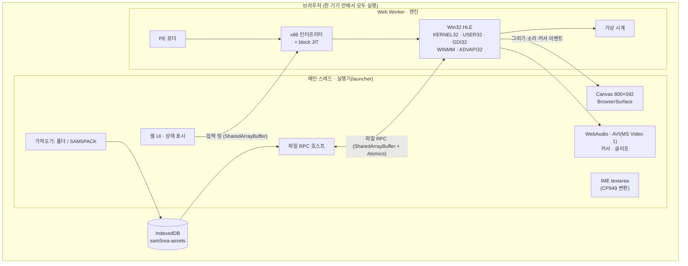
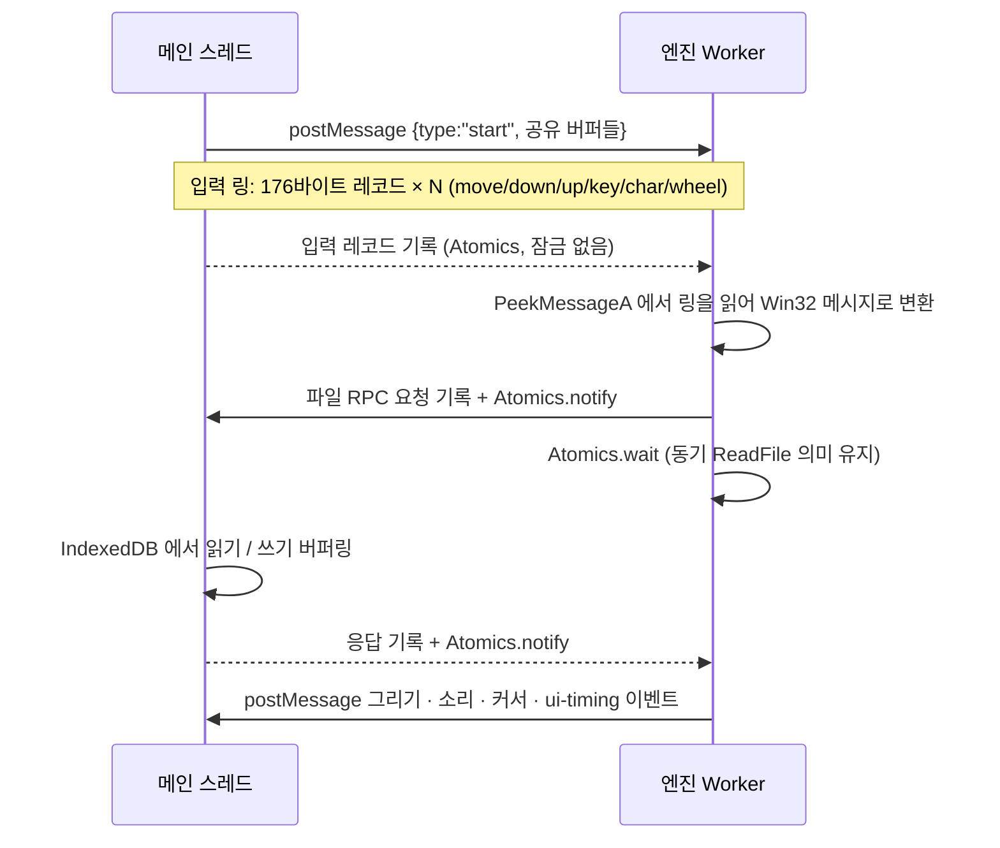
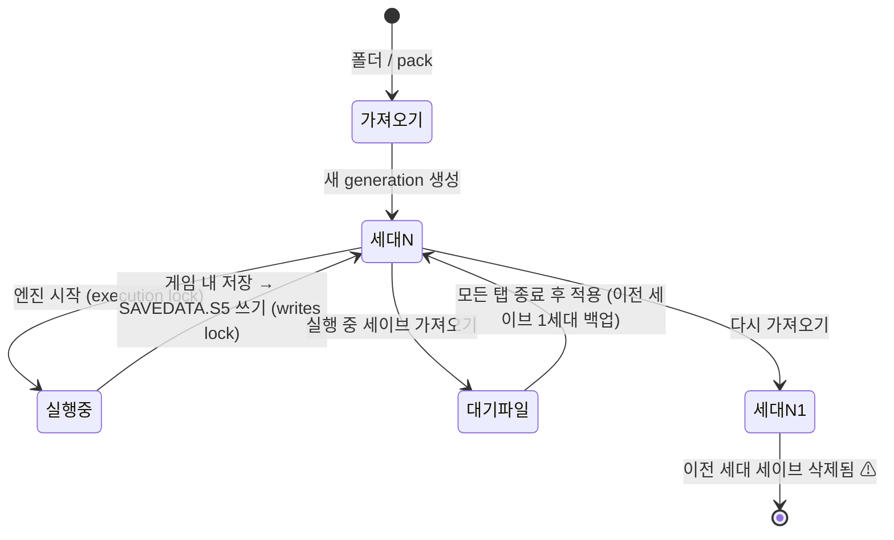
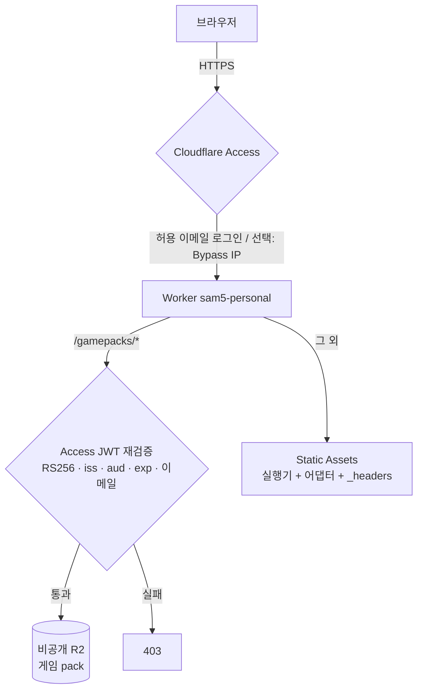

# 아키텍처 상세

[English](ARCHITECTURE_EN.md) · [中文](ARCHITECTURE_ZH.md) · [시각화 가이드(HTML)](visual-guide.html)

이 문서는 Windows 9x용 2D 게임 실행 파일을 **브라우저 안에서 그대로 실행하는** 구조를 설명합니다.
대상은 SAM5GOLD25_KO_1.10r(삼국지 5 한글 황금판 패치)이지만, 설계는 다른 Win32 게임 에뮬레이터를 만들 때 참고할 수 있도록 일반화해서 적었습니다.

> 이 저장소에는 게임 원본·게임에서 추출한 파생 데이터가 없습니다. 실행하려면 본인이 합법적으로 소유한 게임이 필요합니다.

## 1. 전체 그림



| 계층 | 위치 | 하는 일 |
|---|---|---|
| 실행기 | `mac-bundle/web/assets/main-*.js`, `import-*.js`, `store-*.js`, `saves-*.js` | 게임 파일 가져오기·검증, IndexedDB 저장, 화면·입력·소리, 세이브 관리 |
| 엔진 | `mac-bundle/web/assets/worker-*.js` | PE 로드, x86 실행, Win32 API 고수준 에뮬레이션(HLE), 가상 시계 |
| 어댑터 | `deploy/web/*.js` | minified 실행기를 수정하지 않고 바깥에서 동작 추가 (자동 다운로드, 속도, 터치, 소리) |
| 엔진 패치 | `deploy/scripts/patch-engine.mjs` | 빌드 때 엔진 worker에 정확 문자열 치환 7개 적용 |
| 배포 | `deploy/src/worker.js`, `deploy/wrangler.jsonc` | Cloudflare Static Assets + Worker + 비공개 R2 + Access |
| 로컬 서버 | `mac-bundle/server.py`, `start.command` | 표준 라이브러리 Python 정적 서버(loopback 전용) |

## 2. 엔진(Web Worker)

### 2.1 PE 로더와 import 해석

게임 exe의 PE 헤더를 읽어 섹션을 가상 메모리에 올리고, import 테이블의 DLL 함수(`KERNEL32.dll!CreateFileA` 등)를 **JavaScript 구현으로 연결되는 hook 주소**로 채웁니다. 게임이 그 주소를 `call`하면 CPU가 hook 앞에서 멈추고 JS 함수가 호출 규약(`stdcall`/`cdecl`)에 맞게 스택 인자를 읽고 `EAX`를 돌려줍니다.

`LoadLibraryA`/`GetProcAddress`도 HLE 대상이라 늦게 찾는 함수도 hook으로 연결할 수 있습니다. 번들 문자열에서 확인되는 API 표면은 대략 다음과 같습니다.

| DLL | 대표 함수 | 브라우저 대응 |
|---|---|---|
| KERNEL32 | `CreateFileA` `ReadFile` `SetFilePointer` `HeapAlloc` `VirtualAlloc` `GetTickCount` `MultiByteToWideChar` | 파일 RPC, 선형 메모리 힙, 가상 시계, 코드페이지 표 |
| USER32 | `CreateWindowExA` `PeekMessageA` `DispatchMessageA` `SetWindowsHookExA` `LoadCursorA` `MessageBoxA` | 메시지 큐 + 입력 링, 커서 채널 |
| GDI32 | `CreateDIBSection` `BitBlt` `CreatePalette` `AnimatePalette` `TextOutA` `CreateFontA` | 8bpp 프레임버퍼 → Canvas, 글리프 아틀라스 |
| WINMM | `mciSendCommandA` `timeGetTime` | `waveaudio`·`mpegvideo`(MP3)·`avivideo` → WebAudio·AVI 디코더 |
| ADVAPI32 | `RegCreateKeyExA` `RegQueryValueExA` | 메모리 레지스트리 |

> 포인트: **모든 API를 구현하지 않습니다.** 게임이 실제로 부르는 함수만, 게임이 기대하는 정도로만 구현합니다. 처음에는 미구현 hook에서 이름을 기록하고 멈추게 한 뒤 하나씩 채우는 방식이 가장 빠릅니다.

### 2.2 x86 CPU: 인터프리터 + block JIT

- 기본은 명령어 단위 인터프리터(`cpu.step`)입니다. `InvalidOpcode`, `DivideError`, `GuestFault`, `UnimplementedOpcode` 같은 CPU 오류를 구분해 진단 정보로 남깁니다. C 런타임이 쓰는 `RtlUnwind`, `SetUnhandledExceptionFilter` 등도 HLE 대상입니다.
- 빠른 경로 `cpu.run`은 기본 블록을 JS 함수로 컴파일해 캐시하고, `stopBeforeHook` 옵션으로 **API hook 직전에서 멈춥니다**. hook 경계가 곧 "외부 세계와 상호작용하는 지점"이므로 여기서만 입력·시계·중단 조건을 확인하면 됩니다.
- 원본 빌드는 호스트가 `until` 콜백과 clock을 넘기면 빠른 경로를 쓰지 않았습니다. 이 저장소의 빌드 패치가 이를 고칩니다(4장).

### 2.3 가상 시계

게임은 `GetTickCount`/`timeGetTime`으로 시간을 재고, 메시지 루프에서 바쁜 대기(busy wait)를 합니다. 엔진은 **실행한 명령어 수로 진행하는 가상 시간**과 **벽시계(wall time)** 를 분리합니다.

- 가상 시간이 벽시계보다 앞서면 `sleep`해서 원래 속도를 맞춥니다.
- 게임이 `PeekMessage`로 빈 큐를 확인하는 idle 상태에 들어가면 `enterIdle()`로 기록했다가 벽시계만큼 가상 시간을 따라잡게 해 CPU를 낭비하지 않습니다.
- 속도 배율(1~4x)은 이 벽시계를 배율만큼 빨리 흐르게 하는 방식이라 **게임 로직은 바뀌지 않고 대기만 줄어듭니다.**

### 2.4 게임 함수 단위 HLE

일부 게임 내부 함수(`FUN_0048b4e0` 팔레트 갱신, `FUN_0048b880` 등 — 디스어셈블러가 붙인 주소 기반 이름)는 hook으로 표시해 **UI 타이밍 이벤트**(팔레트·화면 전환)를 메인 스레드에 알립니다. 코드를 바꾸지 않고 관찰만 하는 hook이라 원본 동작과 같고, 화면 갱신 시점을 정확히 잡을 수 있습니다.

## 3. 메인 스레드 ↔ 엔진 통신



- **동기 Win32 API ↔ 비동기 브라우저 API.** `ReadFile`은 동기지만 IndexedDB는 비동기입니다. 엔진 Worker가 `Atomics.wait`로 멈추고 메인 스레드가 비동기 작업을 끝낸 뒤 깨우는 구조로 해결합니다. 이를 위해 `SharedArrayBuffer`가 필요하고, 페이지는 **cross-origin isolated**(COOP `same-origin` + COEP `require-corp`)여야 합니다.
- **입력 링 버퍼.** 이벤트당 176바이트 고정 레코드(종류, 좌표, 버튼, VK, 스캔코드, 수정키, 시각 등)를 원형 버퍼로 넘깁니다. 한글 입력은 숨은 `textarea`의 조합 결과를 CP949 2바이트(DBCS)로 바꿔 `WM_CHAR` 두 개로 보냅니다.
- **Web Locks.** `sam5rea:<generation>:execution`, `...:writes` 잠금으로 같은 브라우저의 여러 탭이 같은 세이브를 동시에 쓰지 못하게 합니다. 세이브 관리 페이지는 실행 중이면 가져온 세이브를 대기 상태로 둡니다.

## 4. 빌드 타임 엔진 패치

실행기는 Vite로 빌드된 minified 산출물만 있고 원본 소스는 없습니다. 그래서 `deploy/scripts/patch-engine.mjs`는 **정확히 1번 일치해야 하는 문자열 치환**만 합니다. 실행기가 바뀌어 하나라도 일치하지 않으면 빌드가 실패해 반쯤 패치된 엔진이 배포되지 않습니다. 원본 worker도 함께 배포해 `?engine=original`로 되돌릴 수 있습니다.

| 패치 | 문제 | 해결 |
|---|---|---|
| fast path with until/clock | 호스트가 항상 `until`·clock을 넘겨 block JIT를 한 번도 못 탐. 명령어마다 `step()`+`until()`+시계 갱신 | hook 경계에서만 `until` 평가. `until`이 보는 상태는 hook 안에서만 바뀌므로 멈춤 지점 동일 |
| unclamped slice yield | 8ms 실행 조각 사이 `setTimeout(0)`이 중첩 시 4ms로 강제되어 worker가 1/3 쉼 | `MessageChannel`로 양보 |
| scaled clock ×4, live speed message | 게임 자체 대기(메시지 표시·애니메이션) | 벽시계 배율 + `{type:'sam5-speed'}` 메시지로 실시간 변경 |

측정(맥 Chromium, 새 게임 시작 구간 약 5천만 x86 명령): 에뮬레이션 계산 9.1s → 1.95s(약 4.7배), 조각 사이 유휴 3.6s → 0.03s.

## 5. 게임 데이터: SAM5PACK

```text
offset 0   "SAM5PACK"                 8 bytes, latin1 magic
offset 8   headerLength               uint32 little-endian
offset 12  header JSON (UTF-8)        {"version":1,"files":[{path, role, offset, size, sha256}, ...]}
offset 12+headerLength                파일 데이터를 header 순서대로 이어 붙임 (offset 은 이 지점 기준)
```

| role | 의미 |
|---|---|
| `executable` | 게임 exe. SHA-256을 고정해 지원 버전만 실행 |
| `data` | `.s5`·WAV·MP3·AVI 등 원본 파일 |
| `glyphs` | 글꼴 글리프 아틀라스(`glyphs.json`, `glyphs.bin`) |
| `cursor` | exe 리소스에서 꺼낸 커서(`.cur` + PNG) |
| `module` | 미리 디코드한 모듈 |

- 실행기는 파일별 SHA-256, 경로 중복, exe 해시, 필수 `.s5` 목록을 검사한 뒤 IndexedDB에 저장합니다.
- 경로는 NFC로 정규화합니다. macOS 파일 시스템이 한글 파일명을 NFD로 돌려주는 경우가 있기 때문입니다.
- `glyphs`/`cursor`/`module`은 게임에서 파생된 데이터라 이 저장소에 없습니다(원래 `runtime.bin`). 아래 "제약" 참고.
- 배포 시 pack 키는 내용 해시 기반(`gamepacks/<name>-<sha16>.bin`)이라 불변 URL로 캐시할 수 있습니다.

## 6. 세이브 수명 주기



- `SAVEDATA.S5` 기본 크기 359,972바이트. 내보내기/가져오기, 대기 파일, 이전 세이브 복원이 있습니다.
- **다시 가져오면 이전 세대 세이브가 지워집니다.** 그래서 자동 다운로드 어댑터는 "가져온 게임 없음" 상태에서만 동작합니다.

## 7. 배포(Cloudflare) 보안 모델



- `workers_dev`, `preview_urls`를 끄고 custom domain만 엽니다. Access를 우회하는 URL이 없게 합니다.
- Worker는 Access 뒤에 있어도 JWT를 다시 검증합니다(fail closed). 설정 누락 시 거부합니다.
- 응답 캐시는 `private`입니다. 인증 쿠키가 걸린 콘텐츠를 공유 캐시에 두지 않습니다.
- 접근 제한은 DRM이 아닙니다. 로그인한 사용자의 브라우저에는 게임 파일이 저장됩니다. **본인 소유 게임을 본인만 쓰는 개인 배포** 용도입니다.

## 8. 어댑터: minified 코드를 바깥에서 고치기

| 파일 | 방법 |
|---|---|
| `sam5-autoload.js` | `MutationObserver`로 실행기의 "가져온 게임 없음" 출력을 감지 → manifest·pack 다운로드(크기·SHA-256 확인) → `DataTransfer`로 실행기의 pack `<input>`에 넣고 `change` 발생. 검증·저장은 실행기 코드가 그대로 수행 |
| `sam5-engine.js` | `window.Worker`를 감싸 엔진 worker URL만 패치본으로 교체, 속도 선택 UI |
| `sam5-touch.js` | 터치일 때 IME `textarea`에 `inputmode="none"`을 걸어 화면 키보드가 매번 뜨지 않게 함 |
| `sam5-audio.js` | `AudioContext.prototype.resume`을 감싸 실제 사용자 활성화 이벤트(`pointerup`·`click` 등)에서 다시 resume |

원칙: **실행기의 검증·저장 경로를 우회하지 않는다.** 어댑터는 사용자가 했을 행동(파일 선택, 클릭)을 대신할 뿐입니다.

## 9. 내 게임용 에뮬레이터를 만들 때 체크리스트

1. **대상 고정**: 지원할 exe 하나를 SHA-256으로 고정합니다. 버전이 다르면 주소 기반 hook이 모두 어긋납니다.
2. **API 표면 조사**: import 테이블과 `GetProcAddress` 호출을 기록해 구현할 함수 목록을 만듭니다. 미구현 hook은 이름을 남기고 멈추게 합니다.
3. **CPU는 정확성 먼저**: 인터프리터로 타이틀까지 도달한 뒤 block JIT를 붙입니다. JIT는 hook 앞에서 멈추게 하면 외부 상호작용 의미가 바뀌지 않습니다.
4. **동기 API는 Worker + SharedArrayBuffer + Atomics**: COOP/COEP 헤더를 서버(`_headers`)에 넣고, 로컬은 `coi-serviceworker`로 대체할 수 있습니다.
5. **시간은 가상 시계로**: 명령어 수 기반 가상 시간 + 벽시계 동기화 + idle 감지. 속도 조절이 덤으로 생깁니다.
6. **입력은 고정 크기 링 버퍼**: 메시지 루프(`PeekMessage`)에서만 소비하면 결정적입니다. IME는 게임 코드페이지(CP949, Shift-JIS 등)로 변환합니다.
7. **파생 데이터 분리**: 글꼴·커서처럼 브라우저에 없는 것은 사용자 원본에서 생성해 별도 팩으로 둡니다. 저장소에는 생성 규칙만 둡니다.
8. **세이브 보호 우선**: 데이터 교체·재가져오기가 세이브를 지우지 않는지 먼저 확인하고, 내보내기/가져오기를 항상 남깁니다.
9. **저작권**: 게임 파일, 추출 리소스, 스크린샷, 게임 텍스트를 저장소에 넣지 않습니다. 사용자가 본인 파일을 고르게 합니다.

## 10. 제약과 알려진 문제

- **실행기 원본 소스 없음**: `mac-bundle/web/assets`는 빌드 산출물입니다. 그래서 엔진 수정은 4장 방식의 빌드 타임 패치로만 합니다.
- **파생 데이터 생성기 미포함**: `runtime.bin`(글리프·커서·모듈)은 게임에서 파생된 데이터라 넣지 않았고, 이를 만드는 도구의 소스도 이 번들에 없습니다. 본인 게임에서 직접 생성해 `mac-bundle/web/private/runtime.bin`에 두어야 실행됩니다(5장 형식).
- **Safari/iPad 미동작**: WebKit에서 엔진이 `Invalid file RPC buffer`로 멈춥니다. 엔진 Worker가 받은 버퍼를 `SharedArrayBuffer`로 인식하지 못하는 문제로 보입니다.
- 데스크톱 Chromium 기준으로 검증했습니다. 모바일 실기기·소리 청취는 부분 검증입니다.
