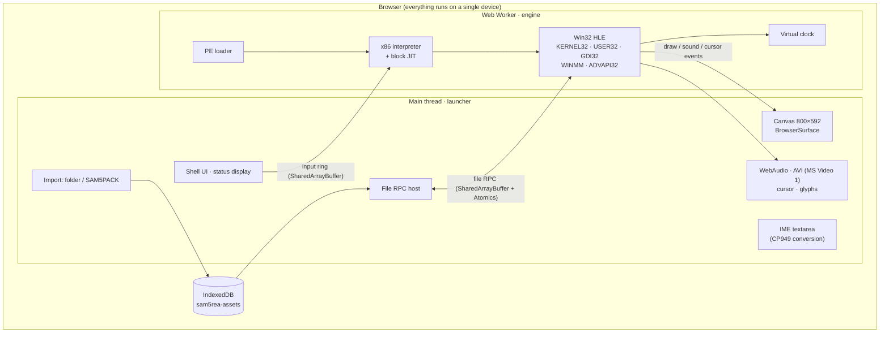
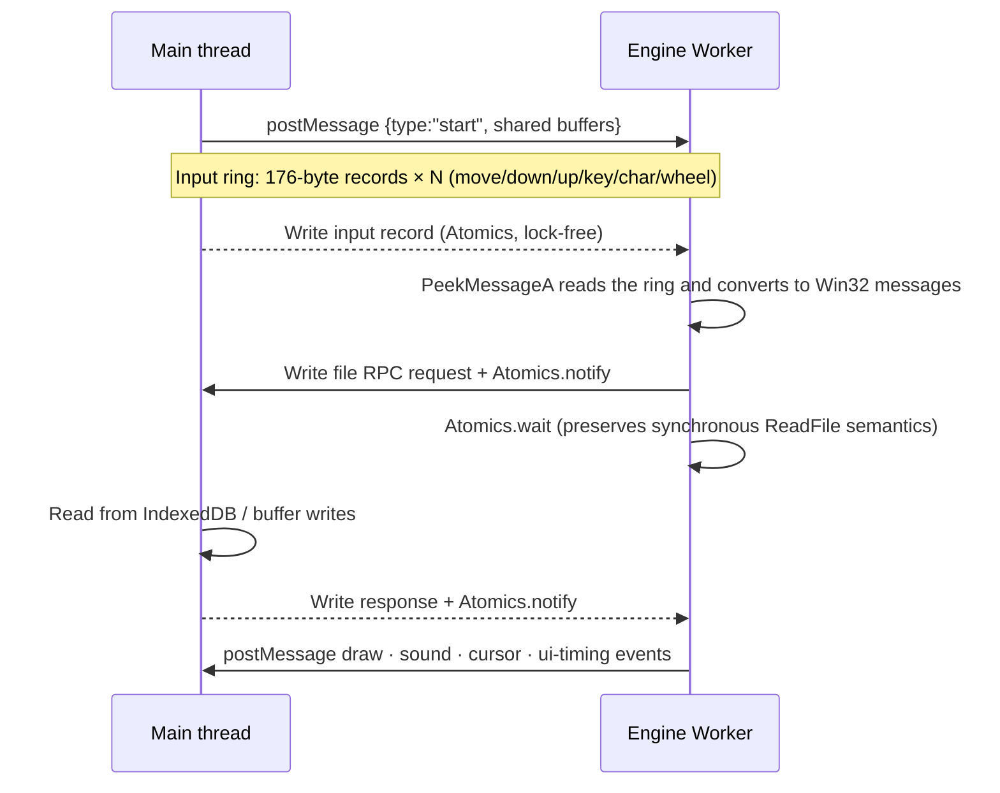
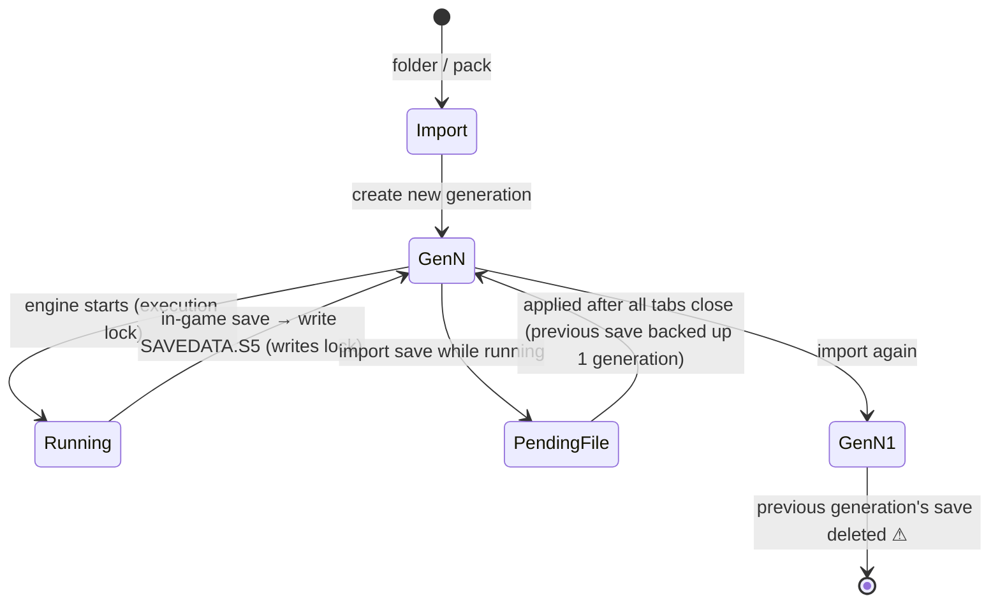
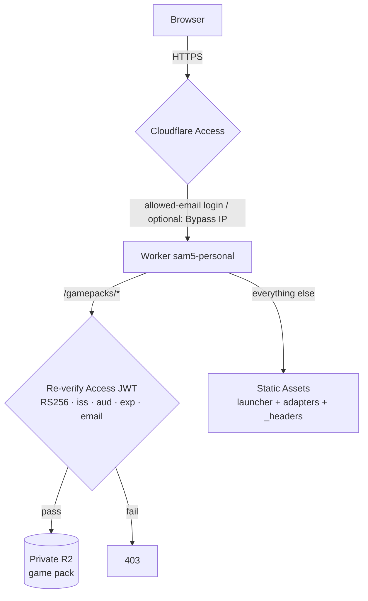

# Architecture in Detail

[한국어](ARCHITECTURE.md) · [中文](ARCHITECTURE_ZH.md) · [Visual guide (HTML, Korean)](visual-guide.html)

This document explains how a 2D game executable built for Windows 9x runs **as-is inside a browser**.
The target is SAM5GOLD25_KO_1.10r (the Romance of the Three Kingdoms V Korean Gold Edition patch), but the design is written in general terms so it can serve as a reference for building emulators for other Win32 games.

> This repository contains neither the original game nor any data derived from it. To run it, you need a copy of the game that you legally own.

## 1. The Big Picture



| Layer | Location | Role |
|---|---|---|
| Launcher | `mac-bundle/web/assets/main-*.js`, `import-*.js`, `store-*.js`, `saves-*.js` | Importing and validating game files, IndexedDB storage, display, input, sound, save management |
| Engine | `mac-bundle/web/assets/worker-*.js` | PE loading, x86 execution, high-level emulation (HLE) of the Win32 API, virtual clock |
| Adapters | `deploy/web/*.js` | Add behavior from the outside without modifying the minified launcher (auto-download, speed, touch, sound) |
| Engine patch | `deploy/scripts/patch-engine.mjs` | Applies 7 exact-string replacements to the engine worker at build time |
| Deployment | `deploy/src/worker.js`, `deploy/wrangler.jsonc` | Cloudflare Static Assets + Worker + private R2 + Access |
| Local server | `mac-bundle/server.py`, `start.command` | Standard-library Python static server (loopback only) |

## 2. The Engine (Web Worker)

### 2.1 PE Loader and Import Resolution

The loader reads the PE header of the game exe, maps the sections into virtual memory, and fills the import table's DLL functions (such as `KERNEL32.dll!CreateFileA`) with **hook addresses that resolve to JavaScript implementations**. When the game `call`s such an address, the CPU stops in front of the hook, and the JS function reads the stack arguments according to the calling convention (`stdcall`/`cdecl`) and returns a value in `EAX`.

`LoadLibraryA`/`GetProcAddress` are also HLE targets, so functions that are looked up late can be wired to hooks as well. The API surface visible in the bundle strings is roughly as follows.

| DLL | Representative functions | Browser counterpart |
|---|---|---|
| KERNEL32 | `CreateFileA` `ReadFile` `SetFilePointer` `HeapAlloc` `VirtualAlloc` `GetTickCount` `MultiByteToWideChar` | File RPC, linear-memory heap, virtual clock, code page tables |
| USER32 | `CreateWindowExA` `PeekMessageA` `DispatchMessageA` `SetWindowsHookExA` `LoadCursorA` `MessageBoxA` | Message queue + input ring, cursor channel |
| GDI32 | `CreateDIBSection` `BitBlt` `CreatePalette` `AnimatePalette` `TextOutA` `CreateFontA` | 8bpp framebuffer → Canvas, glyph atlas |
| WINMM | `mciSendCommandA` `timeGetTime` | `waveaudio` · `mpegvideo` (MP3) · `avivideo` → WebAudio · AVI decoder |
| ADVAPI32 | `RegCreateKeyExA` `RegQueryValueExA` | In-memory registry |

> Key point: **do not implement every API.** Implement only the functions the game actually calls, and only to the extent the game expects. The fastest approach is to have unimplemented hooks log their name and halt at first, then fill them in one by one.

### 2.2 x86 CPU: Interpreter + Block JIT

- The default is a per-instruction interpreter (`cpu.step`). It distinguishes CPU errors such as `InvalidOpcode`, `DivideError`, `GuestFault`, and `UnimplementedOpcode` and records them as diagnostics. `RtlUnwind`, `SetUnhandledExceptionFilter`, and others used by the C runtime are also HLE targets.
- The fast path, `cpu.run`, compiles basic blocks into JS functions and caches them, and the `stopBeforeHook` option makes it **stop right before an API hook**. Since a hook boundary is exactly "the point where the code interacts with the outside world", input, clock, and abort conditions only need to be checked there.
- In the original build, the fast path was not used whenever the host passed an `until` callback and a clock. The build patch in this repository fixes that (Section 4).

### 2.3 Virtual Clock

The game measures time with `GetTickCount`/`timeGetTime` and busy-waits in its message loop. The engine separates **virtual time, which advances by the number of executed instructions,** from **wall time**.

- If virtual time runs ahead of wall time, the engine `sleep`s to match the original speed.
- When the game enters an idle state by checking an empty queue with `PeekMessage`, the engine records it with `enterIdle()` and lets virtual time catch up to wall time, so no CPU is wasted.
- The speed multiplier (1–4x) works by making this wall clock run faster by that factor, so **the game logic is unchanged and only the waiting is reduced.**

### 2.4 Game-Function-Level HLE

Some internal game functions (`FUN_0048b4e0` palette update, `FUN_0048b880`, and so on — names based on addresses assigned by the disassembler) are marked as hooks to notify the main thread of **UI timing events** (palette and screen transitions). Because these hooks only observe and never change the code, behavior is identical to the original, and the exact moment of a screen update can be captured.

## 3. Main Thread ↔ Engine Communication



- **Synchronous Win32 API ↔ asynchronous browser API.** `ReadFile` is synchronous, but IndexedDB is asynchronous. This is solved by having the engine Worker block with `Atomics.wait` and having the main thread wake it after finishing the asynchronous work. This requires `SharedArrayBuffer`, and the page must be **cross-origin isolated** (COOP `same-origin` + COEP `require-corp`).
- **Input ring buffer.** Fixed 176-byte records per event (kind, coordinates, button, VK, scan code, modifier keys, timestamp, and so on) are passed through a circular buffer. For Korean input, the composition result of a hidden `textarea` is converted to a 2-byte CP949 (DBCS) sequence and sent as two `WM_CHAR` messages.
- **Web Locks.** The `sam5rea:<generation>:execution` and `...:writes` locks prevent multiple tabs in the same browser from writing to the same save at the same time. While the game is running, the save management page leaves an imported save in a pending state.

## 4. Build-Time Engine Patches

The launcher exists only as a minified Vite build output, with no original source. So `deploy/scripts/patch-engine.mjs` performs only **string replacements that must match exactly once**. If the launcher changes and even one replacement fails to match, the build fails, so a half-patched engine is never deployed. The original worker is deployed alongside, so you can fall back to it with `?engine=original`.

| Patch | Problem | Fix |
|---|---|---|
| fast path with until/clock | The host always passes `until` and a clock, so the block JIT was never used. Every instruction ran `step()` + `until()` + a clock update | Evaluate `until` only at hook boundaries. The state `until` inspects changes only inside hooks, so the stop points are identical |
| unclamped slice yield | `setTimeout(0)` between 8ms execution slices is forced to 4ms when nested, leaving the worker idle for a third of the time | Yield via `MessageChannel` |
| scaled clock ×4, live speed message | The game's own waits (message display, animations) | Wall-clock scaling + live changes through a `{type:'sam5-speed'}` message |

Measurements (Mac Chromium, the start-of-new-game segment of about 50 million x86 instructions): emulation compute 9.1s → 1.95s (about 4.7x), idle between slices 3.6s → 0.03s.

## 5. Game Data: SAM5PACK

```text
offset 0   "SAM5PACK"                 8 bytes, latin1 magic
offset 8   headerLength               uint32 little-endian
offset 12  header JSON (UTF-8)        {"version":1,"files":[{path, role, offset, size, sha256}, ...]}
offset 12+headerLength                file data concatenated in header order (offsets are relative to this point)
```

| role | Meaning |
|---|---|
| `executable` | The game exe. Its SHA-256 is pinned so that only the supported version runs |
| `data` | Original files such as `.s5`, WAV, MP3, and AVI |
| `glyphs` | Font glyph atlas (`glyphs.json`, `glyphs.bin`) |
| `cursor` | Cursors extracted from the exe resources (`.cur` + PNG) |
| `module` | Pre-decoded modules |

- The launcher validates per-file SHA-256, duplicate paths, the exe hash, and the list of required `.s5` files, then stores the files in IndexedDB.
- Paths are normalized to NFC, because the macOS file system sometimes returns Korean file names in NFD.
- `glyphs`/`cursor`/`module` are data derived from the game, so they are not in this repository (originally `runtime.bin`). See "Constraints" below.
- At deployment, the pack key is based on a content hash (`gamepacks/<name>-<sha16>.bin`), so it can be cached under an immutable URL.

## 6. Save Lifecycle



- `SAVEDATA.S5` is 359,972 bytes by default. Export/import, pending files, and restoring the previous save are supported.
- **Importing again deletes the previous generation's save.** That is why the auto-download adapter works only in the "no imported game" state.

## 7. Deployment (Cloudflare) Security Model



- `workers_dev` and `preview_urls` are turned off, and only the custom domain is exposed, so there is no URL that bypasses Access.
- Even behind Access, the Worker re-verifies the JWT (fail closed). If the configuration is missing, it rejects the request.
- Response caching is `private`. Content tied to an authentication cookie is never placed in a shared cache.
- Access restriction is not DRM. The game files are stored in the browser of the logged-in user. This is intended for **personal deployment, where you use your own game by yourself.**

## 8. Adapters: Fixing Minified Code from the Outside

| File | Method |
|---|---|
| `sam5-autoload.js` | Uses a `MutationObserver` to detect the launcher's "no imported game" output → downloads the manifest and pack (verifying size and SHA-256) → feeds them into the launcher's pack `<input>` via `DataTransfer` and fires `change`. Validation and storage are performed by the launcher's own code as usual |
| `sam5-engine.js` | Wraps `window.Worker` to swap only the engine worker URL for the patched build, and provides the speed selection UI |
| `sam5-touch.js` | On touch devices, sets `inputmode="none"` on the IME `textarea` so the on-screen keyboard does not pop up every time |
| `sam5-audio.js` | Wraps `AudioContext.prototype.resume` to resume again on real user-activation events (`pointerup`, `click`, etc.) |

Principle: **never bypass the launcher's validation and storage paths.** Adapters merely perform on the user's behalf the actions the user would have taken (selecting a file, clicking).

## 9. Checklist for Building an Emulator for Your Own Game

1. **Pin the target**: pin the one exe you support by SHA-256. With a different version, every address-based hook is off.
2. **Survey the API surface**: log the import table and `GetProcAddress` calls to build the list of functions to implement. Make unimplemented hooks log their name and halt.
3. **Correctness first for the CPU**: get to the title screen with the interpreter, then add the block JIT. If the JIT stops in front of hooks, the semantics of external interaction do not change.
4. **Synchronous APIs via Worker + SharedArrayBuffer + Atomics**: put the COOP/COEP headers on the server (`_headers`); locally, `coi-serviceworker` can substitute.
5. **Time via a virtual clock**: instruction-count-based virtual time + wall-clock synchronization + idle detection. Speed control comes as a bonus.
6. **Input via a fixed-size ring buffer**: consuming it only in the message loop (`PeekMessage`) keeps behavior deterministic. Convert IME input to the game's code page (CP949, Shift-JIS, etc.).
7. **Separate derived data**: things the browser lacks, such as fonts and cursors, are generated from the user's originals and kept in a separate pack. The repository holds only the generation rules.
8. **Protect saves first**: first confirm that replacing data or re-importing does not erase saves, and always keep export/import available.
9. **Copyright**: do not put game files, extracted resources, screenshots, or game text in the repository. Have users pick their own files.

## 10. Constraints and Known Issues

- **No launcher source**: `mac-bundle/web/assets` is build output. So engine changes are made only through build-time patches as described in Section 4.
- **No generator for derived data**: `runtime.bin` (glyphs, cursors, modules) is derived from the game, so it is not included, and the source of the tool that produces it is not in this bundle either. You must generate it yourself from your own copy of the game and place it at `mac-bundle/web/private/runtime.bin` for the game to run (format in Section 5).
- **Does not work on Safari/iPad**: on WebKit, the engine halts with `Invalid file RPC buffer`. The cause appears to be that the engine Worker does not recognize the buffer it receives as a `SharedArrayBuffer`.
- Verified on desktop Chromium. Real mobile devices and listening to sound are only partially verified.
