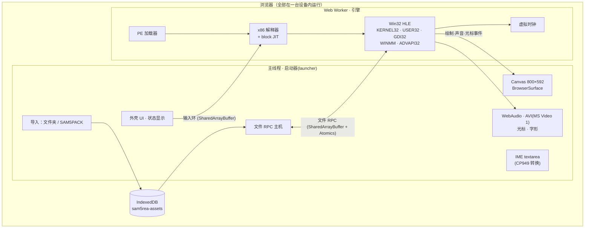
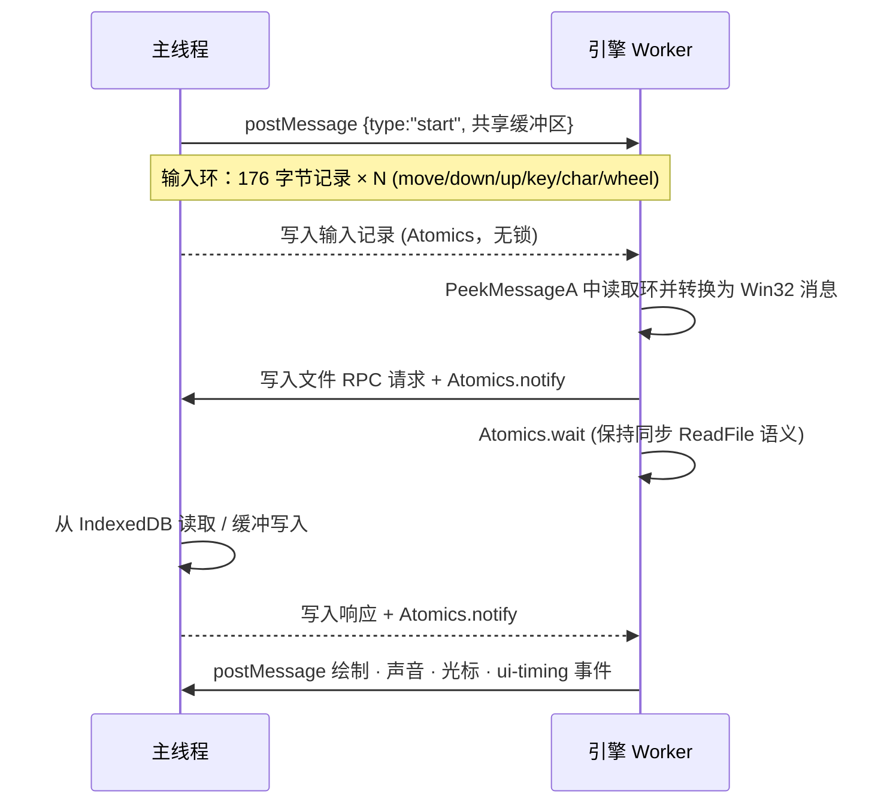
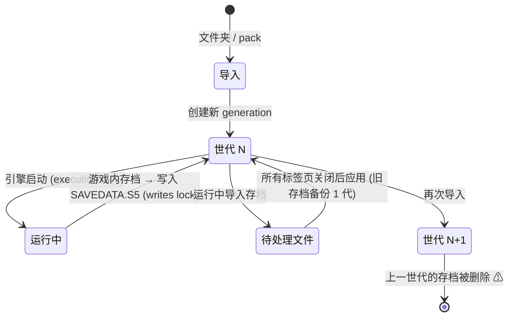
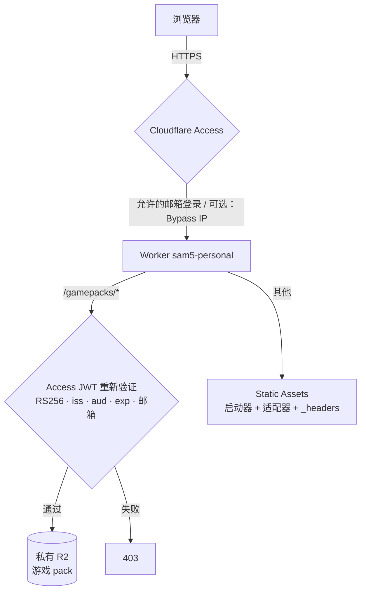

# 架构详解

[한국어](ARCHITECTURE.md) · [English](ARCHITECTURE_EN.md) · [可视化指南（HTML，韩语）](visual-guide.html)

本文说明如何**直接在浏览器中运行** Windows 9x 时代的 2D 游戏可执行文件。
目标游戏是 SAM5GOLD25_KO_1.10r（《三国志5》韩文黄金版补丁），但设计经过通用化整理，可供开发其他 Win32 游戏模拟器时参考。

> 本仓库不包含游戏原版文件，也不包含从游戏中提取的衍生数据。运行时需要你自己合法拥有的游戏。

## 1. 整体结构



| 层 | 位置 | 职责 |
|---|---|---|
| 启动器 | `mac-bundle/web/assets/main-*.js`, `import-*.js`, `store-*.js`, `saves-*.js` | 游戏文件的导入与校验、IndexedDB 存储、画面·输入·声音、存档管理 |
| 引擎 | `mac-bundle/web/assets/worker-*.js` | PE 加载、x86 执行、Win32 API 高层模拟(HLE)、虚拟时钟 |
| 适配器 | `deploy/web/*.js` | 不修改 minified 的启动器，在外部追加行为（自动下载、速度、触控、声音） |
| 引擎补丁 | `deploy/scripts/patch-engine.mjs` | 构建时对引擎 worker 应用 7 处精确字符串替换 |
| 部署 | `deploy/src/worker.js`, `deploy/wrangler.jsonc` | Cloudflare Static Assets + Worker + 私有 R2 + Access |
| 本地服务器 | `mac-bundle/server.py`, `start.command` | 仅使用标准库的 Python 静态服务器（仅限 loopback） |

## 2. 引擎（Web Worker）

### 2.1 PE 加载器与 import 解析

读取游戏 exe 的 PE 头，把各节(section)载入虚拟内存，并把 import 表中的 DLL 函数（如 `KERNEL32.dll!CreateFileA`）填成**指向 JavaScript 实现的 hook 地址**。游戏 `call` 该地址时，CPU 会在 hook 之前停下，由 JS 函数按调用约定（`stdcall`/`cdecl`）从栈中读取参数，并返回 `EAX`。

`LoadLibraryA`/`GetProcAddress` 同样属于 HLE 范围，因此延迟查找的函数也能连接到 hook。从打包后的字符串中可以确认的 API 范围大致如下。

| DLL | 代表函数 | 浏览器对应实现 |
|---|---|---|
| KERNEL32 | `CreateFileA` `ReadFile` `SetFilePointer` `HeapAlloc` `VirtualAlloc` `GetTickCount` `MultiByteToWideChar` | 文件 RPC、线性内存堆、虚拟时钟、代码页表 |
| USER32 | `CreateWindowExA` `PeekMessageA` `DispatchMessageA` `SetWindowsHookExA` `LoadCursorA` `MessageBoxA` | 消息队列 + 输入环、光标通道 |
| GDI32 | `CreateDIBSection` `BitBlt` `CreatePalette` `AnimatePalette` `TextOutA` `CreateFontA` | 8bpp 帧缓冲 → Canvas、字形图集 |
| WINMM | `mciSendCommandA` `timeGetTime` | `waveaudio`·`mpegvideo`(MP3)·`avivideo` → WebAudio·AVI 解码器 |
| ADVAPI32 | `RegCreateKeyExA` `RegQueryValueExA` | 内存注册表 |

> 要点：**不要实现所有 API。** 只实现游戏实际调用的函数，并且只做到游戏所期望的程度。最快的做法是：起初让未实现的 hook 记录函数名并停下，然后逐个补全。

### 2.2 x86 CPU：解释器 + block JIT

- 默认是逐条指令的解释器（`cpu.step`）。它会区分 `InvalidOpcode`、`DivideError`、`GuestFault`、`UnimplementedOpcode` 等 CPU 错误，并保留为诊断信息。C 运行时使用的 `RtlUnwind`、`SetUnhandledExceptionFilter` 等也属于 HLE 范围。
- 快速路径 `cpu.run` 会把基本块编译成 JS 函数并缓存，并通过 `stopBeforeHook` 选项**在 API hook 之前停下**。hook 边界就是“与外部世界交互的点”，因此只需在这里检查输入、时钟和中止条件即可。
- 原版构建中，只要宿主传入 `until` 回调和 clock，就不会使用快速路径。本仓库的构建补丁修复了这一点（第 4 章）。

### 2.3 虚拟时钟

游戏通过 `GetTickCount`/`timeGetTime` 计时，并在消息循环中忙等待(busy wait)。引擎把**按已执行指令数推进的虚拟时间**与**墙上时钟(wall time)** 分开。

- 虚拟时间领先墙上时钟时，通过 `sleep` 来匹配原始速度。
- 当游戏进入用 `PeekMessage` 检查到空队列的 idle 状态时，用 `enterIdle()` 记录下来，之后让虚拟时间追上墙上时钟，避免浪费 CPU。
- 速度倍率（1~4x）的做法是让墙上时钟按倍率加快流逝，因此**游戏逻辑不变，只是缩短了等待。**

### 2.4 游戏函数级 HLE

部分游戏内部函数（`FUN_0048b4e0` 调色板更新、`FUN_0048b880` 等——由反汇编器按地址命名）被标记为 hook，用来向主线程通知 **UI 时序事件**（调色板·画面切换）。这些 hook 只观察而不改动代码，因此行为与原版一致，并且能准确捕捉画面刷新的时机。

## 3. 主线程 ↔ 引擎通信



- **同步 Win32 API ↔ 异步浏览器 API。** `ReadFile` 是同步的，而 IndexedDB 是异步的。解决办法是：引擎 Worker 通过 `Atomics.wait` 挂起，主线程完成异步操作后再将其唤醒。这需要 `SharedArrayBuffer`，页面必须是 **cross-origin isolated**（COOP `same-origin` + COEP `require-corp`）。
- **输入环形缓冲区。** 每个事件使用固定 176 字节的记录（类型、坐标、按钮、VK、扫描码、修饰键、时间等），通过环形缓冲区传递。韩文输入会把隐藏 `textarea` 的组合结果转换为 CP949 双字节(DBCS)，并作为两个 `WM_CHAR` 发送。
- **Web Locks。** 通过 `sam5rea:<generation>:execution`、`...:writes` 锁，防止同一浏览器的多个标签页同时写入同一份存档。存档管理页面在游戏运行时，会把导入的存档置于待处理状态。

## 4. 构建时引擎补丁

启动器只有用 Vite 构建的 minified 产物，没有原始源码。因此 `deploy/scripts/patch-engine.mjs` **只做必须恰好匹配 1 次的字符串替换**。如果启动器变化导致任何一处不匹配，构建就会失败，从而避免部署打了一半补丁的引擎。原版 worker 也一并部署，可通过 `?engine=original` 回退。

| 补丁 | 问题 | 解决 |
|---|---|---|
| fast path with until/clock | 宿主总是传入 `until`·clock，导致 block JIT 一次都没用上。每条指令都要执行 `step()`+`until()`+时钟更新 | 只在 hook 边界评估 `until`。`until` 所观察的状态只会在 hook 内部改变，因此停止点相同 |
| unclamped slice yield | 8ms 执行片之间的 `setTimeout(0)` 在嵌套时被强制为 4ms，导致 worker 有 1/3 的时间在休息 | 改用 `MessageChannel` 让出执行 |
| scaled clock ×4, live speed message | 游戏自身的等待（消息显示·动画） | 墙上时钟倍率 + 通过 `{type:'sam5-speed'}` 消息实时更改 |

测量结果（Mac Chromium，新游戏开始阶段约 5000 万条 x86 指令）：模拟计算 9.1s → 1.95s（约 4.7 倍），执行片之间的空闲 3.6s → 0.03s。

## 5. 游戏数据：SAM5PACK

```text
offset 0   "SAM5PACK"                 8 bytes, latin1 magic
offset 8   headerLength               uint32 little-endian
offset 12  header JSON (UTF-8)        {"version":1,"files":[{path, role, offset, size, sha256}, ...]}
offset 12+headerLength                文件数据按 header 顺序依次拼接 (offset 以此处为基准)
```

| role | 含义 |
|---|---|
| `executable` | 游戏 exe。固定其 SHA-256，只运行受支持的版本 |
| `data` | `.s5`·WAV·MP3·AVI 等原始文件 |
| `glyphs` | 字体字形图集（`glyphs.json`, `glyphs.bin`） |
| `cursor` | 从 exe 资源中取出的光标（`.cur` + PNG） |
| `module` | 预先解码的模块 |

- 启动器会检查每个文件的 SHA-256、路径重复、exe 哈希和必需的 `.s5` 列表，然后存入 IndexedDB。
- 路径统一规范化为 NFC。因为 macOS 文件系统有时会以 NFD 形式返回韩文文件名。
- `glyphs`/`cursor`/`module` 是从游戏派生的数据，因此不在本仓库中（原为 `runtime.bin`）。参见下文“限制”。
- 部署时 pack 的键基于内容哈希（`gamepacks/<name>-<sha16>.bin`），因此可以作为不可变 URL 进行缓存。

## 6. 存档生命周期



- `SAVEDATA.S5` 默认大小为 359,972 字节。支持导出/导入、待处理文件和恢复旧存档。
- **重新导入会清除上一世代的存档。** 因此自动下载适配器只在“没有已导入的游戏”状态下工作。

## 7. 部署（Cloudflare）安全模型



- 关闭 `workers_dev`、`preview_urls`，只开放 custom domain。不留下任何可绕过 Access 的 URL。
- 即使位于 Access 之后，Worker 也会重新验证 JWT（fail closed）。配置缺失时一律拒绝。
- 响应缓存为 `private`。带有认证 Cookie 的内容不会放入共享缓存。
- 访问限制不是 DRM。已登录用户的浏览器中会存有游戏文件。其用途是**本人拥有的游戏、仅供本人使用的个人部署**。

## 8. 适配器：在外部修改 minified 代码

| 文件 | 方法 |
|---|---|
| `sam5-autoload.js` | 用 `MutationObserver` 检测启动器输出的“没有已导入的游戏” → 下载 manifest·pack（确认大小·SHA-256）→ 通过 `DataTransfer` 放入启动器的 pack `<input>` 并触发 `change`。校验·存储仍由启动器代码原样执行 |
| `sam5-engine.js` | 包装 `window.Worker`，只把引擎 worker URL 替换为打过补丁的版本，并提供速度选择 UI |
| `sam5-touch.js` | 触控时给 IME `textarea` 设置 `inputmode="none"`，避免屏幕键盘每次都弹出 |
| `sam5-audio.js` | 包装 `AudioContext.prototype.resume`，在真实的用户激活事件（`pointerup`·`click` 等）中再次 resume |

原则：**不绕过启动器的校验·存储路径。** 适配器只是代替用户执行其本会做的操作（选择文件、点击）。

## 9. 开发自己游戏的模拟器时的检查清单

1. **固定目标**：用 SHA-256 固定要支持的唯一一个 exe。版本不同的话，基于地址的 hook 会全部错位。
2. **调查 API 范围**：记录 import 表和 `GetProcAddress` 调用，列出需要实现的函数清单。未实现的 hook 要留下函数名并停下。
3. **CPU 先求正确**：先用解释器跑到标题画面，再接入 block JIT。让 JIT 在 hook 之前停下，就不会改变与外部交互的语义。
4. **同步 API 用 Worker + SharedArrayBuffer + Atomics**：在服务器（`_headers`）中加入 COOP/COEP 头，本地可用 `coi-serviceworker` 替代。
5. **时间用虚拟时钟**：基于指令数的虚拟时间 + 墙上时钟同步 + idle 检测。调速功能随之而来。
6. **输入用固定大小的环形缓冲区**：只在消息循环（`PeekMessage`）中消费，行为就是确定的。IME 要转换为游戏的代码页（CP949、Shift-JIS 等）。
7. **分离衍生数据**：字体、光标这类浏览器里没有的东西，要从用户的原始文件中生成并放入单独的包。仓库里只放生成规则。
8. **优先保护存档**：先确认替换数据·重新导入不会清除存档，并始终保留导出/导入功能。
9. **版权**：不要把游戏文件、提取的资源、截图、游戏文本放进仓库。让用户自己选择自己的文件。

## 10. 限制与已知问题

- **没有启动器原始源码**：`mac-bundle/web/assets` 是构建产物。因此引擎修改只能采用第 4 章的构建时补丁方式。
- **不含衍生数据生成器**：`runtime.bin`（字形·光标·模块）是从游戏派生的数据，因此没有放入，生成它的工具源码也不在本包中。必须从自己的游戏中亲自生成，并放在 `mac-bundle/web/private/runtime.bin` 才能运行（格式见第 5 章）。
- **Safari/iPad 无法运行**：在 WebKit 上，引擎会因 `Invalid file RPC buffer` 而停止。看起来是引擎 Worker 无法把收到的缓冲区识别为 `SharedArrayBuffer`。
- 已在桌面版 Chromium 上验证。移动真机·声音试听仅为部分验证。
